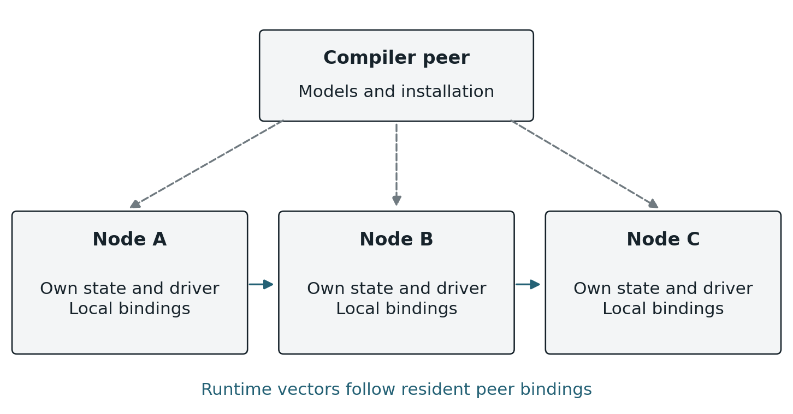
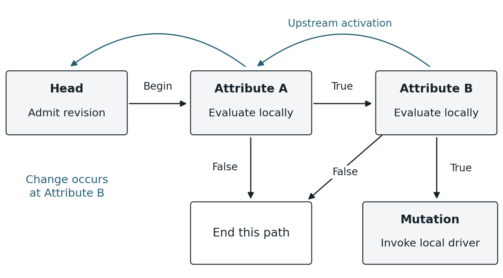
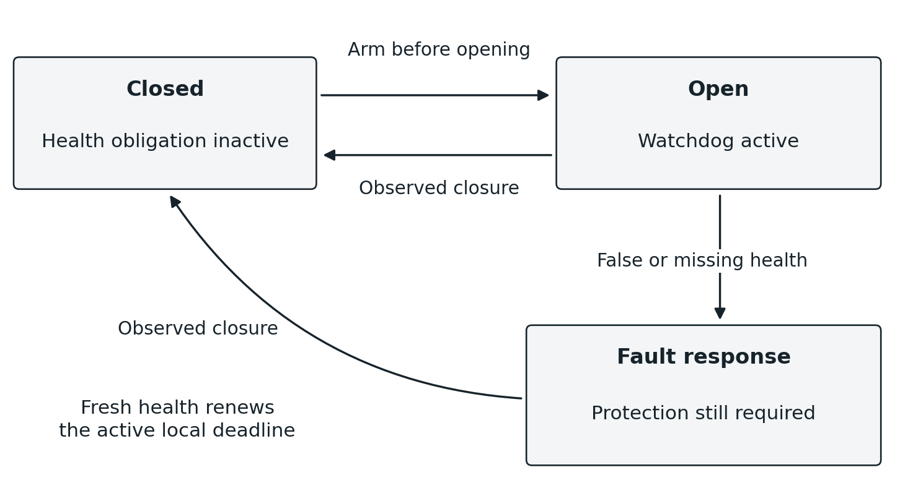
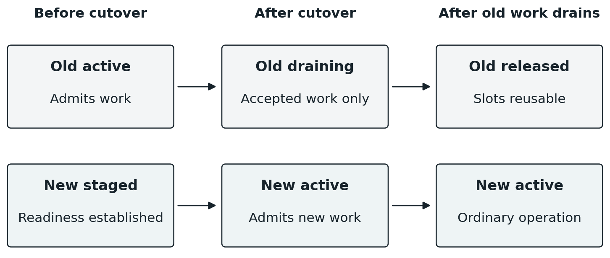

# Lattice architecture

This is the canonical architectural specification for Lattice's distributed RTOS.
Edit this Markdown source. The DOCX white paper is a generated export; see the
[documentation guide](README.md) for ownership and the export command.

For current implemented capabilities and the next task, read
[KERNEL_DIRECTION.md](KERNEL_DIRECTION.md). This specification includes behavior
whose implementation is still pending; it is not a progress report.

## Purpose and architectural contract

The objective is a general substrate for distributed physical computation. A home,
industrial assembly, instrument network, or machine hosting a language model supplies a
particular collection of peripherals and definitions. None changes the fundamental
ownership or execution model. A touchscreen, compiler host, scheduler, and actuator are
distinguishable by their exposed capabilities, not by exceptions to the peripheral
interface.

Hardware integration proceeds in meaningful stages implementing permanent components of
this model. Jarvis is a reference implementation, not the DRTOS specification or an
intermediate product. Development and test discipline are defined in
[AGENTS.md](../AGENTS.md).

### Status of the specification

This document records the intended model. A requirement here is not a claim that code
already implements it. Concrete formats and mechanisms remain open where stated;
implementation status and the immediate work are tracked only in [the kernel
direction](KERNEL_DIRECTION.md). External research informs the design rather than proving
this implementation.

| **Requirement** | **Architectural consequence** |
|----|----|
| Local ownership | A node owns its state and driver. Ordinary execution does not require a replicated image of other nodes or of the entire system. |
| Change delineation | A registered change starts dependent evaluation. There is no global polling cycle over every program. |
| Graph execution | Bindings contain the relationships and predicates. Successful traversal reaches mutation handles directly. |
| Peer operation | Execution and forwarding continue through peers without a mandatory router, Internet service, or central executor. |
| Bounded local resources | Kernel traffic uses fixed pools and ring buffers. Relay placement and overload behavior must respect explicit capacity. |
| Explicit semantics | Safety, arithmetic, lifecycle, and temporal behavior come from declared contracts. The substrate does not infer domain policy. |
| Independent changes | A later ordinary change initiates another traversal. It does not retroactively cancel a decision already propagated. |
| Complete implementation scope | Persistence, replacement, faults, and verification belong to the implementation baseline, not a later rewrite. |

Lattice is neither an entity-component system nor a virtual machine that maintains a
second version of the physical world. Its IR and execution machinery describe and traverse
relationships among existing state locations and available operations. Local schedulers
and communication buffers remain necessary implementation mechanisms; they do not create a
central queue of successfully evaluated mutation tails.

## The distributed kernel and its nodes

A node consists of local kernel facilities, one or more driver surfaces, resident graph
bindings, and communication endpoints. Its state may be the registers of a directly
attached component, the driver-maintained observed surface of a foreign machine, or the
internal state of a software peripheral. Driver placement follows the peripheral rather
than assuming that every driver lives at an orchestrator.

The local kernel handles interrupts, bounded task execution, local timers, binding
dispatch, communication, installation, and fault response. The distributed kernel is the
composition of those local mechanisms and their protocol. There is no additional machine
that must possess the full current state in order for a predicate or mutation to execute.

Figure 1. Node ownership and cross-node bindings. Each node retains its own state and
executable fragments. A compiler peer installs relationships without becoming their
runtime forwarding path.

### The compiler and delegate peer

A specialized peer may host the IR toolchain, solver, optimizer, persistent source
definitions, and installation delegate. It can hold the model of an entire program and the
definitions needed to establish admission. That is different from maintaining a
continuously reconciled copy of every peripheral register. Once installed, resident
programs execute through their own bindings; ordinary execution must not require the
compiler peer to relay each activation or approve each action.

Deployment may send addressed fragments or broadcast a compiled installation package whose
relevant fragments are selected by their intended owners. Both mechanisms must establish
the same installation and compatibility evidence. Replication or migration of the compiler
role is possible, but its coordination protocol has not been selected. Compiler
unavailability prevents work that requires that service, such as a new admission; it does
not by itself invalidate an already installed program.

The basic installation is vertices and a tablet daemon peer; nucleus is optional. The
tablet can author a limited graph directly and supplies intent IR when nucleus is present.
Nucleus owns FSPS/proof/compilation, not an obligatory natural-language interface or
runtime control path. Existing RTOS mechanisms own scheduling, interrupt entry and
synchronization. Board integration supplies only the minimal hardware/state adapters; the
common kernel owns networking, enumeration, state propagation, resident programs and their
storage.

### Local driver responsibility

Appliance firmware is a passive Lattice-native HAL over the board/appliance HAL.
It supplies callable initialization, typed getters and native mutation functions,
with their mathematical meanings and operating constraints. It has no independent
runtime, main loop, monitoring loop or reporting tasks. The kernel owns startup,
the main service loop, RTOS execution contexts and every acquisition/invocation.
An entry stub may connect the hardware bindings; it does not become an application
runtime that periodically calls Lattice as a library.

User requests and installed programs cause the kernel to invoke mutation handles.
The adapter performs the requested hardware operation and returns. It does not
independently schedule state mutations or publish changes. It needs no special
mutable field, report call, message construction or automation callback. The kernel
owns monitoring, change detection, retained-state maintenance, dependency activation
and communication through the supplied functions.

The kernel retains the last established local observation needed to detect change.
It reads through the getter on relevant hardware events or through kernel-owned
monitoring when the device supplies no change event. Device acquisition and
qualification remain hardware-specific; monitoring cadence belongs to that
acquisition path, not to each automation. Sampling only observes the values it
actually acquires; hardware event/latching support is needed where intervening
transitions must be retained. This local observation record is not a replicated
world model. An unchanged observation does not activate programs.

A mutation calls the supplied hardware function. Subsequent acquisition establishes
what actually changed, including partial effects of a failed operation. Returning
success does not manufacture the desired observed state. The kernel propagates
established changes through the same path whether they followed a native command
or originated in the environment. The program evaluator runs on activations and
incoming visits, not as a continuous scan of every predicate.

A native function can remain active for the duration of a finite physical operation.
The kernel must provide its execution context while continuing peer service and
hardware monitoring. Do not require the adapter to return promptly, create its own
task or split the operation into a firmware-owned runtime. Synchronization protects
actual hardware critical sections; holding the entire appliance exclusively for a
long call would defeat concurrent monitoring. This does not create program-wide
serialization, supersession or cancellation of an earlier traversal.

The firmware implementation is the kernel's userspace boundary. Keep its hardware/state
interfaces small and stable, following the SAS-style goal of a few primitive bindings for
a new board. Framing, serialization, addressing, transport limits and program execution
belong inside the kernel and its backend. Changing from IEEE 802.15.4 to a different
medium must not require changes to existing appliance source or the common adapter
interface; new physical hardware supplies another adapter implementation. Byte FIFOs,
packet buffers and DMA are internal mechanisms, not an obligation to author packets.
Matter, GPIO and other local appliance interfaces remain encapsulated behind the same
state/mutation model. The hardware and state interfaces must make participation automatic
without a separate firmware send/notification ritual or firmware-owned monitoring loop.
Kernel-owned physical acquisition is distinct from polling programs for truth. Concrete
hardware binding signatures remain implementation design work.

### Independently replaceable kernel and appliance code

Independent kernel updates remain a later objective: replace the kernel while
retaining the existing appliance binary, without an implementer rebuild. A stable
binary interface behind the firmware's source traits and separately linked code
are candidate mechanics. Their ABI and boot handoff are not selected yet.

This work is deferred until the functional distributed kernel is established.
Current development builds and reflashes the combined kernel/appliance image.
Preserving installed programs and commissioning data requires a protected storage
boundary, not independent kernel/appliance binaries. That storage work does not
make the deferred binary interface a prerequisite for program execution.

## References and resident graph structure

A binding is an attachment to an already existing state location, operation, or relay
slot. The graph stores the relationships among those attachments. Enumeration reveals the
surface and makes its bindings available; it does not manufacture a second object model of
the peripheral.

Within a node, an attachment can resolve to a direct memory reference or function pointer.
Across nodes, a reference must identify an owning peer and a binding within that peer. A
foreign address is never dereferenced as local RAM. This distinction is an addressing
requirement of separated machines, not a requirement for a registry of copied peripheral
entities.

| **Resident information** | **Purpose** |
|----|----|
| Local attribute or mutation reference | Connect an edge to the state or callable handle already owned by the node. |
| Local predicate and value operations | Define the local test, value transfer, branch, or invocation associated with the binding. |
| Directed neighbor references | Identify the next semantic binding and the upstream activation relationship toward a program head. |
| Program revision association | Keep each admitted traversal on compatible installed fragments during replacement. |
| Optional relay binding | Represent an established communication path without changing the program predicate. |
| Optional safety and watchdog slot | Declare fault behavior and retain the bounded state needed while a protected condition is open. |
| Head enablement | Make admission eligibility resident in the graph rather than an external AutomationID lookup table. |

These are logical requirements, not a demand for heap-allocated objects or one large
structure at every attachment. Concrete layouts may use fixed arrays, compact indices,
unions, and references to shared immutable definitions. An attribute participating in
several programs retains the corresponding relationships; no single node has to store the
complete executable.

### Semantic and communication paths

A semantic edge connects the program bindings whose relationship matters to evaluation. A
communication path may include additional relay bindings that carry the activation between
them. Removing relay-only vertices from a path must recover the same semantic
relationship. A relay must not silently become an extra predicate, alter a retained
operand, or substitute for an unavailable state owner.

The graph can contain branches and multiple dependencies even when one particular
traversal is serial. Each node therefore needs explicit directional references for the
edges it owns. An XOR-linked representation is an optional local packing technique, not
the semantic definition of the graph or a promise that raw pointers can cross machines.
Its suitability depends on branching, reconstruction, and the required direction of
traversal.

### Durable identity and runtime address

Native appliance states and mutation functions have durable owner-local bindings.
Their declarations supply permanent binding names; the kernel converts those names
to numeric references and resolves them to the current native handles. Names are
not display labels, Rust type names, enumeration positions or transmitted strings.
Compatible firmware relocation must preserve those references. Reusing a name for
a different physical meaning is an incompatible change, even if its type matches.
Duplicate references must be rejected rather than ambiguously dispatched.

On reconstruction, graph traversal resolves saved native bindings and fixes local
relationships after checking types and compatibility. A multi-node reference adds
the owning node's identity to this reconstruction domain. Mathematical definitions
and surface compatibility fingerprints must not depend on firmware addresses.
Installed graph storage has separate incarnation/reuse rules: boot, replacement
and reuse must distinguish a new binding from delayed traffic for its previous
occupant. Stable native names do not establish that a changed program or hardware
implementation is compatible. Concrete record and installation formats belong
with the kernel implementation.

## The common IR and peripheral semantics

The common intermediate representation (IR) defines typed state, arithmetic, comparisons,
Boolean composition, operation effects, and invariants. Appliance implementors supply the
mathematical meaning of their native state and functions, not the automations that will
later use them. Compilation connects owner-local predicates, value calculations and native
mutation endpoints through resident graph edges. Definitions supplied after firmware
compilation select and bind the kernel's native primitives; they do not require a
firmware-authored Rust evaluator for each automation. The common IR is not an interpreter
hosted on every vertex. Concrete resident-record and installation formats are
maintained with the kernel implementation.

Definitions are composed from the language's primitives rather than added as new
domain-specific opcodes. Duration, duty fraction, warmth, illumination preference, or a
learned intent score belongs in definitions authored using the IR. A reusable duration
definition receives the relevant scope; separate compiler features for television duration
and diffuser duration would violate that abstraction. Definitions are submitted as typed
structured data or compiled artifacts, not strings that the kernel reparses as ad hoc
source.

There is no privileged tablet SDK. A tablet is an ordinary peripheral with a relatively
broad surface. An authenticated binding can connect a user action directly to an
authorized mutation handle. A language model may contribute structured intent definitions
through the same mechanism. Authentication, admission, and safety still apply to those
contributions; a natural-language interpretation does not become an unchecked executable.

### Multiple effects from one invocation

One function can affect several attributes. Its semantic mapping must express a joint
transition relation over the affected state, with all per-attribute effect definitions
referring to the appropriate common input state and command arguments. A tuple of
references to per-attribute transition definitions is a suitable compositional
representation if the mapping also preserves their coupling, execution guards, and which
unaffected attributes remain unchanged.

For example, a command that changes both power and level must not be modeled as two
independently selectable effects. The solver chooses the command once and reasons over its
complete declared transition. That mathematical relation does not imply an atomic physical
transition or simultaneous reports from the device. Delays, guards, failure outcomes, and
observation behavior are part of the supplied model where relevant. The driver still owns
actual convergence.

### Portable arithmetic

Numeric widths belong to the IR and are independent of the host machine. Addition,
subtraction, and multiplication wrap at the declared width. Signed values use
two's-complement interpretation. Checking, saturation, fixed-point scaling, wider
intermediates, and alternative rounding are authored explicitly when required. These are
retained language decisions, not unspecified host-language behavior.

| **Division case** | **Required result at width N** |
|----|----|
| Ordinary division | Quotient rounded toward zero; a nonzero signed remainder has the dividend's sign. |
| Zero divisor | Quotient has all N bits set; remainder is the original dividend. |
| Signed minimum divided by minus one | Quotient is the signed minimum; remainder is zero. |

The solver and target backend must agree on every operation, including exceptional
results. Solver defaults and native instruction behavior are not substitutes for the IR
contract. The shared IR owns arithmetic/type rules. The compiler and installed-program ABI
must preserve them rather than importing host defaults.

Each admitted traversal has bounded local work. Continuing behavior is expressed through
explicit future activations or state-dependent recurrence. The presence of a scheduler
does not by itself prove that the total communicating system lacks unbounded computation.
The relevant implementation obligations are bounded resources and progress for admitted
operations, not an informal claim about Turing completeness.

## Change activation and distributed execution

A registered change identifies the resident dependency relationships affected by that
attribute. For each affected program, activation travels upstream along the installed
relationships toward its head. A target within direct reach can receive the transmission
immediately; otherwise peers relay it. Each logical hop uses the same acknowledged
delivery rules. Routing upstream activation is not itself a substitute for the program's
forward conditional evaluation.

At the enabled head, an admitted activation begins traversal of the installed program
revision. Each visited conditional binding reads the appropriate currently exposed local
value and evaluates its predicate. A true result advances to the declared next binding; a
false result terminates that path or takes the explicitly authored alternative. Values are
discarded once no longer needed. There is no global snapshot assembled before evaluation.

Figure 2. One change activates a program through its upstream relationships. Forward
traversal evaluates the program and reaches its mutation binding only along a successful
path. Every hop uses the common delivery protocol.

### Interrupts and local task execution

Hardware IRQs and kernel-detected changes feed existing RTOS notification/task
machinery. The interrupt acknowledges/captures the event and wakes task-context
work; getters that perform I/O, native mutations and radio waits must not require
blocking inside an ISR. A software-detected delta can notify the task directly.

For a local delta, the kernel follows the changed state's resident dependencies
and starts the corresponding upstream activation work. An incoming forward visit
selects its installed local predicate, reads the relevant state, computes needed
values and follows the selected successor. A false result ends the path unless the
program explicitly supplies an alternative. In an AND chain, arrival embodies the
preceding successful tests; general branching follows the edge actually selected.

Local work uses RTOS tasks with statically bounded storage and independent
traversal values. Task creation/reuse is a kernel implementation concern, never
appliance firmware responsibility or a global graph scheduler. Radio waiting must
not hold the appliance lock. Existing IRQ-driven radio task wakeups are a foundation;
installed-program dispatch still needs implementation.

### The read and write head

The evaluator performs local work along the authored path. An OR branches around its
second predicate when the first is true and visits the second when the first is false; an
AND reaches the second only after the first is true. The chosen edge carries the Boolean
decision, without retaining that decision as another operand. The read/write head carries
only values still needed downstream. Each visited owner contributes its local inputs and
greedily completes calculations whose inputs have become available; the final input owner
sends the most reduced result possible. The mutation owner can pass that result to its
native function or finish a calculation requiring its own local state.

The compiler determines the peak live carried values, their widths and byte capacity for
the emitted traversal, assigns operand locations and reuses them after their last use.
This is neither a universal one-operand limit nor one slot per predicate. For (a - b) \* c
encountered in that order, one carried location can hold a, then a - b, then (a - b) \* c
if those intermediates have no later use. Each traversal owns its own working values;
overlapping traversals never overwrite one another. Every path reaching an operation must
supply its operands, including short-circuit paths. The existing native-call payload limit
does not define this head ABI. General concurrent joins require an explicit bounded design
and are not implied by serial predicate branching.

### Retained history and derived state

Some programs need bounded observations or calculated state that survives a traversal. Its
definition identifies the source states, maintenance calculation, triggering deltas and
retention bound. Inputs remain grounded in actual exposed capabilities or commissioned
context. The appliance firmware qualifies its own observations; the kernel retains
registered changes rather than every sample or tick. No mandatory time-length history is
imposed. Empty/unavailable observations remain distinct from false or zero.

Retained state and the head's temporary working values have different ownership. The
program supplies retained-state definitions after firmware compilation; appliance authors
must not precompile each automation's history/calculation. Installed derived values must
have mathematical definitions available to the compiler. State maintenance uses captured
observations before dependent evaluation; reading a previous computed result does not
itself subscribe that updater to its own output as a new change source.

### Mutation and continuation

A successful path reaches a binding to a local mutation handle. The node invokes that
function with the computed arguments. There is no central queue holding successful tail
pointers while unrelated chains finish. Local processor scheduling or link availability
may delay a visit, but a one-condition program does not wait merely because another
program has eight conditions.

A mutation can be followed by another directed action edge. The program must specify
whether continuation depends on command acceptance, a returned result, or a subsequent
observed state change. Receipt of a packet, successful function return, and physical
achievement of the desired state are different facts. A physical completion dependency is
represented by the relevant observation or declared operation semantics, not inferred from
a transport acknowledgement.

As drivers observe resulting state changes, those changes activate their own dependents in
the ordinary way. No node needs to know the complete automation to perform its local part.
A path reaching its last mutation means that its invocation work has progressed; it is not
proof that every physical consequence has already completed.

### Independent deltas and concurrency

A later change is another valid cause and starts its own dependent traversal, including
when that program is already traversing. If it arrives before a predicate is read, the
predicate reads the newly exposed local value; if it arrives after the predicate has
passed, that decision is not unwound. There is no cancellation, supersession, program-wide
atomic execution lock or global barrier waiting for earlier physical effects. Native
operations and shared local state retain their ordinary synchronization. Resulting
physical observations activate their dependents by the same rule.

Each node serializes access where its local state or mutation interface requires it.
Independent paths and independent nodes can execute concurrently. The correctness of a
program must not depend on the accidental order in which unrelated paths happen to run;
admission and runtime semantics must state any required ordering or interlock.

## A common peer delivery protocol

Broadcast and vector are kernel communication primitives. A broadcast reaches available
local recipients and supports discovery, opportunistic forwarding, and repair. A vector
addresses a particular binding, possibly through multiple peers. A vector is not a promise
of direct radio adjacency. Established relay bindings make its path explicit without
requiring the compiler to precompute route permutations.

The same delivery protocol applies to upstream change activation, forward predicate
traversal, action traversal, installation control, and safety traffic. Evaluation is not
an unreliable exception that may silently disappear after the head receives an activation.
Priorities and retry budgets can differ by declared message class without changing what a
receipt proves.

| **Logical message** | **Meaning** |
|----|----|
| DELIVER | Addressed work for a target binding and phase, with the traversal identity, revision, bounded payload, and any retained operand. |
| RECEIVED | The named target accepted the specified delivery. Relays may propagate this receipt to suppress outstanding copies. |
| COMPLETE | A declared unit of work has finished, including any child work covered by its accounting contract. This is stronger than receipt. |
| FAULT | A declared execution, availability, resource, or safety condition failed, with the scope and response defined by the binding contract. |
| HEALTH | Fresh evidence for an active safety dependency and protection instance, not merely evidence that a processor is alive. |
| INSTALL and ACTIVATE | Stage and verify a program revision, then change admission eligibility under the installation protocol. |

These names define semantic distinctions, not a frozen packet format or six mandatory wire
opcodes. Several may share an envelope or fit in one fixed-size frame. The wire ABI must
specify identity, target, message class, revision, payload bounds, authentication,
integrity checks, and fragmentation where necessary.

### Receipts and duplicate suppression

Duplicate suppression is local recognition of a delivery already accepted within the
retained identity window. A duplicate need not repeat the predicate or mutation, but can
elicit the same receipt so that an earlier lost acknowledgement does not force unnecessary
work. Network redundancy suppression is the related process of stopping other copies after
learning that the intended target accepted the delivery. A relay's receipt alone does not
prove that the semantic target received it.

No network-wide vote or exclusive forwarding authority is required before a recipient
progresses. High-priority receipt dissemination can suppress redundant forwarding
promptly. Missing receipts must nevertheless have bounded consequences; they cannot
justify immortal retry entries. Ring slots, retry limits, identity windows, and eviction
are part of the protocol contract, not an unbounded dynamic cache.

The identity must distinguish a new registered change from another copy of the same change
and distinguish separate legitimate visits where a graph branches or recurs. Reusing only
a program identifier would incorrectly collapse real work. Reusing only a packet
identifier without a boot or slot incarnation would allow delayed traffic to address a
different object. Exact fields and wrap bounds remain to be specified.

### Completion and uncertain outcomes

Receipt at the head establishes delivery to that head. It does not prove that all relay
traffic is quiet, that the execution has reached its tail, or that the peripheral has
reached the desired state. Finite distributed work can use local accounting of spawned
work and returned completion signals to establish termination. Dijkstra–Scholten provides
a relevant foundation under its stated communication assumptions \[1\]. Its result must
not be claimed for a lossy, rebooting implementation without the additional required
protocol.

A target can invoke a function and lose power before its acknowledgement is received.
Without durable operation evidence or a suitable operation-specific property, another node
cannot infer whether invocation happened \[6\]. The baseline does not introduce a mutation
ledger or promise exactly-once physical effects across arbitrary crashes. The
implementation must state its bounded duplicate guarantee and report unresolved outcomes
where that guarantee no longer applies. A fresh observation is a fresh change, not
evidence that an old request should be replayed.

## Adaptive relay bindings and bounded routing state

Nodes may offer a small fixed pool of relay slots. Capacity is explicit and measurable
against the selected hardware. It does not impose the same limit on attributes, semantic
edges or messages in flight. Current protocol capacities belong in the component
documentation.

Initially, broadcast and opportunistic relay discover usable paths. Repeated useful
traversal supplies evidence about which connections are worth retaining. Preferred paths
become resident in relay bindings, so ordinary traffic increasingly follows vectors
through established neighbors. Loss of a relay returns the affected path to discovery or
repair. Broadcast becomes less prominent as useful connectivity stabilizes; it remains
available when that connectivity is insufficient.

### Weights describe marginal usefulness

Communication time is normalized per acknowledged payload byte and composes
additively along a path. Packet overhead and retries contribute to measured service
cost; unknown cost remains unknown. The [wire component](../src/kernel/peer/wire/README.md#communication-cost)
owns its representation and measurement rules. Choosing which relay relationships
to retain under scarce storage is a separate policy from measuring path cost.

A relay weight reflects the benefit of retaining a particular connection under scarce
local capacity. Useful evidence includes delivery success, traversal latency,
transmissions or energy spent, demand, the quality of alternatives, and replacement cost.
The exact formula, quantization, decay, and comparison protocol remain open. Weight is a
compact estimate derived from observed use, not a large learned representation or a claim
that the network computes a global optimum.

A node retains its most useful bindings. If another available peer can serve a dependency
more effectively, traffic can prefer that peer and release the displaced slot once its
accepted work has cleared. The relevant value is marginal contribution: a rarely used
connection that is the only bridge to a required peer can matter more than another copy of
an already excellent route. A local score that ignores alternative reachability can make
harmful choices even if its raw success count is high.

Replacement cost and retained evidence should discourage repeated switching between nearly
equal choices. The eventual policy must be evaluated for route churn, unfair starvation,
loops, and loss of unique bridges. These are properties to establish with the selected
weight rule, not reasons to introduce a centralized route owner.

### Changing a resident path

The implementation must establish that a replacement path is usable before depending on
it, direct subsequent traffic through the new binding, and let already accepted work on
the old binding finish or reach its declared fault outcome before reusing the slot. This
is a local resource transition. It does not require every node to agree on one globally
preferred route.

A relay slot is retained path state. A packet-buffer slot is transient delivery state.
Evicting a low-value path may be appropriate; erasing a packet after acknowledging
responsibility for it is a different operation. The protocol must define what acceptance
commits the node to do and how inability to honor that commitment is signaled.

This architecture resembles a neural structure in its local state, conditional
propagation, connection seeking, and reinforced pathways. The analogy is useful for the
topology. The implementation remains explicit IR, finite storage, messages, and authored
safety behavior; biological terminology does not substitute for those contracts. Directed
diffusion and dissemination research offer relevant comparisons without dictating the
packet or authority model \[2, 3\].

## Safety invariants and conditional watchdogs

A broken route and a missing semantic dependency are different conditions. Broadcast
repair may recover a path to a still available attribute. It cannot supply the value of an
attribute whose owner is unavailable. An ordinary conditional does not become true because
routing failed. The program must wait, terminate, or follow an explicitly declared
alternative. A safety dependency additionally declares the consequence of losing the
required observation.

| **Declared severity** | **Required interpretation** |
|----|----|
| System scope | Dispatch the declared emergency response across its intended scope and perform the required local protective action. |
| Program or device scope | Stop or close the affected operation according to its supplied fault definition; preserve unrelated operation where permitted. |
| Warning with degraded operation | Continue only under an explicitly permitted degraded mode and emit the declared administrator notification. |

The kernel dispatches declared responses. It does not invent a policy after a node
disappears. A known false safety predicate is distinct from an unavailable safety
observation, and a warning designation must not silently authorize a known violation of a
hard invariant. A system-level panic can require continued communication and actuation to
reach a safe state; it does not necessarily mean freezing every processor.

### Protection exists while the state is open

Some invariants matter only while a particular state remains open. Such an invariant edge
owns or references a watchdog slot. Entering the protected state activates the health
obligation from the safety owner and the local expiration mechanism at the protected node.
The exact order must ensure that the state cannot become open without the required
protection being established.

Health must attest to the relevant invariant for the current protection instance. A
processor-alive message or a delayed health packet from an earlier opening is
insufficient. A reported false condition takes the declared violation path; missing health
by the local deadline takes the declared unavailability path. Local timers supply the
bound. A synchronized wall clock is not required.

As soon as the protected state is observed closed, that protection instance stops
requiring health and releases its active watchdog use. There is no arbitrary post-closure
heartbeat period. Merely issuing the close command is not closure. If the actuator remains
open because the command failed, the safety obligation remains active.

Figure 3. Conditional protection follows the observed open state. An outstanding close
command does not establish closure. A fault response can continue driving closure while
protection remains required.

### Distributed fault behavior

A partition can prevent peers from hearing a fault immediately. Each protected node
therefore needs the locally executable response declared for lost health. Timeout
establishes that the required fresh evidence is unavailable; it is not a perfect proof
that a remote node is dead. The distinction follows from the inability to separate
arbitrary communication delay from failure without additional bounds \[4\]. The safety
model must include detection and actuation latency; watchdog protection bounds the
response to lost evidence rather than making remote failure instantaneous.

Safety obligations can outlive the traversal that opened the state. Program retirement
must therefore retain or transfer the active protection binding until closure or an
equivalent validated protection handoff. It must not free the watchdog merely because the
last predicate traversal ended. How active protection is detached from a retiring program
revision without retaining that entire revision is an explicit installation and lifetime
obligation.

## Installation replacement and enablement

A program replacement follows firmware-install reasoning: the old revision remains active
until the new one is installed and compatibility is established. The delegate stages the
new fragments in available fixed storage, obtains installation evidence from their
required owners, and only then permits new activations to enter the new revision. Receipt
of bytes alone is not proof of a valid installation.

| **Phase** | **Required behavior** |
|----|----|
| Stage | Receive fragments without disturbing active bindings; validate identity, IR, references, capacity, and authorization. |
| Establish readiness | Verify that every required semantic fragment and any required protection mechanism can participate in the new revision. |
| Switch admission | At the program head, admit subsequent activations to the new revision once the installation condition is satisfied. |
| Drain old work | Previously admitted old traversals continue using compatible old fragments and their associated delivery state. |
| Release old bindings | Return each old fragment's storage to the fixed pool as soon as no admitted old work or retained safety obligation can use it. |

A traversal must not evaluate half an old program and half a new one because nodes
switched at different moments. Revision selection at admission and compatible references
along the path provide the required model. This does not require every node to flip a
global clock bit simultaneously. Consistent network-update research is relevant to staging
and preserving one configuration per traversal, though its deployment model is not adopted
wholesale \[5\].

Figure 4. Hard admission cutover with independent draining. The new revision accepts new
work while admitted old work finishes. Old storage is released promptly when its actual
obligations end.

No historical copy is retained for sentiment or indefinite rollback. A failed staging
attempt leaves the incumbent active. Once old work and required protection have cleared,
its storage is reusable. Releasing a fixed slot is a lifetime operation; it does not
require heap allocation or a general-purpose object reclamation framework.

### What still needs a protocol

Head relocation, changes to the upstream dependency set, partitions during activation, and
a crash between durable commit and admission cutover need explicit rules. A local
head-pointer exchange is sufficient only when those surrounding preconditions have
actually been established. Likewise, retirement requires evidence that no accepted old
delivery can later reference a reused slot. A timeout alone is not proof of drain unless
the protocol's delivery and identity bounds make it so.

### Enablement is part of the graph

The graph should represent a program's enabled or disabled admission state at its head or
incoming activation gate. The selected physical layout is still to be fixed, but it must
avoid a separate global AutomationID-to-Enabled lookup on every traversal. A disabled
program retains its relationships, definition, and place in admission consistency
checking; disablement does not remove it from the mathematical system.

Disablement lasts until explicit resume. Resume changes the resident admission state and
initiates ordinary evaluation of the currently applicable conditions. Manual mutation
remains a direct authorized invocation; it does not imply a timed hold or an automatically
inserted expected-starting-state guard. A later legitimate automation activation can
change the peripheral again.

Initial enablement likewise admits one fresh evaluation before ordinary delta-driven
operation. After a reboot, a restored enabled head evaluates current conditions once
its required local state/time are available. This is a new traversal with current
inputs, never replay of an interrupted traversal or mutation. Repeated delivery of
the same enable request must not manufacture additional enablement evaluations.

The ordering of an explicit disable or delete against an already admitted traversal needs
a precise lifecycle contract. Ordinary state-change supersession is excluded regardless of
that decision. No lifecycle operation can undo a mutation already registered with a
driver, and disabling a program must not erase an active safety obligation while its
protected state is still open.

## Persistence reconstruction and recovery

Each node persists the local graph fragments and definitions needed to reconstruct its
contribution, including enablement and any retained learning state for which it is
responsible. The compiler peer may persist source definitions and installation metadata.
Persistence does not require every node to store every program, and it does not imply a
log of every mutation or observation.

A valid committed local image must be distinguishable from an interrupted write. The
earlier committed-image approach remains a suitable local persistence mechanism; the exact
storage format, flash wear policy, checksums, and commit procedure must match the target
hardware.

### Protected local configuration

A protected region of the MCU's writable nonvolatile memory is sufficient for
local program definitions and commissioning data. An erase-aligned firmware-region
limit separates replaceable code from retained configuration. Keep that limit in
layout metadata or another durable location outside the ranges it protects from
replacement; it need not be a filesystem or a separate storage device.

Every image writer must honor the boundary, including provisioning, staging and
boot-time copy/swap. A boundary after today's binary is useful only if those erase
and swap extents also stop there. Keep the established boundary across releases;
a candidate that grows into retained data must be rejected or undergo an explicit
layout migration. Do not move it merely by recalculating the new binary's end.
This is ordinary region protection and does not imply high-frequency flash writes.

### Boot reconstructs relationships

Boot establishes the local driver surface, reconstructs the graph through saved-reference
traversal, binds old identities to new addresses, and resolves foreign peer bindings under
the current incarnation rules. Execution must not dereference unbound locations. Persisted
installation state determines which revision is eligible, while incomplete staging must
not masquerade as a complete replacement.

Drivers obtain the current actual peripheral state. They do not recover an old desired
state by replaying unfinished mutation requests. Newly observed state then participates in
ordinary change propagation. A configured schedule may author recovery behavior for a
missed activation, but that is evaluation of a valid current condition, not blind replay
of an unconfirmed old command.

### Recovery while protection may be required

If a peripheral can remain physically open while its controller reboots, boot must
establish whether a safety obligation exists before allowing ordinary operation to
proceed. The implementation must specify how the driver discovers that state and how the
declared protective response operates while required dependencies are unavailable. This is
a concrete hardware and driver obligation; a lost RAM watchdog cannot be assumed to imply
a closed physical device.

Persisted evidence and its decay anchor form one recoverable unit. A completed checkpoint
survives; an interrupted checkpoint falls back to the previous valid one. The system may
lose evidence accumulated since that checkpoint. It must not combine an old statistic with
an unrelated new decay anchor or claim that post-crash observations are known when they
are not.

Distributed installation recovery must reconcile durable fragment readiness with admission
state and old-work drainage. Local durable writes alone do not prove a globally complete
installation. The necessary peer reconciliation belongs to the installation protocol,
without requiring a replicated ledger of ordinary peripheral mutations.

## Synthesis admission and continual refinement

Synthesis combines supplied constraints, driver invariants, transition models, and
available levers to construct a candidate executable. Z3 remains the selected initial
solver foundation. The compiler must reason over actual IR arithmetic and the supported
execution semantics. A proof concerns the supplied models and assumptions; it is not a
promise that an incomplete behavioral model describes every physical externality.

Admission rejects a candidate that is inconsistent with the declared system, including
conflicting admitted programs that are currently disabled. A budget exhausted without a
candidate or an infeasibility proof is unresolved synthesis, not evidence of
impossibility. Candidate search, model validation, and admission are distinct outcomes.
None authorizes the kernel to make up a runtime supersession policy.

### Concurrency belongs in the model

Checking only that two desired final states can coexist is insufficient when their
intermediate actions can interfere. The admission model must cover the allowed
interleavings, command effects, and declared safety dependencies relevant to the emitted
program. Where safety requires a condition to hold during an open interval, the execution
needs the corresponding interlock or watchdog semantics. A prior predicate read is not
evidence that a remote value remains unchanged indefinitely.

### A hypothesis can improve

The initial selected program is a hypothesis. Observed outcomes and resource use update
its evidence from the beginning of operation. During available compute capacity, the
refinement service evaluates whether another admissible implementation is preferable.
Evidence can change without replacing the executable. Acquisition, statistical modeling,
synthesis, and installation may run on different boards or peers; using common evidence
does not collapse them into a single loop or special tablet service.

Structural cost includes actual state/storage, deadline resources, external inputs,
emitted computation, and realized invocation count; it must price the work the target
performs. Invocation count is measured over a comparable workload, not merely the number
of static command sites. Otherwise an arbitrarily long on/off period could look
deceptively cheap while failing the desired behavior.

A later empirical cost estimates consumed resources and probability or consequence of
resolution failure under the supplied objective. Replacement has a cost: remaining
validation, durable writes, installation, retirement, and actual operational transition.
Candidate discovery already completed is a sunk cost. Expected benefit and useful
information must justify changing an admissible incumbent. Safe exploration may accept
worse immediate efficiency when its expected future decision benefit warrants it; it never
waives an invariant.

### Bounded evidence and lazy decay

The statistical meaning of the evidence must remain explicit. A distribution of system
state over time is accumulated from elapsed exposure to that state, not from the number of
change messages. A conditional mutation frequency instead needs its declared opportunity
or exposure denominator. These are different quantities even when they use the same
attributes. Compact accumulators can support both without retaining every observation.
Drivers expose the relevant typed learning surface, and inference consumers share those
definitions rather than introducing separate tablet-specific and synthesis-specific
meanings.

Retain sufficient statistics and model parameters rather than an indefinite history of
samples. For an additive evidence accumulator H, lazy exponential aging has the form Hnew
= rho × H + contribution, where rho = 2 raised to the power of negative elapsed interval
divided by the chosen half-life. A baseline prior can remain separate. Aging occurs when
the evidence is read or updated, not through a periodic task that visits every statistic.

Each independently aged group stores one last-aging reference beside its statistics. This
is not a timestamp on every register or observation. In a distributed deployment, that
reference uses the owning component's declared elapsed-time basis and epoch. Persisting it
requires a defined recovery policy when the epoch changes; an unrelated peer's tick cannot
simply be substituted. Exact statistical families, context selection, fixed-point
implementation, and scalar cost exchange rates remain open.

Learning can improve conditional ordering, command parameters, reusable definitions, or
proposed new programs when sufficient evidence exists. It cannot manufacture unobserved
physical feedback. A model-derived emission estimate must remain distinguishable from an
actual emission measurement. Likewise, correlation can support a hypothesis without
establishing occupant intent or causation by itself.

## Time resources and execution bounds

Change is the trigger for system work; a shared wall clock is not a prerequisite for
propagation. Nodes still need physical oscillators for local execution, communication,
elapsed intervals, retries, and watchdog deadlines. Those local measurements do not
establish one globally simultaneous state of the network.

Every vertex kernel supplies the same local commissioned time and calculated solar
capabilities. The program binds a time or solar predicate at the evaluation vertex where
it belongs in the authored order; neither requires a special clock/solar vertex or a
broadcast for every temporal boundary. Commissioning supplies a UTC reference and
approximate location. Local elapsed counters and calculated boundaries drive deadline
records; an expiry generates an internal delta at its predicate, which follows the normal
upstream-to-head activation path. Forward traversal reads that predicate at its normal
position. The kernel arms the next relevant deadline rather than repeatedly scanning every
program or comparing the clock once per second.

Commissioned location/time configuration occupies rewritable reserved storage that
survives firmware updates, separate from disposable transfer journals. Location
can survive a restart; time validity also requires counter continuity. An unanchored
peer cannot supply another peer's time reference.

Recurring actions arise from explicit changes or local deadline-generated deltas. Kernel
time/solar inputs are distinct from a sensor's qualified physical observations. A saved
timestamp cannot measure time spent without power: after loss of counter continuity, time
must be reacquired from a suitable peer with a valid reference, a backed RTC or a
commissioning client. There is no permanent time master or shared clock-consensus
requirement. Local sequence numbers and counters still need bounded wrap and reuse rules.

### Fixed capacity is part of correctness

Use fixed receive and transmit rings, fixed in-flight delivery slots, fixed
installed-binding storage, bounded temporary operands, and the configured relay pool.
Capacity accounting is local and concrete. This does not require a general dynamic cache
or distributed object allocator.

The full-buffer policy is still a design obligation. An implementation must distinguish
work not yet accepted from work it has already acknowledged. Possible mechanisms include
upstream retry, reserved critical traffic capacity, explicit rejection, and scoped fault
escalation; the final combination must be selected and tested rather than silently
assumed. Physical state changes can arrive faster than an overloaded link drains, so
backpressure alone cannot make arbitrary arrival rates lossless.

This architecture treats separately registered changes as distinct activations. An
implementation that coalesces them under pressure changes that semantic contract and needs
explicit authorization in the protocol. Fixed memory is compatible with bounded delivery
guarantees; it is not a proof of lossless delivery under unbounded load.

### Processor and platform choices

Lattice extends the existing FreeRTOS-derived kernel. Its scheduler, CPU context
switching, interrupt integration and synchronization are the foundation to reuse, not
functions each appliance implementer must supply. The extensions must be as
straightforward to bring up on another supported RTOS target as a small hardware adapter
and ordinary initialization. Kernel or transport evolution must preserve that
firmware-facing source interface. Independent binary replacement is deferred as
described above; persisted graph references and appliance-image compatibility
retain their separate requirements.

Local multiprocessing, threads, interrupt work, and cooperative tasks should be chosen
where they simplify correctness or materially improve throughput. Serial evaluation of one
path does not require a single-core machine, one global execution thread, or a new
operating-system process for each chain. The earlier central-host processor choice does
not dictate MCU selection for every peripheral node.

Hard real-time claims require a deployment profile: maximum local execution costs,
interrupt interference, admitted activation rates, buffer capacities, link delay and loss
bounds, retries, topology assumptions, and safe-state response bounds. Best-effort
broadcast repair under arbitrary partition cannot provide a finite successful-delivery
deadline. A protected node can still enforce a local deadline for its declared failure
response.

## Trust authorization and operational boundaries

Peer-to-peer operation removes the mandatory router, not the need to identify peers and
protect mutation capabilities. A node must distinguish authorized installation, authorized
direct mutation, ordinary graph traffic, and forged or stale messages. Binding identity is
an address; possession of its numeric value alone must not be treated as permission to
actuate a device.

The trust-root, enrollment, key storage, authenticated framing, replay bounds, and
revocation mechanism remain implementation choices. Their memory and compute costs belong
in the resource profile. A deployment without outside Internet access still needs an
explicit trust model for connected peers and physical interfaces.

The delegate is authorized to install admitted graph fragments within its granted scope. A
tablet or other interface may be granted direct access to selected mutation handles. A
learner proposes definitions through the admission path. None acquires unrestricted
authority merely because it is a large node or a convenient point of human interaction.

Diagnostics are ordinary exposed surfaces: current fault state, bounded delivery counters,
binding capacity, active protection, and installation status. They should make the system
inspectable without becoming a mandatory history service. Administrator notification is a
directed capability and can be delivered to a tablet or another peer; the kernel is not
coupled to one user interface.

## Architectural integrity

Execution integrity requires that each accepted delivery addresses the intended binding
incarnation, that an admitted traversal uses one compatible program revision, and that a
false predicate cannot reach its success continuation. Transport integrity requires that
duplicate handling preserve distinct changes, that accepted work has a defined completion
or fault outcome, and that obsolete packets cannot act on a reused slot.

Safety integrity requires that every protected open state have the declared active
protection, that lost freshness cause the specified local response within the deployment
bound, and that closure or validated transfer be established before releasing that
protection. Resource integrity requires that storage remain within configured bounds even
under repeated loss, repeated discovery, revision replacement, and restart.

Progress claims must state their assumptions. Under the chosen connectivity, fairness,
capacity, and fault bounds, accepted finite work should finish or report its defined
failure rather than persist forever. No assumption of bounded packet lifetime,
synchronized clocks, or reliable peers may be imported silently into a proof.

## Research foundations and interpretation

The following research informs particular mechanisms and proof obligations. No cited paper
establishes correctness of the combined Lattice protocol, selects its wire format, or
requires importing a centralized controller or dynamic storage framework.

**\[1\] E W Dijkstra and C S Scholten Termination detection for diffusing computations**

Local accounting and returned signals can establish the termination of a finite
distributed computation under a defined communication model. Relevant to completion and
old-work drainage; not a delivery guarantee for arbitrary packet loss and reboot.

[Primary source](https://www.cs.utexas.edu/~EWD/transcriptions/EWD06xx/EWD684.html)

**\[2\] C Intanagonwiwat R Govindan and D Estrin Directed Diffusion 2000**

A primary comparison for local gradients, data-oriented communication, and empirical
reinforcement of useful paths. Lattice's typed binding references and program fragments
remain its own execution model.

[Primary source](https://www.isi.edu/websites/scadds/projects/diffusion.html)

**\[3\] P Levis N Patel D Culler and S Shenker Trickle 2004**

Demonstrates local suppression of redundant dissemination. Suppression does not establish
execution completion, and adopting its ideas does not select every timing or forwarding
rule for this kernel.

[Primary source](https://csl.stanford.edu/~pal/pubs/trickle-nsdi04/)

**\[4\] T D Chandra and S Toueg Unreliable Failure Detectors for Reliable Distributed Systems 1996**

Provides the formal context for failure suspicion in asynchronous systems. A local
watchdog enforces a freshness requirement and response deadline; it does not perfectly
distinguish a failed peer from an arbitrarily delayed one.

[Primary source](https://www.cs.cornell.edu/courses/cs734/2000FA/cached%20papers/ct96.pdf)

**\[5\] M Reitblatt and colleagues Abstractions for Network Update 2012**

A reference for staged replacement that preserves a coherent configuration for an
individual traversal. Its controller architecture is not a prescription for Lattice's peer
topology.

[Primary source](https://www.cs.princeton.edu/~dpw/papers/network-update-sigcomm12.pdf)

**\[6\] A D Birrell and B J Nelson Implementing Remote Procedure Calls 1984**

Useful background for invocation identity, duplicate handling, and uncertain outcomes when
a response is missing. Lattice does not thereby adopt a conventional RPC object or stub
framework.

[Primary source](https://www.cl.cam.ac.uk/teaching/0708/DigiCommI/birrell1984rpc.pdf)
