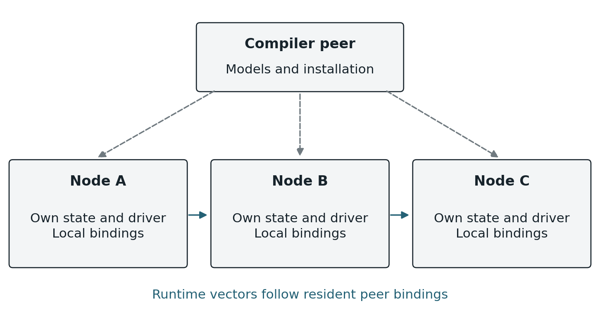
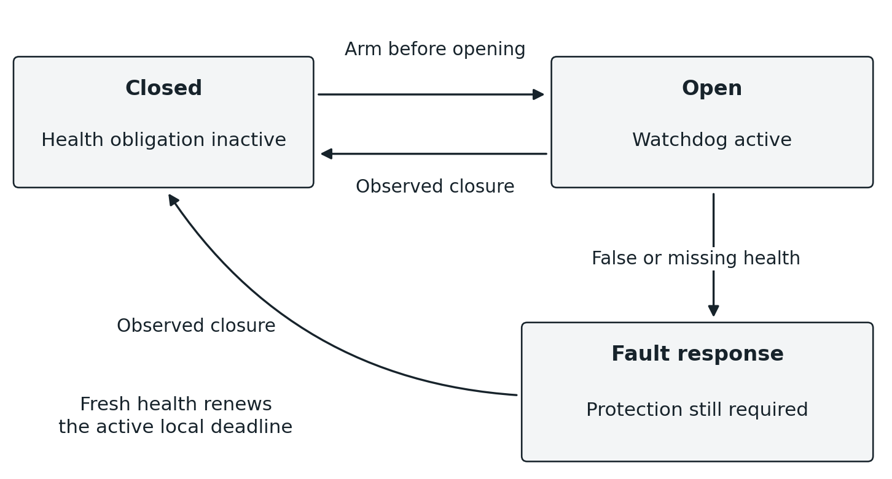

# Lattice architecture

This is the canonical architectural specification for Lattice's distributed RTOS.
Edit this Markdown source. The DOCX white paper is a generated export; see the
[documentation guide](README.md) for ownership and the export command.

For current implemented capabilities and the next task, read
[KERNEL_DIRECTION.md](KERNEL_DIRECTION.md). This specification includes behavior
whose implementation is still pending; it is not a progress report.

## Purpose and architectural contract

Lattice is a constrained distributed physical-control system implemented by cooperating
vertices. An installed automation is a circuit distributed across the owners of its
inputs and outputs. Each owner maintains its local part; directed connections convey
changes in circuit signals. There is no central executor or mandatory system-wide
state replica. A tablet, compiler host, sensor and actuator differ in their exposed
capabilities, not in their authority over ordinary operation.

The kernel's value is automatic participation from an appliance HAL and a formal surface
definition. The implementor declares the encapsulated state, available transformations
and operating invariants. Lattice realizes that model on the board and supplies
enumeration, communication, installation and propagation. It is not a general-purpose
process environment or a library the appliance must drive from its own main loop.

Jarvis remains a source of useful mathematics and device knowledge, not the DRTOS
specification. Development discipline belongs in [AGENTS.md](../AGENTS.md).

### Status of the specification

This is the accepted target model, not a claim of implementation. Maintained circuit
signals and compile-time hardware assembly supersede the earlier upstream-to-head,
forward-visit execution model. The kernel now retains connection inputs in software;
local record interpretation remains until native lowering. Hardware realization is
not established by that software implementation. Formats and evidence live in
component notes.
[The kernel direction](KERNEL_DIRECTION.md) distinguishes that baseline from planned work.

| Requirement | Architectural consequence |
| --- | --- |
| Local ownership | A node owns its appliance signals and the incoming/outgoing relationships of its circuit fragments. |
| Maintained circuits | Local input changes update connected outputs; no fresh whole-DAG traversal is required. |
| Separate kinds of change | Appliance-state notices and addressed circuit-signal updates have different recipients and execution meaning. |
| Compile-time assembly | The build/authoring toolchain constructs typed components and target mappings; a vertex applies prepared configuration. |
| Hardware realization | Pins, latches, comparators, timers, event routes and DMA implement the model wherever the target mapping permits. |
| Minimal firmware boundary | Appliance behavior uses kernel primitives and supplied hardware/state bindings; no appliance-owned Lattice networking, evaluator or reporting loop. |
| Bounded ownership | Peripheral resources, signal storage and accepted delivery state have explicit local limits. |
| Independent changes | Connections preserve their own state; later changes do not cancel hardware calls already running. |
| Explicit semantics | Arithmetic, qualification, discrete mutations and fault behavior are declared, not guessed by the kernel. |

The objective is minimal CPU work during ordinary Lattice operation. Hardware setup,
installation, delivery management and explicitly required native operations still exist.
Their existence does not justify a per-delta bytecode interpreter, a program counter for
each circuit, or periodic scans of every predicate. A hardware claim requires a concrete
peripheral mapping and evidence on that target.

## The distributed kernel and its nodes

A node consists of local kernel facilities, one or more driver surfaces, resident graph
bindings, and communication endpoints. Its state may be the registers of a directly
attached component, the driver-maintained observed surface of a foreign machine, or the
internal state of a software peripheral. Driver placement follows the peripheral rather
than assuming that every driver lives at an orchestrator.

The local kernel handles interrupts, bounded task execution, local timers, binding
dispatch, communication, installation, and fault response. The distributed kernel is the
composition of those local mechanisms and their protocol. There is no additional machine
that must possess the full current state in order for a predicate or mutation to execute.

Figure 1. Node ownership and cross-node bindings. Each node retains its own state and
executable fragments. A compiler peer installs relationships without becoming their
runtime forwarding path.

### The compiler and delegate peer

A specialized peer may host the IR toolchain, solver, optimizer, persistent source
definitions, and installation delegate. It can hold the model of an entire program and the
definitions needed to establish admission. That is different from maintaining a
continuously reconciled copy of every peripheral register. Once installed, resident
programs execute through their own bindings; ordinary execution must not require the
compiler peer to relay each activation or approve each action.

Deployment may send addressed fragments or broadcast a compiled installation package whose
relevant fragments are selected by their intended owners. Both mechanisms must establish
the same installation and compatibility evidence. Replication or migration of the compiler
role is possible, but its coordination protocol has not been selected. Compiler
unavailability prevents work that requires that service, such as a new admission; it does
not by itself invalidate an already installed program.

The basic installation is vertices and a tablet daemon peer; nucleus is optional. The
tablet compiles the graph the user constructs, without FSPS or program synthesis.
When nucleus is present, the tablet can supply intent IR to its FSPS. Nucleus owns
synthesis and proof, then passes the resulting program to the same compiler used by
the tablet. Neither compiler use creates a runtime control authority. Nucleus has no
obligatory natural-language interface. Existing RTOS mechanisms own scheduling,
interrupt entry and synchronization. Board integration supplies only the minimal hardware/state adapters; the
common kernel owns networking, enumeration, state propagation, resident programs and their
storage.

### Local driver responsibility

Appliance firmware implements its device state machine using kernel-provided primitives
and supplies its hardware/state bindings. Its mathematical surface describes scalar
domains, transformations and invariants for synthesis and authoring consumers. That
mathematical description is not the kernel's runtime control model. The kernel needs
operational bindings, value representations, callable signatures and change facilities;
it need not interpret an appliance's admissible scalar range to publish a value or
dispatch a call. Firmware owns device limits, calibration and qualification.
The kernel may expose the mathematical metadata to consumers without evaluating it.
Appliance-specific tasks, event handlers and
control logic belong to that firmware. Scheduling, resource ownership and Lattice
participation belong to the kernel. The implementor does not write a graph evaluator,
network/reporting loop or periodically call a service routine to keep Lattice running.

Kernel-owned state, event and operation primitives wrap the implementor's trait hooks
or closures. Their mandatory behavior wires declared state transitions into delta
publication automatically, including intermediate changes during a native operation.
Protect this path with concrete wrappers and sealed internal interfaces; externally
implemented appliance hooks remain open. An overridable default trait method alone
does not enforce the wrapper. Ordinary static dispatch suffices; reflection,
source rewriting and extensive macros are not requirements.

Each exposed value has one authoritative location: a peripheral register or a
kernel-owned typed RAM location. A software setting is real state, not a mirror
that requires a continuing task. Register/field metadata and queued event payloads
are distinct from that authoritative value.

A qualified local IRQ or validated addressed command performs its bounded mutation
in the handling context. It does not wait for a worker, transmission, persistence
or a free bookkeeping slot. The kernel owns atomic read/set/clear/toggle behavior,
change capture and subsequent publication. No task-context capability may be
fabricated in an IRQ to bypass the existing interface. Only bounded, nonblocking
operations belong on the immediate path. Hardware adapters supply actual access
mechanisms; firmware supplies device limits and relationships.

Deferred work consists of bounded invocations, not an entire update stream or a
long-lived appliance controller. Select the most urgent ready invocation, preserve
FIFO order within its priority, execute its bounded step, then reconsider priorities.
A timer retains a deadline and schedules an invocation; cancellation invalidates
both armed deadlines and queued invocations. A diffuser can retain an intensity
setting, react to fan-on with its first cycle step, react to fan-off by immediately
clearing output/canceling cycle work, and calculate each later interval from the
current settings. No sleeping appliance thread is implied. Immediate interlocks
must remain effective against stale deferred work.

Retention is independent of execution urgency. A volatile value has only its live
representation. A nonvolatile value changes immediately and automatically schedules
background commitment through the kernel's exclusive protected-storage owner.
Repeated writes may coalesce for persistence only; actual state-change events are
not thereby coalesced. Restore the last committed settings before enabling their
dependent behavior. Deferred durability can lose uncommitted updates on power loss;
it does not require a firmware rebuild or a direct UICR write for each mutation.

Queue/burst bounds are kernel obligations. An unexpected capture overflow is a
kernel fault, not an instruction for firmware to retry a physical action that has
already happened. Best-effort maintenance must not consume all capacity required
by foreground events. Numerical response-time guarantees still require explicit
execution/interference bounds and compatible flash operations; a low-priority
label does not make an interrupt-masked erase preemptible.

The hardware/state binding supplies the value location and relevant change facility.
The kernel wires the event into its handling path. A qualified change is already a
change; general getter polling and comparison are not the intended detection model.
An appliance may need sampling or software qualification internally, but that does not
make polling every exposed getter a kernel responsibility.

Operational bindings identify storage and available hardware/event facilities. State
may reside in a peripheral register, ordinary memory, or a device-managed buffer.
These are first-class sources under the same state/event contract; their access and
notification mechanics are supplied by the binding. A software-maintained command
model is valid for an initial integration or a device whose actual internal state is
inaccessible. A fan can later use custom feedback hardware without changing graph
participation. A TV may continue to require a firmware-maintained model. Neither
an analog input nor a directly readable peripheral register is mandatory.

Types and formulas alone cannot identify which appliance pin or peripheral supplies an
input. That association comes through the hardware/state binding supplied by the
implementor. The target implementation must preserve enough of that association for
compilation and allocation; it must not attempt to infer hardware from an opaque getter's
machine code. The implementor does not choose circuit-specific PPI/ETM channels, allocate
comparator resources for unknown future automations, or author a second software model
solely to notify the kernel.

The hardware value and its declared meaning remain distinct. A relay-drive output is
not evidence that contacts closed or a load drew current. A dimmer's setting is its
duty/phase configuration, not every edge of its switching waveform. Physical feedback
is a separate source when the appliance has it. Calibration and declared resolution
connect an electrical quantity to the surface's mathematical value.

Qualification belongs to the source model: edge polarity, debounce, hysteresis, resolution
and sampling where required. A comparator crossing may establish a predicate without
first materializing a scalar in a software observation cache. A numerical report may
still require ADC conversion or a bus read. Raw noise and repeated above-threshold sample
events are not automatically distinct system deltas. Preserve required intervening changes
through the available latch, counter, FIFO or bounded storage.

The kernel configures event paths and data buffers from supplied bindings and prepared definitions. When a
physical task can implement a mutation, that task is the endpoint. Where an adapter must
perform a finite native operation, existing RTOS contexts let it run while acquisition,
communication and unrelated circuits continue. It must not supply its own scheduler or
manually publish resulting changes. Returning success does not manufacture observed
physical completion, and a later input change does not preempt a running native call.

The firmware is the stable userspace boundary. Communication medium, framing, retries,
message sizes, peer paths, circuit installation and storage remain kernel responsibilities.
A transport change must not make every appliance author rewrite their surface. The
common boundary must make declaring a relay, dimmer or diffuser materially simpler than
implementing its network behavior and peripheral coordination manually.

### Independently replaceable kernel and appliance code

Independent kernel updates remain a later objective: replace the kernel while
retaining the existing appliance binary, without an implementer rebuild. A stable
binary interface behind the firmware's source traits and separately linked code
are candidate mechanics. Their ABI and boot handoff are not selected yet.

This work is deferred until the functional distributed kernel is established.
Current development builds and reflashes the combined kernel/appliance image.
Preserving installed programs and commissioning data requires a protected storage
boundary, not independent kernel/appliance binaries. That storage work does not
make the deferred binary interface a prerequisite for program execution.

## References and resident graph structure

A binding identifies an appliance signal, a configured component, an operation or a relay
relationship. The graph stores the connections among them. Enumeration reveals the
surface and makes its bindings available; it does not manufacture a second object model of
the peripheral.

Within a node, a binding can resolve to a peripheral endpoint, bounded data location or
native function pointer.
Across nodes, a reference must identify an owning peer and a binding within that peer. A
foreign address is never dereferenced as local RAM. This distinction is an addressing
requirement of separated machines, not a requirement for a registry of copied peripheral
entities.

| **Resident information** | **Purpose** |
|----|----|
| Local attribute or mutation reference | Connect an edge to the state or callable handle already owned by the node. |
| Compiled local components | Describe prepared predicates, calculations and output actions with their resource requirements. |
| Paired neighbor references | Identify the incoming signal and its connected outgoing destination; retain their association. |
| Circuit revision association | Keep signal updates attached to compatible installed connections during replacement. |
| Optional relay binding | Represent an established communication path without changing the program predicate. |
| Optional safety and watchdog slot | Declare fault behavior and retain the bounded state needed while a protected condition is open. |
| Head enablement | Supply the circuit's enabling signal without a global AutomationID lookup on every update. |
| Connection signal state | Retain incoming activation, required typed values and emitted output state; activation defaults LOW while missing scalar values remain unavailable. |

These are logical requirements, not a demand for heap-allocated objects or one large
structure at every attachment. Concrete layouts may use fixed arrays, compact indices,
unions, and references to shared immutable definitions. An attribute participating in
several programs retains the corresponding relationships; no single node has to store the
complete executable.

### Semantic and communication paths

A semantic edge connects components whose signals depend on each other. A communication
path may include additional relays. Relays preserve the addressed update and its meaning;
they do not become predicates, alter values or substitute for an unavailable owner.

Each vertex knows the directed connections it owns. Receiving an update for one pair
does not authorize propagation through unrelated pairs. Fan-out and Boolean combination
are authored circuit relationships, not an accidental consequence of sharing storage.
Physical input availability, transport delivery and circuit continuity are distinct.
Radio propagation is not instantaneous global electrical continuity.

Packing local links into indices or offsets is an implementation choice. A local list
link is not a foreign memory pointer or an additional semantic edge. Discovery can still
walk adjacency references; retiring execution traversal does not remove network discovery.

### Durable identity and runtime address

Native appliance states and mutation functions have durable owner-local bindings.
Their declarations supply permanent binding names; the kernel converts those names
to numeric references and resolves them to the current native handles. Names are
not display labels, Rust type names, enumeration positions or transmitted strings.
Compatible firmware relocation must preserve those references. Reusing a name for
a different physical meaning is an incompatible change, even if its type matches.
Duplicate references must be rejected rather than ambiguously dispatched.

An appliance may separately supply a compile-time descriptive name. The kernel
exposes that metadata on demand without adding it to ordinary state deltas or
discovery broadcasts. Display-name changes do not change native bindings or the
surface compatibility fingerprint used by installed programs and firmware updates.

On reconstruction, the loader resolves saved native bindings and fixes local
relationships after checking types and compatibility. A multi-node reference adds
the owning node's identity to this reconstruction domain. Mathematical definitions
and surface compatibility fingerprints must not depend on firmware addresses.
Installed graph storage has separate incarnation/reuse rules: boot, replacement
and reuse must distinguish a new binding from delayed traffic for its previous
occupant. Stable native names do not establish that a changed program or hardware
implementation is compatible. Concrete record and installation formats belong
with the kernel implementation.

## The common IR and peripheral semantics

The shared IR defines typed state, arithmetic, comparisons, Boolean composition,
transformation effects and invariants. Appliance authors describe their hardware's
mathematical surface, not automations that might later use it. Nucleus may prove and
synthesize circuits; a basic-install authoring peer can compile a graph without a solver.
Neither service becomes an execution coordinator.

The `lattice-ir` repository owns the shared language and its planned LLVM backend.
The backend is a separate compiler crate, so firmware can consume the `no_std`
definitions without LLVM dependencies. Vertex owns the native loading/binding
interface and ongoing execution. Compiler validation and optimization preserve an
already authored or synthesized program; they do not add synthesis to the tablet.

Mathematical descriptions are optional for appliance firmware. Native state and
callable signatures suffice for ordinary participation and explicit authoring.
The kernel does not generate, infer or execute a default model to fill a gap.
Provided IR is authored data for nucleus to assess; a future build-time authoring
tool may assist the implementor, but no such generator runs on the vertex.

Discovery carries the implementor's IR availability/completeness declaration so
nucleus can avoid fetching an absent or known-incomplete model. This is neither a
kernel certification nor a reason to reject a native-only vertex from the basic
installation. A claim of completeness still requires nucleus validation. Optional
IR that cannot be encoded within kernel resource bounds is omitted and marked
incomplete while the native interface remains available.

The circuit primitive vocabulary uses those same types and meanings. Typed sources,
Boolean gates, comparisons, supported value transformations and output endpoints form a
small circuit instruction set. Each target port supplies concrete implementations and
resource requirements. There is no separate domain opcode for every appliance behavior
and no competing arithmetic language beside lattice-ir.

### Compile-time circuit assembly

Circuit assembly and native code generation occur before activation, never on each delta.
The selected software path uses the shared LLVM backend on the tablet or nucleus
to emit machine code for the receiving target. LLVM is not part of MCU firmware.
Future hardware realization uses the typed IR, not disassembly of previously emitted
native code; concrete hardware selection and resource mappings remain separate work.

The appliance build binds its state and operations through the supplied HAL and kernel
primitives, with mathematical metadata referring to those same declared members.
Later authoring partitions circuit logic by ownership without a firmware rebuild or a
firmware-authored evaluator per automation. The selected lowering path prepares physical
configuration and any required native instruction sequences before activation.

| Stage | Responsibility |
| --- | --- |
| Appliance build | Bind state, events and operations; supply mathematical descriptions for synthesis/authoring consumers. |
| Circuit authoring and target lowering | Compile the tablet-authored or nucleus-synthesized program through the shared backend; resolve target code, constants, data locations and connections. |
| Boot or installation | Validate the compiled artifact, relocate/bind resources, apply setup and establish valid inputs before activation. |
| Ordinary operation | Propagate qualified input/output changes through the established hardware and communication paths. |

Installation may validate, relocate handles, reserve resources and write configuration
registers. It does not run LLVM or FSPS, invent an automation or interpret operations
per delta in the native backend. Concrete peripheral assignments must respect resources
already used by the RTOS, radio and other installed connections. Prepared setup is limited
to admitted HAL resources and target operations, not arbitrary MCU register writes.
The resource description and relocation format remain implementation work; no fixed recipe
or new wire ABI is selected by this specification.

PPI, ETM, comparators, timers and DMA must be considered together when mapping components.
A lack of a general LUT fabric does not prove that a composed hardware implementation is
impossible. Conversely, an event matrix alone does not prove arbitrary value comparison,
packet classification or arithmetic is implemented in hardware. Required CPU operations
must be explicit target implementations chosen during compilation, with bounded cost;
there is no silent fallback to the current record interpreter. Unsupported semantics or
insufficient resources must be reported rather than weakened.

The required association is between a signal and the hardware capable of acting on it,
not a requirement to reserve CPU registers for every state. Typed values may live in
peripheral registers, analog signals, latches or bounded DMA buffers. SRAM used directly
by peripheral producers/consumers does not imply software evaluation or per-event copying.

Definitions arrive as compiled structured artifacts, never ad hoc strings reparsed on
each update. Enumeration can expose static IR definitions without shipping the solver,
compiler or an IR interpreter on a vertex. The tablet uses the same authorized surface
and mutation interfaces as other peers.

### Multiple effects from one invocation

One function can affect several attributes. Its semantic mapping must express a joint
transition relation over the affected state, with all per-attribute effect definitions
referring to the appropriate common input state and command arguments. A tuple of
references to per-attribute transition definitions is a suitable compositional
representation if the mapping also preserves their coupling, execution guards, and which
unaffected attributes remain unchanged.

For example, a command that changes both power and level must not be modeled as two
independently selectable effects. The solver chooses the command once and reasons over its
complete declared transition. That mathematical relation does not imply an atomic physical
transition or simultaneous reports from the device. Delays, guards, failure outcomes, and
observation behavior are part of the supplied model where relevant. The driver still owns
actual convergence.

### Portable arithmetic

Numeric widths belong to the IR and are independent of the host machine. Addition,
subtraction, and multiplication wrap at the declared width. Signed values use
two's-complement interpretation. Checking, saturation, fixed-point scaling, wider
intermediates, and alternative rounding are authored explicitly when required. These are
retained language decisions, not unspecified host-language behavior.

| **Division case** | **Required result at width N** |
|----|----|
| Ordinary division | Quotient rounded toward zero; a nonzero signed remainder has the dividend's sign. |
| Zero divisor | Quotient has all N bits set; remainder is the original dividend. |
| Signed minimum divided by minus one | Quotient is the signed minimum; remainder is zero. |

The solver and target backend must agree on every operation, including exceptional
results. Solver defaults and native instruction behavior are not substitutes for the IR
contract. The shared IR owns arithmetic/type rules. The compiler and installed-program ABI
must preserve them rather than importing host defaults.

Each component update has bounded local work. Continuing behavior is expressed through
qualified input changes, declared feedback or local deadline events. The presence of a scheduler
does not by itself prove that the total communicating system lacks unbounded computation.
The relevant implementation obligations are bounded resources and progress for admitted
operations, not an informal claim about Turing completeness.

## Maintained circuits and delta propagation

An authored automation can produce several discrete DAGs. Each DAG connects a set
of predicates to an explicit system-state mutation; it is not a long-lived execution
holding an appliance in a target state. Turning the dining-room sconces on at sunset
and off at midnight produces two DAGs, each with its own trigger and mutation.
The installed relationships and their predicate activation can persist between
invocations, while each resulting native invocation remains finite.

Each DAG forms a maintained distributed circuit. Its head supplies enablement; it is
not a central evaluator or the destination of a round trip on every change. For a serial
AND path, a component's outgoing continuity is its established upstream continuity AND
its local predicate. A true local predicate alone cannot power the circuit.

Each connection retains the relevant incoming signal and its established outgoing state.
A local source transition or an incoming circuit update can change the local result.
Only affected connections respond. No backward activation, per-visit program counter or
fresh whole-DAG evaluation is required. A change propagates as far as it affects connected
outputs; every vertex needs only its owned portion of the circuit.

Both high and low propagate. If a previously conductive path becomes low, the downstream
owner must learn that transition even though the gate is now closed. Dropping traffic at
the first false predicate would leave the rest of the circuit incorrectly high.

Boolean composition can use serial short-circuit connections. With upstream continuity
established, AND proceeds to the second condition only when the first is true; otherwise
the result is low. OR bypasses the second condition when the first is true and lets the
second determine the result when the first is false. Neither requires simultaneous
evaluation, a parallel fan-in component or a separately dispatched Boolean opcode.
Co-located conditions use the same relationships through local connections.

Serial dependency order does not restore the old whole-DAG traversal engine. The installed
connections maintain their selected paths as inputs change. A bypassed source still owns
its physical state; when it becomes relevant, its current condition must be established.
Path handover must propagate the correct resulting output, including low, and delayed
updates from a formerly selected path must not override the active path. The exact
binding/delivery mechanism belongs to the implementation plan, not an assumed parallel join.

Circuit activation initializes LOW. Each vertex evaluates its local predicate,
but local truth alone cannot activate its output while upstream activation is LOW.
Only an enabled head whose predicate is true can originate the initial HIGH.
Otherwise the default LOW is already correct and requires no startup transmission.
A received upstream HIGH causes the next local fragment to evaluate; it propagates
HIGH only if its predicate permits it. Initialization requires no neighbor-state
announcement or query. Later genuine high-to-low transitions still propagate.

Adjacent activation and carried values are volatile current context, not persisted
copies of a neighbor's pre-reboot state. Reconstruct the installed relationships,
not their former activation. Missing scalar measurements are still unavailable;
the LOW activation default does not fabricate an appliance measurement or infer a
new resting mutation. Circuit state reflects received changes, not a simultaneous
system-wide snapshot.

The implemented software retains activation between changes. A deferred heartbeat
will check an active chain periodically instead of requiring a continuous carrier.
The head sends a heartbeat along its selected active connections; the tail returns
a correlated pong to the head's address. This confirms a completed continuity check,
not another invocation or proof that an appliance action physically succeeded.
The existing connection binding identifies the DAG: a head MAC alone cannot
distinguish several DAGs originating at the same vertex. Pulse correlation must
also distinguish current evidence from a delayed or duplicate pong.

The interval, missed-heartbeat allowance, local activation expiry and recovery
behavior remain to specify. A pong timeout alone informs only the head; clearing
stale activation downstream of a silent head or broken link needs local expiry.
Expiry must not invent an appliance mutation, and heartbeat traffic must not count
as a fresh execution request. ACK/retry still owns delivery of issued updates;
it cannot establish that a silent source remains operational. No heartbeat or
expiry is implemented yet, so isolated failure can leave retained HIGH downstream.

### System-state and circuit-state changes

| Change | Meaning | Recipients |
| --- | --- | --- |
| System-state delta | A qualified exposed appliance value changed. | Observation consumers, ordinarily through broadcast; explicit subscriptions can have stronger delivery. |
| Circuit-state delta | An installed connection's continuity or relevant typed output values changed. | Its named downstream dependent, directly or through a relay. |

A source can publish an observation without causing an action. The same appliance state
may feed several circuits with different upstream conditions, so one activation bit on
the general observation broadcast cannot describe them all. Continuity is per connection.
Transport batching may share an envelope where recipients and delivery rules permit it;
the logical distinctions must survive. Neither table row defines a new packet format.

### Digital and analog outputs

Digital and analog describe the effective signal, not separate general-purpose execution
engines or a restriction on all upstream input types. A scalar comparison can produce a
digital result. An analog output carries continuity plus the computed target arguments.
Those values remain numeric on the network; "analog" does not introduce an untyped or
floating-point execution language.

| Established output change at a mutation endpoint | Required behavior |
| --- | --- |
| Low to high, active arguments available | Apply the declared active target. |
| High to low | Withdraw activation; do not invoke an opposite or resting action. |
| High remains high, effective arguments change | Apply the new target. |
| Continuity and effective arguments unchanged | Do not invoke again. |
| Low remains low while inputs/arguments change | Update required input state without invoking an active target. |
| Same update retransmitted | Preserve its original identity; do not manufacture another transition. |
| Continuity heartbeat/pong | Refresh path-health evidence only; do not invoke the mutation again. |

An opposite state change requires its own authored DAG. LOW is a circuit update,
not an implicit off/zero command; it cannot undo a completed native operation.
Explicit appliance safety behavior remains separately defined by its surface and
protection obligations. It is not inferred from ordinary circuit continuity.
An unchanged high carrying a changed required argument is also a meaningful delta;
an additional "execute again" bit is not inherently required. Circuit connections may
carry different types or widths along one graph as comparisons reduce values to Boolean
signals or calculations produce scalar arguments.

### Values and physical representation

Compilation determines which values each component consumes and produces, their widths,
storage requirements and connections. It computes values where their required inputs are
available and carries only the outputs needed downstream. This replaces a per-traversal
read/write stack with maintained, bounded signal storage. A physical signal or hardware
register need not be copied into a mandatory software cache just to participate.

Events and data may have separate paths: a comparator/edge event changes a connection,
while a peripheral register or prepared DMA buffer supplies its value. A frame template
can bind the destination and layout during installation; changing fields and transmit
triggers then follow those bindings. Hardware ownership must prevent a producer from
overwriting a buffer still being read or transmitted. Radio identifiers, integrity,
accepted delivery and required formatting do not disappear because a frame is prepared.

### Interrupts and local task execution

Prefer peripheral-to-peripheral events over CPU interrupts where the target can implement
the required behavior. An IRQ that merely wakes a task to reread and compare every state
is not evidence of a hardware circuit realization. Required CPU handlers are finite and
event-driven, using the inherited RTOS notification/task mechanisms. Blocking hardware
operations and radio waits must not run inside an ISR or hold an appliance-wide lock.
There is no continuous program scan and no global scheduling of successful circuit tails.

### Historical inputs and current calculations

Current calculations over established signals are ordinary circuit work. Historical
inputs require a separate declared retention capability. Installing a circuit must not
silently add history getters to an appliance or depend on an ephemeral history that
vanishes after reboot. Automation-authored history maintenance remains deferred.

An optional recording vertex may retain qualified network deltas and expose historical
information through its own surface. It does not require every appliance to log raw
samples indefinitely. Missing history is not zero/false. A public receive call log is
also deferred; it is not a prerequisite for addressed dependent delivery.

### Mutation and independent changes

The endpoint's installed binding determines the physical task or finite native function
and its mutation arguments. Packet acceptance, command completion and physical
achievement remain different facts. A physical completion dependency uses an observed
state or another explicitly declared result; receipt alone cannot supply it.

Independent connections and nodes operate concurrently. Accepted meaningful circuit
updates retain their ordering/delivery obligations. A later update does not cancel a
hardware function already running, and a long function does not block the whole network.
Resulting appliance changes feed their own connected circuits. There is no global atomic
execution lock or automatic whole-program supersession.

Repeated reports that leave a circuit's effective output unchanged are not new actions.
Coalescing distinct already-accepted target transitions is a separate semantic choice;
the existing latest-target policy for manual slider streams does not silently authorize
it for installed circuits. Queue bounds and the handling of a busy physical endpoint
must be stated by the implementation.

## A common peer delivery protocol

Broadcast and vector are kernel communication primitives. A broadcast reaches available
local recipients and supports discovery, opportunistic forwarding, and repair. A vector
addresses a particular binding, possibly through multiple peers. A vector is not a promise
of direct radio adjacency. Established relay bindings make its path explicit without
requiring the compiler to precompute route permutations.

Delivery responsibility follows actual installed dependencies and explicitly addressed
recipients. An observation broadcast is not the sole delivery path for an automation's
required inputs. Circuit updates address the next bound owner; that owner establishes
its input and produces any resulting output changes. A relay forwards without evaluating
the condition or learning every circuit in the network.

Direct delivery with bounded retries is the first path where the peer is reachable;
relay recovery may be needed when it is not. The precise retry budget and transition to
alternative routes are transport policy, not implied by the circuit definition. A
physical broadcast used for relay discovery does not turn the addressed circuit update
into an instruction for every listener. This revision does not select a new routing policy.

| Logical message | Meaning |
| --- | --- |
| STATE | Exposed appliance-value notice for observation. |
| CIRCUIT | Addressed connection update: established continuity and any relevant typed values, with identity/order/revision information. |
| RECEIVED | The named target accepted that update; a MAC ACK from an intermediate hop is insufficient. |
| COMPLETE | A declared operation completed; this is stronger than delivery and distinct from physical feedback. |
| FAULT / HEALTH | Declared failure or fresh evidence for an active protection instance. |
| INSTALL / ENABLE | Apply validated compiled configuration and control the head's enabling signal. |

These names distinguish meaning, not mandatory opcodes or finalized byte layouts. A
continuity value needs one bit, but the packet still needs enough binding and delivery
information to address the right connection and reject duplicates or stale incarnations.
Binary framing, bounds, integrity and any fragmentation remain kernel responsibilities.

### Composable channel policies

One common transceiver serves logical channels. A logical channel binds a message
definition/codec, the identity of its stream, bounded storage and a composition of
receive policies. Channels share the physical transport; they are not separate
radio drivers, tasks or RF frequencies. Kernel services establish these bindings.
Appliance implementors do not select network policies or construct messages.

The message definition supplies encoding/decoding and the metadata needed by its
selected policies. The common mechanism admits, stores and delivers messages;
service handlers act on accepted data without recreating sequence/duplicate rules.
The basic policies are:

| Policy | Meaning | Required evidence |
| --- | --- | --- |
| Unique | Accept an identified message or piece at most once within its stream. A duplicate cannot cause repeated delivery or execution. | An accepted sequence or occupied position in a bounded indexed receive window. |
| Temporal | Register a logical update only if newer than the last registered update for the corresponding owned attribute or connection. Discard older and equal arrivals; do not wait for gaps or resequence. | The sequence associated with that current registered state. |
| Complete | Collect every position in a declared finite transmission before delivering the assembled object. Pieces may arrive out of order; their individual age is not grounds for rejecting a missing position. | Declared extent and accepted-piece coverage, plus successful object verification. |

All message channels use Unique. State notices, continuous control and evaluation/
execution updates compose Unique + Temporal. Program-fragment and firmware-image
transfers compose Unique + Complete. Existing integrity and firmware-authenticity
verification remain in their respective owners; completeness alone does not authorize
installing or booting an image. These are required semantics, not claims that the
current handlers already implement a common channel.

The fundamental metadata is the originating stream/binding, logical update identity
and sequence, and, for a multipart object, piece position/extent and declared total.
A source may use one transmit counter; each registered attribute still compares
against the sequence of its own value. No wall clock or system-wide ordering is
required. Counter reuse/wrap and stream re-establishment belong to the common
channel implementation, not individual evaluators.

Composition must preserve the distinction between an update and pieces of that
update. If Temporal and Complete are combined, Temporal applies to the logical
object version; Complete tracks coverage within it. Receiving piece 9 never makes
missing piece 8 obsolete. Policies are fixed for an established channel and their
combination is validated against the message definition before use.

Policies share acceptance evidence: Unique + Temporal can use the same last-accepted
sequence, and Unique + Complete can use the same occupied-position map. They do not
each allocate an independent history or payload queue. Indexed storage is bounded;
a large firmware transfer may use flash and a bounded receive window rather than
requiring an image-sized RAM allocation. Protocol codecs and storage bindings may
differ while the policy mechanism remains common.

A transmission's identity and contents are immutable once issued. Retries use that
same logical message or piece; new state receives a new identity/sequence. Integrity
is verified before acceptance. Advance acceptance state only after the receiving
storage accepts responsibility, so Busy or a failed write cannot make a retry look
already received. A duplicate may repeat an acceptance response without repeating
delivery to the consumer.

Temporal rejects newly arriving stale data; it does not preempt already-running
native work or retroactively cancel accepted changes. Distinct increasing updates
that arrive in order remain distinct accepted changes. Manual-control replacement
of pending intent is the separately declared behavior below, not a consequence of
Temporal. Evaluation/branch logic is unaffected by these receive policies.

### Continuous native control

Continuous scalar control is a required core kernel communication primitive. A peer
such as the tablet can maintain an addressed control relationship with an existing
native transformer and send successive typed arguments while receiving state feedback.
Dragging a dimmer slider is the immediate use case. It needs no installed automation,
nucleus, appliance-specific stream handler or installed automation.

The caller supplies the destination, native handle and argument. The kernel owns binary
framing, correlation, ordering, bounded flow control, delivery recovery and dispatch to
the native hardware function. The relationship reuses established bindings and routes;
it must not require surface discovery or a new connection for each slider movement.
Opening a control stream binds its forwarding path as well as its native function.
Each participating relay retains the adjacent directions for that stream. Subsequent
updates carry a stream handle, ordering information and raw argument bytes; the type,
function and end-to-end addresses belong to the binding. A lost binding interrupts
the stream. It must be reopened with fresh input, not silently rerouted or replayed.

Feedback belongs to the participating peers rather than a guarantee that every vertex
receives every update. Receipt, native-call completion and observed physical state retain
their distinct meanings. The final selected value needs an established outcome or an
explicitly unconfirmed result, rather than silent loss when the gesture ends.

The performance goal is a short path from a compact numeric handle/argument message to
native dispatch, with no text or per-value IR interpretation. Minimize buffer copies
where port ownership permits reuse, but do not assume RDMA, shared MCU addresses or a
zero-copy path that the implementation has not demonstrated. Measure input-to-dispatch
and input-to-observed-state latency; radio airtime, contention, retries and finite native
execution still contribute. A hard latency bound requires those costs to be bounded.

A live scalar stream represents the user's current intended target. Obsolete intermediate
slider positions may be replaced while still pending, before the hardware function
starts. An immediately dispatched target has no queued preparation to retarget. This explicitly differs
from admitting a discrete program/native operation: accepting a stream sample records
current intent and does not promise to invoke every intermediate value. A running native
call is not preempted. Every actual acquired appliance change retains its normal delta
semantics. Hardware qualification and application units determine meaningful granularity;
the kernel does not invent a universal brightness deadband.

Finishing a gesture seals its latest target for a native result and observed-state
feedback. Closing an unsealed session abandons undispatched intent. A disconnected host
cannot carry an old unsent target into a new attachment. Stale receiver/session identity
is an explicit failure, not authorization to reopen and replay an uncertain operation.
The component documentation owns the bounded session, expiry and wire details.

### Dependent delivery and acceptance receipts

The sender retains an addressed circuit update until its named receiving owner accepts
it or the declared delivery policy reports a failure. The receiver accepts responsibility
for establishing that input and delivering any resulting output changes to its own
dependents. Relays need no global dependency census. Observing unrelated traffic is not
evidence that the intended connection received its update.

Retries retain identity and ordering. A lost acceptance receipt is answered from retained
evidence without repeating processing. Changing the radio path does not turn the same
update into a fresh transition. Unique + Temporal prevents an old high from overwriting
a newer registered low. Older arrivals are discarded, without resequencing; this does
not cancel an earlier accepted evaluation. The component notes specify the bounded
signal-update format and its acceptance storage. A finite retry budget does not prove eventual delivery after an
unbounded outage.

Capacity is explicit. Busy leaves work with its sender, and accepted work cannot be
evicted to admit another update. Local overflow is reported rather than represented as
lossless acquisition. Incarnation and storage-reuse identity prevent delayed packets
from binding to a different connection. These obligations reuse the kernel's delivery
owners. The software backend uses addressed signal updates in place of visit reservations.

General observation broadcasts remain best-effort. A consumer requiring dependable
observations needs an explicit receiving relationship. Universal dissemination, public
receive logs and a distributed historical ledger remain deferred.

### Completion and uncertain outcomes

An installed DAG can remain available after its discrete action completes; retained
activation is not evidence of a still-running automation. Individual deliveries
and finite native operations have completion or failure outcomes. Their evidence must not be confused with physical
convergence or network-wide quiescence. Termination accounting such as
Dijkstra-Scholten concerns finite work under stated assumptions, not proof that a
maintained circuit has permanently finished [1].

A target can apply an output and lose power before its receipt is returned. Without
durable operation evidence or a suitable operation-specific property, another node cannot
infer whether the action happened [6]. The baseline does not introduce a mutation ledger
or promise exactly-once physical effects across arbitrary crashes. Recovery establishes
current inputs and reconciles configured outputs; it does not blindly replay old commands.

## Adaptive relay bindings and bounded routing state

Nodes may offer a small fixed pool of relay slots. Capacity is explicit and measurable
against the selected hardware. It does not impose the same limit on attributes, semantic
edges or messages in flight. Current protocol capacities belong in the component
documentation.

Initially, broadcast and opportunistic relay discover usable paths. Repeated useful
delivery supplies evidence about which connections are worth retaining. Preferred paths
become resident in relay bindings, so ordinary traffic increasingly follows vectors
through established neighbors. Loss of a relay returns the affected path to discovery or
repair. Broadcast becomes less prominent as useful connectivity stabilizes; it remains
available when that connectivity is insufficient.

### Weights describe marginal usefulness

Communication time is normalized per acknowledged payload byte and composes
additively along a path. Packet overhead and retries contribute to measured service
cost; unknown cost remains unknown. The [wire component](../src/kernel/peer/wire/README.md#communication-cost)
owns its representation and measurement rules. Choosing which relay relationships
to retain under scarce storage is a separate policy from measuring path cost.

Local elapsed measurements provide cost evidence without globally synchronized clocks.
If send/receive timestamps are exposed in future diagnostics, their different clock domains
and uncertainty must be retained when estimating one-way latency. Public log inspection is
not required to measure marginal communication cost.

A relay weight reflects the benefit of retaining a particular connection under scarce
local capacity. Useful evidence includes delivery success, delivery latency,
transmissions or energy spent, demand, the quality of alternatives, and replacement cost.
The exact formula, quantization, decay, and comparison protocol remain open. Weight is a
compact estimate derived from observed use, not a large learned representation or a claim
that the network computes a global optimum.

A node retains its most useful bindings. If another available peer can serve a dependency
more effectively, traffic can prefer that peer and release the displaced slot once its
accepted work has cleared. The relevant value is marginal contribution: a rarely used
connection that is the only bridge to a required peer can matter more than another copy of
an already excellent route. A local score that ignores alternative reachability can make
harmful choices even if its raw success count is high.

Replacement cost and retained evidence should discourage repeated switching between nearly
equal choices. The eventual policy must be evaluated for route churn, unfair starvation,
loops, and loss of unique bridges. These are properties to establish with the selected
weight rule, not reasons to introduce a centralized route owner.

### Changing a resident path

The implementation must establish that a replacement path is usable before depending on
it, direct subsequent traffic through the new binding, and let already accepted work on
the old binding finish or reach its declared fault outcome before reusing the slot. This
is a local resource transition. It does not require every node to agree on one globally
preferred route.

A relay slot is retained path state. A packet-buffer slot is transient delivery state.
Evicting a low-value path may be appropriate; erasing a packet after acknowledging
responsibility for it is a different operation. The protocol must define what acceptance
commits the node to do and how inability to honor that commitment is signaled.

This architecture resembles a neural structure in its local state, conditional
propagation, connection seeking, and reinforced pathways. The analogy is useful for the
topology. The implementation remains explicit IR, finite storage, messages, and authored
safety behavior; biological terminology does not substitute for those contracts. Directed
diffusion and dissemination research offer relevant comparisons without dictating the
packet or authority model \[2, 3\].

## Safety invariants and conditional watchdogs

A broken route and a missing semantic dependency are different conditions. Broadcast
repair may recover a path to a still available attribute. It cannot supply the value of an
attribute whose owner is unavailable. An ordinary conditional does not become true because
routing failed. The program must wait, terminate, or follow an explicitly declared
alternative. A safety dependency additionally declares the consequence of losing the
required observation.

| **Declared severity** | **Required interpretation** |
|----|----|
| System scope | Dispatch the declared emergency response across its intended scope and perform the required local protective action. |
| Program or device scope | Stop or close the affected operation according to its supplied fault definition; preserve unrelated operation where permitted. |
| Warning with degraded operation | Continue only under an explicitly permitted degraded mode and emit the declared administrator notification. |

The kernel dispatches declared responses. It does not invent a policy after a node
disappears. A known false safety predicate is distinct from an unavailable safety
observation, and a warning designation must not silently authorize a known violation of a
hard invariant. A system-level panic can require continued communication and actuation to
reach a safe state; it does not necessarily mean freezing every processor.

### Protection exists while the state is open

Some invariants matter only while a particular state remains open. Such an invariant edge
owns or references a watchdog slot. Entering the protected state activates the health
obligation from the safety owner and the local expiration mechanism at the protected node.
The exact order must ensure that the state cannot become open without the required
protection being established.

Health must attest to the relevant invariant for the current protection instance. A
processor-alive message or a delayed health packet from an earlier opening is
insufficient. A reported false condition takes the declared violation path; missing health
by the local deadline takes the declared unavailability path. Local timers supply the
bound. A synchronized wall clock is not required.

As soon as the protected state is observed closed, that protection instance stops
requiring health and releases its active watchdog use. There is no arbitrary post-closure
heartbeat period. Merely issuing the close command is not closure. If the actuator remains
open because the command failed, the safety obligation remains active.

Figure 2. Conditional protection follows the observed open state. An outstanding close
command does not establish closure. A fault response can continue driving closure while
protection remains required.

### Distributed fault behavior

A partition can prevent peers from hearing a fault immediately. Each protected node
therefore needs the locally executable response declared for lost health. Timeout
establishes that the required fresh evidence is unavailable; it is not a perfect proof
that a remote node is dead. The distinction follows from the inability to separate
arbitrary communication delay from failure without additional bounds \[4\]. The safety
model must include detection and actuation latency; watchdog protection bounds the
response to lost evidence rather than making remote failure instantaneous.

Safety obligations can outlive the circuit transition that opened the state. Program retirement
must therefore retain or transfer the active protection binding until closure or an
equivalent validated protection handoff. It must not free the watchdog merely because the
triggering update was processed or a circuit was disabled. How active protection is detached from a retiring program
revision without retaining that entire revision is an explicit installation and lifetime
obligation.

## Installation replacement and enablement

### Vertex-owned fragment sharing

The compiler composes logic, partitions it by ownership, and supplies each vertex's
prepared components and connections. It does not inspect a global catalog of installed
fragments to arrange deduplication or remain online to coordinate execution. The vertex
matches equivalent local computation/configuration during installation.

A shared component retains paired upstream/downstream references. Different pairs retain
their own established upstream continuity, typed inputs, output state and delivery
identity wherever those differ. Receiving an update for one pair cannot activate another
pair merely because they share a predicate or physical upstream peer. A local physical
change can affect several pairs, each according to its own inputs and authored wiring.

Removing a pair releases only that relationship. The final user permits reclamation of
the shared component when no active peripheral, DMA operation, accepted delivery or
protection obligation still uses it. Native appliance states and functions remain owned
by the appliance, not by a removable automation.

### Explicit removal

An addressed removal takes effect in that vertex's local event order. Local processing
already underway is not retroactively interrupted by another message. Waiting for radio
traffic or a native function does not block all local events. There is no network-wide
execution stack or deletion authority.

Removal disconnects the selected pair and its event routes. Later traffic for that
incarnation cannot act on reused storage. A native function already running finishes;
unstarted work for the removed connection is canceled. Hardware/DMA resources cannot be
reused while their previous owner can still touch them. Work already delivered to another
vertex cannot be recalled by local deletion.

High-to-low propagation withdraws activation without an implicit appliance command.
Deleting a DAG does not reverse a mutation that already happened. A requested opposite
mutation is separately authored; explicit deletion must not be represented as a
network-wide rest or drain operation.

### Replacement lifecycle

Stage a candidate's prepared configuration without disturbing the incumbent. Validate
bindings, resource needs and required protection before activation. New and old
connection identities must not be mixed as nodes receive installation messages at
different times. A failed staging attempt leaves the incumbent available.

The previous model's policy of draining whole admitted traversals cannot simply be
renamed for maintained signals. Cutover must account for established input levels,
pending updates, discrete output mutations, in-progress native operations and
shared hardware resources. The exact cutover and output reconciliation protocol remains
open. Consistent-update research [5] is relevant but does not choose that protocol.

### What still needs a protocol

Resource relocation, versioned circuit installation/update encoding, input baseline
exchange, enablement/cutover, owner replacement and restart reconciliation require concrete
formats before implementation. An old compiled image or a saved high bit is not proof
that its peer input is current. No new API should encode an arbitrary choice here merely
to demonstrate packet movement. [The implementation plan](PROGRAM_DESIGN.md) identifies
the decisions that must be resolved for the first circuit implementation.

### Enablement is part of the graph

The head retains the enabling signal. Local predicates may be true while the circuit is
disabled; that truth cannot energize its outputs. Disabled definitions remain installed
and participate in consistency/resource accounting. Enabling establishes the outputs
from valid current inputs. Repeating the same accepted enable command is not another
edge. Disabling propagates LOW through its connections without changing the appliance
back, erasing the graph or preempting a running hardware function.

Manual control remains an authorized direct operation or control stream, without an
implicit hold timer or invented expected-starting-state guard. A later meaningful circuit
output transition can change the appliance again. An unchanged high circuit does not
repeatedly override a manual command through polling.

After reboot, restore the compiled configuration and enabled setting and establish
physical inputs. Circuit activation starts LOW; do not restore a saved adjacent
activation/value snapshot. Only the head can originate initial activation, and
only while its enabled predicate is true. Other vertices remain LOW until an
upstream HIGH and their own evaluation permit propagation. Do not add a forced
upstream-state announcement on connection establishment or replay an interrupted
mutation. This replaces the prior independent upstream recovery evaluations.
No lifecycle operation can undo a completed physical action or drop protection while
the protected state remains open.

## Persistence reconstruction and recovery

Each node persists the local graph fragments and definitions needed to reconstruct its
contribution, including enablement and any retained learning state for which it is
responsible. The compiler peer may persist source definitions and installation metadata.
Persistence does not require every node to store every program, and it does not imply a
log of every mutation or observation.

A valid committed local image must be distinguishable from an interrupted write. The
earlier committed-image approach remains a suitable local persistence mechanism; the exact
storage format, flash wear policy, checksums, and commit procedure must match the target
hardware.

### Protected local configuration

A protected region of the MCU's writable nonvolatile memory is sufficient for
local program definitions and commissioning data. An erase-aligned firmware-region
limit separates replaceable code from retained configuration. Keep that limit in
layout metadata or another durable location outside the ranges it protects from
replacement; it need not be a filesystem or a separate storage device.

Every image writer must honor the boundary, including provisioning, staging and
boot-time copy/swap. A boundary after today's binary is useful only if those erase
and swap extents also stop there. Keep the established boundary across releases;
a candidate that grows into retained data must be rejected or undergo an explicit
layout migration. Do not move it merely by recalculating the new binary's end.
This is ordinary region protection and does not imply high-frequency flash writes.

### Boot reconstructs relationships

Boot applies the prepared local surface/circuit setup, reconstructs saved relationships,
binds durable identities to current resources, and resolves foreign peer bindings under
the current incarnation rules. Execution must not dereference unbound locations. Persisted
installation state determines which revision is eligible, while incomplete staging must
not masquerade as a complete replacement.

Drivers obtain the current actual peripheral state. They do not recover an old desired
state by replaying unfinished mutation requests. Newly observed state then participates in
ordinary change propagation. A configured schedule may author recovery behavior for a
missed transition, but that is reconciliation of valid current inputs, not blind replay
of an unconfirmed old command.

### Recovery while protection may be required

If a peripheral can remain physically open while its controller reboots, boot must
establish whether a safety obligation exists before allowing ordinary operation to
proceed. The implementation must specify how the driver discovers that state and how the
declared protective response operates while required dependencies are unavailable. This is
a concrete hardware and driver obligation; a lost RAM watchdog cannot be assumed to imply
a closed physical device.

Persisted evidence and its decay anchor form one recoverable unit. A completed checkpoint
survives; an interrupted checkpoint falls back to the previous valid one. The system may
lose evidence accumulated since that checkpoint. It must not combine an old statistic with
an unrelated new decay anchor or claim that post-crash observations are known when they
are not.

Distributed installation recovery must reconcile durable fragment readiness with admission
state, pending update ownership and physical resource retirement. Local durable writes
alone do not prove a globally complete installation. The necessary peer reconciliation
belongs to the installation protocol,
without requiring a replicated ledger of ordinary peripheral mutations.

## Synthesis admission and continual refinement

Synthesis combines supplied constraints, driver invariants, transition models, and
available levers to construct a candidate executable. Z3 remains the selected initial
solver foundation. The compiler must reason over actual IR arithmetic and the supported
execution semantics. A proof concerns the supplied models and assumptions; it is not a
promise that an incomplete behavioral model describes every physical externality.

Admission rejects a candidate that is inconsistent with the declared system, including
conflicting admitted programs that are currently disabled. A budget exhausted without a
candidate or an infeasibility proof is unresolved synthesis, not evidence of
impossibility. Candidate search, model validation, and admission are distinct outcomes.
None authorizes the kernel to make up a runtime supersession policy.

### Concurrency belongs in the model

Checking only that two desired final states can coexist is insufficient when their
intermediate actions can interfere. The admission model must cover the allowed
interleavings, command effects, and declared safety dependencies relevant to the emitted
program. Where safety requires a condition to hold during an open interval, the execution
needs the corresponding interlock or watchdog semantics. A retained upstream high is not
evidence of fresh remote state after its required delivery/health relationship is lost.

### A hypothesis can improve

The initial selected program is a hypothesis. Observed outcomes and resource use update
its evidence from the beginning of operation. During available compute capacity, the
refinement service evaluates whether another admissible implementation is preferable.
Evidence can change without replacing the executable. Acquisition, statistical modeling,
synthesis, and installation may run on different boards or peers; using common evidence
does not collapse them into a single loop or special tablet service.

Structural cost includes actual state/storage, deadline resources, external inputs,
emitted computation, and realized invocation count; it must price the work the target
performs. Invocation count is measured over a comparable workload, not merely the number
of static command sites. Otherwise an arbitrarily long on/off period could look
deceptively cheap while failing the desired behavior.

A later empirical cost estimates consumed resources and probability or consequence of
resolution failure under the supplied objective. Replacement has a cost: remaining
validation, durable writes, installation, retirement, and actual operational transition.
Candidate discovery already completed is a sunk cost. Expected benefit and useful
information must justify changing an admissible incumbent. Safe exploration may accept
worse immediate efficiency when its expected future decision benefit warrants it; it never
waives an invariant.

### Bounded evidence and lazy decay

The statistical meaning of the evidence must remain explicit. A distribution of system
state over time is accumulated from elapsed exposure to that state, not from the number of
change messages. A conditional mutation frequency instead needs its declared opportunity
or exposure denominator. These are different quantities even when they use the same
attributes. Compact accumulators can support both without retaining every observation.
Drivers expose the relevant typed learning surface, and inference consumers share those
definitions rather than introducing separate tablet-specific and synthesis-specific
meanings.

Retain sufficient statistics and model parameters rather than an indefinite history of
samples. For an additive evidence accumulator H, lazy exponential aging has the form Hnew
= rho × H + contribution, where rho = 2 raised to the power of negative elapsed interval
divided by the chosen half-life. A baseline prior can remain separate. Aging occurs when
the evidence is read or updated, not through a periodic task that visits every statistic.

Each independently aged group stores one last-aging reference beside its statistics. This
is not a timestamp on every register or observation. In a distributed deployment, that
reference uses the owning component's declared elapsed-time basis and epoch. Persisting it
requires a defined recovery policy when the epoch changes; an unrelated peer's tick cannot
simply be substituted. Exact statistical families, context selection, fixed-point
implementation, and scalar cost exchange rates remain open.

Learning can improve conditional ordering, command parameters, reusable definitions, or
proposed new programs when sufficient evidence exists. It cannot manufacture unobserved
physical feedback. A model-derived emission estimate must remain distinguishable from an
actual emission measurement. Likewise, correlation can support a hypothesis without
establishing occupant intent or causation by itself.

## Time resources and execution bounds

Change is the trigger for system work; a shared wall clock is not a prerequisite for
propagation. Nodes still need physical oscillators for local execution, communication,
elapsed intervals, retries, and watchdog deadlines. Those local measurements do not
establish one globally simultaneous state of the network.

Every vertex kernel supplies the same local commissioned time and calculated solar
capabilities. The program binds a time or solar predicate at the owner where
it belongs in the authored circuit; neither requires a special clock/solar vertex or a
broadcast for every temporal boundary. Commissioning supplies a UTC reference and
approximate location. Local elapsed counters and calculated boundaries drive deadline
records; an expiry changes the local temporal signal and updates its connected circuit
outputs. A closed time window propagates LOW without an implicit opposite mutation.
A sunset-on/midnight-off schedule authors separate DAGs for those two changes. The kernel arms
the next relevant deadline rather than repeatedly scanning every program or comparing
the clock once per second. Calendar/solar boundary computation remains bounded support
work; it is not evidence that all such mathematics runs in a hardware comparator.

Civil-time predicates such as 20:00–22:00 follow the installation's local civil
time, including daylight-saving changes. Commissioning must therefore supply the
timezone information needed to determine those changes, alongside UTC and location.
UTC remains the common reference; a fixed offset alone does not implement this
policy. Timezone interpretation and solar calculation belong to the kernel, not
appliance adapters. A small recurring month/week/weekday rule pair allows each
vertex to derive future seasonal transitions from the commissioned policy. Rules
are policy, not geography: coordinates alone cannot supply civil timezone law.
If that policy changes, commissioning updates it; no annual transition download
is needed for an unchanged recurring rule.

A tablet or computer can supply the initial reference and rough coordinates.
An outdoor observational vertex with GPS may later supply an accurate reference
through the same ordinary peer mechanism. Neither GPS nor Wi-Fi is a required
kernel interface, and the observation provider acquires no special network role.

Commissioned location/time configuration occupies rewritable reserved storage that
survives firmware updates, separate from disposable transfer journals. Location
can survive a restart; time validity also requires counter continuity. An unanchored
peer cannot supply another peer's time reference.

Recurring actions arise from explicit changes or local deadline-generated deltas. Kernel
time/solar inputs are distinct from a sensor's qualified physical observations. A saved
timestamp cannot measure time spent without power: after loss of counter continuity, time
must be reacquired from a suitable peer with a valid reference, a backed RTC or a
commissioning client. There is no permanent time master or shared clock-consensus
requirement. Local sequence numbers and counters still need bounded wrap and reuse rules.

### Fixed capacity is part of correctness

Admission accounts for actual peripheral channels, comparator/timer instances, shared
resources, signal/DMA storage, transmit/receive rings, accepted updates and relay capacity.
Hardware resource exhaustion is as real as SRAM exhaustion. Equivalent computation may
share resources only when doing so preserves independent connections and input/output
semantics. Do not reserve arbitrary large scratch buffers for every potential fragment.

Preserve accepted meaningful updates. A receiver without capacity reports Busy before
acceptance; its sender retains the update for retry. Bounded local storage reports
overflow rather than silently evicting earlier required transitions. Distinct accepted
circuit-output transitions are not duplicate packets. Coalescing them requires an
explicit policy; the exception for manual continuous-control streams remains separate.
Backpressure cannot make arbitrary physical change rates lossless under a stalled link.

### Processor and platform choices

The current kernel reuses FreeRTOS-derived scheduling, CPU context switching,
interrupt integration and synchronization. These facilities avoid reinventing useful
primitives; FreeRTOS does not define Lattice's architecture or firmware-facing contract.
Keep it while it simplifies the implementation. If accommodating it becomes a source
of unnecessary complexity or incompatible constraints, replacement by another RTOS
or an integrated Lattice implementation is valid. This is not a decision to replace
the current substrate or introduce a generic multi-RTOS layer now.

Board integration must remain a small hardware binding and ordinary initialization;
firmware authors do not reimplement kernel execution primitives. Internal RTOS or
transport changes must preserve the firmware-facing source interface. Independent binary replacement is deferred as
described above; persisted graph references and appliance-image compatibility
retain their separate requirements.

Local multiprocessing, threads, interrupt work, and cooperative tasks should be chosen
where they simplify correctness or materially improve throughput. Configured peripheral
paths need no software process for each circuit, and finite native operations need no
separate scheduler alongside the kernel's execution facilities. The earlier central-host processor choice does
not dictate MCU selection for every peripheral node.

Hard real-time claims require a deployment profile: maximum local execution costs,
interrupt interference, admitted activation rates, buffer capacities, link delay and loss
bounds, retries, topology assumptions, and safe-state response bounds. Best-effort
broadcast repair under arbitrary partition cannot provide a finite successful-delivery
deadline. A protected node can still enforce a local deadline for its declared failure
response.

## Trust authorization and operational boundaries

Peer-to-peer operation removes the mandatory router, not the need to identify peers and
protect mutation capabilities. A node must distinguish authorized installation, authorized
direct mutation, ordinary graph traffic, and forged or stale messages. Binding identity is
an address; possession of its numeric value alone must not be treated as permission to
actuate a device.

The trust-root, enrollment, key storage, authenticated framing, replay bounds, and
revocation mechanism remain implementation choices. Their memory and compute costs belong
in the resource profile. A deployment without outside Internet access still needs an
explicit trust model for connected peers and physical interfaces.

The delegate is authorized to install admitted graph fragments within its granted scope. A
tablet or other interface may be granted direct access to selected mutation handles. A
learner proposes definitions through the admission path. None acquires unrestricted
authority merely because it is a large node or a convenient point of human interaction.

Diagnostics are ordinary exposed surfaces: current fault state, bounded delivery counters,
binding capacity, active protection, and installation status. They should make the system
inspectable without becoming a mandatory history service. Administrator notification is a
directed capability and can be delivered to a tablet or another peer; the kernel is not
coupled to one user interface.

## Architectural integrity

Execution integrity requires that each accepted delivery addresses the intended binding
incarnation, that circuit updates remain within one compatible connection revision, and that
a false/unknown required condition cannot produce a valid high output. Transport integrity requires that
duplicate handling preserve distinct changes, that accepted work has a defined completion
or fault outcome, and that obsolete packets cannot act on a reused slot.

Safety integrity requires that every protected open state have the declared active
protection, that lost freshness cause the specified local response within the deployment
bound, and that closure or validated transfer be established before releasing that
protection. Resource integrity requires that storage remain within configured bounds even
under repeated loss, repeated discovery, revision replacement, and restart.

Progress claims must state their assumptions. Under the chosen connectivity, fairness,
capacity, and fault bounds, accepted finite work should finish or report its defined
failure rather than persist forever. No assumption of bounded packet lifetime,
synchronized clocks, or reliable peers may be imported silently into a proof.

## Research foundations and interpretation

The following research informs particular mechanisms and proof obligations. No cited paper
establishes correctness of the combined Lattice protocol, selects its wire format, or
requires importing a centralized controller or dynamic storage framework.

**\[1\] E W Dijkstra and C S Scholten Termination detection for diffusing computations**

Local accounting and returned signals can establish the termination of a finite
distributed computation under a defined communication model. Relevant to completion and
old-work drainage; not a delivery guarantee for arbitrary packet loss and reboot.

[Primary source](https://www.cs.utexas.edu/~EWD/transcriptions/EWD06xx/EWD684.html)

**\[2\] C Intanagonwiwat R Govindan and D Estrin Directed Diffusion 2000**

A primary comparison for local gradients, data-oriented communication, and empirical
reinforcement of useful paths. Lattice's typed binding references and program fragments
remain its own execution model.

[Primary source](https://www.isi.edu/websites/scadds/projects/diffusion.html)

**\[3\] P Levis N Patel D Culler and S Shenker Trickle 2004**

Demonstrates local suppression of redundant dissemination. Suppression does not establish
execution completion, and adopting its ideas does not select every timing or forwarding
rule for this kernel.

[Primary source](https://csl.stanford.edu/~pal/pubs/trickle-nsdi04/)

**\[4\] T D Chandra and S Toueg Unreliable Failure Detectors for Reliable Distributed Systems 1996**

Provides the formal context for failure suspicion in asynchronous systems. A local
watchdog enforces a freshness requirement and response deadline; it does not perfectly
distinguish a failed peer from an arbitrarily delayed one.

[Primary source](https://www.cs.cornell.edu/courses/cs734/2000FA/cached%20papers/ct96.pdf)

**\[5\] M Reitblatt and colleagues Abstractions for Network Update 2012**

A reference for staged replacement that preserves a coherent configuration for an
individual path. Its controller architecture is not a prescription for Lattice's peer
topology.

[Primary source](https://www.cs.princeton.edu/~dpw/papers/network-update-sigcomm12.pdf)

**\[6\] A D Birrell and B J Nelson Implementing Remote Procedure Calls 1984**

Useful background for invocation identity, duplicate handling, and uncertain outcomes when
a response is missing. Lattice does not thereby adopt a conventional RPC object or stub
framework.

[Primary source](https://www.cl.cam.ac.uk/teaching/0708/DigiCommI/birrell1984rpc.pdf)
