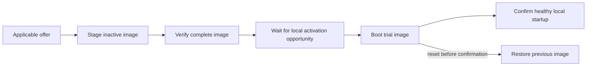

# Firmware updates

Status: Nordic local staging and trial/revert integration now have host checks
and [XIAO hardware validation](../src/port/nrf52840/tests/UPDATE.md#validation).
C6 storage/boot integration has host checks and
[hardware staging/trial/rollback/confirmation validation](../src/port/esp32c6/tests/UPDATE.md#validation).
Both ports share the common bounded image-storage code.
The optional `firmware-update` service now authenticates signed packages, receives
image ranges through ordinary peer forwarding, and resumes from durable page
checkpoints. With measured signed costs, activation now waits for local quiet,
appliance holds, and one-hop neighbor coordination. Unknown costs retain explicit
local activation. The kernel now confirms locally healthy startup automatically;
hardware watchdog expiry resets stalled trials for bootloader reversion.
This plan follows the
[kernel direction](KERNEL_DIRECTION.md).

An update replaces a vertex's appliance/RTOS image. It is separate from installing
an automation's state references, predicates, and transformer calls. Firmware is
built for a particular target; ordinary program distribution does not require a
new machine-code image for each participating architecture.

## Ownership

| Owner | Responsibility |
| --- | --- |
| Common kernel | Accept an applicable image offer, transfer and resume it, verify it, choose when to activate, and confirm successful local startup |
| Platform port | Bound flash access to the update regions; provide erase/write/read, boot selection, trial status, confirmation, and reset |
| Bootloader | Recover interrupted installation, start the trial image, and restore the previous image after an unconfirmed trial |
| Appliance | Existing device initialization and physical behavior; indicate when physical work makes interruption inappropriate |
| Supplying peer | Serve the immutable package and its measured cost data through ordinary Lattice communication |

The tablet, nucleus, or another capable peer can supply a package. None is a
required update coordinator. Supported ports supply storage and boot integration;
each appliance author does not implement an updater, flash protocol, or radio
configuration. Trust in an image comes from a provisioned release key, independently
of which peer carries its bytes. Node-admission authentication remains separate.

The first maintenance interface is a user's computer with a USB radio companion.
They participate as one ordinary peer, discover reachable vertices, and let the
user select a destination and drop a signed package into a local application.
Existing forwarding carries the transfer beyond direct radio range. No router,
Internet connection, tablet, or permanent maintenance server is required. Release
files can be obtained separately from the local transfer.

The local `lattice-tools` checkout implements this interface with a reusable Rust
host peer and a loopback-only drag-and-drop window. It consumes the shared host-v4
codec, walks resident links and supplies one selected package. The current remote
reply establishes verified staging, not the running release after activation; the
window keeps that distinction visible. The host repository is published; the
tablet now consumes its pinned peer library and CLI instead of a copied client.

On 2026-10-18, that browser interface completed both directions: C6 USB peer to
Nordic receiver (132,228 image bytes), then Nordic USB peer to C6 receiver
(292,208 image bytes). Each receiving vertex activated release 3 autonomously and
retained it after another reset without a host Confirm command. Reversing the roles
required no driver, protocol or client changes. Boot results were checked through
diagnostic USB; the browser reported only verified staging. These one-hop
empty-appliance checks do not establish multi-hop hardware delivery or physical
appliance behavior.

Each release contains the kernel and appliance implementation together. A canned
appliance release can apply to several compatible vertices; custom implementations
can require distinct packages. Platform, layout, appliance, and surface checks
remain at each receiver. Propagating a retained release between compatible peers
is later work: current receivers do not yet expose their flash as a package source.

## Package and timing

A fixed-format numeric package header binds the image length and digest to its
target/appliance family, board and boot layout, release version, compatibility
information, and signature. The signature covers these fields and the image
digest. Reject a wrong target, unsupported format, or oversized image before
erasing staging storage. A complete digest and signature check precedes trial
selection. The first implementation updates applications; bootloader replacement,
partition-table changes, and key rotation are separate operations.

The signed header also carries a small cost function measured during release dry
runs on that target. Use fixed-point coefficients and quantities, not executable
cost code. Record erase cost per page, programming and verification cost per byte,
and activation/startup cost, including any boot-time image swap. Include the
longest unavoidable service pause observed during staging. These are estimates
for planning, not a promise that every boot or flash operation meets that time.

Communication uses the existing directional `TimePerByte`:

```text
transfer service estimate = path cost × remaining transmitted payload bytes
local staging estimate   = erase cost × pages + write/verify cost × image bytes
activation outage        = measured boot selection/swap/startup cost
```

Count protocol envelopes as well as image data in the payload quantity. Account
for progress/control traffic using its own direction's cost. MAC retries are
already represented in the measured unit cost; do not multiply by a retry factor
again. There is no special bulk-transfer estimator. Unknown path cost stays
unknown. Summed service costs help compare paths and budget work; contention,
deferrals, and overlapping work prevent treating that sum as a guaranteed
completion timestamp.

## Image lifecycle



The current image remains available throughout transfer and verification. Keep one
candidate and bounded transfer storage per receiver, with no image-sized RAM
buffer or list of pending updates. A failed download or rejected candidate leaves
the current firmware running. A verified image can wait indefinitely for activation;
publication is an offer, not a reboot deadline.

Transfer image ranges sized to fit a complete Lattice frame, including its routing
envelope. Image identity and offset make each range independently checkable and
retransmittable. The receiver controls progress at its flash-write rate. Reuse
existing peer routing and addressed MAC ACK/retry; do not add a separate routing
layer or flood image contents through the network.

A MAC ACK establishes neither a flash write nor a durable checkpoint. Update
progress distinguishes bytes accepted this boot from a committed resume offset.
Checkpoint completed erase pages in a small recoverable flash record. After power
loss, erase and resend the incomplete page. Duplicates compare against accepted
data or return retained progress instead of blindly programming the same flash
word again. Resuming requires the same package identity; a different package must
start a new candidate. Whole-image verification still decides readiness.

Keep only bounded chunk/alignment storage and hash state in RAM. The port supplies
flash geometry; the common transfer path handles a final partial write without
crossing the reserved slot. Preserve identity, keys, and persistent appliance data
outside the image slots. Persistent-data changes must remain readable by the old
image during trial or wait until confirmation; firmware rollback cannot undo an
incompatible data migration or an already performed physical operation.

## Background work and activation

Serve ordinary changes, native calls, and relays ahead of update ranges. Yield
between bounded flash operations. A low-priority task alone does not guarantee
radio availability: internal-flash operations can stall instruction fetch or
interrupt handling. The port must expose the actual interruption behavior, and
the local update policy must defer work that cannot fit an available interval.

The receiver chooses activation from its local activity and known obligations.
Use the package's activation estimate to look for a suitable quiet interval;
recheck before committing the boot selection. Renewed activity defers activation.
The current kernel can observe local calls and traffic, but does not yet retain
installed timed obligations or predict future user changes. Initial behavior must
be honest about that limit rather than claim a globally idle network.

A returned native call or an unlocked appliance mutex does not mean a valve,
motor, or timed cycle has finished. Provide one small local way for the appliance
to hold activation while that physical work continues. Its default needs no
custom scheduling implementation. The kernel owns the hold, timing, and reboot
mechanics; the appliance supplies only the physical fact the kernel cannot infer.

Announce a proposed absence to maintained neighbors, defer while a neighbor is
updating, and stagger competing attempts with local backoff. This reduces
simultaneous disruption without a coordinator. Best-effort notices do not prove
that an alternate route exists or that a partition cannot occur. Protection of
unique bridges remains a later extension of maintained link information.

Trial confirmation checks local kernel, radio, storage, and appliance initialization.
It must not depend on a tablet, nucleus, or reachable neighbor being present.
An unconfirmed image must reset through a watchdog or explicit failure path so
the bootloader can revert; rollback does not run while a hung CPU simply remains
hung. After either boot, register actual appliance state through the ordinary
startup/change path. Do not replay uncertain native commands as update recovery.

## Handle compatibility

Current surface handles derive from local declaration addresses. A rebuild can
move them or reuse an old address for a different declaration. Clearing a tablet
cache does not prevent a delayed message from invoking that new declaration.

For the first unattended updates, require preserved exported handles and meanings,
compatible wire behavior, and rollback-compatible persistent data. Check these
against the previous release during packaging, not just with a developer-supplied
"compatible" flag. If that cannot be established, automatic activation waits for
an explicit rebind/invalidation mechanism that also rejects stale references at
the receiving vertex. The boot/staging milestone can use an empty appliance to
prove image handling before adding that mechanism. This limitation must not be
hidden inside the updater or mistaken for installed-program migration support.

## Port work

**nRF52840:** the [port boot crate](../src/port/nrf52840/boot/README.md) now integrates
`embassy-boot` 0.7.0 and provides the same bounded storage operations to the kernel
port. Its DFU region includes the extra erase page needed by the swap algorithm.
[Embassy boot documentation](https://docs.embassy.dev/embassy-boot/0.7.0/default/index.html)

The current [XIAO layout](../src/port/nrf52840/tests/memory-xiao.x) gives the
application `0x27000..0xED000`; it does not reserve a second image or boot-state
region. Update layout revision 2 reserves a 32 KiB loader, 4 KiB boot state, 372 KiB
active image, 376 KiB DFU region, and 8 KiB transfer journal inside that span. Two-step factory provisioning
keeps its CRC over the immutable loader only; the port rejects a CRC span covering
mutable regions. The factory recovery loader is retained. Provisioning, staging,
trial/revert, and confirmed reboot have run on the XIAO. The full-slot swap took
about 25 seconds through USB re-enumeration; physical interrupted-swap checks
remain separate from host fault injection.

The current Embassy NVMC driver writes four-byte words and erases 4 KiB pages
synchronously. Nordic documents flash-execution stalls and partial erase for
shortening individual stalls. Decide the staging operation size from that behavior;
do not run an entire image erase inside peer dispatch and assume interrupts keep
working. [Nordic NVMC reference](https://docs.nordicsemi.com/r/bundle/ps_nrf52840/page/nvmc.html)

**ESP32-C6:** the [port backend](../src/port/esp32c6/boot/README.md) now reads the
validated partition table and actual MMU mapping, and uses `esp-storage` for flash.
Its metadata decoder excludes corrupt and aborted records, preserves the running
image's record while selecting a trial, and confirms only the running image.
The convenience library's sequence-only OTA selector is not used after rollback.
The maintained test builds an ESP-IDF v5.5.4 loader with rollback enabled and two
1 MiB application slots. Host checks, builds, and the hardware lifecycle check pass.
First successful status after trial/rollback reset arrived in about 0.28 seconds,
including a 250 ms host wait; the loader selects the image in place.
This uses no ESP-IDF application scheduler or networking runtime.
[Espressif OTA documentation](https://docs.espressif.com/projects/esp-idf/en/release-v5.4/esp32c6/api-reference/system/ota.html)

One-time provisioning establishes the boot layout. Ordinary OTA packages operate
inside that layout and never rewrite its recovery loader or partition map.

## Implementation sequence

1. **Local image staging and recovery.** Establish the Nordic flash layout and boot
   integration, then its C6 equivalent. Use two small kernel images to demonstrate
   staging, trial, confirmation, and reversion, with a recoverable interrupted
   write/boot transition. Measure flash stalls and boot time. Keep maintained checks
   beside the ports and boot support beside the code that owns it.
   Nordic storage and the loader are implemented; the A/B USB fixture has run.
   Host checks cover bounds, confirmation/reversion, and interrupted swap/revert.
   Hardware staging, trial, confirmation, and reversion pass. Physical interrupted
   swaps remain open; watchdog checks now have separate maintained fixtures. C6 staging, trial, rollback, and
   confirmation have also run on hardware. Both ports now use
   [shared image storage](../src/kernel/update/storage/README.md).
2. **Common transfer and verification.** Add `kernel::update` for one candidate,
   package checks, durable progress, and port calls. Extend `kernel::peer` with the
   bounded update records and route them through existing forwarding. Prove a
   dropped or duplicated range and a restarted receiver resume without corrupting
   either image. Do not expose a remotely activatable unsigned update path as an
   ordinary kernel feature. This slice is implemented; the current mechanisms and
   explicit limits are described below.
3. **Autonomous activation.** Measured local-cost deferral, appliance holds, and
   neighbor notices are implemented. Local health confirmation and watchdog-backed trial recovery are implemented.
   Cost-based staging admission and incremental verification are implemented. A
   standalone computer peer now supplies packages through the same receiver. Remote
   running-release reporting and compatible-release packaging beyond unchanged
   surfaces remain subsequent work; the MCU receiver owns its lifecycle.

Host checks cover the common state transitions and bounds. Hardware checks answer
the flash and boot questions on both ports. RF capture experiments remain in the
external lab; none becomes an updater dependency. Review this sequence and the
[implementation map](KERNEL_DIRECTION.md#implementation-map) as each slice lands.

## Implemented signed transfer

Enable `firmware-update` together with the selected port's `nrf52840-update` or
`esp32c6-update` feature. `kernel::start_with_updates` receives that port's storage
and a build-provisioned `update::package::Policy`, then starts the normal kernel.
The policy contains the trusted Ed25519 public key, platform, boot-layout revision,
appliance family, current release, and exposed-surface fingerprint. Startup checks
the fingerprint against the actual encoded appliance surface. A transmitting peer
cannot choose the receiver's key or compatibility policy.

The package is a 192-byte numeric header followed by the image:

| Byte range | Field |
| --- | --- |
| 0–7 | `LVUP`, format u16, platform u16 |
| 8–27 | Layout u32, appliance family 16 bytes |
| 28–59 | SHA-256 of the current/candidate exported surface |
| 60–71 | Release u64, image length u32 |
| 72–103 | Image SHA-256 |
| 104–127 | Six u32 local-cost coefficients, in the order listed above |
| 128–191 | Ed25519 signature over bytes 0–127 |

Integers are little-endian. Per-byte local costs are Q24.8 microseconds; other
coefficients are integer microseconds. `0xffffffff` means unknown. Package identity
is the first 16 bytes of SHA-256 over the complete signed header. Verification uses
`ed25519-dalek`'s strict verifier without allocation or precomputed-table features.
No flash mutation precedes signature, target, surface, size, and newer-release
checks. The image's complete hash and target vectors/header are checked before
readiness. Selection reuses the verified digest while the candidate exclusively
owns unchanged flash, and rechecks the small target prefix.

The shared wire crate defines Header, Prepare, Data, Finish, and Status requests.
Four independently acknowledged 48-byte header ranges assemble one offer. Each
Prepare advances at most one erase page, or commits the journal header. Data
carries at most 48 image bytes, its offset, and package identity. Finish advances
bounded verification; phase 7 (Verifying) means another Finish is required before
Ready. Busy is backpressure: no flash progress occurred for that request. Its largest radio
frame is 124 bytes excluding FCS, inside the 125-byte MAC limit. Requests/replies
reuse the existing read-token/reverse-path records and learned routes; relays do
not retain package images. New radio opcodes 16/17 and attached-host opcodes 5/0x85
are additive to LVT v7/host v4. Older peers cannot relay these new records until
updated; receivers built without the update service return Unsupported.

Each port reserves an 8 KiB journal. A signed header becomes recoverable only when
its commit marker is written. Append-only offset/complement records checkpoint
complete 4 KiB pages or the final image length. A torn record is skipped, never
rewritten. Restart revalidates the signed header, erases the unfinished page and
remaining staging area, and returns the committed offset. The host can re-offer
the same package and continue there. Accepted bytes may exceed durable bytes.
The journal is consumed before trial selection so a reverted trial cannot be
silently reselected from retained download metadata.

The resident peer task owns the receiver and flash. There is no updater task,
allocator, image buffer, or new routing table. OTA-enabled builds reserve a fixed
24 KiB radio stack: a 16 KiB reservation overflowed on C6's remote signature path.
Both maintained OTA fixtures enable the existing kernel stack-overflow guard.
Ordinary builds now reserve 12 KiB; their smaller 8 KiB reservation overflowed
in the guarded C6 local-update check after neighbor bookkeeping grew. The journal owns persistent transfer
progress; boot metadata separately owns trial/confirmation/reversion.

Explicit SelectTrial, Confirm, and Reset maintenance controls use the attached host only (host
opcodes 6/0x86), or the kernel's local activation/confirmation API. They have no
radio activation encoding. Unknown-cost fixtures still require explicit local activation. Confirmation now follows local startup progress; receipt of a package alone
does not confirm its image. Explicit Confirm is idempotent after those checks
and returns Busy until they succeed.

## Packaging and maintained checks

From the repository root, with Python `cryptography` and `pyserial` installed:

```sh
python tools/update_package.py keygen --key /PRIVATE/PATH/release-key
# Pass the printed PUBLIC key to either port's build, never the private seed.
export LATTICE_UPDATE_PUBLIC_KEY=PUBLIC_KEY_HEX
```

Both port build scripts accept `update.py prepare --ota`, placing artifacts in
that port's ignored `tests/target/ota`. Follow the port's provisioning procedure
with those artifacts. Nordic needs both factory DFU uploads; C6 additionally
provisions `journal-empty.bin` at `0x210000`. Revision 1 Nordic images used different
slot boundaries: provision the revision 2 loader/application together before OTA;
an ordinary package cannot migrate the layout. Preserve existing recovery loaders.

The empty-appliance fixtures use family `01010101010101010101010101010101`, layout
2, release A=1 and B=2. Their serialized surface is `LSF`, byte 1, byte 32, then
eight zero bytes. Keep that file beside the ignored generated artifacts.

```sh
python tools/update_package.py pack --image PORT/tests/target/ota/b.bin \
  --surface CURRENT_SURFACE --candidate-surface CANDIDATE_SURFACE \
  --key /PRIVATE/PATH/release-key --output PORT/tests/target/ota/b.lvup \
  --platform PLATFORM --layout 2 --release 2 \
  --appliance 01010101010101010101010101010101 --unmeasured
python tools/update_peer.py --port SOURCE_USB info
python tools/update_peer.py --port SOURCE_USB upload --owner RECEIVER_HEX PACKAGE
python tools/update_peer.py --port RECEIVER_USB info
python tools/update_peer.py --port RECEIVER_USB activate
# Reconnect after the trial starts, inspect release and local operation, then:
python tools/update_peer.py --port RECEIVER_USB confirm
python tools/update_peer.py --port RECEIVER_USB reset
```

Platform is 1 for Nordic, 2 for C6. `--stop-after BYTES` stops an upload without
selection, allowing reset/resume checks. The supplying computer streams through
its attached peer; the actual receiver gets the package over Lattice radio.
The tool retries immutable transfer requests with bounded attempts and preserves
package/offset identity. It never retries a native transformer invocation.

`--unmeasured` explicitly records unknown timing and is appropriate only for these
manually activated fixtures. Release packaging instead requires `--costs JSON`
with `erase_page_us`, `write_per_byte`, `verify_per_byte`, `activation_us`,
`swap_per_byte`, and `longest_pause_us`. It also requires byte-identical current and
candidate surface descriptions. The build/signing pipeline must supply authentic
surface dumps and the matching candidate release; the packager does not extract
or prove those properties from arbitrary machine code.

Remaining work: shorter port-level indivisible flash pauses, stale-handle/rebind support,
and remote running-release reporting. Page erases remain indivisible; image
verification is incremental. Each synchronous step can pause radio service. A completed transfer is
not evidence of uninterrupted background operation. Physical power cuts during an
individual flash write or swap remain distinct from reset/resume and host fault
injection. Release version checking is relative to the running firmware; it is not
hardware-enforced anti-rollback or secure boot.

## Signed OTA validation, 2026-10-18

The XIAO Nordic ending `D64C` and 8 MiB C6 ending `67:98` ran the maintained
empty-appliance OTA fixtures on their ordinary formed network. C6 TX stayed at
20 dBm; the laptop's Wi-Fi adapter was not used for the test.

| Transfer | Image bytes | Interrupted accepted / committed | After receiver reset | Final result |
| --- | ---: | ---: | ---: | --- |
| Nordic → C6 | 286,208 | 9,024 / 8,192 | 8,192 / 8,192 | Verified, locally selected, release 2 booted and confirmed, retained after reset |
| C6 → Nordic | 126,364 | 9,024 / 8,192 | 8,192 / 8,192 | Verified, locally selected, release 2 booted and confirmed, retained after reset |

The remaining radio transfers and final verification took approximately 93.5 s
and 41.8 s respectively, excluding preparation and activation. These are observed
fixture durations, not release cost coefficients. The Nordic also rejected a
modified signed header as Signature and a valid C6 package as Target before
preparing it. Local-reset resume is proven here; this run did not remove power
mid-write or interrupt a boot-time swap.

The initial C6 remote-offer run exposed a real 16 KiB task-stack overflow. Raw
USB exception capture localized it, and the kernel stack guard reproduced it.
The fixed 24 KiB reservation passed both complete transfers with guards enabled.
No RF settings were changed to mask that failure. This evidence checks the
exercised stack path, not every possible appliance's added call depth.

Portable checks cover rejection before flash mutation, durable versus accepted
progress, duplicate bytes without reprogramming, torn checkpoints, header-buffer
ownership, consumed-trial metadata, verification failure, cost arithmetic, routed
reply identity, and wire framing. The final run passed 95 kernel tests, 3 shared
wire tests, 8 port boot tests, and the shared diagnostic-console stream check.
Strict whole-kernel Clippy still encounters existing inherited-core/forwarding
lints; it is not a passing validation gate for this checkout.


## Local activation policy

`kernel::update::activation` runs inside the resident peer task. Once verification
succeeds, complete known signed timing coefficients enable automatic activation.
The outage estimate includes boot selection/startup and the actual port swap extent (the whole Nordic active slot, zero on C6). Unknown
or excessive estimates keep the image ready for explicit maintenance. Absence
estimates are bounded at ten minutes; no arithmetic overflow becomes a free cost.

The vertex waits for quiet lasting at least the estimated outage or five seconds,
whichever is longer, plus a bounded address/time-mixed backoff below two seconds.
This is a local heuristic based on recent activity, not a prediction of user intent
or proof of a future idle interval. Continued activity may defer an update
indefinitely; there is no compulsory reboot deadline. Registered local changes, native access, active
state/surface/link reads, native calls, deltas and their relaying restart the wait.
Periodic formation/link maintenance and update transfer records are not user work;
outstanding read/call return paths still defer selection until answered or expired.

`Appliance::with` and native invocation automatically hold admission while using
the appliance. For a motor cycle, timer or other physical operation continuing
past the call, retain `update::hold_activation(&context)?` until it finishes.
The guard is one counted local hold, not a job or schedule. Busy means activation
already closed admission; do not begin the physical operation. Dropping a hold
records activity and wakes the resident task. Automatic selection atomically closes
new holds, then rechecks activity and pending deltas before changing boot metadata.
An `Appliance::with` arriving after commitment waits for reset (or reopens after a
failed selection). Explicit USB maintenance controls remain explicit overrides.

A proposal is broadcast two seconds before departure. Only maintained immediate
neighbors retain it, in their existing link record. Nodes about to update defer to
an already-departing neighbor; simultaneous proposals use the smaller radio address
as a tie-break. Renewed activity cancels the proposal. A final leaving notice precedes
selection; failed TX or a captured/in-progress reception postpones commitment.
There is no new task, graph scheduler, routing registry, or network-wide lock.

LVT v7 opcode 18 carries the network tag and a nine-byte notice: attempt `u32`,
phase `u8` (proposed=0, leaving=1, cancel=2), and estimated outage milliseconds `u32`.
It is one-hop broadcast only. Cancellation must match the retained attempt. Repeated
notices do not extend their timer, and a stale proposal cannot downgrade a leaving
notice. The record expires after its estimate plus notice time and five seconds of
slack; an announced neighbor can remain retained beyond ordinary link expiry until
then. Newer ordinary firmware understands notices even if it has no updater enabled.
Older firmware ignores them. Loss, hidden terminals and partitions can still permit
overlapping updates; this mechanism does not prove that a replacement relay path exists.

Only a ready measured image shortens receive waits (to at most 250 ms) while the
local decision is pending. Ordinary idle participation retains its existing waits.
Formation and resident participation now use separate function frames so their
large temporary state is not stacked together during startup. The port fixtures
enable kernel stack guards and can report the radio task's minimum free stack.

## Measuring a release

The maintained local `update` fixtures report `elapsed_us` for each operation.
C6 uses the HAL monotonic timer; Nordic uses the 64 MHz DWT cycle counter, taking
wrapping differences before conversion. Measurements exclude serial reporting.
`tools/update_costs.py` stages a candidate, measures page erases, chunk programming,
verification and selection, boots the trial, checks changed fixture identity, then
confirms it. It writes the six signed-package coefficients plus provenance to JSON.
It requires an already provisioned matching local fixture and never installs a layout.

```sh
python tools/update_costs.py --port ACTUAL_PORT --image CANDIDATE_BIN \
  --output costs.json --swap-bytes 380928  # Nordic layout 2; omit swap-bytes on C6
```

Programming/verification use Q24.8 microseconds per image byte. Erase uses the
largest observed page time. Reset-to-local-peer readiness is measured separately for the original
and trial image; on Nordic their difference supplies the per-swapped-byte term.
The fixed term includes baseline startup and the cached selection operation.
Verification has already completed and is charged to staging, not to boot outage.
The default 125% margin rounds upward. The existing NetworkSelected test event prevents early USB enumeration from
being mistaken for restored peer service. USB return/host waits make boot estimates
conservative; these are measured planning inputs, not WCET guarantees. Validate
representative release builds and physical workloads before publishing their
costs; an empty fixture measures only its own initialization and workload. Flash erases remain indivisible even though staging and verification are paced;
this does not make flash service uninterrupted.

`prepare --ota --activation-check` adds a ten-second physical-work hold to fixture
A after verification. Fixture B is ordinary OTA firmware. This check uses the public
hold API, not a test opcode or a second networking loop. Activation may happen only
after that hold, a fresh quiet interval, and the proposal window; confirmation is
still a separate local action. Generated keys, packages, cost files and captures
stay in ignored target directories.


## Activation measurements and checks, 2026-10-18

The maintained local fixtures measured the following on the connected C6 and
XIAO Nordic. Coefficients include the tool's default 25% planning margin.

| Signed coefficient | C6 | Nordic |
| --- | ---: | ---: |
| Erase microseconds/page | 38,910 | 105,207 |
| Write Q24.8 microseconds/byte | 2,088 | 3,940 |
| Verify Q24.8 microseconds/byte | 283 | 414 |
| Fixed activation microseconds | 1,744,222 | 2,045,027 |
| Swap Q24.8 microseconds/byte | 0 | 19,707 |
| Longest observed operation with margin, microseconds | 215,059 | 153,183 |

The Nordic trial returned to local peer service in approximately 25.01 seconds,
against a 1.55-second baseline; its swap extent is 380,928 bytes. C6 trial return
was approximately 1.37 seconds. These are fixture measurements, not universal
board limits or guarantees for another appliance's initialization. Cost JSON,
image digests, and raw logs remain local generated artifacts.

The expanded neighbor records exposed the old ordinary 8 KiB radio-stack limit.
C6 exception capture and the kernel guard reproduced the overflow. Formation and
resident participation now have separate frames, and ordinary participation uses
12 KiB; signed OTA remains at 24 KiB. The maintained local fixtures subsequently
reported minimum free radio stack of 3,820 bytes on C6 and 3,844 bytes on Nordic
after formation and continued operation. Both local staging/trial/confirmation
timing runs passed. This headroom describes the tested empty appliance, not an
arbitrary appliance callback's stack use.

Portable checks cover unknown costs, activity/hold/neighbor deferral, quiet and
notice windows, failed notice TX, tick wrap, admission versus commit, bounded
one-hop encoding, matched cancellation, simultaneous proposal ordering, and expiry.
There are 99 passing kernel tests, 3 shared wire tests, 8 boot tests, and the shared
console framing check. Clippy introduces no new diagnostics in the new activation
or timing code; inherited core/forwarding lints remain.


For the automatic C6 check, Nordic supplied the signed 290,144-byte image over
radio. The C6 remained ready on release 1 through 18.15 seconds after verification,
covering the ten-second fixture hold and subsequent quiet/notice interval. Release
2 was observed at 32.21 seconds without sending SelectTrial or Reset beforehand;
that observation includes a host command timeout across reboot, so it is not a
measurement of boot outage. Local confirmation and a subsequent reset retained
release 2. The test source requested transfer only; activation belonged to the receiver.


For the automatic Nordic check, C6 supplied the signed 129,620-byte image. Its
coefficients and full-slot swap extent produced a 31,579 ms outage estimate. A
remained ready through 44.38 seconds after verification, covering the fixture hold,
the longer quiet interval, and notice window. B was observed at 70.40 seconds after
the automatic reset/swap. No host activation command was sent. Local confirmation
and another reset retained release 2. Both peers ended on confirmed B. These runs
prove local automatic activation with the public hold on both ports; simultaneous
neighbor arbitration and loss cases remain portable-model checks, not a hardware
network-partition guarantee. Trial confirmation was explicit throughout.


## Watchdog-backed startup confirmation

`update::startup` owns one local confirmation state. Storage initialization and
appliance binding precede scheduler startup. A completed local radio energy
measurement and an advancing kernel tick then permit confirmation in the resident
peer task. No tablet, nucleus, reachable neighbor, packet exchange, or successful
network formation is required. This establishes initialization of the local
components; it does not prove arbitrary appliance behavior or future executions.

The kernel writes confirmation once. An uncertain confirmation failure stops
watchdog feeding and is not retried against potentially changed boot metadata.
The loader resolves that state after reset. Public/manual Confirm cannot bypass
the startup checks. Existing explicit local boot fixtures retain their manual
confirmation path so they can still exercise healthy-but-unconfirmed reversion.

Both ports reserve a nominal 30-second watchdog interval. The peer task feeds it
after confirmed startup and on normal execution progress, never from the tick or
radio IRQ. A stalled peer therefore cannot stay alive merely because interrupts
continue. Both watchdogs remain active after confirmation: a later stall resets
the confirmed image rather than reverting it. The ordinary receive/discovery waits
are shorter than the interval. Long blocking appliance code must not monopolize
that task for the watchdog interval.

On Nordic, the loader arms WDT after the full-slot swap and before jumping to an
unconfirmed trial, giving application startup a fresh interval. It reads the
persistent *resulting* boot state: Embassy's `prepare_boot` return value describes
the entry state even after a reversion. That distinction prevents treating restored
A as another unconfirmed B. The port and loader compile the same small watchdog
module; one reload register is enabled and counting continues during CPU sleep or
debug halt. The peripheral cannot be stopped once started, so kernel progress
continues feeding it after confirmation. Its configuration becomes writable again
on system reset. [Nordic WDT reference](https://docs.nordicsemi.com/r/bundle/ps_nrf52840/page/wdt.html)

The C6 loader uses RTC WDT with a 30,000 ms timeout and
`BOOTLOADER_WDT_DISABLE_IN_USER_CODE=y`. The port rearms RTC WDT at `initialize`
entry and retains hardware reset action; no watchdog ISR is installed.
[Espressif watchdog reference](https://docs.espressif.com/projects/esp-idf/en/v5.5.2/esp32c6/api-reference/system/wdts.html)
There is a known C6 handoff gap: esp-hal 1.1.2 unconditionally disables watchdogs
inside `esp_hal::init`, before Lattice's port initialization rearms one. A stall
inside that interval is not covered. Keep port initialization directly after HAL
initialization/resource setup. The current implementation does not vendor or patch
the whole HAL to change this behavior, and does not claim uninterrupted protection
through that interval.

The watchdog-capable loaders require one-time provisioning. This changes boot
behavior without moving the revision-2 image/journal boundaries. Ordinary packages
still update applications only; they do not install a new loader. Nordic factory
recovery and the C6 ROM loader remain intact, and no eFuses are changed.

### Maintained trial failures

`update.py prepare --ota --watchdog-check` builds healthy A/B plus two signed-package
candidates: `stall-entry` spins before peripheral initialization; `stall-radio`
spins in the existing DiscoveryStarted test hook, after the scheduler/radio task
starts and before the first radio operation. Both mask interrupts and spin forever.
They execute no panic handler, software reset or host recovery command. These
failures belong solely to the port fixtures; kernel runtime has no test failure
opcode or extra task.

Sign all three candidates using `tools/update_package.py`, release 2 and explicit
`--unmeasured`, into `stall-entry-watchdog.lvup`, `stall-radio-watchdog.lvup`, and
`b-watchdog.lvup`. Provision the new loader and A first, then run:

```sh
python src/port/tests/update_watchdog.py --port ACTUAL_PORT \
  --images PORT/tests/target/ota --minimum-recovery-seconds 25
# Nordic: use --minimum-recovery-seconds 65 to include both full-slot swaps.
```

The runner uses the local signed receiver to stage each image. It explicitly
selects/resets into each trial, then waits for the hardware watchdog and loader to
return A, without another reset or confirmation command. Finally it boots healthy
B, sends no Confirm, resets B again and requires B to remain. These are boot and
local-startup checks, not another RF or physical power-cut investigation.


### Watchdog validation, 2026-10-18

Both connected boards ran the shared signed-receiver watchdog runner with the new
loaders. No host Confirm was issued in any case. After selecting/resetting into a
stalled trial, the runner sent no further reset command while waiting for recovery.

| Trial | C6 observed return | Nordic observed return | Result |
| --- | ---: | ---: | --- |
| Stall before peripheral initialization | 39.41 s | 88.27 s | Prior release 1 restored |
| Stall in peer task before first radio operation | 35.71 s | 79.32 s | Prior release 1 restored |
| Healthy release 2 | 11.64 s | 25.32 s | Automatic confirmation; retained after another reset |

Times start at reset acknowledgement and end at a successful attached-host status.
They include boot/swap work, peer formation, USB reconnects, and command timeouts;
they do not measure the nominal watchdog period. Nordic failure cases include both
full-slot swap and reversion. Both devices ended on automatically confirmed release
2. The retained Nordic factory loader and C6 ROM recovery path were preserved;
no fuse or laptop Wi-Fi settings changed.

Host checks passed 101 kernel tests, 8 boot tests, and 3 shared-wire tests. The
confirmation checks cover missing tick/radio progress, wrapping ticks, exactly one
confirmation write, and fail-stop behavior after an uncertain confirmation result.
The Nordic boot test now checks the post-reversion state returned to the loader.
Both MCU builds passed. Existing inherited Clippy lints remain; the new startup and
watchdog code introduced no host Clippy diagnostics. The C6 HAL handoff limitation
above remains outside the exercised protection windows.


## Paced staging and incremental verification

The receiver performs one bounded staging step per request. `update::staging`
admits that work on the existing peer task using the signed erase/page and
write/verify-per-byte costs. An operation waits for recent appliance/ordinary peer
activity to settle for its estimated duration. After completion it leaves an equal
estimated service interval for normal work, with a minimum receive turn (six ms
at the current PHY). Post-operation timing avoids counting stalled/lost RTOS ticks
as if normal service had run during flash access.

Pending native calls and non-update reads take precedence; outstanding update
paths do not block one another. Captured/in-progress radio frames are serviced
before host-originated update work. Registered changes also defer staging. A
refused step returns Busy with unchanged progress; the receiver stores no queued
flash job. Status, completed operations and identical written ranges stay readable.
The supplying tool retries only immutable update requests, with ten-ms Busy
backoff and a thirty-second per-request deferral limit. If activity continues,
it stops and the caller can re-offer the same package later.

`Appliance::with` and native invocation now acquire an update hold automatically.
Their actual access and a flash step cannot be admitted simultaneously. A new
local appliance access waits for an already-started flash step; a native request
can report Busy. For physical work continuing beyond a call, retain
`update::hold_updates(&context)?` if it cannot tolerate background flash pauses or
automatic reboot. Keep using `hold_activation` when only reboot must wait: that
hold intentionally allows staging, including workflows waiting for a candidate
to become Ready. Explicit maintenance controls remain deliberate overrides.

Finish uses a one-ms estimated hash-work target, capped at 1,024 image bytes per
request. The storage layer still reads through one aligned 256-byte buffer and
retains only the SHA-256 state and cursor. A zero coefficient still has the byte
cap. Unknown verification costs use one 256-byte step; unknown costs otherwise
receive only the minimum service interval. Unknown remains unknown: those cases
have no measured pause estimate and do not qualify for automatic activation.

Verifying is a volatile phase. Reset retains durable image bytes, but discards the
partial hash and recomputes it from the beginning. Only the final matching digest
plus port prefix validation makes the image Ready. Actual writes, erases, and
resume reset the digest state. Selection compares the requested digest to the
completed result instead of silently performing another whole-image scan. This
assumes the port's exclusive ownership of its unchanged candidate region; it is
not a fresh physical-corruption scan at activation. The low-level `verify_image`
convenience remains synchronous for explicit local port callers, while the kernel
uses `verify_step` exclusively.

The wire remains LVT v7 / host v4 with unchanged record widths. Updater consumers
must use the updated shared phase decoder and continue Finish while Verifying;
they must not interpret every successful Finish reply as Ready. Older firmware
that finishes synchronously still works with the updated supplying tool. Native
invocation/read/delta records are unchanged, and native mutations are never retried
by the update tool's Busy handling.

This pacing gives normal work opportunities; it does not shorten an indivisible
page erase or predict future changes. Harder latency requirements need port work
such as partial erase or execution from RAM, and representative cost measurements.
The release timing tool now measures cached selection directly instead of
subtracting a verification pass that selection no longer performs.

Build `prepare --ota --staging-check` to make fixture A hold all background updates
for ten seconds when it accepts a package. Sign B using a measured cost file and
run `src/port/tests/update_staging.py --port ACTUAL_PORT --package PACKAGE`. It
checks Busy responses with frozen progress alongside responsive status requests,
then completes bounded verification, selects the image and checks retained B after
reset without host confirmation. This is a maintained local receiver/flash check;
it does not replace the earlier radio-transfer checks or prove physical appliance
latency during an erase.

For a subsequent candidate without reprovisioning a running fixture, set
`LATTICE_UPDATE_RELEASE=N` when building its `ota` binary. The build embeds that
release identity, and packaging must use the same value. Without the override,
the maintained A/B fixtures remain releases 1 and 2. This override is for a single
candidate build; assigning the same override to both A/B builds would defeat a
version-advancing test.

### Staging validation, 2026-10-18

Both maintained fixtures passed through the local USB receiver, using the existing
dry-run cost files. Each returned 78 Busy responses with unchanged preparation and
byte counters during the sampled eight seconds of its ten-second hold, while
servicing 78 intervening local status requests. After release, both completed
staging and verification, booted release 2, confirmed startup, and retained release
2 after another reset without a host Confirm command.

| Receiver | Image bytes | Verification steps | Selection response |
| --- | ---: | ---: | ---: |
| ESP32-C6 | 292,208 | 324 | 31 ms |
| nRF52840 | 132,228 | 214 | 86 ms |

Selection timings include host/USB service; they are not isolated flash timings.
These checks reused earlier coefficients to exercise pacing, not to certify new
release cost measurements. Portable checks also cover reset during verification:
durable bytes survive, partial hash state does not, and selection remains forbidden
until the restarted scan completes.
