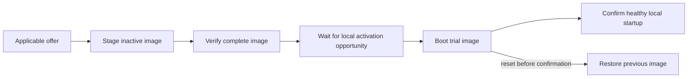

# Firmware updates

Status: Nordic local staging and trial/revert integration now have host checks
and [XIAO hardware validation](../src/port/nrf52840/tests/UPDATE.md#validation).
C6 storage/boot integration has host checks and built test images; physical
validation is pending. Both ports share the common bounded image-storage code.
Signed update messages, download resume, and autonomous activation remain planned.
This plan follows the
[kernel direction](KERNEL_DIRECTION.md).

An update replaces a vertex's appliance/RTOS image. It is separate from installing
an automation's state references, predicates, and transformer calls. Firmware is
built for a particular target; ordinary program distribution does not require a
new machine-code image for each participating architecture.

## Ownership

| Owner | Responsibility |
| --- | --- |
| Common kernel | Accept an applicable image offer, transfer and resume it, verify it, choose when to activate, and confirm successful local startup |
| Platform port | Bound flash access to the update regions; provide erase/write/read, boot selection, trial status, confirmation, and reset |
| Bootloader | Recover interrupted installation, start the trial image, and restore the previous image after an unconfirmed trial |
| Appliance | Existing device initialization and physical behavior; indicate when physical work makes interruption inappropriate |
| Supplying peer | Serve the immutable package and its measured cost data through ordinary Lattice communication |

The tablet, nucleus, or another capable peer can supply a package. None is a
required update coordinator. Supported ports supply storage and boot integration;
each appliance author does not implement an updater, flash protocol, or radio
configuration. Trust in an image comes from a provisioned release key, independently
of which peer carries its bytes. Node-admission authentication remains separate.

## Package and timing

A fixed-format numeric package header binds the image length and digest to its
target/appliance family, board and boot layout, release version, compatibility
information, and signature. The signature covers these fields and the image
digest. Reject a wrong target, unsupported format, or oversized image before
erasing staging storage. A complete digest and signature check precedes trial
selection. The first implementation updates applications; bootloader replacement,
partition-table changes, and key rotation are separate operations.

The signed header also carries a small cost function measured during release dry
runs on that target. Use fixed-point coefficients and quantities, not executable
cost code. Record erase cost per page, programming and verification cost per byte,
and activation/startup cost, including any boot-time image swap. Include the
longest unavoidable service pause observed during staging. These are estimates
for planning, not a promise that every boot or flash operation meets that time.

Communication uses the existing directional `TimePerByte`:

```text
transfer service estimate = path cost × remaining transmitted payload bytes
local staging estimate   = erase cost × pages + write/verify cost × image bytes
activation outage        = measured boot selection/swap/startup cost
```

Count protocol envelopes as well as image data in the payload quantity. Account
for progress/control traffic using its own direction's cost. MAC retries are
already represented in the measured unit cost; do not multiply by a retry factor
again. There is no special bulk-transfer estimator. Unknown path cost stays
unknown. Summed service costs help compare paths and budget work; contention,
deferrals, and overlapping work prevent treating that sum as a guaranteed
completion timestamp.

## Image lifecycle



The current image remains available throughout transfer and verification. Keep one
candidate and bounded transfer storage per receiver, with no image-sized RAM
buffer or list of pending updates. A failed download or rejected candidate leaves
the current firmware running. A verified image can wait indefinitely for activation;
publication is an offer, not a reboot deadline.

Transfer image ranges sized to fit a complete Lattice frame, including its routing
envelope. Image identity and offset make each range independently checkable and
retransmittable. The receiver controls progress at its flash-write rate. Reuse
existing peer routing and addressed MAC ACK/retry; do not add a separate routing
layer or flood image contents through the network.

A MAC ACK establishes neither a flash write nor a durable checkpoint. Update
progress distinguishes bytes accepted this boot from a committed resume offset.
Checkpoint completed erase pages in a small recoverable flash record. After power
loss, erase and resend the incomplete page. Duplicates compare against accepted
data or return retained progress instead of blindly programming the same flash
word again. Resuming requires the same package identity; a different package must
start a new candidate. Whole-image verification still decides readiness.

Keep only bounded chunk/alignment storage and hash state in RAM. The port supplies
flash geometry; the common transfer path handles a final partial write without
crossing the reserved slot. Preserve identity, keys, and persistent appliance data
outside the image slots. Persistent-data changes must remain readable by the old
image during trial or wait until confirmation; firmware rollback cannot undo an
incompatible data migration or an already performed physical operation.

## Background work and activation

Serve ordinary changes, native calls, and relays ahead of update ranges. Yield
between bounded flash operations. A low-priority task alone does not guarantee
radio availability: internal-flash operations can stall instruction fetch or
interrupt handling. The port must expose the actual interruption behavior, and
the local update policy must defer work that cannot fit an available interval.

The receiver chooses activation from its local activity and known obligations.
Use the package's activation estimate to look for a suitable quiet interval;
recheck before committing the boot selection. Renewed activity defers activation.
The current kernel can observe local calls and traffic, but does not yet retain
installed timed obligations or predict future user changes. Initial behavior must
be honest about that limit rather than claim a globally idle network.

A returned native call or an unlocked appliance mutex does not mean a valve,
motor, or timed cycle has finished. Provide one small local way for the appliance
to hold activation while that physical work continues. Its default needs no
custom scheduling implementation. The kernel owns the hold, timing, and reboot
mechanics; the appliance supplies only the physical fact the kernel cannot infer.

Announce a proposed absence to maintained neighbors, defer while a neighbor is
updating, and stagger competing attempts with local backoff. This reduces
simultaneous disruption without a coordinator. Best-effort notices do not prove
that an alternate route exists or that a partition cannot occur. Protection of
unique bridges remains a later extension of maintained link information.

Trial confirmation checks local kernel, radio, storage, and appliance initialization.
It must not depend on a tablet, nucleus, or reachable neighbor being present.
An unconfirmed image must reset through a watchdog or explicit failure path so
the bootloader can revert; rollback does not run while a hung CPU simply remains
hung. After either boot, register actual appliance state through the ordinary
startup/change path. Do not replay uncertain native commands as update recovery.

## Handle compatibility

Current surface handles derive from local declaration addresses. A rebuild can
move them or reuse an old address for a different declaration. Clearing a tablet
cache does not prevent a delayed message from invoking that new declaration.

For the first unattended updates, require preserved exported handles and meanings,
compatible wire behavior, and rollback-compatible persistent data. Check these
against the previous release during packaging, not just with a developer-supplied
"compatible" flag. If that cannot be established, automatic activation waits for
an explicit rebind/invalidation mechanism that also rejects stale references at
the receiving vertex. The boot/staging milestone can use an empty appliance to
prove image handling before adding that mechanism. This limitation must not be
hidden inside the updater or mistaken for installed-program migration support.

## Port work

**nRF52840:** the [port boot crate](../src/port/nrf52840/boot/README.md) now integrates
`embassy-boot` 0.7.0 and provides the same bounded storage operations to the kernel
port. Its DFU region includes the extra erase page needed by the swap algorithm.
[Embassy boot documentation](https://docs.embassy.dev/embassy-boot/0.7.0/default/index.html)

The current [XIAO layout](../src/port/nrf52840/tests/memory-xiao.x) gives the
application `0x27000..0xED000`; it does not reserve a second image or boot-state
region. The new update layout reserves a 32 KiB loader, 4 KiB boot state, 376 KiB
active image, and 380 KiB DFU region inside that span. Two-step factory provisioning
keeps its CRC over the immutable loader only; the port rejects a CRC span covering
mutable regions. The factory recovery loader is retained. Provisioning, staging,
trial/revert, and confirmed reboot have run on the XIAO. The full-slot swap took
about 25 seconds through USB re-enumeration; physical interrupted-swap checks
remain separate from host fault injection.

The current Embassy NVMC driver writes four-byte words and erases 4 KiB pages
synchronously. Nordic documents flash-execution stalls and partial erase for
shortening individual stalls. Decide the staging operation size from that behavior;
do not run an entire image erase inside peer dispatch and assume interrupts keep
working. [Nordic NVMC reference](https://docs.nordicsemi.com/r/bundle/ps_nrf52840/page/nvmc.html)

**ESP32-C6:** the [port backend](../src/port/esp32c6/boot/README.md) now reads the
validated partition table and actual MMU mapping, and uses `esp-storage` for flash.
Its metadata decoder excludes corrupt and aborted records, preserves the running
image's record while selecting a trial, and confirms only the running image.
The convenience library's sequence-only OTA selector is not used after rollback.
The maintained test builds an ESP-IDF v5.5.4 loader with rollback enabled and two
1 MiB application slots. Host checks and builds pass; hardware validation is pending.
This uses no ESP-IDF application scheduler or networking runtime.
[Espressif OTA documentation](https://docs.espressif.com/projects/esp-idf/en/release-v5.4/esp32c6/api-reference/system/ota.html)

One-time provisioning establishes the boot layout. Ordinary OTA packages operate
inside that layout and never rewrite its recovery loader or partition map.

## Implementation sequence

1. **Local image staging and recovery.** Establish the Nordic flash layout and boot
   integration, then its C6 equivalent. Use two small kernel images to demonstrate
   staging, trial, confirmation, and reversion, with a recoverable interrupted
   write/boot transition. Measure flash stalls and boot time. Keep maintained checks
   beside the ports and boot support beside the code that owns it.
   Nordic storage and the loader are implemented; the A/B USB fixture has run.
   Host checks cover bounds, confirmation/reversion, and interrupted swap/revert.
   Hardware staging, trial, confirmation, and reversion pass. Physical interrupted
   swaps and watchdog expiry remain open. C6 storage/boot selection and its fixture
   are built and host-checked, awaiting physical validation. Both ports now use
   [shared image storage](../src/kernel/update/storage/README.md).
2. **Common transfer and verification.** Add `kernel::update` for one candidate,
   package checks, durable progress, and port calls. Extend `kernel::peer` with the
   bounded update records and route them through existing forwarding. Prove a
   dropped or duplicated range and a restarted receiver resume without corrupting
   either image. Do not expose a remotely activatable unsigned update path as an
   ordinary kernel feature.
3. **Autonomous activation.** Apply normalized route cost and measured local cost,
   appliance holds, neighbor notices, and local deferral. Integrate the small
   package-serving operation with the tablet peer; the MCU receiver owns its
   lifecycle. Add compatible-release packaging checks before unattended rollout.

Host checks cover the common state transitions and bounds. Hardware checks answer
the flash and boot questions on both ports. RF capture experiments remain in the
external lab; none becomes an updater dependency. Review this sequence and the
[implementation map](KERNEL_DIRECTION.md#implementation-map) as each slice lands.
