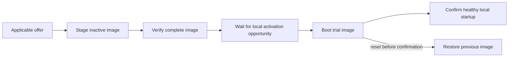

# Firmware updates

Status: Nordic local staging and trial/revert integration now have host checks
and [XIAO hardware validation](../src/port/nrf52840/tests/UPDATE.md#validation).
C6 storage/boot integration has host checks and
[hardware staging/trial/rollback/confirmation validation](../src/port/esp32c6/tests/UPDATE.md#validation).
Both ports share the common bounded image-storage code.
The optional `firmware-update` service now authenticates signed packages, receives
image ranges through ordinary peer forwarding, and resumes from durable page
checkpoints. Activation and confirmation are explicit local operations; autonomous
activation remains planned.
This plan follows the
[kernel direction](KERNEL_DIRECTION.md).

An update replaces a vertex's appliance/RTOS image. It is separate from installing
an automation's state references, predicates, and transformer calls. Firmware is
built for a particular target; ordinary program distribution does not require a
new machine-code image for each participating architecture.

## Ownership

| Owner | Responsibility |
| --- | --- |
| Common kernel | Accept an applicable image offer, transfer and resume it, verify it, choose when to activate, and confirm successful local startup |
| Platform port | Bound flash access to the update regions; provide erase/write/read, boot selection, trial status, confirmation, and reset |
| Bootloader | Recover interrupted installation, start the trial image, and restore the previous image after an unconfirmed trial |
| Appliance | Existing device initialization and physical behavior; indicate when physical work makes interruption inappropriate |
| Supplying peer | Serve the immutable package and its measured cost data through ordinary Lattice communication |

The tablet, nucleus, or another capable peer can supply a package. None is a
required update coordinator. Supported ports supply storage and boot integration;
each appliance author does not implement an updater, flash protocol, or radio
configuration. Trust in an image comes from a provisioned release key, independently
of which peer carries its bytes. Node-admission authentication remains separate.

## Package and timing

A fixed-format numeric package header binds the image length and digest to its
target/appliance family, board and boot layout, release version, compatibility
information, and signature. The signature covers these fields and the image
digest. Reject a wrong target, unsupported format, or oversized image before
erasing staging storage. A complete digest and signature check precedes trial
selection. The first implementation updates applications; bootloader replacement,
partition-table changes, and key rotation are separate operations.

The signed header also carries a small cost function measured during release dry
runs on that target. Use fixed-point coefficients and quantities, not executable
cost code. Record erase cost per page, programming and verification cost per byte,
and activation/startup cost, including any boot-time image swap. Include the
longest unavoidable service pause observed during staging. These are estimates
for planning, not a promise that every boot or flash operation meets that time.

Communication uses the existing directional `TimePerByte`:

```text
transfer service estimate = path cost × remaining transmitted payload bytes
local staging estimate   = erase cost × pages + write/verify cost × image bytes
activation outage        = measured boot selection/swap/startup cost
```

Count protocol envelopes as well as image data in the payload quantity. Account
for progress/control traffic using its own direction's cost. MAC retries are
already represented in the measured unit cost; do not multiply by a retry factor
again. There is no special bulk-transfer estimator. Unknown path cost stays
unknown. Summed service costs help compare paths and budget work; contention,
deferrals, and overlapping work prevent treating that sum as a guaranteed
completion timestamp.

## Image lifecycle



The current image remains available throughout transfer and verification. Keep one
candidate and bounded transfer storage per receiver, with no image-sized RAM
buffer or list of pending updates. A failed download or rejected candidate leaves
the current firmware running. A verified image can wait indefinitely for activation;
publication is an offer, not a reboot deadline.

Transfer image ranges sized to fit a complete Lattice frame, including its routing
envelope. Image identity and offset make each range independently checkable and
retransmittable. The receiver controls progress at its flash-write rate. Reuse
existing peer routing and addressed MAC ACK/retry; do not add a separate routing
layer or flood image contents through the network.

A MAC ACK establishes neither a flash write nor a durable checkpoint. Update
progress distinguishes bytes accepted this boot from a committed resume offset.
Checkpoint completed erase pages in a small recoverable flash record. After power
loss, erase and resend the incomplete page. Duplicates compare against accepted
data or return retained progress instead of blindly programming the same flash
word again. Resuming requires the same package identity; a different package must
start a new candidate. Whole-image verification still decides readiness.

Keep only bounded chunk/alignment storage and hash state in RAM. The port supplies
flash geometry; the common transfer path handles a final partial write without
crossing the reserved slot. Preserve identity, keys, and persistent appliance data
outside the image slots. Persistent-data changes must remain readable by the old
image during trial or wait until confirmation; firmware rollback cannot undo an
incompatible data migration or an already performed physical operation.

## Background work and activation

Serve ordinary changes, native calls, and relays ahead of update ranges. Yield
between bounded flash operations. A low-priority task alone does not guarantee
radio availability: internal-flash operations can stall instruction fetch or
interrupt handling. The port must expose the actual interruption behavior, and
the local update policy must defer work that cannot fit an available interval.

The receiver chooses activation from its local activity and known obligations.
Use the package's activation estimate to look for a suitable quiet interval;
recheck before committing the boot selection. Renewed activity defers activation.
The current kernel can observe local calls and traffic, but does not yet retain
installed timed obligations or predict future user changes. Initial behavior must
be honest about that limit rather than claim a globally idle network.

A returned native call or an unlocked appliance mutex does not mean a valve,
motor, or timed cycle has finished. Provide one small local way for the appliance
to hold activation while that physical work continues. Its default needs no
custom scheduling implementation. The kernel owns the hold, timing, and reboot
mechanics; the appliance supplies only the physical fact the kernel cannot infer.

Announce a proposed absence to maintained neighbors, defer while a neighbor is
updating, and stagger competing attempts with local backoff. This reduces
simultaneous disruption without a coordinator. Best-effort notices do not prove
that an alternate route exists or that a partition cannot occur. Protection of
unique bridges remains a later extension of maintained link information.

Trial confirmation checks local kernel, radio, storage, and appliance initialization.
It must not depend on a tablet, nucleus, or reachable neighbor being present.
An unconfirmed image must reset through a watchdog or explicit failure path so
the bootloader can revert; rollback does not run while a hung CPU simply remains
hung. After either boot, register actual appliance state through the ordinary
startup/change path. Do not replay uncertain native commands as update recovery.

## Handle compatibility

Current surface handles derive from local declaration addresses. A rebuild can
move them or reuse an old address for a different declaration. Clearing a tablet
cache does not prevent a delayed message from invoking that new declaration.

For the first unattended updates, require preserved exported handles and meanings,
compatible wire behavior, and rollback-compatible persistent data. Check these
against the previous release during packaging, not just with a developer-supplied
"compatible" flag. If that cannot be established, automatic activation waits for
an explicit rebind/invalidation mechanism that also rejects stale references at
the receiving vertex. The boot/staging milestone can use an empty appliance to
prove image handling before adding that mechanism. This limitation must not be
hidden inside the updater or mistaken for installed-program migration support.

## Port work

**nRF52840:** the [port boot crate](../src/port/nrf52840/boot/README.md) now integrates
`embassy-boot` 0.7.0 and provides the same bounded storage operations to the kernel
port. Its DFU region includes the extra erase page needed by the swap algorithm.
[Embassy boot documentation](https://docs.embassy.dev/embassy-boot/0.7.0/default/index.html)

The current [XIAO layout](../src/port/nrf52840/tests/memory-xiao.x) gives the
application `0x27000..0xED000`; it does not reserve a second image or boot-state
region. Update layout revision 2 reserves a 32 KiB loader, 4 KiB boot state, 372 KiB
active image, 376 KiB DFU region, and 8 KiB transfer journal inside that span. Two-step factory provisioning
keeps its CRC over the immutable loader only; the port rejects a CRC span covering
mutable regions. The factory recovery loader is retained. Provisioning, staging,
trial/revert, and confirmed reboot have run on the XIAO. The full-slot swap took
about 25 seconds through USB re-enumeration; physical interrupted-swap checks
remain separate from host fault injection.

The current Embassy NVMC driver writes four-byte words and erases 4 KiB pages
synchronously. Nordic documents flash-execution stalls and partial erase for
shortening individual stalls. Decide the staging operation size from that behavior;
do not run an entire image erase inside peer dispatch and assume interrupts keep
working. [Nordic NVMC reference](https://docs.nordicsemi.com/r/bundle/ps_nrf52840/page/nvmc.html)

**ESP32-C6:** the [port backend](../src/port/esp32c6/boot/README.md) now reads the
validated partition table and actual MMU mapping, and uses `esp-storage` for flash.
Its metadata decoder excludes corrupt and aborted records, preserves the running
image's record while selecting a trial, and confirms only the running image.
The convenience library's sequence-only OTA selector is not used after rollback.
The maintained test builds an ESP-IDF v5.5.4 loader with rollback enabled and two
1 MiB application slots. Host checks, builds, and the hardware lifecycle check pass.
First successful status after trial/rollback reset arrived in about 0.28 seconds,
including a 250 ms host wait; the loader selects the image in place.
This uses no ESP-IDF application scheduler or networking runtime.
[Espressif OTA documentation](https://docs.espressif.com/projects/esp-idf/en/release-v5.4/esp32c6/api-reference/system/ota.html)

One-time provisioning establishes the boot layout. Ordinary OTA packages operate
inside that layout and never rewrite its recovery loader or partition map.

## Implementation sequence

1. **Local image staging and recovery.** Establish the Nordic flash layout and boot
   integration, then its C6 equivalent. Use two small kernel images to demonstrate
   staging, trial, confirmation, and reversion, with a recoverable interrupted
   write/boot transition. Measure flash stalls and boot time. Keep maintained checks
   beside the ports and boot support beside the code that owns it.
   Nordic storage and the loader are implemented; the A/B USB fixture has run.
   Host checks cover bounds, confirmation/reversion, and interrupted swap/revert.
   Hardware staging, trial, confirmation, and reversion pass. Physical interrupted
   swaps and watchdog expiry remain open. C6 staging, trial, rollback, and
   confirmation have also run on hardware. Both ports now use
   [shared image storage](../src/kernel/update/storage/README.md).
2. **Common transfer and verification.** Add `kernel::update` for one candidate,
   package checks, durable progress, and port calls. Extend `kernel::peer` with the
   bounded update records and route them through existing forwarding. Prove a
   dropped or duplicated range and a restarted receiver resume without corrupting
   either image. Do not expose a remotely activatable unsigned update path as an
   ordinary kernel feature. This slice is implemented; the current mechanisms and
   explicit limits are described below.
3. **Autonomous activation.** Apply normalized route cost and measured local cost,
   appliance holds, neighbor notices, and local deferral. Integrate the small
   package-serving operation with the tablet peer; the MCU receiver owns its
   lifecycle. Add compatible-release packaging checks before unattended rollout.

Host checks cover the common state transitions and bounds. Hardware checks answer
the flash and boot questions on both ports. RF capture experiments remain in the
external lab; none becomes an updater dependency. Review this sequence and the
[implementation map](KERNEL_DIRECTION.md#implementation-map) as each slice lands.

## Implemented signed transfer

Enable `firmware-update` together with the selected port's `nrf52840-update` or
`esp32c6-update` feature. `kernel::start_with_updates` receives that port's storage
and a build-provisioned `update::package::Policy`, then starts the normal kernel.
The policy contains the trusted Ed25519 public key, platform, boot-layout revision,
appliance family, current release, and exposed-surface fingerprint. Startup checks
the fingerprint against the actual encoded appliance surface. A transmitting peer
cannot choose the receiver's key or compatibility policy.

The package is a 192-byte numeric header followed by the image:

| Byte range | Field |
| --- | --- |
| 0–7 | `LVUP`, format u16, platform u16 |
| 8–27 | Layout u32, appliance family 16 bytes |
| 28–59 | SHA-256 of the current/candidate exported surface |
| 60–71 | Release u64, image length u32 |
| 72–103 | Image SHA-256 |
| 104–127 | Six u32 local-cost coefficients, in the order listed above |
| 128–191 | Ed25519 signature over bytes 0–127 |

Integers are little-endian. Per-byte local costs are Q24.8 microseconds; other
coefficients are integer microseconds. `0xffffffff` means unknown. Package identity
is the first 16 bytes of SHA-256 over the complete signed header. Verification uses
`ed25519-dalek`'s strict verifier without allocation or precomputed-table features.
No flash mutation precedes signature, target, surface, size, and newer-release
checks. The image's complete hash and target vectors/header are checked before
readiness and again by local trial selection.

The shared wire crate defines Header, Prepare, Data, Finish, and Status requests.
Four independently acknowledged 48-byte header ranges assemble one offer. Each
Prepare advances at most one erase page, or commits the journal header. Data
carries at most 48 image bytes, its offset, and package identity. Its largest radio
frame is 124 bytes excluding FCS, inside the 125-byte MAC limit. Requests/replies
reuse the existing read-token/reverse-path records and learned routes; relays do
not retain package images. New radio opcodes 16/17 and attached-host opcodes 5/0x85
are additive to LVT v7/host v4. Older peers cannot relay these new records until
updated; receivers built without the update service return Unsupported.

Each port reserves an 8 KiB journal. A signed header becomes recoverable only when
its commit marker is written. Append-only offset/complement records checkpoint
complete 4 KiB pages or the final image length. A torn record is skipped, never
rewritten. Restart revalidates the signed header, erases the unfinished page and
remaining staging area, and returns the committed offset. The host can re-offer
the same package and continue there. Accepted bytes may exceed durable bytes.
The journal is consumed before trial selection so a reverted trial cannot be
silently reselected from retained download metadata.

The resident peer task owns the receiver and flash. There is no updater task,
allocator, image buffer, or new routing table. OTA-enabled builds reserve a fixed
24 KiB radio stack: a 16 KiB reservation overflowed on C6's remote signature path.
Both maintained OTA fixtures enable the existing kernel stack-overflow guard.
Ordinary builds retain their 8 KiB radio stack. The journal owns persistent transfer
progress; boot metadata separately owns trial/confirmation/reversion.

Local SelectTrial, Confirm, and Reset controls use the attached host only (host
opcodes 6/0x86), or the kernel's local activation/confirmation API. They have no
radio activation encoding. The initial fixtures intentionally require an explicit
local activation and confirmation. They do not automatically confirm an image just
because a remote transfer completed.

## Packaging and maintained checks

From the repository root, with Python `cryptography` and `pyserial` installed:

```sh
python tools/update_package.py keygen --key /PRIVATE/PATH/release-key
# Pass the printed PUBLIC key to either port's build, never the private seed.
export LATTICE_UPDATE_PUBLIC_KEY=PUBLIC_KEY_HEX
```

Both port build scripts accept `update.py prepare --ota`, placing artifacts in
that port's ignored `tests/target/ota`. Follow the port's provisioning procedure
with those artifacts. Nordic needs both factory DFU uploads; C6 additionally
provisions `journal-empty.bin` at `0x210000`. Revision 1 Nordic images used different
slot boundaries: provision the revision 2 loader/application together before OTA;
an ordinary package cannot migrate the layout. Preserve existing recovery loaders.

The empty-appliance fixtures use family `01010101010101010101010101010101`, layout
2, release A=1 and B=2. Their serialized surface is `LSF`, byte 1, byte 32, then
eight zero bytes. Keep that file beside the ignored generated artifacts.

```sh
python tools/update_package.py pack --image PORT/tests/target/ota/b.bin \
  --surface CURRENT_SURFACE --candidate-surface CANDIDATE_SURFACE \
  --key /PRIVATE/PATH/release-key --output PORT/tests/target/ota/b.lvup \
  --platform PLATFORM --layout 2 --release 2 \
  --appliance 01010101010101010101010101010101 --unmeasured
python tools/update_peer.py --port SOURCE_USB info
python tools/update_peer.py --port SOURCE_USB upload --owner RECEIVER_HEX PACKAGE
python tools/update_peer.py --port RECEIVER_USB info
python tools/update_peer.py --port RECEIVER_USB activate
# Reconnect after the trial starts, inspect release and local operation, then:
python tools/update_peer.py --port RECEIVER_USB confirm
python tools/update_peer.py --port RECEIVER_USB reset
```

Platform is 1 for Nordic, 2 for C6. `--stop-after BYTES` stops an upload without
selection, allowing reset/resume checks. The supplying computer streams through
its attached peer; the actual receiver gets the package over Lattice radio.
The tool retries immutable transfer requests with bounded attempts and preserves
package/offset identity. It never retries a native transformer invocation.

`--unmeasured` explicitly records unknown timing and is appropriate only for these
manually activated fixtures. Release packaging instead requires `--costs JSON`
with `erase_page_us`, `write_per_byte`, `verify_per_byte`, `activation_us`,
`swap_per_byte`, and `longest_pause_us`. It also requires byte-identical current and
candidate surface descriptions. The build/signing pipeline must supply authentic
surface dumps and the matching candidate release; the packager does not extract
or prove those properties from arbitrary machine code.

Remaining work: measured release costs and automatic deferral, appliance activity
holds, neighbor absence notices, watchdog trial expiry, stale-handle/rebind support,
and tablet package-serving integration. Page erases and full-image verification
are synchronous in this slice and can pause radio service. A completed transfer is
not evidence of uninterrupted background operation. Physical power cuts during an
individual flash write or swap remain distinct from reset/resume and host fault
injection. Release version checking is relative to the running firmware; it is not
hardware-enforced anti-rollback or secure boot.

## Signed OTA validation, 2026-10-18

The XIAO Nordic ending `D64C` and 8 MiB C6 ending `67:98` ran the maintained
empty-appliance OTA fixtures on their ordinary formed network. C6 TX stayed at
20 dBm; the laptop's Wi-Fi adapter was not used for the test.

| Transfer | Image bytes | Interrupted accepted / committed | After receiver reset | Final result |
| --- | ---: | ---: | ---: | --- |
| Nordic → C6 | 286,208 | 9,024 / 8,192 | 8,192 / 8,192 | Verified, locally selected, release 2 booted and confirmed, retained after reset |
| C6 → Nordic | 126,364 | 9,024 / 8,192 | 8,192 / 8,192 | Verified, locally selected, release 2 booted and confirmed, retained after reset |

The remaining radio transfers and final verification took approximately 93.5 s
and 41.8 s respectively, excluding preparation and activation. These are observed
fixture durations, not release cost coefficients. The Nordic also rejected a
modified signed header as Signature and a valid C6 package as Target before
preparing it. Local-reset resume is proven here; this run did not remove power
mid-write or interrupt a boot-time swap.

The initial C6 remote-offer run exposed a real 16 KiB task-stack overflow. Raw
USB exception capture localized it, and the kernel stack guard reproduced it.
The fixed 24 KiB reservation passed both complete transfers with guards enabled.
No RF settings were changed to mask that failure. This evidence checks the
exercised stack path, not every possible appliance's added call depth.

Portable checks cover rejection before flash mutation, durable versus accepted
progress, duplicate bytes without reprogramming, torn checkpoints, header-buffer
ownership, consumed-trial metadata, verification failure, cost arithmetic, routed
reply identity, and wire framing. The final run passed 95 kernel tests, 3 shared
wire tests, 8 port boot tests, and the shared diagnostic-console stream check.
Strict whole-kernel Clippy still encounters existing inherited-core/forwarding
lints; it is not a passing validation gate for this checkout.
