# Lattice vertex kernel direction

Build `lattice-vertex` as one RTOS kernel whose normal runtime makes an appliance
a participant in a Lattice network. This repository owns local execution, peer communication,
and the behavior shared by every vertex. Its FreeRTOS-derived machinery is the
execution core we extend and maintain as part of that kernel.

On supported hardware, adopting Lattice should require appliance definitions and
appliance-specific hardware behavior. Network setup, packet handling, discovery,
exposure, and change propagation are provided by the kernel and its platform port.

Nordic nRF52840 and ESP32-C6 are both hardware targets. C6 support is needed for
the Shelly devices as well as the existing prototypes. Keep each platform's
dependencies isolated and the common kernel's interfaces and protocol portable.

RF range/PHY investigation is parked after the tablet coprocessor proof and
bounded MAC ACK/retry implementation. Keep captures, diagnostic images, and
vendor comparisons in the external local lab.
Reproduce a concrete failure before changing radio behavior; successful delivery
checks do not establish RF range or explain earlier absolute RSSI measurements.

Read this plan alongside the
[architecture white paper](Lattice-DRTOS-Architecture-White-Paper.docx). This file
defines repository ownership and the implementation sequence. Existing interfaces
are provisional and must be brought into alignment with it. The
[current baseline](#current-baseline) identifies what is implemented today.

## Division of responsibility

| Owner | Supplies and controls |
| --- | --- |
| Appliance author | Native states and state-transforming operations; their IR definitions, axioms, and invariants; appliance-specific I/O and physical behavior |
| Common kernel | Boot and resident storage; local execution contexts; network configuration and discovery; surface enumeration and exposure; change messages; fragment installation and local dispatch; forwarding and relay participation |
| Platform port | MCU startup support, timer and interrupt integration, context switching, radio operation, and board-specific pins, clocks, antenna routing, and hardware limits |
| Nucleus | FSPS, proof, compilation, and delegation of the solved program to participating vertices |
| `lattice-ir` | Shared mathematical definitions used by appliance surfaces and nucleus |

The public appliance concepts remain `State` and `StateTransformer`. An appliance
exposes mutable state, native operations that transform it, and the mathematical
meaning and operating constraints of those operations. The kernel provides the
common behavior that makes that surface participate in Lattice.

Appliance-specific code establishes actual hardware state through the kernel's
state interface. The kernel handles the resulting delta. Native command success
alone does not establish the physical post-state described by an IR effect.
Axioms and invariants are part of the exposed mathematical surface and must remain
available to the FSPS.

For a supported platform, we supply the radio integration. A developer adding an
unsupported MCU, radio, or board may need to implement a port. Every appliance
using that port should then reuse it. Hardware resources and wiring belong at
this boundary; network policy does not become a requirement for each appliance.

The ordinary appliance startup API must not ask the author to select a PAN ID,
channel, radio address, formation/join role, or implement a networking loop. The
kernel owns those decisions and operations. Any installation selection or
credentials needed for commissioning belong to the common Lattice mechanism.

The first installation is vertices plus a tablet running a daemon peer. It needs
surface reads, native control, registered state changes, and limited manually
authored automation. Nucleus adds synthesis/compilation later; the tablet currently
supplies intent IR when nucleus is present. Learned surface models, observation
nodes, and executable capability challenges belong to later tiers and are not
requirements for this basic installation.

## Local participation produces the distributed kernel

Each vertex encapsulates its appliance, retains its assigned relationships and
compiled fragments, and responds to local changes or received messages. Those
local responses collectively produce the distributed operating system.

A node's common kernel behavior includes:

- Enumerating and exposing states, transformers, axioms, and invariants.
- Broadcasting state changes and passing activation upstream through its resident
  state dependencies.
- Evaluating its assigned compiled conditional and forwarding the continuation.
- Invoking a reached native state transformer with the supplied arguments.
- Forwarding peer messages and participating in relay when required.

No individual node conducts a walk over the entire distributed graph. Nucleus is
an installation and compilation peer; ordinary execution does not require it to
relay or approve each operation. Communication is peer to peer, without a required
router role or permanent central runtime coordinator.

Change is the unit of execution. Handle changes and messages as they arrive.
Separately registered deltas remain distinct; a later change does not silently
withdraw earlier work. There is no graph work queue, periodic graph evaluation
cycle, or extra graph scheduler. Existing RTOS tasks and synchronization provide
local execution facilities, including overlapping work where needed. Local timers
remain available for hardware and communication needs.

Task notifications signal that work or transport data is available. They do not
replace the data describing distinct changes. Notification coalescing must not
silently become coalescing of graph activations. Transport buffering and delivery
mechanics must preserve the distinction between transmission, peer receipt, and
execution; the kernel must not invent repeated transformer invocations.

## Mathematical definitions and native execution

`lattice-ir` defines mathematical state, transformations, constraints, and the
information nucleus needs for reasoning. Firmware can retain those definitions
as static data and expose them through the common kernel.

Nucleus solves and compiles programs, then delegates their fragments. For the
basic installation, the tablet can compile the user's graph directly without an
FSPS. The initial program is a finite DAG of state references, predicates/basic
arithmetic, native transformer handles and arguments, and continuation references.
Compilation binds those steps to participating vertices; it need not emit new
machine code for each architecture. The vertex supplies the small execution
primitives. Neither the shared IR crate nor the vertex kernel needs an IR
interpreter, compiler, or solver. Preserve the current one-invocation-per-requirement
synthesis limit; expanding it does not imply a general-purpose program runtime.

State dependencies and transformer invocation have different roles. Upstream
activation belongs to states used by conditions. A transformer is an invocation
endpoint, never a Boolean-condition dependency. Changes produced by its hardware
operation propagate through the affected states. A transformer's return value is
not a replacement for state-change messaging.

## One kernel runtime

The kernel's public startup path accepts the appliance definitions and the selected
platform's resources. It owns initialization of the node's resident structures,
required static execution contexts, and communication behavior, then starts the
existing RTOS scheduler. The appliance author should not assemble these pieces
into an independent runtime.

Use the mechanisms already present in the inherited core:

| Existing mechanism | Integration work |
| --- | --- |
| [Scheduler startup](../src/kernel/tasks.rs), including idle and optional timer tasks | Establish the Lattice system-task and storage setup in the same kernel startup path |
| [Static task creation](../src/sync/task.rs) and [allocation configuration](../src/config.rs) | Supply fixed stacks and control blocks for kernel-owned execution |
| Task notifications and ISR wakeups in [tasks.rs](../src/kernel/tasks.rs) | Connect radio and other relevant hardware events to local kernel handlers |
| [Port selection and primitives](../src/port/mod.rs) | Provide target-correct timer, interrupt, and context-switch integration |
| Existing synchronization and bounded buffers | Reuse them where the concrete execution or transport path needs them |

The startup sequence must establish storage and interrupt targets before a device
can signal them. The platform port and kernel jointly control when interrupts and
local execution become active. Radio callbacks must enter a valid kernel context;
appliance code must not have to reproduce this sequencing.

Radio reception and transmission completion use existing task notifications.
The selected driver is created inside the kernel's resident radio task, after the
scheduler has valid task storage. Driver futures register a waker for that task;
when pending, the task blocks on a notification. The IRQ wakes it to resume the
same operation. There is no additional executor task or graph work queue.

Once formation completes, every successful transmission gives neighbors a receive
turn before another transmission. Pending local deltas cannot immediately cancel
that turn. It ends with the first valid frame or a bounded deadline sized for one
maximum 250-kbit/s frame plus radio turnaround and tick rounding (six ticks at
1 kHz). CRC failures can consume the remaining window without ending it early.
If hardware has already started a frame when local work or a timeout requests
interruption, a separately bounded completion interval lets that frame finish.
A stuck hardware indication still times out. Nordic reports actual PHY length
reception; C6 reports its existing MAC RX state.
Captured bytes enter four fixed receive records and pass through the ordinary
MAC/peer validation on the next receive call. Oldest eviction is explicit under
buffer pressure. Formation keeps its existing rendezvous windows.

This addresses the reproduced collision between a producer's next delta and a
neighbor's rebroadcast of the preceding one. It also preserves immediate replies
received before the transmitting peer returns to normal dispatch. The bounded
receive opportunity remains separate from link acknowledgement. Addressed frames
request a 2006 immediate ACK. The resident task makes at most four attempts,
retaining identical bytes and MAC sequence, with randomized bounded backoff.
Broadcasts remain single transmissions. A missing ACK reports uncertain link
delivery; an already-issued read/call remains pending for its normal reply deadline.
It never originates a new native invocation or changes its request token. A CCA
failure after an earlier unacknowledged transmission remains uncertain. A frame
already arriving at the ACK deadline gets the same bounded completion grace as
ordinary receive, preserving responses that overlap a lost ACK.

`radio::mac` owns that bounded policy and eight recent sender/sequence records.
Duplicate addressed frames are acknowledged again by the port but delivered only
once while the sender record remains resident and younger than 200 ms. Records
expire, evict oldest, and clear on channel configuration. The existing bounded
native-call history still protects reconverging routes; neither mechanism is a
persistent exactly-once guarantee across eviction or reboot.

C6 uses hardware ACK TX/RX with an 864-us ACK timeout. Nordic receives through
its port IRQ and uses hardware TIFS (192 us) for immediate ACK transmission;
Embassy retains chip initialization and CCA/data TX. The common task rounds the
Nordic ACK receive deadline to kernel ticks (up to two ticks at 1 kHz), bounded
separately from an entire transmit attempt. Unrelated frames heard during an ACK
wait or retry backoff enter the existing four-frame receive ring. Cancellation
stops DMA before reusing its storage. All of this stays below appliance firmware.

`kernel::Appliance::new(&SURFACE)` reserves the native instance's static storage
and RTOS mutex. Firmware initializes it once before scheduler startup, then passes
that binding to `kernel::start(context, radio_peripheral, &APPLIANCE)`. Hardware
report tasks use `APPLIANCE.with` and the existing state-update primitives. The
kernel owns both synchronization with incoming native calls and delta transport;
appliance code supplies its actual device behavior and observations.

Startup owns the static radio stack/control block and starts the existing scheduler.
The resident transport owns its selected driver and task waker, then runs
`kernel::peer` on the same task. It surveys/selects a channel, discovers peers,
serves borrowed description ranges and current-state reads, forwards compact
arrival/owner messages, invokes exposed native transformers, and propagates
registered state changes.
Responses establish bounded owner directions; every vertex runs the same behavior,
without an enumeration administrator or foreign-surface catalog.

Invocation success records the native function's return, not physical convergence.
The kernel publishes actual observations later as reported. Remote calls return
`Busy` if the native instance is already in use. No automatic mutation retries,
IR evaluation, or graph work queue is introduced. Authentication and installed
compiled fragments remain separate work. The
[native invocation path](../src/kernel/peer/INVOCATION.md) documents the exact
frame, observation, replay, and storage semantics.

Hardware tests opt into `test-support` to observe the ordinary path or replace
its handler with a supplied RF-probe workload. Both use the same resident task,
transport operations, and notification waits. The entry and observer callbacks
are excluded from ordinary builds and are not an appliance networking API.

## Repository organization

Organize the repository around these responsibilities as runtime integration is
implemented:

| Area | Responsibility |
| --- | --- |
| `src/kernel/` | The complete kernel: startup, task machinery, resident state and change handling, and common peer participation |
| `src/kernel/appliance.rs` | Static native-instance ownership, existing RTOS mutex, and typed dispatch against exposed handles |
| `src/kernel/change.rs` | Pending registered observation deltas in one fixed transport ring |
| `src/kernel/peer/` | Formation/discovery, surface reads, native invocation, delta forwarding, and portable wire encoding |
| `src/port/` | Architecture, MCU, and radio-specific implementation and board integration |
| `src/sync/` | Safe access to existing kernel synchronization facilities |
| `src/memory/` | Kernel memory support and storage mechanisms |
| `src/lib.rs` | Public entry point and exports |
| `examples/` | Small, self-contained examples of the public state/surface APIs |
| `src/kernel/radio/tests/` | Reusable transport probe and passive counters for ordinary peer discovery |
| `src/port/{esp32c6,nrf52840}/tests/` | Board test entry points and logging |

The inherited host/QEMU tests and `xtask` runner remain reusable kernel checks.
MCU test firmware lives in each port's `tests/` directory, and the shared transport
workload lives in `src/kernel/radio/tests/`. These are separately built crates
with their own entry points and linker setup, not ordinary kernel dependencies.
Board-specific upload layouts and fixture logging stay there because they make
kernel checks reproducible on supported hardware.

One-off experiments live outside the repository. Local `experiments/` and `lab/`
paths are ignored and excluded from Cargo packages as a backstop; neither should
be added to Git. Vendor comparison firmware, register assays, receive-only RF
captures, room/range diaries, and private appliance integration prototypes are
not permanent kernel tests or feature-gated kernel APIs. Their source must be
preserved in the lab before removal. Generic examples and tests depend only on
the kernel and shared IR, not diffuser/radio application repositories. Runtime,
maintained tests, and build instructions must be usable without the local lab.

The kernel must never depend on the test workload crate. The board fixtures depend
on both the kernel and `lattice-radio-test`. Only the gated transport entry and
event callbacks remain in `src/kernel/radio/testing.rs`; all probe definitions,
cadence, reply logic, and counter storage live under `src/kernel/radio/tests/`.
The callbacks observe waits, ISR wakeups, buffer evictions, and available RX
signal/abort metadata without introducing
counter storage or callback dispatch into ordinary builds. Local `#[cfg(test)]`
unit tests may stay beside the implementation they test.

The Nordic CPU port is [`src/port/nrf52840.rs`](../src/port/nrf52840.rs). It uses
`embassy-nrf` 0.11.0 for chip initialization and reuses the existing Cortex-M4F
task/FPU context switching, SysTick, and critical sections. It retains the kernel
exception bindings, supplies the fixed 64 MHz clock, and defines the kernel's
interrupt priority boundary for Nordic's three implemented priority bits.
Appliance code does not supply clock constants or scheduler vector bindings.
It requires neither ESP code nor an Embassy executor/time driver.

The ESP32-C6 CPU port is
[`src/port/esp32c6.rs`](../src/port/esp32c6.rs), with the register save/restore
routine beside it in `src/port/esp32c6/context.S`. It uses `esp-hal` 1.1.2 for
reset/startup, interrupt routing, and SYSTIMER. Software interrupt 0 performs
deferred context switches through the existing task scheduler. It does not bring
in the `esp-rtos` scheduler. The generic CLINT port remains a separate target;
both now use a compatible `riscv-rt` 0.16 dependency generation.

The [Nordic radio port](../src/port/nrf52840/radio.rs) consumes
`embassy-nrf`'s initialization and CCA/transmit driver. Its
[`radio/receive.rs`](../src/port/nrf52840/radio/receive.rs) owns aligned RX storage
and immediate ACK turnaround in the RADIO IRQ. Register-level energy detection
shares that IRQ because the HAL does not expose it. The port also
restores the nRF52840 CCA correlation threshold/count after the HAL's whole-register
mode write clears them; this is port initialization, not appliance policy.
The [C6 radio port](../src/port/esp32c6/radio/mod.rs)
uses extracted `esp-radio` MAC/register/clock code, with upstream attribution
and its MIT license retained. It uses `esp-phy` for PHY initialization. Both
ports supply fixed frame storage and interrupt-driven operations to the same
kernel task. Neither requires an allocator or a vendor task scheduler.

The current top-level surface and observation code must be integrated into
these responsibilities. Preserve useful typed definitions and checks while
reworking ownership and call paths. File moves should accompany that work. The
FreeRTOS-derived source remains maintained kernel code, with its attribution and
license preserved; its origin does not make its current organization immutable.

A function should live with the data or operation it owns. Extend an existing
kernel facility when it already owns the responsibility. New modules and types
must correspond to concrete behavior or storage, not merely provide a place to
put otherwise unassigned code.

## Radio and network ownership

IEEE 802.15.4 is the initial radio basis. The common protocol must remain portable
across supported radios. Chip-specific dependencies such as `esp-radio` belong
inside the corresponding platform integration. They do not define the appliance
API or the network protocol.

The common kernel and hardware-test crate use `ieee802154` for MAC framing, with
extended source addresses derived from factory identifiers. The standard codec
is shared as a dependency; diagnostic payloads and the probe workload remain
outside ordinary kernel builds.
Hardware libraries still need chip-specific integration; the kernel supplies that
integration for supported platforms. The implementation effort should concentrate
on Lattice's common behavior above frame I/O.

PAN coordination, channel selection, peer discovery, addressing, and participation
are kernel responsibilities. The radio port applies the kernel's settings within
hardware limits. Appliance startup receives no public PAN/channel/address
configuration record
and requires no transceiver implementation. The provisional `Transceiver` and
`Config` API has been removed; chip differences stay in the selected port.

The test workload selects channel 15 and broadcast PAN 0xffff and sends frames
without MAC ACK requests. Those test settings and the entire probe/reply workload
live under `src/kernel/radio/tests/`. `radio-probe` is a board-fixture feature that
includes that crate and the kernel's `test-support` entry. It is no longer a kernel
feature. Ordinary kernel startup has no diagnostic probe parser, responder,
cadence, or statistics.

Common startup now searches channels 11–26 before choosing one. `peer::bootstrap`
performs two surveys, each measuring 4,096 us of peak energy per channel, sending
a discovery request, and listening for 60–90 ms. An established resident's
presence takes precedence over founding a network, even when its channel is
noisier than a local alternative. Only if no resident answers does the node
propose the channel with the lowest worst observed energy. Failed measurements
never count as a quiet channel. The survey uses 32 bytes of fixed local storage.

Startup delay, scan order, channel ties, and transmit timing are decorrelated by
an address/tick-seeded PRNG; it is not a source of security randomness. Formation
has no designated physical channel. Candidates compute a jump/stay sequence:
51 visits using a nonzero stride modulo 17, then 17 visits on their preferred
channel. Each local interval is 40 ms. The stride comes from that preference;
equal preferences give a common stay channel and different preferences give
different strides. Each round advances the sequence start. The virtual extra
channel maps back to the preferred channel. No sequence table or clock
synchronization is required, and these intervals are only radio-discovery timing.

Candidates advertise their best proposal on the channel they currently visit.
A broadcast proposal solicits a directed reply: existing residents answer with
presence, and candidates answer with their preferred proposal. A directed proposal
that agrees with the receiver's choice allows it to settle immediately. Directed
responses never echo. Without agreement, formation runs three rounds (nominally
8.16 seconds) and retains the best proposal heard. The founding-address/channel
order breaks proposal ties. A proposal can name a channel other than the one
carrying it; resident presence must match the receive channel. There is no
fallback control channel. Lost frames, clock drift, and partitions still limit
convergence; reconciling established networks remains separate work.

Each resident retains the founding address and selected channel and can advertise
both. The founder has no permanent coordinator role. The record is currently
volatile: reboot searches again, and an existing resident can supply the original
record even when the founder is absent. Established nodes stay on their selected
channel; coordinated migration in response to later interference is not yet
implemented. Active discovery lets a newcomer find a resident without waiting
for its periodic announcement.

PAN `0x4c56` remains a common discovery filter, not an allocated PAN or membership
credential. The network tag distinguishes advertised networks; startup currently
adopts the first established network it hears. Choosing between independently
owned deployments and authorizing operations are not decided by that tag or PAN.
The `LVT` version-7 envelope carries discovery, proposals, surface reads, native
calls/results, and deltas; it rejects earlier wire versions. Ordinary discovery still
repeats every 2–3 seconds after selection. Presence never causes an echo. Broadcast discovery/proposals do not request ACKs;
directed presence/proposal responses use the common MAC ACK path. No peer table, appliance formation/join knob,
graph work queue, or repeated transformer invocation is introduced.

The board fixture's `peer-observer` feature observes this normal path. It supplies
an authored test surface, registers a passive event callback, and reports counters;
it supplies no radio settings, message generator, or handler. Both C6 and Nordic
use the same common discovery and [surface reads](../src/kernel/peer/EXPOSURE.md).
Arrival and periodic link discovery do not transmit complete mathematical definitions.
Arrival notices can cross eight links. One owner-discovery round after joining
finds preexisting owners; matching owner replies follow recorded reverse paths.
Later periodic discovery stays link-local, and arrivals do not trigger new searches.
An interested peer requests a range from a named owner. The owner encodes that
range from immutable IR without invoking native readers/transformers. Intermediates
forward borrowed frames and retain only request paths and learned directions.
Consumer-side reconstruction/caching, content-based definition sharing,
authorization, and installed-fragment delivery remain open. A received definition grants
no permission to install or mutate.

C6 TX remains fixed at 20 dBm, and Nordic uses its supported 8 dBm. Keep the
retained PHY timing, PAN/ED-mask, clock, and Nordic CCA corrections in the ports;
these are driver behavior, not experimental workload. Provenance belongs beside
the driver. Detailed RF measurements and vendor comparison programs stay outside
the repository. Ordinary and observed images use the same receive operations;
test instrumentation must not install an alternative radio configuration.

The survey timings and discovery encoding are provisional common-kernel decisions.
Deployment selection, authorization, and installed-fragment encodings remain open.
Discovery works before Lattice assigns any short radio address. PAN IDs and radio
addresses remain transport data, not substitutes for graph relationships or proof
of network membership.

Configuration and packet adaptation must stay below the appliance boundary. The
same appliance definition should work on another supported platform without a
new networking implementation. Platform-specific capabilities or limitations
should be handled by that port and the common kernel policy.

## Maintained peer links and progressive discovery

Every vertex is responsible for maintaining a bounded set of reciprocal peer
links when neighbors are available. Joining includes establishing relationships
that both participants retain; an announcement alone does not establish a link.
The kernel owns admission, confirmation, refresh, expiry, and rediscovery. A
solitary vertex can operate locally and continue looking for neighbors.

These maintained links are distinct from learned destination paths. Links describe
which adjacent participants are available for forwarding and traversal. Destination
paths describe preferred or alternative directions toward a farther owner. Both
are communication relationships; neither is an installed executable edge or a
copy of another appliance's surface. The intended relay behavior combines this
local network memory with cost-based selection and bounded redundant delivery.
Multiple next hops do not automatically imply independent end-to-end paths.

Link enumeration is a standard kernel protocol operation, `ReadLinks`. Its numeric
format is shared by all participants and requires no appliance IR definition or
firmware callback. A tablet or other peer starts with one reachable vertex,
enumerates its maintained links, and follows references outward. It can read the
encountered owner's surface or current state when useful. The consumer retains
its own visited set; there is no mandatory global inventory or compulsory
whole-network state report on arrival.

A discovered handle must retain a usable direction through the vertex that
provided it. Traversal therefore needs an explicit way to approach a newly named
neighbor through that already-reachable vertex. A successfully returned read can
teach the ordinary destination path used by later surface reads and commands.
The walk remains bounded by transport scope and may observe topology changes;
it is not an atomic census or evidence that an unreachable vertex ceased to exist.

**Implementation status:** maintained peer links, standard `ReadLinks`, and guided
traversal through an advertising vertex now run in the common peer task. The
[link protocol](../src/kernel/peer/LINKS.md) defines admission/refresh, enumeration,
and the route hint. Host tests exercise a chained walk followed by a surface read;
both MCU ports build. Destination records now retain two next-hop candidates,
ranked by normalized directional delivery cost. Addressed invocations can split
once into two copies; adaptive probability/coverage scoring remains subsequent work.

## Forwarding learned from communication

Use directed diffusion as the design basis for common peer delivery: explore
when a necessary direction is unknown, retain local incoming/next-hop relationships,
and let successful communication establish useful paths. The founding vertex,
tablet, and nucleus have no exclusive forwarding role. Surface availability,
arrival dissemination, relay participation, and repair should reuse this machinery.
Definitions remain owned by appliances; interested peers may retain disposable
copies. Content identifiers and shared mathematical definitions are a subsequent
extension, not an implemented global registry or predefined appliance vocabulary.

A semantic relationship names the state/transformer owner that must participate.
A communication path can add relay vertices without adding predicates or changing
that target. Duplicate transport copies and distinct registered changes are
separate things. Neither routing nor duplicate suppression may merge independent
deltas or invent additional transformer invocations. A cached mathematical
surface cannot stand in for its owner's physical state or execute its operation.

`peer::forwarding` carries bounded surface and current-state reads to an owner,
exploring by broadcast when no confirmed next hop is available. Each
relay retains the first incoming neighbor for that request. A matching reply
returns through those records and installs a direction toward the owner. Later
reads use that direction. Local TX failure, unanswered-read expiry, and stale
route expiry restore exploration for subsequent requests. No automatic read retry
or graph work queue is added; the consumer owns any retry with a fresh read token.

Owner discovery now shares that forwarding component and route cache. A compact
arrival carries the original owner, description length, sequence, and distance;
relays preserve that origin while replacing the immediate MAC sender. A separate
owner query retains its first incoming neighbor. Each reached vertex replies
with its own address/description length and relays the query within its remaining
scope. Multiple owners' responses can follow the same return path. Correlated
replies can teach alternate directions; an unsolicited announcement alone does not.

The runtime announces itself and maintains local relationships after joining.
There is no automatic owner search. `FindOwners` remains an explicit bounded search operation; it is not
a compulsory startup census. An incoming arrival does not trigger surface transfer.
Interested peers progressively follow maintained links and fetch only the data they
need. Ordinary vertices retain no complete owner list.

The current fixed forwarder budget is three cached owners with two directions each,
eight recent paths
shared by surface, current-state, and link reads, four owner-query return paths,
eight recent owner notices, four call paths, and eight delta duplicate keys. Eight
adjacent-peer records are maintained separately from destination paths, inside a
combined compile-time 2,304-byte ceiling. All return
paths and duplicate keys expire after 10 seconds;
confirmed routes after 60 seconds without another matching response. Path/history
storage evicts its oldest record; the adjacent-peer records reject new admissions
when full and expire unconfirmed/unrefreshed entries rather than evict healthy links. Eviction can lose a response or shorten duplicate
suppression; hop limits remain necessary. Neither these paths nor a TX completion prove native execution. The limits are explicit starting capacities.

Host checks cover arrival propagation, cyclic/duplicate paths, several owners
replying to one query, and discovering then reading an owner through two relays.
Discovery remains best-effort and scoped: no response proves complete network
membership, and a missing response does not prove absence. Startup tokens use
local ticks, not durable boot identities; rapid restart or token reuse can collide
with retained history until it expires. Fresh-query attempts recover independently.

The current selector ranks normalized directional time per delivered payload byte,
then hop count/address for ties, and retains an alternate direction. Unknown
costs remain explicit and rank after measured paths. Adaptive broadcast coverage,
energy/probability objectives, and coordinated protection of unique bridges remain
open. Arrival, owner discovery,
reads, calls/results, and deltas are bounded to eight links. Channel survey/formation remains local and
requires an existing radio neighbor; forwarding requires the same selected network
and channel. Partition merging and coordinated channel migration remain separate.

Native invocation now reuses this direction/reverse-path mechanism. The owner
matches an exposed handle and invokes its native adapter. Four call paths retain
exact arguments and returned results; eight owner records replay an identical
call's status without invoking again. Reused caller/request with different content
is rejected. This replay is bounded by eviction/reboot and is not an exactly-once
ledger. Unlike immutable read attempts, uncertain mutations must not be retried
with fresh tokens. There are no automatic command retries. Installed executable
fragments and their activation ABI remain future work.

A registered observation emits a compact owner/attribute/sequence/value delta.
The kernel preserves distinct changes, including unavailable state, and relays
accepted messages within the same scope with recent duplicate suppression.
Receiving another appliance's delta never overwrites local state. No global state
mirror, periodic state polling, or learned model is introduced.

An interested peer can read one exposed current value from its owner without
waiting for a change. The owner matches the attribute, reads it under the existing
appliance mutex, and includes the latest registered change sequence in the reply.
Busy, unknown attribute, and unavailable observation are distinct. The read does
not emit a delta or invoke dependents. It reuses the surface-read path budget and
token namespace; there is no periodic poller or foreign-state mirror. A consumer
can compare that attribute's read watermark against later deltas within a boot;
this is not an atomic multi-attribute snapshot or a reboot ordering mechanism.

### Marginal communication cost

Communication cost is normalized per unit of delivered information. The shared
`lattice-peer-wire::cost::TimePerByte` represents microseconds per acknowledged
MAC payload byte, in unsigned Q24.8 fixed point. Both MCU ports use the same
meaning, independent of CPU clock. `ratio` compares two known costs;
`estimate_us(quantity)` applies any byte quantity to the same value. Ten bytes
and ten thousand bytes do not select different models. Energy is not silently
mixed into the time unit.

The resident transport measures each addressed send from its first attempt
through its successful receive turn or exhausted attempts. This includes MAC
header/FCS airtime, ACK waits, retry backoff, and the mandatory receive opportunity;
the denominator counts the acknowledged payload once, excluding MAC header/FCS.
Failed sends add service time and zero acknowledged bytes. Remote application
execution and idle time between sends are not measured. The first implementation
uses the kernel tick clock (1 ms on the supported ports), so these are quantized
service estimates, not fine-resolution PHY timestamps or hard deadlines.

Eight existing neighbor records own the measurements. Samples are aged by halving
the accumulated evidence after roughly 4 KiB of acknowledged payload; 60 seconds
without new samples makes the cost unknown. Four transient samples hand timing
results from the radio task's sends to those records. No sample history array,
allocator, network-wide cost table, or separate task is introduced. Frame overhead
is amortized over the observed packet-size mix; changes in that mix or contention
change the estimate as new observations arrive. A consumer counts the actual MAC
payload bytes its operation will transmit, including its protocol envelopes.

An owner's reply starts with zero remaining path cost. Each relay adds its own
outgoing-link cost toward the replying neighbor and advertises that sum on the
reverse reply. The recipient adds its own outgoing link to that suffix. Reverse
link cost and request/reply processing latency are not substituted for forward
cost. Route records retain the suffix separately, allowing fresh first-hop
measurements to change ranking without copying or rediscovering the entire path.
This is an additive serialized service estimate; overlapping transmissions or
future traffic cannot be inferred as a guaranteed wall-clock completion time.

Unknown is encoded as `0xffffffff`, not zero. Zero denotes an empty/local path.
Unknown components or arithmetic overflow leave the estimate unknown. Known
paths rank by their normalized cost, including when a longer route is cheaper
than a direct link. Hop limits still bound traversal. Link enumeration exposes
both the normalized outgoing cost and the existing round-trip diagnostic; RTT
is no longer the routing objective.

These quantities are available for updater planning, but no OTA service or updater
scheduler is implemented by this change. Firmware-local flash/verification/boot
costs remain distinct from communication time.

### Alternate directions and bounded redundant invocation

Each cached owner retains up to two learned next-hop candidates. Selection
uses composed directional time per payload byte, then hop count and address
for equal costs. Unknown estimates follow known estimates. These are local
observations, not a global optimum or an independent delivery probability. Failures withdraw the
specific direction; they must not erase a successful alternate for the same owner.
Candidates come from correlated exchanges and guided traversal. Until an alternate
is learned, the owner has only one known direction; no background path-probing
workload is introduced.

An addressed invocation can carry a budget for two copies. A relay with two
eligible directions splits once and passes one-copy budgets onward. A route with
only one candidate carries the unused split budget farther. Broadcast exploration
consumes that budget: it already reaches several neighbors and must not authorize
another directed split at every recipient. The existing hop bound still applies.

Copies preserve caller/request, transformer, and exact arguments. Reconverging
copies retain up to two incoming directions and share downstream work; matching
results can return through both. Owner dispatch uses the existing bounded result
history. This adds transport redundancy, not an automatic retry of native work;
it does not extend duplicate guarantees past history eviction or reboot.

This is implemented in the common forwarder and validated with encoded host
exchanges, including a lost branch and reconvergence before/after a result.
Reconverging copies join return paths only when their remaining scope is at least
that of the first copy; this prevents downstream echoes becoming upstream paths.
Later longer branches are not retained at the convergence point. Delta/arrival
dissemination remains the existing bounded broadcast behavior; adaptive coverage
is separate. LVT v7 packs the invocation copy budget into its existing control
byte and rejects older wire versions.

## Attached tablet host

The tablet and its attached nRF use one resident network identity. The new optional
`host-link` feature adds one fixed local request/response exchange and eight
pending change records, without USB code in the common kernel or a new radio
configuration API. The Linux client and
maintained XIAO attachment firmware live in `lattice-tablet`. Ordinary appliance
builds do not include this feature. Its operations now include status, link/surface/state reads, and native calls.
The Linux client can inspect a complete LSF description and consume its exposed
references. Registered local changes and accepted, deduplicated remote deltas
stream to an attached host without state polling. Ready replies have priority over
loss notices and pending changes; overflow evicts the oldest event and reports the
count. Disconnect clears this event buffer. It is not a retained state mirror or
a graph work queue. Slint presentation and continuous daemon operation remain
subsequent work.

Local read and call origins share the existing return-path budgets and route
learning. Local native requests use the same appliance binding and result replay
as radio requests; success is not a physical observation. Typed scalar encoding is
shared in `peer/wire`, with no radio-wire or IR-language change.
Disconnect invalidates host completions while peer participation continues. Radio read tokens persist across host reconnects. Native call identities use the
host token sequence seeded from OS entropy, with bounded/volatile replay protection.
A timeout produces a failure without retransmitting; for a mutation, its outcome
remains unconfirmed until observed. Periodic maintenance now sends either a link
exchange or discovery in one iteration, leaving reception available for the reply
instead of immediately transmitting a second solicitation.

## Structured memory and resident relationships

Use fixed, structured memory for Lattice's node machinery. Keep a state, its
dependent relationships, and their upstream references together. One-to-many
relationships must be represented directly and compactly. Each node retains the
local data needed to encapsulate its appliance and participate in its installed
programs.

Local references may be direct memory references or native function handles.
Cross-peer references identify the owning peer and the relevant location there;
remote addresses are never dereferenced as local memory. The wire encoding is an
implementation choice, not a reason to introduce an ECS, copied world model,
global object registry, auto-incremented entity IDs, or relational edge tables.

Use static task/control storage and bounded communication buffers. Fixed rings
with explicit eviction are transport storage, not a graph-job queue. Choose packing,
layout, and hardware offload against the target's actual memory and latency needs.
The radio task has a fixed 8 KiB stack and a static task control block. Nordic
uses the HAL's caller-owned TX packet, a 128-byte RX buffer, and a four-byte ACK buffer. C6 has an aligned static DMA buffer and
four fixed receive entries, evicting the oldest frame on overflow. The common
transport separately owns four raw-frame records for captures made while a send
call gives the neighbors their receive turn; those bytes have left the port's DMA
or ISR storage but have not yet reached peer dispatch. Test builds
report evictions to fixture-owned counters. Transmit storage remains owned by the driver until completion.
No transport buffer is used as storage for queued graph activations.

The native binding owns one existing static RTOS mutex/control block and the
actual appliance value. `kernel::change` retains eight pending delta records,
evicting oldest on overflow with a counter. Grouped observations register every
changed value before dependent callbacks run, so newer callback changes cannot
precede an older sibling delta. Notifications wake the resident radio task without
merging those records; receive waits become interruptible after formation. Owner
invocation history has a 768-byte compile-time ceiling. No allocator is enabled
by either MCU port. Loss, eviction, and reboot do not imply automatic recovery.

## Firmware updates

The [updater plan](FIRMWARE_UPDATES.md) applies the same normalized communication
cost to image transfer and uses package-supplied dry-run measurements for flash
work and activation downtime. The receiver stages and verifies an inactive image,
then chooses a local activation opportunity. The port and bootloader own trial,
confirmation, and recovery. Any capable peer can supply the package; neither the
tablet nor nucleus is a required update coordinator.

The Nordic local storage/boot slice is implemented with host checks and a passing
XIAO USB/RTOS staging, trial, confirmation, and reversion check. Its port and separately
linked loader share one flash layout and the Embassy swap/revert implementation.
C6 boot integration and test images now have host/build checks, with physical
validation pending. Both ports use `kernel/update/storage` for bounded chunk
staging and digest verification. Common OTA transfer, package authorization, and
autonomous activation remain planned.
Current surface-handle compatibility and flash execution stalls are explicit
implementation constraints. Firmware replacement remains separate from installing
an automation's references, conditions, and native calls.

## Implementation map

This is the working responsibility map used by the
[post-change review](../AGENTS.md#review-after-each-meaningful-change). Solid arrows
show existing relationships. Dashed boxes and arrows show the integration to
build. The map represents code ownership and local execution, not an executable
DAG. Update the status of these connections as implementation replaces the gaps.

```mermaid
flowchart TB
    appliance["Appliance state and native operations"]
    surface["Existing State / StateTransformer and surface definitions"]
    ir["lattice-ir mathematical definitions"]
    startup["kernel::start: static radio task and scheduler startup"]
    binding["kernel::Appliance: static native instance, surface, RTOS mutex"]
    observation["StateHandle / observation: register actual changes, dispatch local dependents"]
    state["kernel::change: bounded outgoing deltas"]
    invocation["peer::invocation: native dispatch and bounded result replay"]
    peers["Authorization and installed compiled-fragment dispatch: to build"]
    discovery["kernel::peer: channel survey, computed rendezvous, arrival and message dispatch"]
    exposure["peer::exposure: borrowed local IR and bounded range encoding"]
    links["peer::links: maintained adjacent peers, confirmation, refresh and cursor enumeration"]
    forwarding["peer::forwarding: bounded dissemination, return paths, normalized-cost directions, one invocation split"]
    radio["Nordic/C6 radio ports: fixed buffers, energy/CCA, immediate ACK, RX progress, hardware IRQs"]
    transport["kernel::radio: resident driver, notification waits and receive turns"]
    cost["wire::cost: time per byte; radio::cost: bounded measurement handoff"]
    update["Common update service: transfer, package authorization and local activation: to build"]
    imagestorage["kernel/update/storage: bounded staging, duplicates, padding and digest"]
    flash["Nordic update port: bounded image staging and trial/confirm operations"]
    boot["Nordic boot crate: shared flash layout and Embassy swap/revert loader"]
    c6update["C6 update port: actual running slot, flash, OTA record selection and confirmation"]
    c6boot["ESP-IDF second-stage loader: trial and rollback; hardware check pending"]
    mac["radio::mac: ACK matching, four attempts, backoff, eight recent senders"]
    rxbuffer["radio::receive: four owned frames captured before peer dispatch"]
    probe["src/kernel/radio/tests: transport probe, discovery counters and surface-range observer"]
    testentry["test-support only: scoped transport access and event hooks"]
    tasks["Existing RTOS tasks, notifications, synchronization, static storage"]
    cpu["CPU ports: Nordic nRF52840, ESP32-C6, and generic targets"]
    cortex["Shared Cortex-M4F task/FPU context, SysTick, and critical sections"]
    nordic["embassy-nrf chip initialization"]
    hal["esp-hal startup, timers, and interrupt routing: C6 only"]
    smoke["Nordic and C6 test firmware beside their ports"]
    usbconsole["Nordic fixture only: USB diagnostics and XIAO serial-DFU entry"]
    hostlink["Optional kernel::host: fixed exchange, read/call origins, bounded change delivery"]
    hostwire["peer/wire: shared scalar codec and optional host records"]
    tabletradio["lattice-tablet firmware: XIAO USB and host task"]
    tabletpeer["lattice-tablet peer: Linux serial client"]
    sync["Existing safe synchronization API"]

    surface -->|native access| appliance
    surface -->|mathematical descriptions| ir
    surface -->|static reference supplied at startup| exposure
    sync -->|uses| tasks
    tasks -->|context switching and timer setup| cpu
    cpu -->|ticks and ISR wakeups| tasks
    cpu -->|nRF52840 reuses| cortex
    cpu -->|Nordic hardware support| nordic
    cpu -->|C6 hardware support| hal
    smoke -->|initializes selected chip resources| cpu
    smoke -->|creates static tasks and starts scheduler| tasks
    smoke -->|radio-probe or peer-observer feature includes| probe
    smoke -->|optional USB console feature| usbconsole
    usbconsole -->|low-priority reporter uses existing task API| tasks
    usbconsole -->|USB peripheral driver| nordic
    tabletradio <-->|requests, completions and pushed changes| hostlink
    tabletradio -->|USB peripheral driver| nordic
    tabletpeer <-->|USB stream| tabletradio
    tabletpeer -->|codec| hostwire
    hostlink -->|codec and records| hostwire
    discovery -->|shared scalar/status encoding| hostwire
    exposure -->|shared typed literals| hostwire
    hostlink -->|wake resident task| transport
    discovery -->|service requests and publish registered or accepted changes| hostlink
    hostlink -->|originate and complete reads and calls| forwarding
    probe -->|installs transport workload or observes peers and surface ranges| testentry
    testentry -->|uses normal task and scheduler startup| startup
    testentry -->|passes resident transport to workload| transport
    transport -->|test builds emit events to fixture callback| testentry
    discovery -->|test builds emit events to fixture callback| testentry
    appliance -->|static surface and native instance| binding
    binding -->|existing mutex synchronization| sync
    binding -->|supplied with board resources| startup
    startup -->|binds exact native instance| state
    surface -->|typed updates and explicit changes| observation
    observation -->|registered deltas before local callbacks| state
    discovery -->|validated native call at owner| invocation
    discovery -->|owner reads exposed current state under mutex| binding
    binding -->|samples change watermark while holding mutex| state
    invocation -->|typed adapter under mutex| binding
    state -->|notifies resident radio task| transport
    discovery -->|drains pending deltas| state
    startup -->|creates static radio task| tasks
    startup -->|creates resident transport| transport
    startup -->|checks and borrows local description| exposure
    transport -->|retains frames captured after TX| rxbuffer
    rxbuffer -->|FIFO delivery through normal receive| transport
    transport -->|measures send service and acknowledged bytes| cost
    cost -->|samples retained with adjacent peers| links
    links -->|directional unit cost| forwarding
    forwarding -->|suffix cost in correlated replies| cost
    discovery -.->|update records through existing forwarding| update
    update -.->|same path cost times transfer quantity| cost
    update -.->|bounded background work in existing execution contexts| tasks
    update -.->|bounded storage operations and boot selection| flash
    update -.->|C6 equivalent| c6update
    flash -->|shared image layout and persistent boot-state implementation| boot
    flash -->|inactive image chunks| imagestorage
    c6update -->|inactive image chunks| imagestorage
    c6update -->|ESP-IDF OTA records| c6boot
    c6boot -->|selected image starts normal kernel| startup
    boot -->|selected image starts normal kernel| startup
    smoke -->|USB update fixture exercises real storage| flash
    smoke -->|C6 USB update fixture exercises real storage| c6update
    transport -->|bounded link delivery and duplicate filtering| mac
    radio -->|ACK frame recognition| mac
    transport -->|owns selected driver| radio
    transport -->|ordinary resident task runs| discovery
    discovery -->|local exchanges, maintenance, and validated peer messages| forwarding
    forwarding -->|retains neighbors, enumerates and follows advertised links| links
    links -->|expired neighbors invalidate directions| forwarding
    forwarding -->|owner encodes requested range| exposure
    forwarding -->|bounded dissemination, selected invocation copies, and reverse replies| transport
    discovery -->|surveys energy, selects channel, exchanges frames through| transport
    transport -->|receives and transmits frames| radio
    transport -->|blocks on notifications while hardware works| tasks
    peers -.->|compiled activations depend on local state| observation
    peers -.->|invokes reached transformer| binding
    peers -.->|runs in kernel execution contexts| tasks
    peers -.->|configures and exchanges frames| transport
    radio -->|IRQ waker notifies resident task| tasks

    classDef planned stroke-dasharray: 5 5;
    class peers,update planned;
```

## Current baseline

The inherited task/list/queue/timer/event/stream implementations remain the
execution core. Both MCU ports have static kernel-owned radio task startup,
interrupt wakeups, channel survey/formation, and common peer handling. Neither
port requires an allocator, appliance-owned network loop, or separate executor.
The standalone CPU smoke checks exercise static task startup, critical sections,
IRQ wakeups, preemption, and register preservation; they have build validation,
not a claimed hardware pass.

Nordic uses the shared Cortex-M4F task/FPU port, SysTick at 1 kHz, the 64 MHz CPU,
and the required 32 MHz radio crystal. C6 uses its RV32IMAC task context, 2 KiB
minimum task/idle stacks, and a separate 2 KiB context-switch stack. Radio drivers
are initialized inside the resident task after scheduler storage is established.
The separate XIAO fixture can preserve its stock bootloader and provide USB
logging/upload entry; those are fixture facilities, not kernel requirements.

Prior board bring-up exercised discovery and formation on C6, and Nordic/C6 peer
exchange through the kernel. RF quality remains unresolved and the range/PHY
investigation is parked. Historical captures used older wire revisions and live
in the external lab; they do not establish current protocol delivery or general loss-free operation.

The current LVT v7 path has host tests and both MCU builds: borrowed surface range
reads, maintained adjacent links and guided traversal, bounded relay directions,
native appliance binding,
owner-directed invocation/results, current-state reads, and registered observation
deltas. Tests cover argument/reference rejection, retained command replay, actual observation timing,
and grouped-delta ordering. Kernel task/protocol behavior remains in common source;
portable codecs, fixture counters, and hardware logging live in separate test crates.

Authentication, tablet UI integration, installed compiled fragments, and
their distributed activation remain open. Nordic local staging and boot recovery
have host and XIAO hardware validation. C6 local staging/metadata has host/build
validation; its hardware lifecycle check is pending. OTA transport and activation policy remain planned in
[the updater design](FIRMWARE_UPDATES.md). Local dependents are immediate native
callbacks, not an installed distributed DAG. The earlier LVT v6/host v3 Linux/tablet USB companion path
has exercised native calls, state reads and pushed deltas on Nordic hardware;
this does not establish physical appliance behavior or loss-free RF. The v7/v4
cost exchange has host and build checks; a coordinated firmware/client rollout
and live cost measurements remain separate from those checks.

## Next implementation sequence

Maintained reciprocal links, built-in `ReadLinks`, and guided traversal are now
implemented using the existing read return paths and resident task. Cost-ranked
alternate directions and a bounded invocation split now preserve message identity
through independent and reconverging paths. A Linux host client and XIAO USB
attachment now originate local/remote link,
surface, and state reads plus native calls through that runtime; registered changes
now stream through USB without host polling. The shared local codec and optional kernel host endpoint are
[documented beside their owner](../src/kernel/peer/host/README.md). Tablet UI/service
integration, broader hardware validation, and adaptive delivery/coverage policy
remain open. Native duplicate
history is bounded and volatile; this is not an exactly-once ledger.

1. **Establish the integrated boot path across Nordic and ESP.** Provide
   the timer, interrupt, and context-switch integration needed by the existing scheduler. Establish the
   kernel's resident storage and required static task setup. Connect radio events
   to a kernel-owned execution context. Completion means the flashed image runs
   our scheduler and the hardware event path reaches our kernel, with no separate
   appliance-owned radio loop.
   Both CPU/radio ports, fixed buffering, and kernel-owned radio task/startup
   are implemented. The C6 pair has completed the hardware receive → wakeup →
   reply run using the separated test workload; the Nordic radio fixture now
   runs ordinary discovery alongside C6. The fixture supplies diagnostic traffic and settings through a
   test-only entry on the real kernel transport. Native appliance-instance binding
   and state-change handling now have separate host checks; the prior task captures
   do not validate them.
   Rendezvous/discovery and relay-assisted surface reads now run through ordinary
   kernel startup. Forwarding/control behavior has host/build validation. A Linux host has now exercised one-hop links, complete surface reads, registered
   state reads, and native control on two Nordic boards using a software appliance.
   This does not validate multi-hop radio delivery or physical appliance completion.
2. **Implement automatic peer participation.** Put radio configuration, bootstrap,
   discovery, and surface-exposure handling in the common kernel. Use the provided
   platform port to perform the hardware operations. Completion means two appliance
   implementations can enter the network and expose their surfaces through the
   same kernel behavior, without choosing PANs or writing packet handlers.
   Channel survey/formation, directed discovery, reciprocal link maintenance,
   `ReadLinks`, and guided traversal are implemented. Owner-directed surface reads, bounded exploration, reverse replies, and learned
   directions are implemented. Compact arrivals and owner discovery now cross relays
   using the same route cache. Consumer integration, adaptive relay selection,
   and authorization remain open. Surface descriptions
   do not establish physical appliance state or permission to mutate it.
3. **Complete the state-change communication path.** An appliance establishes a
   state change; the kernel detects/registers the delta, emits the required peer
   message, and the receiving kernel performs its prescribed local handling.
   Completion means this path works through the common runtime, with the examples
   reduced to appliance definitions and physical I/O.
   Native binding, owner-directed calls/results, registered observation capture,
   scoped delta forwarding, and on-demand current-state reads are implemented and
   checked on the host. The attached-host path now delivers accepted deltas with
   bounded buffering and explicit local-loss notices. Both MCU images build. The
   tablet daemon and installed conditional activation remain open.

The immediate next work is physical validation of the built C6
[firmware staging and trial-boot recovery](FIRMWARE_UPDATES.md#implementation-sequence) path.
Common transfer policy then reuses the kernel's measured unit costs and existing
peer communication. Nordic watchdog expiry and physical interrupted-swap checks
remain distinct from the completed explicit-reset trial/confirm/revert path.

Extend the working control path into compiled-fragment installation, conditional
activation, and their forwarding semantics. Native transformer invocation is now
available independently of fragment installation. Keep upstream state
activation distinct from downstream execution. Nucleus supplies compiled work;
its full implementation is not a prerequisite to building the node's common
mechanics. Relay optimization and storage tuning follow concrete implementation
needs rather than displacing these first runtime steps.

## Development approach

Build in useful increments, compile as we go, and learn from concrete failures.
Use focused checks for actual invariants: frame encoding, static-storage bounds,
interrupt-to-task handoff, and the end-to-end behavior just added. Reuse existing
kernel tests. QEMU and physical boards are tools for specific questions, not
prerequisites to every small change or grounds for an exhaustive simulation gate.

Keep compile success, scheduler execution, packet exchange, and physical appliance
behavior as separate evidence. A radio probe or host test does not prove the full
kernel is running on a target. Supported-platform progress should make appliance
examples smaller and remove custom networking work from them.

After each meaningful change, review names, ownership, and the implementation map.
Check for duplicated storage or behavior, confused domain terms, and abstractions
without a concrete responsibility. Let the code's developing responsibilities
refine the organization. Keep this document focused on the direction and next
working kernel behavior. Retain useful build instructions with the supported
ports and tests; temporary investigation material must not become a permanent
part of the kernel source tree.
