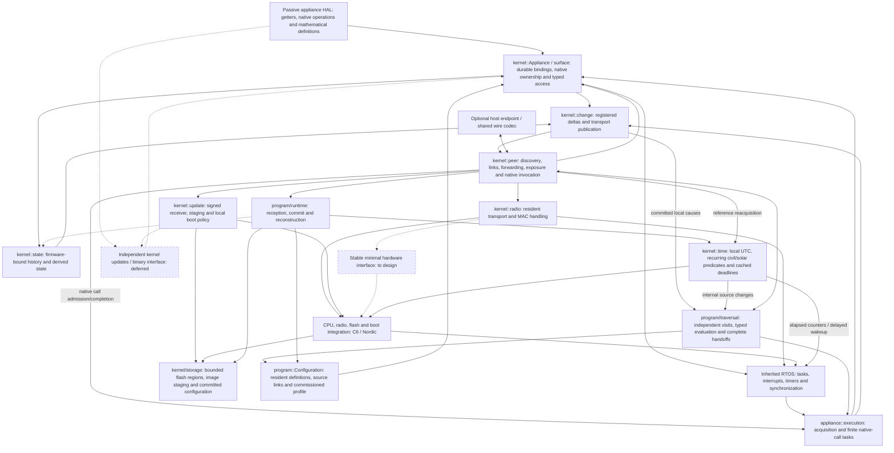

# Lattice vertex implementation direction

Read [ARCHITECTURE.md](ARCHITECTURE.md) for the system model and
[AGENTS.md](../AGENTS.md) for development discipline. This file records the code's
current responsibilities, gaps and next work. It is not a second specification,
protocol manual, test diary or history of completed milestones.

## Current baseline

| Area | Implemented behavior | Current boundary |
| --- | --- | --- |
| RTOS core and CPU ports | Existing task, interrupt, timer and synchronization facilities; C6 and Nordic startup | Reuse this foundation; appliance authors do not reimplement it |
| State and native operations | Passive shared HAL, kernel getter acquisition, observed-value cache, registered deltas and history maintenance | Fallback sampling is implemented; direct device-event acquisition bindings remain optional port work |
| Native call execution | Static FreeRTOS call tasks, asynchronous RF/USB completion, pending-call deduplication and update holds | Execution capacity is bounded; caller/route timeouts do not cancel a call or guarantee late result delivery |
| Durable appliance bindings | Named declarations become owner-local numeric references; native lookup/deltas and LSF v2 use them; duplicate bindings are rejected | Loader reconstruction uses these references; changed physical meanings/types remain compatibility changes |
| Resident programs | Durable installation/enablement, upstream activation, typed local evaluation, receiver-reserved handoffs and asynchronous native invocation; C6/Nordic live execution and reset reconstruction checked | Native and temporal execution are live checked with software-backed surfaces; externally installed retained-state operations remain absent |
| Time and solar | Commissioned UTC anchor, persistent coordinates/recurring civil rules, local deadline sources and peer reacquisition | C6/Nordic deadline execution and peer reacquisition live checked; no backed RTC/GPS adapter or clock consensus |
| Protected configuration storage | Both ports reserve 16 KiB; one kernel flash owner serves program storage and optional signed updates | Layout 3 requires coordinated provisioning; host checks do not establish physical power-loss recovery |
| Retained state | Static native-width history, native updater, mathematical enumeration and ordinary reads/deltas | Firmware-bound before startup; not externally authored program storage |
| Communication | Kernel-owned 802.15.4 framing, formation, maintained links, owner-directed forwarding and bounded MAC delivery | Concrete C6/Nordic backends; portable public hardware interface still missing |
| Surface and native access | Read surfaces/current state, invoke native functions, forward observations | Program activation has separate bounded storage; outward observation publication remains lossy |
| Host participation | Optional USB companion endpoint and shared numeric codec | Host clients live in `lattice-tools`; tablet consumes that library |
| Firmware updates | Signed whole-image staging, durable resume, local deferral, startup confirmation and watchdog recovery | Combined-image replacement is accepted for now; independent kernel updates are deferred |

The callback-based `Fragment` prototype and its private packet queue are removed.
Its source and runs are preserved in the external lab. They established callback
and operand transport, not installation of previously unknown automations.

The firmware-local `observation::Dependent`/report API and its callback example
have been removed and archived. The native updater accepted by
`Appliance::install_state` remains a pre-start history helper, not the compiler's
program interface. Resident records now install through the common peer service.
Native-state programs can now be enabled and executed after installation.

## Implementation map

Solid edges are implemented relationships; dashed edges are planned integration.
This is a responsibility map, not the executable DAG of a particular automation.
Protocol details and internal updater phases belong in their component notes.

## Next implementation milestone

The [resident program component](../src/kernel/program/README.md) now executes
installed native-state definitions: committed observations activate upstream,
enabled heads admit independent forward visits, primitive records select branches
and calculate values, and native calls run in the existing RTOS tasks. Head
admission changes commit before becoming effective. Accepted visits retain their
storage under pressure; remote Busy produces retry, and local activation overflow
is separately reported.

Host checks exercise installed records across two execution owners, including
backward activation, conditional forwarding, independent causes, native invocation,
partial handoffs, duplicate receipts and bounded storage. The two-board check has
now installed definitions after boot, forwarded a computed argument, verified both
predicate branches and backward activation, captured resulting deltas, and restored
the enabled program after resetting both MCUs. It used software-backed dimmer
surfaces, not physical light output. Evidence belongs to the program component.

Commissioned UTC/location/timezone context and local deadline-driven time/solar
predicates are now integrated. A 32-byte recurring profile is retained in the same
configuration image without moving program references; UTC validity is reacquired
after reboot. The ordinary peer service supplies configuration and reference
messages. Installed temporal records register independent sources at their owner,
and their deadlines feed the existing upstream path. Jarvis solar/date mathematics
is reused without its entity graph or host timezone database.

The live C6/Nordic check installed a temporal fragment after boot, exercised both
civil-window boundaries through upstream traversal, and checked a calculated sunset
using a deliberately shifted test UTC anchor. After Nordic reset, UTC was initially
unavailable and then reacquired from C6 without host anchoring. Existing definition
bytes/references survived the LPG v2-to-v3 migration. The fixture uses software-backed
states; it does not establish physical appliance behavior or astronomical accuracy.
The [time component](../src/kernel/time/README.md#validation) records the evidence.

The host `lattice-tools` clock commands currently need a local wire override until
this vertex revision is published and its dependency pin advances. No Wi-Fi location
lookup or GPS device driver has been added.

Externally installed retained-state maintenance remains the next execution
extension. The [remaining program design](PROGRAM_DESIGN.md) identifies it.
Replacement, delete/reclamation, head relocation and revision cutover remain
separate lifecycle work; occupied definition extents are not reused.

Reboot recovery currently initiates upstream activations from restored source
bindings. Multiple returning participants can re-evaluate the same program;
coordinated outage reconciliation is explicitly deferred. Receiver reservations
and receipt retention prevent a repeated handoff from becoming a fresh invocation;
loss of that evidence produces an uncertain outcome, not automatic replay.

One physical flash owner supports configuration and signed updates. Startup commits
a fresh receiver incarnation before execution. Trial confirmation first requires
read-only reconstruction; the checkpoint waits until confirmation permits writes. It
also upgrades LPG v1/v2 metadata without moving definitions or changing their references.
Builds and host checks do not establish physical power-loss behavior.

## Deferred work

Independent kernel OTA remains slated after functional program installation and
execution. It must eventually preserve an existing appliance binary through a
stable binary interface. It is not a prerequisite for the current kernel work or
for preserving local configuration through combined-image updates.

## Component references and evidence

| Owner | Documentation |
| --- | --- |
| Peer formation and maintained discovery checks | [peer/TESTING.md](../src/kernel/peer/TESTING.md) |
| Adjacent links and guided traversal | [peer/LINKS.md](../src/kernel/peer/LINKS.md) |
| Mathematical surface encoding/read path | [peer/EXPOSURE.md](../src/kernel/peer/EXPOSURE.md) |
| Native calls, current-state reads and delta propagation | [peer/INVOCATION.md](../src/kernel/peer/INVOCATION.md) |
| Numeric wire types and marginal communication cost | [peer/wire/README.md](../src/kernel/peer/wire/README.md) |
| Host attachment | [peer/host/README.md](../src/kernel/peer/host/README.md) |
| Image transfer and activation | [FIRMWARE_UPDATES.md](FIRMWARE_UPDATES.md) |
| Local time, solar and commissioning | [time/README.md](../src/kernel/time/README.md) |
| Resident records and program installation | [program/README.md](../src/kernel/program/README.md) |
| Flash regions and committed configuration | [storage/README.md](../src/kernel/storage/README.md) |
| Build/upload and maintained hardware checks | [port/TESTING.md](../src/port/TESTING.md) |

Both MCU targets have kernel/peer builds and selected hardware evidence for native
calls, observed state and update lifecycle behavior. Those checks do not establish
all multi-hop paths, physical appliance convergence
or loss-free RF. Test commands and their scope belong beside the owners above.
RF range/PHY investigation remains parked; historical captures and pre-cleanup
source snapshots are archived outside the repository.
