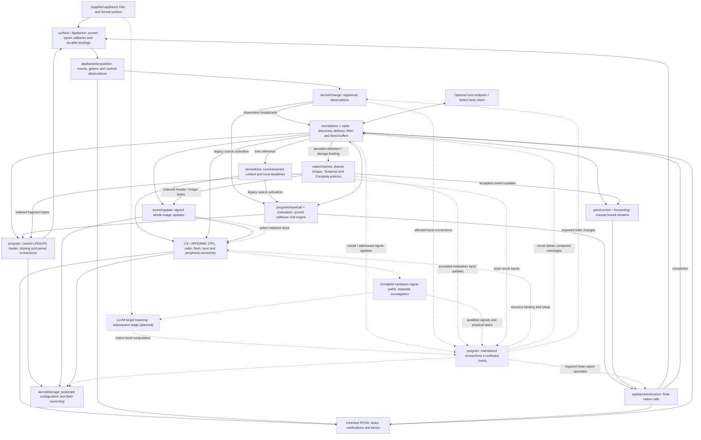

# Lattice vertex implementation direction

[ARCHITECTURE.md](ARCHITECTURE.md) owns intended semantics,
[PROGRAM_DESIGN.md](PROGRAM_DESIGN.md) owns the circuit migration plan,
and [AGENTS.md](../AGENTS.md) owns development discipline. This file is the current
implementation map and work order, not another protocol specification or run diary.

## Current baseline

**The next implementation is maintained activation and signal state in software
on nRF52840 and ESP32-C6, followed by LLVM lowering to native machine code on both
targets.** The current code still executes binary operation records through
upstream activation and forward visits. Hardware selection/offload investigation
continues separately and is not a prerequisite for this migration. These are
planned changes, not capabilities established by the existing software tests.

| Area | Current implementation | Boundary / next use |
| --- | --- | --- |
| RTOS and CPU ports | FreeRTOS-derived tasks, interrupts, timers and synchronization on C6/Nordic | Reuse; no new general process environment |
| Appliance surface | Durable named bindings, typed getters/native operations, IR meanings and invariants | Getter callbacks do not describe an allocatable physical circuit |
| Acquisition | Per-state event, interval and call-boundary acquisition into a software observation cache | IRQ wakeups are proven; direct physical state/component realization is not |
| Program installation | Protected persistence, validation, local computation sharing, paired connections, removal and reconstruction | Reuse ownership; current LPD/LPG artifacts describe the software visit engine |
| Program execution | Read/Test/Branch/arithmetic dispatch, temporary visit operands, upstream/forward delivery and native-call tasks | Replace visits with maintained connections first; replace local record dispatch with LLVM-generated native code afterward |
| Time/solar | Commissioned UTC/location/civil rules, calculated boundaries, deadline events and peer reacquisition | Reuse local sources; current notifications still activate the old traversal path |
| Peer/radio | Formation, discovery, adjacency, addressed forwarding, MAC ACK/retry and protected receive queues | Reuse; new circuit-update identity/baseline semantics remain to specify |
| Observation delivery | Best-effort exposed-value broadcasts plus separate addressed evaluation/execution messages | Consolidate Unique + Temporal acceptance before retaining activation context |
| Receive policies | Shared Channel<Definition, Policies, Storage>; control/state-notice freshness and indexed program/firmware reception | Retained evaluation inputs will use the same channel when visits are replaced; relay-notice storage remains bounded |
| Manual continuous control | Pinned paths, compact argument messages, latest-target preparation and feedback | Reuse where applicable; its coalescing policy is not automatically circuit policy |
| Native execution | Finite RTOS call tasks, admission/completion, update holds and duplicate handling | Running calls finish; hardware tasks should implement suitable physical actions |
| Storage and updates | One flash owner, protected configuration, signed whole-image OTA, boot confirmation/recovery | Preserve configuration and recovery while changing the execution representation |
| Host and retained state | Optional USB attachment; firmware-bound history helper | USB is not an ordinary appliance requirement; automation-authored history stays deferred |
| Hardware circuit backend | Not implemented on either chipset | Separate investigation of complete signal paths, including RF; isolated predicate offload is not end-to-end proof |

Current C6/Nordic evidence covers the software engine, shared-fragment reclamation,
time reacquisition, interrupt-driven acquisition, compact manual control and OTA.
The radio fixes also passed back-to-back native calls and reads in both directions.
These runs used software-backed appliance states; they do not prove a physical
circuit backend, arbitrary RF delivery, or hard response-time bounds. Evidence and
maintained procedures belong beside their components.

Incoming legacy LPD fragments remain capped at **512 bytes**; the current resident
arena is **8 KiB**. These are implementation limits, not per-circuit allocations or
a selected layout for the new backend. Staged component installation for a genuinely
larger fragment is still deferred. The removed callback-fragment prototype remains
archived outside the repository and must not become a substitute for compiled circuits.

## Implementation map

Solid arrows are current relationships. Dashed arrows are planned relationships.
Native target lowering is the stage after maintained software connections and
occurs **before activation**. Compiler packaging and the native artifact/call ABI
remain to specify. Existing module names identify ownership, not a commitment to
retain the old representation.

The planned signal path replaces upstream/forward visits. Existing local arithmetic
may be reused during that explicit first migration stage; it is not the final
execution backend. LLVM-generated computation then replaces record dispatch while
retaining connection ownership and signal propagation. Kernel code owns installation,
resources and network behavior. The appliance gains no evaluator, message construction
or firmware main loop. Existing predicate/branch/mutation meaning stays unchanged.

## Next implementation milestone

**Retain activation/value context so existing evaluation can resume locally on
both ports, using the shared channel admission machinery.** Follow
[the implementation sequence](PROGRAM_DESIGN.md#implementation-sequence).

Logical channels now apply Unique + Temporal to control targets and the bounded
state-notice cache, and Unique + Complete to program fragments and firmware data.
The definition supplies already-decoded metadata; existing owners keep payload
storage, integrity/signature verification and activation. The evaluation/execution
visit path has not yet been migrated. Its retained input channels must live with
the installed bindings, independently of the expiring relay-notice cache.

Each addressed connection retains its established incoming activation and required
typed inputs, plus the output it has produced. A local appliance/time change or
accepted incoming update recomputes that connection directly. Changed outputs
propagate downstream, including low; unrelated connections and shared users remain
independent. Predicate expressions, AND/OR decisions and native mutation calls
retain their existing meanings; this is a change to activation and propagation.

Incoming activation initializes LOW. Retained adjacent activation/values live in
RAM and are not restored from before reboot. Only a true, enabled head originates
initial HIGH; a false head leaves the default LOW unchanged. Downstream vertices
require upstream HIGH before propagating. There is no forced neighbor-state
announcement; addressed acceptance/retry handling owns delivery.

Reuse protected installation, native bindings, source/deadline notifications,
addressed delivery and finite native-call tasks. Evaluation/execution messages
are updates; installing a program fragment is a complete-object transfer. Keep
those policies distinct within the same channel mechanism.
Retained signal bytes must be budgeted from installed definitions; do not multiply
the old 4 KiB visit arena or reserve 512 bytes for every connection.

This first stage retains activation between reliably delivered deltas, without
periodic continuity traffic. No old test automation is live; do not build a legacy
compatibility runtime or redesign evaluation on that account. Preserve unrelated
appliance/time configuration and existing authored actions. The following stage lowers
local computation through LLVM for Thumb and RV32 while preserving the same signal
and invocation behavior. Hardware investigation does not block these two stages.

## Boundaries of this work

- The inherited RTOS, reliable MAC handling, protected storage, OTA and normal peer
  discovery remain useful. No new scheduler, transport stack or radio tuning is implied.
- Software-maintained activation is the immediate target; CPU-independent sustained
  continuity is a separate hardware goal. Do not claim the former proves the latter.
- The prior upstream recovery evaluations and visit draining remain current-code
  behavior only. Maintained signals need initial-input reconciliation and their own
  explicit output/cutover rules.
- The old getter fallback remains documented as implemented; it is not the intended
  mandatory route for every physical signal in the new backend.
- Manual continuous-control coalescing remains explicit. A duplicate circuit update
  and a distinct accepted target transition are different things.
- Tickless completion, hardware cryptography and experimental RF-range work are
  separate priorities. C6 TX remains 20 dBm; never scan the laptop Wi-Fi.
- Optional USB debugging/host-companion support is not production appliance work.
  Measure the actual release role when reporting RAM, image or CPU costs.

## Shelly testing: next boot/storage work

The selected direction is a [locally retained, selectable stock backup](FIRMWARE_UPDATES.md#selectable-shelly-stock-backup-planned).
Boot selection and protected placement are not implemented. Inspect one Shelly's
complete stock image and flash map before changing the C6 backend's two-slot layout.
The Wi-Fi recovery-image proposal is deferred.

## Deferred work

An end-to-end heartbeat while a circuit is active follows the software activation
migration. Until then, retained HIGH can outlive an isolated upstream failure.
The present shared-power bench tolerates that limitation; no heartbeat timer or
forced neighbor-state recovery is introduced by the channel-policy change.

Independent kernel OTA remains slated after functional program installation and
execution. It must eventually preserve an existing appliance binary through a
stable binary interface. It is not a prerequisite for the current kernel work or
for preserving local configuration through combined-image updates.

## Component references and evidence

| Owner | Documentation |
| --- | --- |
| Peer formation and maintained discovery checks | [peer/TESTING.md](../src/kernel/peer/TESTING.md) |
| Adjacent links and guided traversal | [peer/LINKS.md](../src/kernel/peer/LINKS.md) |
| Mathematical surface encoding/read path | [peer/EXPOSURE.md](../src/kernel/peer/EXPOSURE.md) |
| Native calls, current-state reads and delta propagation | [peer/INVOCATION.md](../src/kernel/peer/INVOCATION.md) |
| Numeric wire types and marginal communication cost | [peer/wire/README.md](../src/kernel/peer/wire/README.md) |
| Continuous scalar intent and feedback | [control/README.md](../src/kernel/peer/control/README.md) |
| Host attachment | [peer/host/README.md](../src/kernel/peer/host/README.md) |
| Image transfer and activation | [FIRMWARE_UPDATES.md](FIRMWARE_UPDATES.md) |
| Local time, solar and commissioning | [time/README.md](../src/kernel/time/README.md) |
| Resident records and program installation | [program/README.md](../src/kernel/program/README.md) |
| Flash regions and committed configuration | [storage/README.md](../src/kernel/storage/README.md) |
| Build/upload and maintained hardware checks | [port/TESTING.md](../src/port/TESTING.md) |

Both MCU targets have kernel/peer builds and selected hardware evidence for native
calls, observed state and update lifecycle behavior. Those checks do not establish
all multi-hop paths, physical appliance convergence
or loss-free RF. Test commands and their scope belong beside the owners above.
RF range/PHY investigation remains parked; historical captures and pre-cleanup
source snapshots are archived outside the repository.
