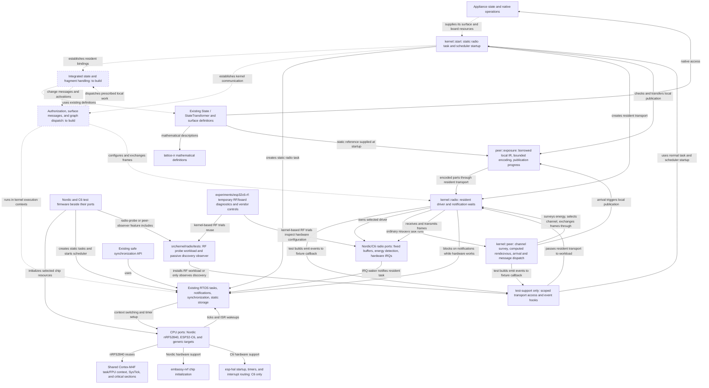

# Lattice vertex kernel direction

Build `lattice-vertex` as one RTOS kernel whose normal runtime makes an appliance
a participant in a Lattice network. This repository owns local execution, peer communication,
and the behavior shared by every vertex. Its FreeRTOS-derived machinery is the
execution core we extend and maintain as part of that kernel.

On supported hardware, adopting Lattice should require appliance definitions and
appliance-specific hardware behavior. Network setup, packet handling, discovery,
exposure, and change propagation are provided by the kernel and its platform port.

Nordic nRF52840 and ESP32-C6 are both hardware targets. C6 support is needed for
the Shelly devices as well as the existing prototypes. Keep each platform's
dependencies isolated and the common kernel's interfaces and protocol portable.

Read this plan alongside the
[architecture white paper](Lattice-DRTOS-Architecture-White-Paper.docx). This file
defines repository ownership and the implementation sequence. Existing interfaces
are provisional and must be brought into alignment with it. The
[current baseline](#current-baseline) identifies what is implemented today.

## Division of responsibility

| Owner | Supplies and controls |
| --- | --- |
| Appliance author | Native states and state-transforming operations; their IR definitions, axioms, and invariants; appliance-specific I/O and physical behavior |
| Common kernel | Boot and resident storage; local execution contexts; network configuration and discovery; surface enumeration and exposure; change messages; fragment installation and local dispatch; forwarding and relay participation |
| Platform port | MCU startup support, timer and interrupt integration, context switching, radio operation, and board-specific pins, clocks, antenna routing, and hardware limits |
| Nucleus | FSPS, proof, compilation, and delegation of the solved program to participating vertices |
| `lattice-ir` | Shared mathematical definitions used by appliance surfaces and nucleus |

The public appliance concepts remain `State` and `StateTransformer`. An appliance
exposes mutable state, native operations that transform it, and the mathematical
meaning and operating constraints of those operations. The kernel provides the
common behavior that makes that surface participate in Lattice.

Appliance-specific code establishes actual hardware state through the kernel's
state interface. The kernel handles the resulting delta. Native command success
alone does not establish the physical post-state described by an IR effect.
Axioms and invariants are part of the exposed mathematical surface and must remain
available to the FSPS.

For a supported platform, we supply the radio integration. A developer adding an
unsupported MCU, radio, or board may need to implement a port. Every appliance
using that port should then reuse it. Hardware resources and wiring belong at
this boundary; network policy does not become a requirement for each appliance.

The ordinary appliance startup API must not ask the author to select a PAN ID,
channel, radio address, formation/join role, or implement a networking loop. The
kernel owns those decisions and operations. Any installation selection or
credentials needed for commissioning belong to the common Lattice mechanism.

## Local participation produces the distributed kernel

Each vertex encapsulates its appliance, retains its assigned relationships and
compiled fragments, and responds to local changes or received messages. Those
local responses collectively produce the distributed operating system.

A node's common kernel behavior includes:

- Enumerating and exposing states, transformers, axioms, and invariants.
- Broadcasting state changes and passing activation upstream through its resident
  state dependencies.
- Evaluating its assigned compiled conditional and forwarding the continuation.
- Invoking a reached native state transformer with the supplied arguments.
- Forwarding peer messages and participating in relay when required.

No individual node conducts a walk over the entire distributed graph. Nucleus is
an installation and compilation peer; ordinary execution does not require it to
relay or approve each operation. Communication is peer to peer, without a required
router role or permanent central runtime coordinator.

Change is the unit of execution. Handle changes and messages as they arrive.
Separately registered deltas remain distinct; a later change does not silently
withdraw earlier work. There is no graph work queue, periodic graph evaluation
cycle, or extra graph scheduler. Existing RTOS tasks and synchronization provide
local execution facilities, including overlapping work where needed. Local timers
remain available for hardware and communication needs.

Task notifications signal that work or transport data is available. They do not
replace the data describing distinct changes. Notification coalescing must not
silently become coalescing of graph activations. Transport buffering and delivery
mechanics must preserve the distinction between transmission, peer receipt, and
execution; the kernel must not invent repeated transformer invocations.

## Mathematical definitions and native execution

`lattice-ir` defines mathematical state, transformations, constraints, and the
information nucleus needs for reasoning. Firmware can retain those definitions
as static data and expose them through the common kernel.

Nucleus solves and compiles programs, then delegates their fragments. Vertices
install and execute their assigned native fragments. Neither the shared IR crate
nor the vertex kernel needs an IR interpreter, compiler, or solver. The initial
program model is a finite DAG of compiled conditional steps and native function
calls. Preserve the current one-invocation-per-requirement synthesis limit;
expanding that model belongs to nucleus/IR work and does not imply adding a
general-purpose program runtime to each vertex.

State dependencies and transformer invocation have different roles. Upstream
activation belongs to states used by conditions. A transformer is an invocation
endpoint, never a Boolean-condition dependency. Changes produced by its hardware
operation propagate through the affected states. A transformer's return value is
not a replacement for state-change messaging.

## One kernel runtime

The kernel's public startup path accepts the appliance definitions and the selected
platform's resources. It owns initialization of the node's resident structures,
required static execution contexts, and communication behavior, then starts the
existing RTOS scheduler. The appliance author should not assemble these pieces
into an independent runtime.

Use the mechanisms already present in the inherited core:

| Existing mechanism | Integration work |
| --- | --- |
| [Scheduler startup](../src/kernel/tasks.rs), including idle and optional timer tasks | Establish the Lattice system-task and storage setup in the same kernel startup path |
| [Static task creation](../src/sync/task.rs) and [allocation configuration](../src/config.rs) | Supply fixed stacks and control blocks for kernel-owned execution |
| Task notifications and ISR wakeups in [tasks.rs](../src/kernel/tasks.rs) | Connect radio and other relevant hardware events to local kernel handlers |
| [Port selection and primitives](../src/port/mod.rs) | Provide target-correct timer, interrupt, and context-switch integration |
| Existing synchronization and bounded buffers | Reuse them where the concrete execution or transport path needs them |

The startup sequence must establish storage and interrupt targets before a device
can signal them. The platform port and kernel jointly control when interrupts and
local execution become active. Radio callbacks must enter a valid kernel context;
appliance code must not have to reproduce this sequencing.

Radio reception and transmission completion use existing task notifications.
The selected driver is created inside the kernel's resident radio task, after the
scheduler has valid task storage. Driver futures register a waker for that task;
when pending, the task blocks on a notification. The IRQ wakes it to resume the
same operation. There is no additional executor task or graph work queue.

`kernel::start(context, radio_peripheral, &surface)` owns the static radio stack/control
block and starts the existing scheduler. The resident transport owns its selected
driver and task waker, then runs `kernel::peer` on the same task. Common discovery
selects the rendezvous radio settings, broadcasts discovery, and answers a peer
with directed presence. It borrows and encodes the supplied static surface, then
publishes it when arriving or encountering another arrival. The same behavior
runs on every vertex, with no enumeration administrator or polling catalog.
State changes, authorization, and installed fragments still need to be connected
to common peer handling.

Hardware tests opt into `test-support` to observe the ordinary path or replace
its handler with a supplied RF-probe workload. Both use the same resident task,
transport operations, and notification waits. The entry and observer callbacks
are excluded from ordinary builds and are not an appliance networking API.

## Repository organization

Organize the repository around these responsibilities as runtime integration is
implemented:

| Area | Responsibility |
| --- | --- |
| `src/kernel/` | The complete kernel: startup, task machinery, resident state and change handling, and common peer participation |
| `src/kernel/peer/` | Channel survey/formation, common discovery, and portable MAC/message encoding |
| `src/port/` | Architecture, MCU, and radio-specific implementation and board integration |
| `src/sync/` | Safe access to existing kernel synchronization facilities |
| `src/memory/` | Kernel memory support and storage mechanisms |
| `src/lib.rs` | Public entry point and exports |
| `examples/` | Small appliance implementations that consume kernel behavior |
| `src/kernel/radio/tests/` | RF-probe workload and passive counters for ordinary peer discovery |
| `src/port/{esp32c6,nrf52840}/tests/` | Board test entry points and logging |
| `experiments/esp32c6-rf/` | Temporary RF/register/GPIO investigations and standalone vendor/Wi-Fi/OpenThread comparisons |

The original polling radio experiment has been removed. Its useful hardware
adaptation lives in the C6 port. MCU test firmware lives in each port's `tests/`
directory, and the shared radio workload lives in `src/kernel/radio/tests/`.
These remain separately built crates so each firmware has its own entry point
and linker setup; colocation does not make test code part of ordinary kernel
modules or dependencies. Independent RF comparisons and one-off board investigations
live under `experiments/esp32c6-rf/`, including the antenna trial and raw register
reporting that were previously mixed into the C6 test binary. This is temporary
scaffolding, not part of the permanent kernel layout. Experiments may consume the
kernel and test workload; neither depends on experiments. Captured binaries and
logs remain ignored artifacts, not source dependencies.

The kernel must never depend on the test workload crate. The board fixtures depend
on both the kernel and `lattice-radio-test`. Only the gated transport entry and
event callbacks remain in `src/kernel/radio/testing.rs`; all probe definitions,
cadence, reply logic, and counter storage live under `src/kernel/radio/tests/`.
The callbacks observe waits, ISR wakeups, buffer evictions, and available RX
signal/abort metadata without introducing
counter storage or callback dispatch into ordinary builds. Local `#[cfg(test)]`
unit tests may stay beside the implementation they test.

The Nordic CPU port is [`src/port/nrf52840.rs`](../src/port/nrf52840.rs). It uses
`embassy-nrf` 0.11.0 for chip initialization and reuses the existing Cortex-M4F
task/FPU context switching, SysTick, and critical sections. It retains the kernel
exception bindings, supplies the fixed 64 MHz clock, and defines the kernel's
interrupt priority boundary for Nordic's three implemented priority bits.
Appliance code does not supply clock constants or scheduler vector bindings.
It requires neither ESP code nor an Embassy executor/time driver.

The ESP32-C6 CPU port is
[`src/port/esp32c6.rs`](../src/port/esp32c6.rs), with the register save/restore
routine beside it in `src/port/esp32c6/context.S`. It uses `esp-hal` 1.1.2 for
reset/startup, interrupt routing, and SYSTIMER. Software interrupt 0 performs
deferred context switches through the existing task scheduler. It does not bring
in the `esp-rtos` scheduler. The generic CLINT port remains a separate target;
both now use a compatible `riscv-rt` 0.16 dependency generation.

The [Nordic radio port](../src/port/nrf52840/radio.rs) consumes
`embassy-nrf`'s 802.15.4 packet driver and adds register-level energy detection
on the same interrupt, because the HAL does not expose that operation.
The [C6 radio port](../src/port/esp32c6/radio/mod.rs)
uses extracted `esp-radio` MAC/register/clock code, with upstream attribution
and its MIT license retained. It uses `esp-phy` for PHY initialization. Both
ports supply fixed frame storage and interrupt-driven operations to the same
kernel task. Neither requires an allocator or a vendor task scheduler.

The current top-level surface and observation code must be integrated into
these responsibilities. Preserve useful typed definitions and checks while
reworking ownership and call paths. File moves should accompany that work. The
FreeRTOS-derived source remains maintained kernel code, with its attribution and
license preserved; its origin does not make its current organization immutable.

A function should live with the data or operation it owns. Extend an existing
kernel facility when it already owns the responsibility. New modules and types
must correspond to concrete behavior or storage, not merely provide a place to
put otherwise unassigned code.

## Radio and network ownership

IEEE 802.15.4 is the initial radio basis. The common protocol must remain portable
across supported radios. Chip-specific dependencies such as `esp-radio` belong
inside the corresponding platform integration. They do not define the appliance
API or the network protocol.

The common kernel and hardware-test crate use `ieee802154` for MAC framing, with
extended source addresses derived from factory identifiers. The standard codec
is shared as a dependency; diagnostic payloads and the probe workload remain
outside ordinary kernel builds.
Hardware libraries still need chip-specific integration; the kernel supplies that
integration for supported platforms. The implementation effort should concentrate
on Lattice's common behavior above frame I/O.

PAN coordination, channel selection, peer discovery, addressing, and participation
are kernel responsibilities. The radio port applies the kernel's settings within
hardware limits. Appliance startup receives no public PAN/channel/address
configuration record
and requires no transceiver implementation. The provisional `Transceiver` and
`Config` API has been removed; chip differences stay in the selected port.

The test workload selects channel 15 and broadcast PAN 0xffff and sends frames
without MAC ACK requests. Those test settings and the entire probe/reply workload
live under `src/kernel/radio/tests/`. `radio-probe` is a board-fixture feature that
includes that crate and the kernel's `test-support` entry. It is no longer a kernel
feature. Ordinary kernel startup has no diagnostic probe parser, responder,
cadence, or statistics.

Common startup now searches channels 11–26 before choosing one. `peer::bootstrap`
performs two surveys, each measuring 4,096 us of peak energy per channel, sending
a discovery request, and listening for 60–90 ms. An established resident's
presence takes precedence over founding a network, even when its channel is
noisier than a local alternative. Only if no resident answers does the node
propose the channel with the lowest worst observed energy. Failed measurements
never count as a quiet channel. The survey uses 32 bytes of fixed local storage.

Startup delay, scan order, channel ties, and transmit timing are decorrelated by
an address/tick-seeded PRNG; it is not a source of security randomness. Formation
has no designated physical channel. Candidates compute a jump/stay sequence:
51 visits using a nonzero stride modulo 17, then 17 visits on their preferred
channel. Each local interval is 40 ms. The stride comes from that preference;
equal preferences give a common stay channel and different preferences give
different strides. Each round advances the sequence start. The virtual extra
channel maps back to the preferred channel. No sequence table or clock
synchronization is required, and these intervals are only radio-discovery timing.

Candidates advertise their best proposal on the channel they currently visit.
A broadcast proposal solicits a directed reply: existing residents answer with
presence, and candidates answer with their preferred proposal. A directed proposal
that agrees with the receiver's choice allows it to settle immediately. Directed
responses never echo. Without agreement, formation runs three rounds (nominally
8.16 seconds) and retains the best proposal heard. The founding-address/channel
order breaks proposal ties. A proposal can name a channel other than the one
carrying it; resident presence must match the receive channel. There is no
fallback control channel. Lost frames, clock drift, and partitions still limit
convergence; reconciling established networks remains separate work.

Each resident retains the founding address and selected channel and can advertise
both. The founder has no permanent coordinator role. The record is currently
volatile: reboot searches again, and an existing resident can supply the original
record even when the founder is absent. Established nodes stay on their selected
channel; coordinated migration in response to later interference is not yet
implemented. Active discovery lets a newcomer find a resident without waiting
for its periodic announcement.

PAN `0x4c56` remains a common discovery filter, not an allocated PAN or membership
credential. The network tag distinguishes advertised networks; startup currently
adopts the first established network it hears. Choosing between independently
owned deployments and authorizing operations are not decided by that tag or PAN.
The `LVT` version-2 envelope carries discovery, provisional proposals, and directed
presence; it rejects the earlier fixed-channel version. Ordinary discovery still
repeats every 2–3 seconds after selection. Presence never causes an echo. MAC ACKs
are not requested for these frames. No peer table, appliance formation/join knob,
graph work queue, or repeated transformer invocation is introduced.

The board fixture's `peer-observer` feature observes this normal path. It supplies
an authored test surface, registers a passive event callback, and reports counters;
it supplies no radio settings, message generator, or handler. Both C6 and Nordic
use the same common discovery and [surface publication](../src/kernel/peer/EXPOSURE.md).
One arrival announcement triggers reciprocal publication of local definitions.
Periodic discovery and received descriptions do not trigger exposure. Parts are
generated from immutable IR without invoking native readers/transformers or
retaining another vertex's definitions. Interested consumers own any reassembly;
the ordinary receiver currently discards descriptions after frame validation.
Transport receipts, forwarding, consumer integration, and authorization remain
open. Discovery or a description grants no permission to install or mutate.

C6 RF investigation keeps TX power fixed at 20 dBm, including reference runs.
Similar results across the three tested boards make the shared PHY setup the
current investigation focus. The C6 port now selects combo-radio PHY mode before
calibration and explicitly disables Wi-Fi RX for its 802.15.4-only operation,
matching the vendor initialization convention and upstream PHY fix. Its effect
has been checked in a follow-up capture: both boards still report one unanswered
post-contact probe and roughly -66 dBm RSSI. The subsequent vendor-reference run
at channel 15 / 20 dBm received 20/20 frames each way but still reported median
RSSI of -68 and -69 dBm, reproducing the weak readings without our driver/kernel.
The cause remains unresolved; retain the evidence and comparison tools under
the RF experiments rather than treating this short run as proof of RF quality.
A phone subsequently detected one board's Wi-Fi control AP with a strong bar
indication. C6 Wi-Fi scans have not produced peer RSSI samples, so this establishes
only qualitative Wi-Fi transmission to an independent receiver, not a validated
C6 receive path or resolution of the 802.15.4 problem.
The [register assay](../experiments/esp32c6-rf/RF_ASSAY.md#corrections-and-verification)
led to fixes for the PAN mask, ED sampling fields, and unused Wi-Fi-power clock.
Both boards' readbacks verify the corrected configuration at 20 dBm. A one-minute
run still reported two/four unanswered post-contact probes and weak RSSI, so the
remaining RF issue continues to need investigation.
An [OpenThread control](../experiments/esp32c6-rf/openthread/README.md) now supplies
pinned source, radio/Thread validation, and flash/register captures. Its comparison
led to an explicit modem ETM clock enable; the C6 radio fixture also now matches
the reference's 160 MHz CPU setting. The latest short run answered 17/17
and 18/18 probes but still reported -66 to -61 dBm. This is useful configuration
evidence, not a resolution of the weak-signal concern.

The survey timings and discovery encoding are provisional common-kernel decisions.
Deployment selection, authorization, and executable-message encodings remain open.
Discovery works before Lattice assigns any short radio address. PAN IDs and radio
addresses remain transport data, not substitutes for graph relationships or proof
of network membership.

Configuration and packet adaptation must stay below the appliance boundary. The
same appliance definition should work on another supported platform without a
new networking implementation. Platform-specific capabilities or limitations
should be handled by that port and the common kernel policy.

## Structured memory and resident relationships

Use fixed, structured memory for Lattice's node machinery. Keep a state, its
dependent relationships, and their upstream references together. One-to-many
relationships must be represented directly and compactly. Each node retains the
local data needed to encapsulate its appliance and participate in its installed
programs.

Local references may be direct memory references or native function handles.
Cross-peer references identify the owning peer and the relevant location there;
remote addresses are never dereferenced as local memory. The wire encoding is an
implementation choice, not a reason to introduce an ECS, copied world model,
global object registry, auto-incremented entity IDs, or relational edge tables.

Use static task/control storage and bounded communication buffers. Fixed rings
with explicit eviction are transport storage, not a graph-job queue. Choose packing,
layout, and hardware offload against the target's actual memory and latency needs.
The radio task has a fixed 6 KiB stack and a static task control block. Nordic
uses the HAL's caller-owned DMA packet. C6 has an aligned static DMA buffer and
four fixed receive entries, evicting the oldest frame on overflow. Test builds
report evictions to fixture-owned counters. Transmit storage remains owned by the driver until completion.
No transport buffer is used as storage for queued graph activations.

## Implementation map

This is the working responsibility map used by the
[post-change review](../AGENTS.md#review-after-each-meaningful-change). Solid arrows
show existing relationships. Dashed boxes and arrows show the integration to
build. The map represents code ownership and local execution, not an executable
DAG. Update the status of these connections as implementation replaces the gaps.

## Current baseline

The inherited task, synchronization, and memory implementations remain the
execution core. `port-nrf52840` connects them to Nordic hardware through the
shared Cortex-M4F port. `initialize` consumes SysTick and returns Nordic appliance
peripherals after HAL initialization. The kernel owns the 1 kHz tick and its
exception handlers. The port starts the 32 MHz crystal required for radio use;
the low-frequency source remains internal. `kernel::start` transfers RADIO to
the resident task, which initializes it. Ordinary startup runs common discovery
on that transport; the optional RF-test workload replaces the common handler.

The [Nordic hardware smoke image](../src/port/nrf52840/tests/README.md) builds
without an allocator and without ESP dependencies. Its assertions cover the
kernel vectors, tick configuration, critical sections, ISR wakeup, preemption,
and integer/FPU context preservation. The standalone image uses SWD/RTT and does
not assume a board-specific USB bootloader. It is build/link verified; execution
on an nRF52840 remains unverified.

`port-esp32c6` connects the same task scheduler to the C6 through
esp-hal, saving registers on each task's static stack and switching on a private
2 KiB stack. C6's minimum task/idle stack is 2 KiB because HAL peripheral handlers
use the interrupted task's stack. Timer setup precedes the first task restore,
which enables interrupts only after the scheduler has valid task storage.

The [C6 hardware smoke image](../src/port/esp32c6/tests/README.md) builds without
an allocator. It tests static task startup, nested critical sections, device ISR
notification, tick preemption, and register preservation. Build/link checks pass;
the standalone smoke fixture has not been run on hardware. C6 runtime evidence
comes from the integrated radio image below. This port still uses a
periodic tick; `tickless-idle` falls back to waiting with that tick running.

The resident radio transport is connected to RTOS startup and the actual radio
interrupts on both ports. The [radio test images](../src/kernel/radio/TESTING.md)
compile/link without an allocator. Their shared test crate owns the diagnostic
codec and its wire-vector/rejection tests. Ordinary images build independently
without that crate or the `test-support` feature.

C6 hardware bring-up has exercised the separated workload in both directions.
Fixture logging no longer masks radio interrupts, and the port preserves the
linked PHY initializer's baseband/MAC timing instead of overwriting one delay.
The [timing-change capture](../experiments/esp32c6-rf/RF_RESULTS.md#result-after-preserving-phy-timing--2026-10-06)
verifies both boards' timing/channel/power-index readbacks and reports 22/22 and
23/23 probes answered, with no pending/unanswered probes, API errors, or evictions.
This establishes the receive → IRQ wakeup → task handling → reply path for that
run. It does not establish the cause of the earlier missed reply or general
loss-free delivery. The subsequent combo-PHY capture reports one unanswered
post-contact probe per board, with no pending probes and -66 dBm RSSI. It leaves
the reported loss and received-signal concern unresolved.

Received signal remains around -64 to -70 dBm in the excerpts. Hardware SFD-timeout
counters are nonzero and increasing, without attribution to specific peers or
probes. RF quality/range and Nordic hardware interoperability remain open; the
RF experiment notes retain the earlier captures and the configuration audit.
The [vendor comparison](../experiments/esp32c6-rf/RF_RESULTS.md#vendor-comparison-result--2026-10-06)
also reports weak RSSI at 20 dBm, with 20/20 raw frames delivered each way. Both
boards were restored to Lattice; their short follow-up answered 19/19 and 20/20
probes with sampled RSSI from -70 to -63 dBm. No kernel change accompanied this
comparison, and the earlier intermittent loss remains unexplained.

Typed surface/IR definitions now enter kernel startup and feed arrival-triggered
surface messages through `kernel::peer`. Publication carries states, transformer
preconditions/effects, axioms, and invariants without executing them. There is no
foreign-surface catalog. The local observation callback list is still separate
from distributed message handling and is not the installed distributed DAG.
State-change messages and fragment installation remain unimplemented. The
diagnostic probe/reply handler provides none of these production behaviors.

The [common discovery capture](../src/kernel/peer/TESTING.md#c6-result--2026-10-06)
identified both C6 peers and exchanged directed presence responses. Replacing
one board's observed image with ordinary firmware preserved discovery while the
other board stayed running; reflashing it again also required no peer-side setup.
This validates the common handler independently of the test workload. Both MCU
ports build it; Nordic hardware validation remains pending.
That capture used version 1 on fixed channel 15. Subsequent channel-survey and
formation results are recorded separately in the
[hardware check](../src/kernel/peer/TESTING.md#formation-validation-status--2026-10-07):
A selected channel 21 from measured energy, B joined it, and B preserved the
network while A restarted and returned. An ordinary image without test features
also rejoined. A simultaneous start converged on channel 12 and one founding
address in that intermediate implementation. The shared formation channel has
since been removed in favor of computed channel rendezvous. The subsequent C6
pair met on channel 16 and settled on operating channel 12 during simultaneous
startup; the channel-24 staggered run also passed joining and founder-return
checks, including ordinary firmware. Five host tests and both MCU builds pass.
Nordic's new ED path still awaits hardware execution.

Earlier standalone C6 probes exchanged frames without our scheduler. They do
not prove packet delivery through this new kernel path, and the earlier RF range
issue remains open. C6 peer reception and replies are now demonstrated through
the kernel; a separate scheduler-only test is not a prerequisite to further work.

## Next implementation sequence

1. **Establish the integrated boot path across Nordic and ESP.** Provide
   the timer, interrupt, and context-switch integration needed by the existing scheduler. Establish the
   kernel's resident storage and required static task setup. Connect radio events
   to a kernel-owned execution context. Completion means the flashed image runs
   our scheduler and the hardware event path reaches our kernel, with no separate
   appliance-owned radio loop.
   Both CPU/radio ports, fixed buffering, and kernel-owned radio task/startup
   are implemented. The C6 pair has completed the hardware receive → wakeup →
   reply run using the separated test workload; Nordic hardware execution remains
   pending. The fixture supplies diagnostic traffic and settings through a
   test-only entry on the real kernel transport. Native appliance-instance binding
   and distributed state-change handling remain separate from these task checks.
   Rendezvous/discovery and arrival-triggered surface publication now run through
   ordinary kernel startup.
2. **Implement automatic peer participation.** Put radio configuration, bootstrap,
   discovery, and surface-exposure handling in the common kernel. Use the provided
   platform port to perform the hardware operations. Completion means two appliance
   implementations can enter the network and expose their surfaces through the
   same kernel behavior, without choosing PANs or writing packet handlers.
   Channel survey/formation and directed discovery responses are implemented.
   Arrival-triggered mathematical surface publication is implemented. Reliable
   delivery/consumer integration and authorization remain open. Surface descriptions
   do not establish physical appliance state or permission to mutate it.
3. **Complete the state-change communication path.** An appliance establishes a
   state change; the kernel detects/registers the delta, emits the required peer
   message, and the receiving kernel performs its prescribed local handling.
   Completion means this path works through the common runtime, with the examples
   reduced to appliance definitions and physical I/O.

Extend that working path into compiled-fragment installation, conditional
activation, transformer invocation, and forwarding. Keep upstream state
activation distinct from downstream execution. Nucleus supplies compiled work;
its full implementation is not a prerequisite to building the node's common
mechanics. Relay optimization and storage tuning follow concrete implementation
needs rather than displacing these first runtime steps.

## Development approach

Build in useful increments, compile as we go, and learn from concrete failures.
Use focused checks for actual invariants: frame encoding, static-storage bounds,
interrupt-to-task handoff, and the end-to-end behavior just added. Reuse existing
kernel tests. QEMU and physical boards are tools for specific questions, not
prerequisites to every small change or grounds for an exhaustive simulation gate.

Keep compile success, scheduler execution, packet exchange, and physical appliance
behavior as separate evidence. A radio probe or host test does not prove the full
kernel is running on a target. Supported-platform progress should make appliance
examples smaller and remove custom networking work from them.

After each meaningful change, review names, ownership, and the implementation map.
Check for duplicated storage or behavior, confused domain terms, and abstractions
without a concrete responsibility. Let the code's developing responsibilities
refine the organization. Keep this document focused on the direction and next
working kernel behavior. Retain useful build instructions with the supported
ports and tests; temporary investigation material must not become a permanent
part of the kernel source tree.
