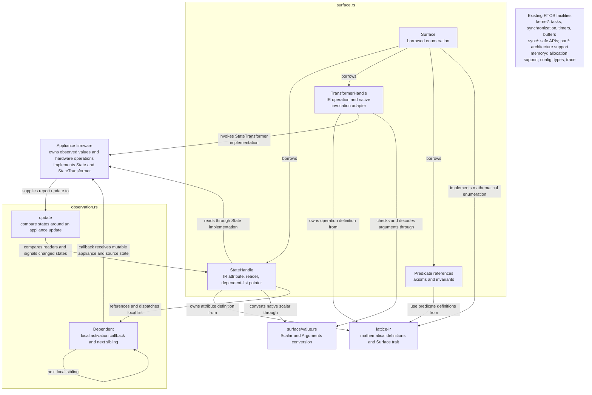

# Lattice vertex kernel direction

This document records the implementation direction for extending the imported
FreeRTOS kernel into a cooperative distributed RTOS. Read it alongside the
[architecture white paper](Lattice-DRTOS-Architecture-White-Paper.docx). The scope,
local participation model, memory approach, and development approach below govern
work in this repository. They describe what we are building, not functionality
already implemented.

## Kernel and firmware responsibilities

The kernel implements the common behavior of a lattice node. Firmware authors
plug their appliance into that behavior through the interfaces we provide. They
should not assemble a protocol from an unstructured collection of primitives or
reimplement enumeration, change broadcasts, conditional evaluation, or forwarding.

The firmware implementor supplies:

- The appliance's typed mutable attributes: for example, a binary power state,
  scalar brightness, or enumerated fan speed.
- Its typed state-transforming function handles, backed by the concrete hardware
  operations that modify those attributes.
- IR definitions of device-model axioms and the safety and operating invariants
  that synthesis must preserve, including relationships across appliance states.
- The hardware facilities the kernel needs, including the platform's timing and
  interrupt support and primitive peer communication operations.

Express these requirements through small interfaces with static dispatch. A
transceiver trait is a likely requirement; its exact name and methods will follow
the communication code's actual needs. The kernel does not require a new HAL or
an appliance driver framework.

Hardware observations enter through the supplied attribute interface. From that
point, the kernel handles the dependent activity and communication. Firmware
authors provide access to their state and functions; they do not manually arrange
change propagation or evaluate graph conditions.

Migrating firmware such as `diffuser-fw` or `mhz-radio-fw` means retaining its
appliance-specific hardware code, exposing its attributes and functions through
these interfaces, and replacing its ad hoc networking and prior surface
enumeration with the kernel's common node behavior.

The shared [`lattice-ir`](https://github.com/zacharytomlinson/lattice-ir) crate
defines the mathematical surface of those attributes and transformations.
Firmware can expose these definitions as static data. The nucleus owns proof,
synthesis, and compilation, and delegates compiled fragments to participating
vertices. The shared crate contains definitions, not an interpreter or solver;
vertices execute the delegated fragments without hosting an IR interpreter.
Mathematical effect outputs describe post-state for reasoning. Runtime changes
are communicated through the node's change messages, not program return values.

## Cooperation produces the distributed kernel

The kernel exists collectively across participating nodes. Each node responds to
a local hardware change or an incoming message by doing the part assigned to it:

- Expose and enumerate its states, state transformers, axioms, and invariants.
- Broadcast changes and pass activation messages upstream toward the relevant
  program head through its resident dependencies.
- Execute its assigned compiled conditional and pass the continuation downstream.
- Invoke a reached local state-transforming function.
- Offer relay participation and forward peer messages.

These successive local responses produce the distributed execution. Each node
needs only its own state, functions, executable relationships, and the references
needed for its communications. There is no separate executor conducting a walk
over the distributed graph. The broader installation, recovery, and protection
behavior described in the white paper also belongs to the common kernel
implementation rather than being rebuilt by each appliance author.

Change is the unit of execution. Process local changes and received messages as
they arrive. There is no graph work queue, additional graph scheduler, or periodic
evaluation cycle. FreeRTOS already supplies the local execution facilities,
including tasks for overlapping evaluations when needed. Local timing remains
available for hardware, communication, and explicitly temporal operations; an
omnipresent clock does not drive graph evaluation.

## Structured memory and resident edges

An attribute is actual mutable appliance state exposed to the network. Edges
through attributes carry conditional evaluation; edges through function handles
carry state modification. Together they embody the distributed executable.

Upstream activation belongs to state dependencies. A state transformer is an
invocation endpoint, never an input to a Boolean conditional. Changes caused by
its hardware operation propagate through the affected states' relationships.

Keep an attribute, its dependent edges, and their upstream relationships tied
together in the memory structure. One-to-many relationships are fundamental.
Use structured memory and direct references with no dynamic allocation for the
lattice node machinery. Firmware-resident vertices are terminal hardware
participants, not objects that need relocation between machines.

Choose the concrete layout against the target's available memory and hardware.
A static structure is appropriate when its layout minimizes padding and its
access adds no unnecessary indirection. Do not impose a matrix, generic edge-slot
pool, auto-incremented object IDs, relational lookup layer, or ECS. Existing MCU
storage and registers may be useful where their hardware semantics permit it.
The particular field layout remains an implementation choice.

Fixed-width communication rings with hard eviction are transport storage. They
do not imply a queue of graph jobs. Reuse the RTOS facilities already present and
add the local mechanics that lattice participation actually requires.

## Implementation approach

ESP32 is the initial platform. The flashed firmware will include this kernel.
Existing ESP Rust HAL code and nearby firmware are platform references.
`lattice-ir` starts with the shared mathematical definitions extracted from
Jarvis's `zmt/rewrite` branch. Its formal development continues with the nucleus;
the kernel can use the shared definitions to build surface exposure independently.

Build working kernel code in meaningful increments, compile as we go, and learn
from concrete failures. Use focused checks where they answer a real question.
QEMU is available when useful; exhaustive simulations and speculative failure
models are not prerequisites to ordinary progress. Physical hardware testing
happens when the user chooses that the implementation is far enough along.

Start with the kernel interfaces and local participation behavior. Settle packing
and hardware integration through implementation. Relay tuning and hypothetical
storage-reuse problems must not displace that work. Keep the code small, direct,
and economical in memory; avoid extra abstractions and machinery without a
current purpose.

## Implementation map

This is the working map for the naming and organization review described in
[AGENTS.md](../AGENTS.md#review-after-each-meaningful-change). Update it when a
change alters the responsibilities or relationships shown. Arrows describe code
relationships and calls; this diagram is not a delegated executable DAG.

The appliance owns the actual state. Handles retain mathematical definitions and
native access, while `Surface` borrows those handles and predicate definitions.
Its implementation of `lattice_ir::Surface` exposes that same data to mathematical
consumers without a second collection of descriptors. Native scalar conversion is
kept within the surface module.

`surface` and `observation` currently depend on each other: state handles retain
their local dependent-list pointer, and observation updates use those handles to
read and signal changes. `Dependents` is the private atomic-pointer storage and
dispatch implementation; each public `Dependent` holds a callback and a sibling
link. These links represent local activation only. A callback can invoke a
transformer, as the observation example does, but the list does not specify its
body or a distributed continuation.

The existing RTOS facilities are shown separately because local observation
dispatch runs in its caller's context and adds no scheduling layer. Peer transport,
resident upstream/downstream fragment relationships, and fragment installation
remain unimplemented. Extend the map as those responsibilities acquire concrete
code.

## Current surface implementation

`lattice_vertex::surface` provides the implementor-facing `State` and
`StateTransformer` traits. A state supplies its native scalar type and observation
reader; its IR type is derived automatically. A transformer supplies typed native
arguments, an IR operation definition, and an invocation method. Static handles
reject disagreement between the native and declared argument signatures during
compilation. Incoming values are checked and decoded before invocation.

`Surface` enumerates states, transformers, device-model axioms, and invariants.
Axioms are supplied facts/assumptions; invariants are device-wide properties that
admitted transitions must preserve. Both use the common IR and direct state
references, independently of individual transformer preconditions. Nucleus
validates and reasons over these declarations. The local surface does not
interpret predicates, prove native behavior, or publish mathematical effects as
observed hardware state.

The common mathematical enumeration interface is `lattice_ir::Surface`. The
vertex's native `Surface` implements it by borrowing definitions from its existing
handles. Nucleus and other mathematical consumers can use this interface without
depending on the RTOS, constructing a second definition table, or invoking native
readers or transformers. Native `State`/`StateTransformer` traits, scalar adapters,
and hardware callbacks remain in vertex. Each native transformer owns its
operation root, preserving distinct callable references even when expressions
are shared; no second collection of mathematical descriptors is retained.

The [surface example](../examples/surface.rs) declares two states, one transformer
with coupled effects, a device axiom, and a safe operating invariant. Run it with
`cargo run --locked --example surface`. The shared IR is pinned to a Git revision
so building this repository does not require a sibling checkout.

Local enumeration, reads, invocation, observation registration, and local
dependent activation are implemented. On-air encoding, peer delivery, and
compiled-fragment installation are not implemented yet. The examples exercise
local behavior; they are not ESP hardware ports or networked nodes.

### Observation changes and local activation

`StateHandle::update` applies an observation update and signals an actual value
or availability change. `observation::update` handles a fixed group of states affected
by one hardware report, including derived states. All fields are updated and
compared before callbacks start. Prior values and changed flags exist only on the
caller's stack; the kernel retains no observation mirror. An unchanged report
does not trigger an activation. Where hardware already identifies a change,
`StateHandle::changed` signals it directly after the state is established.

Each state retains one atomic pointer to its first local `Dependent` entry.
Installation code sets that pointer with `set_dependents`; subsequent links
enumerate sibling dependents of this state, not steps toward a DAG entry point.
These list pointers do not encode cross-peer routing or a DAG entry point. Links are
immutable and statically resident; the list must be acyclic. Replacing the first-dependent pointer
affects future dispatches while an already-started dispatch finishes its original
list. This is local binding plumbing, not distributed installation or reclamation.

Activations execute directly in the caller's context and read current state when
reached. A newer delta does not withdraw an earlier activation. There is no graph
work queue, polling loop, or IR interpreter. ISR callers must use the existing
RTOS task-notification facilities when their callbacks cannot run in interrupt
context. The native callbacks are a local execution interface, not a frozen
fragment ABI.

Run `cargo run --locked --example observation` for a contact-change → native activation
→ transformer request → separately observed output-change example. The appliance
examples also route complete observation reports through this same registration
path. Native command success alone does not publish modeled effects.

### Appliance formalizations

Run `cargo run --locked --example appliance_surfaces` to inspect the
[appliance definitions](../examples/appliances/mod.rs) without contacting hardware:

- The diffuser and read-only HVAC-observer surfaces use `diffuser-fw`'s existing
  S3 controller and RA4 snapshot types. Readers preserve sensor validity and fan
  qualification; relay requests use the existing controller's guards and lease
  commands. The model includes the signed 24-bit scale domain and assigned fault
  domains. It does not equate a requested relay state with an observed one.
- The RC400 fan follows the checked-in training record: Off, speeds 1 through 6,
  and direction. It has no fabricated On, toggle, or light function. Off retains
  the selected speed; setting speed has coupled power/selected/running effects.
  A known direction is required before asking the native planner to implement a
  directional setter that may use a toggle waveform. Transmit completion does
  not supply RF feedback or mutate the observation fields.
- The Shelly dimmer is a proposed minimal custom-firmware surface, using the
  documented independent output and 0–100 brightness controls. Its hardware
  backend supplies readiness and applies both settings. The effective setting is
  derived from output and brightness; it is not a measured light intensity.
  See the official [Dimmer Gen4](https://shelly-api-docs.shelly.cloud/gen2/Devices/Gen4/ShellyDimmerG4/)
  and [Light component](https://shelly-api-docs.shelly.cloud/gen2/ComponentsAndServices/Light/)
  references. This is not a complete model of stock Shelly firmware behavior.

Reference dependencies are pinned to `diffuser-fw` commit
`e78cbe3eb31f977222a97acd6f628534462d7ab5` and `mhz-radio-fw` commit
`846da6acc2cf2980d2b14d5162cc76a5c775e9b6`, exclusively as development dependencies.
The RF profile is recorded in that repository's
`fixtures/rc400/2026-09-25-explicit-surface.json`.

These first formalizations describe successful modeled state transitions, not
instantaneous hardware completion. Native I/O hooks still need wiring into each
firmware. Lease expiry/renewal, dimmer calibration/warmup, and full fault-response
dynamics are not encoded as temporal IR in these examples. Per-operation cost
expressions also remain outside the current surface API. The checks exercise
native dispatch, observations, and declared state references; they are not an
FSPS proof of the models or physical-device validation.
