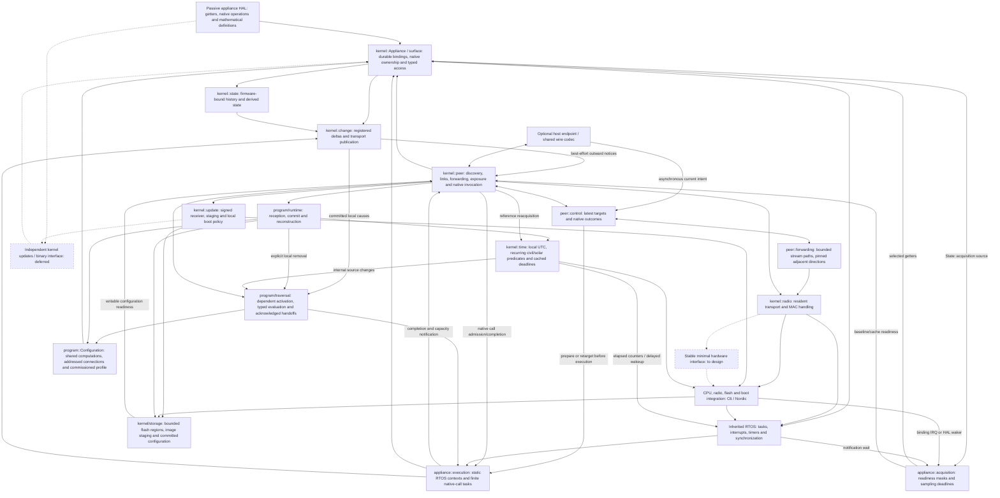

# Lattice vertex implementation direction

Read [ARCHITECTURE.md](ARCHITECTURE.md) for the system model and
[AGENTS.md](../AGENTS.md) for development discipline. This file records the code's
current responsibilities, gaps and next work. It is not a second specification,
protocol manual, test diary or history of completed milestones.

## Current baseline

| Area | Implemented behavior | Current boundary |
| --- | --- | --- |
| RTOS core and CPU ports | Existing task, interrupt, timer and synchronization facilities; C6 and Nordic startup | Reuse this foundation; appliance authors do not reimplement it |
| State and native operations | Per-state event/interval/call-boundary acquisition, cached observations, registered deltas and history maintenance | Getter-only adapters retain the 10 ms fallback; MCU IRQ-to-acquisition checked on both ports, real sensor bindings remain |
| Native call execution | Static FreeRTOS call tasks, asynchronous RF/USB completion, pending-call deduplication and update holds | Execution capacity is bounded; caller/route timeouts do not cancel a call or guarantee late result delivery |
| Network-service wakeups | Runnable work, producer notifications and actual retry/expiry/time/update deadlines replace blanket polling | Periodic RTOS ticks and discovery maintenance remain; this is not tickless CPU operation |
| Continuous native control | Bound forwarding paths, compact raw-argument targets, native preparation replacement and addressed progress/feedback | Compact path and final-value completion live checked both ways with software-backed states |
| Durable appliance bindings | Named declarations become owner-local numeric references; native lookup/deltas and LSF v2 use them; duplicate bindings are rejected | Loader reconstruction uses these references; changed physical meanings/types remain compatibility changes |
| Resident programs | Durable installation/enablement, local computation sharing/removal, upstream activation, typed evaluation, receiver-reserved handoffs and native invocation; C6/Nordic execution, reclamation and reset reconstruction checked | Native and temporal execution are live checked with software-backed surfaces; externally installed retained-state operations remain absent |
| Time and solar | Commissioned UTC anchor, persistent coordinates/recurring civil rules, local deadline sources and peer reacquisition | C6/Nordic deadline execution and peer reacquisition live checked; no backed RTC/GPS adapter or clock consensus |
| Protected configuration storage | Both ports reserve 16 KiB; one kernel flash owner serves program storage and optional signed updates | Layout 3 requires coordinated provisioning; host checks do not establish physical power-loss recovery |
| Retained state | Static native-width history, native updater, mathematical enumeration and ordinary reads/deltas | Firmware-bound helper; automation-authored history is deferred |
| Communication | Kernel-owned 802.15.4 framing, formation, maintained links, owner-directed forwarding and bounded MAC delivery | Concrete C6/Nordic backends; portable public hardware interface still missing |
| Surface and native access | Read surfaces/current state, invoke native functions, forward observations | Program activation has separate bounded storage; outward observation publication remains lossy |
| Host participation | Optional USB companion endpoint and shared numeric codec | Host clients live in `lattice-tools`; tablet consumes that library |
| Firmware updates | Signed whole-image staging, durable resume, local deferral, startup confirmation and watchdog recovery | Combined-image replacement is accepted for now; independent kernel updates are deferred |

The callback-based `Fragment` prototype and its private packet queue are removed.
Its source and runs are preserved in the external lab. They established callback
and operand transport, not installation of previously unknown automations.

The firmware-local `observation::Dependent`/report API and its callback example
have been removed and archived. The native updater accepted by
`Appliance::install_state` remains a pre-start history helper, not the compiler's
program interface. Resident records now install through the common peer service.
Native-state programs can now be enabled and executed after installation.

## Implementation map

Solid edges are implemented relationships; dashed edges are planned integration.
This is a responsibility map, not the executable DAG of a particular automation.
Protocol details and internal updater phases belong in their component notes.

Continuous native control extends the existing peer, host and native-call owners.
It coalesces current intent in fixed storage and uses the same native tasks; it adds
no appliance callback, networking responsibility or firmware loop.

## Next implementation milestone

### Required acquisition and hardware-offload pass

State acquisition now has a production kernel event path. `State::acquisition`
selects an `AcquisitionEvent`, a per-source interval, or native-call-boundary-only
acquisition. The existing task establishes a baseline and blocks on notifications
or its earliest sample deadline. Shared events select a group; unrelated getters
remain untouched. Native calls retain acquisition before/after execution, including
errors. Legacy getter-only bindings keep their 10 ms fallback. Physical event
qualification and FIFO/counter retention stay in the hardware binding.

Host checks cover selection, shared events, interval wrap, baseline/delta behavior,
readiness during acquisition and contention retention. C6/Nordic release kernel
builds pass without host-link or test-support. These are software/build checks;
The live check used software-triggered MCU interrupts on both ports: one IRQ
acquired both states in its bound group once, with zero getter activity in idle
windows. This validates interrupt entry/notification/acquisition, not a physical
GPIO/ADC sensor or its qualification. The remaining offload targets are:

| Owner | Current gap | Next mechanism |
| --- | --- | --- |
| Appliance bindings | Kernel event/interval selection is implemented; concrete devices still supply their physical signal | Connect peripheral-ready IRQs/HAL wakers to the declared event; select explicit intervals for sources without notification capability |
| CPU ports | Tickless is not enabled in these images; C6's hook only executes WFI with its periodic timer running | Reuse the RTOS delayed-task deadline with timer compare/elapsed accounting. Nordic has an inherited SysTick suppression implementation; C6 needs a real port implementation |
| Appliance peripheral bindings | Physical device adapters are still to come | Use Nordic PPI/GPIOTE/SAADC/EasyDMA and C6 ETM/GDMA, timer/capture/PWM/counter facilities for local sampling, pulse generation and counting |
| Image verification | SHA-256 is software; signature verification also pulls in large SHA-512 code | Hardware SHA-256 is a candidate, measured against setup/driver cost. Neither chip's hash engine provides SHA-512; compact software SHA remains a separate size optimization |

The hardware basis is Nordic's [PPI](https://docs.nordicsemi.com/r/bundle/ps_nrf52840/page/ppi.html?contentId=Zp7tr4w5Gk_894YIQpStEA)
and [CryptoCell specification](https://docs.nordicsemi.com/r/bundle/ps_nrf52840/page/cryptocell.html?contentId=yVmM3Rd8fwyu15zhqdjG0w),
and the [C6 datasheet](https://documentation.espressif.com/esp32-c6_datasheet_en.html).
The pinned HALs already expose peripheral event-routing and USB async facilities.
USB servicing is separate fixture/host-companion work, not a requirement of an
ordinary appliance vertex. The 1 ms USB loops and their task stacks belong to the
hardware-check images; `host-link` is optional and kernel startup creates no USB
task. Computer/tablet radio companions use USB operationally in their own builds.
Their readiness/output-notification cleanup must not hold up appliance acquisition
or be counted as mandatory appliance runtime cost. Footprint comparisons must
identify which of these build roles they measure.
Radio reception, FCS, DMA and portions of ACK/turnaround already use hardware;
this pass does not reopen RF tuning. C6 ECC supports P-192/P-256, not a direct
replacement for the current Ed25519 verifier. Nordic's CryptoCell SDK advertises
Ed25519, but adopting its hardware/software stack needs a separate integration
and image-cost assessment. No signature-format change is implied.

The kernel receives source readiness through its public event/waker primitive;
firmware supplies no value-report or networking callback. The implementation map
now includes this relationship. [Native acquisition mechanics](../src/kernel/peer/INVOCATION.md#hardware-acquisition-sources)
record the API, lifetime and bounds. Program/control wakeups now use readiness and
actual deadlines. Tickless port completion, hardware cryptography and peripheral
pipelines remain separate passes. Shared-fragment reclamation now has host validation;
its live hardware check remains next.

The network service no longer wakes every 10 ms merely because work or receipts
are retained. Native completion/capacity, observation baseline/cache publication,
batch commit and flash-access release notify it. It waits for actual send retries,
receipt expiry, clock reacquisition, temporal predicates, control expiry/heartbeat
and update quiet/notice deadlines. Ready local work gets another bounded receive
turn; blocked visits retain their state. No new work queue or scheduler was added.

On C6/Nordic, retained receipts produced 9/18 radio notification waits over roughly
two seconds, with no getter activity. Both ports also completed a deliberately
long native call, interrupt acquisition and 50 Hz compact control. These counters
measure radio-task waits, not total CPU interrupts or power consumption. The saved
cross-owner program executed after restoring the maintained images; Nordic then
reacquired commissioned time from C6. Saved definitions/profiles were preserved.

### Dependent delivery baseline

The baseline is [delivery to actual dependents](ARCHITECTURE.md#dependent-delivery-and-acceptance-receipts),
not dissemination of every delta to every vertex. A registered source delta must
produce an outward notification along each affected program's upstream path. The
code calls this an upstream activation and retains/retries its addressed handoff.
The separate `StateChanged` broadcast ring is best-effort. That implementation
distinction does not make automation independent of outward delta delivery.
Relays do not infer relevance or receipt by watching unrelated traversal.

The source/activation/handoff review confirmed that separation. The existing owner-local
delivery table now drops requests or replies in both remote upstream activation and
forward handoff, checking that accepted causes still produce one invocation each. It also checks the
false branch and independence from outward broadcast eviction. These are host checks;
they do not establish arbitrary physical RF delivery or recovery across crashes.
The remote case registers its source change on the other owner and loses the first
upstream request or receipt before the head can act. That focused gap is now covered
by the existing owner-local table. No runtime delivery change was needed for those
cases. Earlier hardware runs exercised remote upstream activation without controlled
loss. The broadcast ring still supplies no reliable subscription.

Public receive logs, universal delta reconciliation and automation history are
deferred. Coordinated replacement remains subsequent lifecycle work;
explicit removal reuses freed extents with fresh generations. Further delivery changes should address
a concrete failure or an explicitly added recipient requirement.

### Continuous native control

The [control component](../src/kernel/peer/control/README.md) binds the forwarding
path and a native function during Open. Each relay reserves bounded path state;
successful setup pins both directions. Targets carry a session handle, monotonic
sequence and raw argument bytes. One-byte targets use 18 bytes of Lattice payload
instead of 54; the current MAC header brings those counts to 39 versus 75 bytes,
excluding FCS. No type, function reference or end-to-end address is repeated in
that fast path. The local USB/client API retains its typed records.

Source and receiver coalesce current intent; prepared targets remain replaceable
until native execution starts. Progress follows the bound reverse path and provides
receipt plus native/observed feedback. Lost bindings interrupt the stream; no sample
triggers route discovery or automatic reopening. Open and final lifecycle exchanges
retain explicit receiver identity, and Finish/Close follow the pinned directions.

Host checks cover compact encoding, capacity, path direction, expiry, pending setup,
latest intent and lost feedback receipts. Both MCU targets build. The earlier
C6/Nordic burst and 50 Hz runs validated the preceding transport with software-backed
states. The compact path has now also completed 100-target, 50 Hz runs in both
directions with matching final native outcomes and acquired values. The shared client must
consume the matching wire revision; unpublished source uses an external Cargo patch.

Shared-fragment installation and owner-local reclamation are implemented. The
vertex matches computation locally, retains paired connections separately, and
keeps each evaluation on its addressed pair. Removing a connection detaches its
source/time activations and local continuation; a running native function finishes.
The last connection releases the computation, free extents are reused without
moving live references, and a fresh generation rejects stale traffic. LPD input
remains unchanged; LPG v4 stores the shared representation. Firmware gains no
new responsibility. The [program component](../src/kernel/program/README.md) owns
the storage and removal details.

Host checks cover connection isolation, ownership/removal order, generation reuse,
FIFO ready dispatch and interrupted commit boundaries. C6/Nordic hardware now
also validates addressed-pair isolation, shared-body reconstruction after reboot,
last-connection reclamation, stale-reference rejection, and removal while a native
call finishes without continuation. These use software-backed appliance states;
physical-actuator behavior and hard response times remain unproven. The subsequent
radio investigation reproduced CCA timing/configuration faults and eviction of an
ACKed result by broadcast traffic. The corrected C6 setup and common MAC/receive
policies passed back-to-back calls and reads in both directions on maintained
images. The [radio checks](../src/kernel/radio/TESTING.md#receive-turns-in-the-resident-peer)
own the findings and validation limits.
Coordinated replacement, head relocation and distributed admission cutover remain
separate lifecycle work. Explicit deletion addresses each local connection; there
is no newly introduced network-wide removal coordinator or automatic deletion crawl.

Incoming fragments are capped at 512 bytes, including LPD metadata, and use one
static staging buffer of that size. This capacity is independent of the 8 KiB
resident image. Begin rejects oversize input; Info advertises the fragment limit.
If a concrete fragment outgrows this limit, the planned extension is component-wise
staging in an installation session with bounded working memory; the
[program component](../src/kernel/program/README.md#ownership-and-publication) records
that deferred path. The current whole-fragment cap remains 512 bytes.
Tablet UI/physical-appliance integration remains separate work. No RDMA, zero-copy
or hard response-time guarantee is claimed.

### Implemented execution foundation

The [resident program component](../src/kernel/program/README.md) now executes
installed native-state definitions: committed observations activate upstream,
enabled heads admit independent forward visits, primitive records select branches
and calculate values, and native calls run in the existing RTOS tasks. Head
admission changes commit before becoming effective. Accepted visits retain their
storage under pressure; remote Busy produces retry, and local activation overflow
is separately reported.

Host checks exercise installed records across two execution owners, including
backward activation, conditional forwarding, independent causes, native invocation,
partial handoffs, duplicate receipts and bounded storage. The two-board check has
now installed definitions after boot, forwarded a computed argument, verified both
predicate branches and backward activation, captured resulting deltas, and restored
the enabled program after resetting both MCUs. It used software-backed dimmer
surfaces, not physical light output. Evidence belongs to the program component.

Commissioned UTC/location/timezone context and local deadline-driven time/solar
predicates are now integrated. A 32-byte recurring profile is retained in the same
configuration image without moving program references; UTC validity is reacquired
after reboot. The ordinary peer service supplies configuration and reference
messages. Installed temporal records register independent sources at their owner,
and their deadlines feed the existing upstream path. Jarvis solar/date mathematics
is reused without its entity graph or host timezone database.

The live C6/Nordic check installed a temporal fragment after boot, exercised both
civil-window boundaries through upstream traversal, and checked a calculated sunset
using a deliberately shifted test UTC anchor. After Nordic reset, UTC was initially
unavailable and then reacquired from C6 without host anchoring. Existing definition
bytes/references survived the LPG v2-to-v3 migration. The fixture uses software-backed
states; it does not establish physical appliance behavior or astronomical accuracy.
The [time component](../src/kernel/time/README.md#validation) records the evidence.

The host `lattice-tools` clock commands consume the published wire crate through
their pinned Git dependency. No local override is required. No Wi-Fi location
lookup or GPS device driver has been added.

Historical automation and externally installed retained-state maintenance are
deferred. Current-state arithmetic and carried operands remain supported. Coordinated replacement,
head relocation and revision cutover remain separate lifecycle work. Explicit
owner-local removal and free-extent reuse are implemented.

Reboot recovery currently initiates upstream activations from restored source
bindings. Multiple returning participants can re-evaluate the same program;
coordinated outage reconciliation is explicitly deferred. Receiver reservations
and receipt retention prevent a repeated handoff from becoming a fresh invocation;
loss of that evidence produces an uncertain outcome, not automatic replay.

One physical flash owner supports configuration and signed updates. Startup commits
a fresh receiver incarnation before execution. Trial confirmation first requires
read-only reconstruction; the checkpoint waits until confirmation permits writes. It
also upgrades LPG v1/v2/v3 metadata to v4 without moving definitions or changing their references.
Builds and host checks do not establish physical power-loss behavior.

## Deferred work

Independent kernel OTA remains slated after functional program installation and
execution. It must eventually preserve an existing appliance binary through a
stable binary interface. It is not a prerequisite for the current kernel work or
for preserving local configuration through combined-image updates.

## Component references and evidence

| Owner | Documentation |
| --- | --- |
| Peer formation and maintained discovery checks | [peer/TESTING.md](../src/kernel/peer/TESTING.md) |
| Adjacent links and guided traversal | [peer/LINKS.md](../src/kernel/peer/LINKS.md) |
| Mathematical surface encoding/read path | [peer/EXPOSURE.md](../src/kernel/peer/EXPOSURE.md) |
| Native calls, current-state reads and delta propagation | [peer/INVOCATION.md](../src/kernel/peer/INVOCATION.md) |
| Numeric wire types and marginal communication cost | [peer/wire/README.md](../src/kernel/peer/wire/README.md) |
| Continuous scalar intent and feedback | [control/README.md](../src/kernel/peer/control/README.md) |
| Host attachment | [peer/host/README.md](../src/kernel/peer/host/README.md) |
| Image transfer and activation | [FIRMWARE_UPDATES.md](FIRMWARE_UPDATES.md) |
| Local time, solar and commissioning | [time/README.md](../src/kernel/time/README.md) |
| Resident records and program installation | [program/README.md](../src/kernel/program/README.md) |
| Flash regions and committed configuration | [storage/README.md](../src/kernel/storage/README.md) |
| Build/upload and maintained hardware checks | [port/TESTING.md](../src/port/TESTING.md) |

Both MCU targets have kernel/peer builds and selected hardware evidence for native
calls, observed state and update lifecycle behavior. Those checks do not establish
all multi-hop paths, physical appliance convergence
or loss-free RF. Test commands and their scope belong beside the owners above.
RF range/PHY investigation remains parked; historical captures and pre-cleanup
source snapshots are archived outside the repository.
