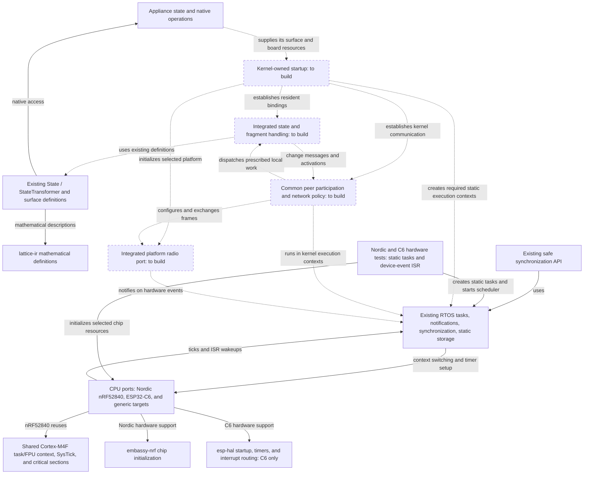

# Lattice vertex kernel direction

Build `lattice-vertex` as one RTOS kernel whose normal runtime makes an appliance
a participant in a Lattice network. This repository owns local execution, peer communication,
and the behavior shared by every vertex. Its FreeRTOS-derived machinery is the
execution core we extend and maintain as part of that kernel.

On supported hardware, adopting Lattice should require appliance definitions and
appliance-specific hardware behavior. Network setup, packet handling, discovery,
exposure, and change propagation are provided by the kernel and its platform port.

Nordic nRF52840 and ESP32-C6 are both hardware targets. C6 support is needed for
the Shelly devices as well as the existing prototypes. Keep each platform's
dependencies isolated and the common kernel's interfaces and protocol portable.

Read this plan alongside the
[architecture white paper](Lattice-DRTOS-Architecture-White-Paper.docx). This file
defines repository ownership and the implementation sequence. Existing interfaces
and experiments are provisional and must be brought into alignment with it. The
[current baseline](#current-baseline) identifies what is implemented today.

## Division of responsibility

| Owner | Supplies and controls |
| --- | --- |
| Appliance author | Native states and state-transforming operations; their IR definitions, axioms, and invariants; appliance-specific I/O and physical behavior |
| Common kernel | Boot and resident storage; local execution contexts; network configuration and discovery; surface enumeration and exposure; change messages; fragment installation and local dispatch; forwarding and relay participation |
| Platform port | MCU startup support, timer and interrupt integration, context switching, radio operation, and board-specific pins, clocks, antenna routing, and hardware limits |
| Nucleus | FSPS, proof, compilation, and delegation of the solved program to participating vertices |
| `lattice-ir` | Shared mathematical definitions used by appliance surfaces and nucleus |

The public appliance concepts remain `State` and `StateTransformer`. An appliance
exposes mutable state, native operations that transform it, and the mathematical
meaning and operating constraints of those operations. The kernel provides the
common behavior that makes that surface participate in Lattice.

Appliance-specific code establishes actual hardware state through the kernel's
state interface. The kernel handles the resulting delta. Native command success
alone does not establish the physical post-state described by an IR effect.
Axioms and invariants are part of the exposed mathematical surface and must remain
available to the FSPS.

For a supported platform, we supply the radio integration. A developer adding an
unsupported MCU, radio, or board may need to implement a port. Every appliance
using that port should then reuse it. Hardware resources and wiring belong at
this boundary; network policy does not become a requirement for each appliance.

The ordinary appliance startup API must not ask the author to select a PAN ID,
channel, radio address, formation/join role, or implement a networking loop. The
kernel owns those decisions and operations. Any installation selection or
credentials needed for commissioning belong to the common Lattice mechanism.

## Local participation produces the distributed kernel

Each vertex encapsulates its appliance, retains its assigned relationships and
compiled fragments, and responds to local changes or received messages. Those
local responses collectively produce the distributed operating system.

A node's common kernel behavior includes:

- Enumerating and exposing states, transformers, axioms, and invariants.
- Broadcasting state changes and passing activation upstream through its resident
  state dependencies.
- Evaluating its assigned compiled conditional and forwarding the continuation.
- Invoking a reached native state transformer with the supplied arguments.
- Forwarding peer messages and participating in relay when required.

No individual node conducts a walk over the entire distributed graph. Nucleus is
an installation and compilation peer; ordinary execution does not require it to
relay or approve each operation. Communication is peer to peer, without a required
router role or permanent central runtime coordinator.

Change is the unit of execution. Handle changes and messages as they arrive.
Separately registered deltas remain distinct; a later change does not silently
withdraw earlier work. There is no graph work queue, periodic graph evaluation
cycle, or extra graph scheduler. Existing RTOS tasks and synchronization provide
local execution facilities, including overlapping work where needed. Local timers
remain available for hardware and communication needs.

Task notifications signal that work or transport data is available. They do not
replace the data describing distinct changes. Notification coalescing must not
silently become coalescing of graph activations. Transport buffering and delivery
mechanics must preserve the distinction between transmission, peer receipt, and
execution; the kernel must not invent repeated transformer invocations.

## Mathematical definitions and native execution

`lattice-ir` defines mathematical state, transformations, constraints, and the
information nucleus needs for reasoning. Firmware can retain those definitions
as static data and expose them through the common kernel.

Nucleus solves and compiles programs, then delegates their fragments. Vertices
install and execute their assigned native fragments. Neither the shared IR crate
nor the vertex kernel needs an IR interpreter, compiler, or solver. The initial
program model is a finite DAG of compiled conditional steps and native function
calls. Preserve the current one-invocation-per-requirement synthesis limit;
expanding that model belongs to nucleus/IR work and does not imply adding a
general-purpose program runtime to each vertex.

State dependencies and transformer invocation have different roles. Upstream
activation belongs to states used by conditions. A transformer is an invocation
endpoint, never a Boolean-condition dependency. Changes produced by its hardware
operation propagate through the affected states. A transformer's return value is
not a replacement for state-change messaging.

## One kernel runtime

The kernel's public startup path accepts the appliance definitions and the selected
platform's resources. It owns initialization of the node's resident structures,
required static execution contexts, and communication behavior, then starts the
existing RTOS scheduler. The appliance author should not assemble these pieces
into an independent runtime.

Use the mechanisms already present in the inherited core:

| Existing mechanism | Integration work |
| --- | --- |
| [Scheduler startup](../src/kernel/tasks.rs), including idle and optional timer tasks | Establish the Lattice system-task and storage setup in the same kernel startup path |
| [Static task creation](../src/sync/task.rs) and [allocation configuration](../src/config.rs) | Supply fixed stacks and control blocks for kernel-owned execution |
| Task notifications and ISR wakeups in [tasks.rs](../src/kernel/tasks.rs) | Connect radio and other relevant hardware events to local kernel handlers |
| [Port selection and primitives](../src/port/mod.rs) | Provide target-correct timer, interrupt, and context-switch integration |
| Existing synchronization and bounded buffers | Reuse them where the concrete execution or transport path needs them |

The startup sequence must establish storage and interrupt targets before a device
can signal them. The platform port and kernel jointly control when interrupts and
local execution become active. Radio callbacks must enter a valid kernel context;
appliance code must not have to reproduce this sequencing.

Radio reception and transmission completion should use the existing RTOS wakeup
facilities rather than the experiment's busy-wait/polling loop. State updates enter
common change handling. Received messages enter common peer handling. Those paths
perform this node's prescribed operations using its resident state and fragments.

## Repository organization

Organize the repository around these responsibilities as runtime integration is
implemented:

| Area | Responsibility |
| --- | --- |
| `src/kernel/` | The complete kernel: startup, task machinery, resident state and change handling, and common peer participation |
| `src/port/` | Architecture, MCU, and radio-specific implementation and board integration |
| `src/sync/` | Safe access to existing kernel synchronization facilities |
| `src/memory/` | Kernel memory support and storage mechanisms |
| `src/lib.rs` | Public entry point and exports |
| `examples/` | Small appliance implementations that consume kernel behavior |

The existing `experiments/` directory is temporary bring-up scaffolding. As its
useful pieces are integrated into platform ports and kernel tests, discard the
superseded probes and remove the directory. It has no place in the permanent
kernel layout, and kernel operation must not depend on it.

The Nordic CPU port is [`src/port/nrf52840.rs`](../src/port/nrf52840.rs). It uses
`embassy-nrf` 0.11.0 for chip initialization and reuses the existing Cortex-M4F
task/FPU context switching, SysTick, and critical sections. It retains the kernel
exception bindings, supplies the fixed 64 MHz clock, and defines the kernel's
interrupt priority boundary for Nordic's three implemented priority bits.
Appliance code does not supply clock constants or scheduler vector bindings.
It requires neither ESP code nor an Embassy executor/time driver.

The ESP32-C6 CPU port is
[`src/port/esp32c6.rs`](../src/port/esp32c6.rs), with the register save/restore
routine beside it in `src/port/esp32c6/context.S`. It uses `esp-hal` 1.1.2 for
reset/startup, interrupt routing, and SYSTIMER. Software interrupt 0 performs
deferred context switches through the existing task scheduler. It does not bring
in the `esp-rtos` scheduler. The generic CLINT port remains a separate target;
both now use a compatible `riscv-rt` 0.16 dependency generation.

For nRF52840 radio integration, examine
[`embassy-nrf`'s 802.15.4 driver](https://github.com/embassy-rs/embassy/blob/main/embassy-nrf/src/radio/ieee802154.rs)
for the peripheral integration. Its radio code is reusable independently of the
Embassy executor. The Nordic CPU port is implemented; radio integration remains
separate work on both supported platforms.

The current top-level surface, observation, and radio code must be integrated into
these responsibilities. Preserve useful typed definitions and checks while
reworking ownership and call paths. File moves should accompany that work. The
FreeRTOS-derived source remains maintained kernel code, with its attribution and
license preserved; its origin does not make its current organization immutable.

A function should live with the data or operation it owns. Extend an existing
kernel facility when it already owns the responsibility. New modules and types
must correspond to concrete behavior or storage, not merely provide a place to
put otherwise unassigned code.

## Radio and network ownership

IEEE 802.15.4 is the initial radio basis. The common protocol must remain portable
across supported radios. Chip-specific dependencies such as `esp-radio` belong
inside the corresponding platform integration. They do not define the appliance
API or the network protocol.

Reuse existing portable framing support, including suitable parts of
`ieee802154`, before growing a separate implementation of the same standard.
Hardware libraries still need chip-specific integration; the kernel supplies that
integration for supported platforms. The implementation effort should concentrate
on Lattice's common behavior above frame I/O.

PAN coordination, channel selection, peer discovery, addressing, and participation
are kernel responsibilities. The radio port applies the kernel's settings within
hardware limits. A public configuration record that requires each appliance to
choose those values is not the intended integration model. The current
`Transceiver` API is a prototype hardware boundary, not a settled appliance API.

The exact bootstrap, network-selection, address, enrollment, and wire encodings
remain implementation decisions. Resolve them in shared kernel code as the first
participation path is built. Discovery must work before Lattice has assigned a
vertex a short radio address. The probe's fixed PAN, addresses, power, and packet format
do not determine these choices. PAN IDs and radio addresses are transport data,
not substitutes for graph relationships or proof of network membership.

Configuration and packet adaptation must stay below the appliance boundary. The
same appliance definition should work on another supported platform without a
new networking implementation. Platform-specific capabilities or limitations
should be handled by that port and the common kernel policy.

## Structured memory and resident relationships

Use fixed, structured memory for Lattice's node machinery. Keep a state, its
dependent relationships, and their upstream references together. One-to-many
relationships must be represented directly and compactly. Each node retains the
local data needed to encapsulate its appliance and participate in its installed
programs.

Local references may be direct memory references or native function handles.
Cross-peer references identify the owning peer and the relevant location there;
remote addresses are never dereferenced as local memory. The wire encoding is an
implementation choice, not a reason to introduce an ECS, copied world model,
global object registry, auto-incremented entity IDs, or relational edge tables.

Use static task/control storage and bounded communication buffers. Fixed rings
with explicit eviction are transport storage, not a graph-job queue. Choose packing,
layout, and hardware offload against the target's actual memory and latency needs.
A selected driver must fit this approach; the experimental C6 driver's allocating
receive queue is work to address before treating that adapter as the kernel port.

## Implementation map

This is the working responsibility map used by the
[post-change review](../AGENTS.md#review-after-each-meaningful-change). Solid arrows
show existing relationships. Dashed boxes and arrows show the integration to
build. The map represents code ownership and local execution, not an executable
DAG. Update the status of these connections as implementation replaces the gaps.

## Current baseline

The inherited task, synchronization, and memory implementations remain the
execution core. `port-nrf52840` connects them to Nordic hardware through the
shared Cortex-M4F port. `initialize` consumes SysTick and returns Nordic appliance
peripherals after HAL initialization. The kernel owns the 1 kHz tick and its
exception handlers. The port starts the 32 MHz crystal required for radio use;
the low-frequency source remains internal. Radio I/O is not initialized yet.

The [Nordic hardware smoke image](../tests/hardware/nrf52840/README.md) builds
without an allocator and without ESP dependencies. Its assertions cover the
kernel vectors, tick configuration, critical sections, ISR wakeup, preemption,
and integer/FPU context preservation. The standalone image uses SWD/RTT and does
not assume a board-specific USB bootloader. It is build/link verified; execution
on an nRF52840 remains unverified.

`port-esp32c6` connects the same task scheduler to the C6 through
esp-hal, saving registers on each task's static stack and switching on a private
2 KiB stack. C6's minimum task/idle stack is 2 KiB because HAL peripheral handlers
use the interrupted task's stack. Timer setup precedes the first task restore,
which enables interrupts only after the scheduler has valid task storage.

The [C6 hardware smoke image](../tests/hardware/esp32c6/README.md) builds without
an allocator. It tests static task startup, nested critical sections, device ISR
notification, tick preemption, and register preservation. Build/link checks pass;
execution on a C6 remains unverified. The software device-event source exercises
the wakeup path but does not establish radio reception. This port still uses a
periodic tick; `tickless-idle` falls back to waiting with that tick running.

The Lattice additions currently provide typed surface/IR definitions, local
change comparison and callback dispatch, and experimental radio interfaces and
framing. They are not yet connected to RTOS startup or a common peer runtime.
The local callback list is not the vertex's installed distributed DAG structure.

The C6 radio probe has exchanged frames on hardware, but it runs separately from
our RTOS scheduler. Its use of the compile-only default port does not establish
C6 scheduler execution. The inherited `riscv32` port assumes SiFive CLINT hardware;
the new C6 port supplies the different timer and interrupt integration. The radio
range/configuration issue also remains open. Detailed experiment results are
evidence for hardware work, not architectural requirements or proof of kernel
integration.

## Next implementation sequence

1. **Establish the integrated boot path across Nordic and ESP.** Provide
   the timer, interrupt, and context-switch integration needed by the existing scheduler. Establish the
   kernel's resident storage and required static task setup. Connect radio events
   to a kernel-owned execution context. Completion means the flashed image runs
   our scheduler and the hardware event path reaches our kernel, with no separate
   appliance-owned radio loop.
   Both CPU ports and static scheduler test images are now implemented. Remaining:
   hardware execution, fixed radio buffering, and kernel-owned radio task/startup
   integration on both platforms. The test images are not the final appliance
   startup API.
2. **Implement automatic peer participation.** Put radio configuration, bootstrap,
   discovery, and surface-exposure handling in the common kernel. Use the provided
   platform port to perform the hardware operations. Completion means two appliance
   implementations can enter the network and expose their surfaces through the
   same kernel behavior, without choosing PANs or writing packet handlers.
3. **Complete the state-change communication path.** An appliance establishes a
   state change; the kernel detects/registers the delta, emits the required peer
   message, and the receiving kernel performs its prescribed local handling.
   Completion means this path works through the common runtime, with the examples
   reduced to appliance definitions and physical I/O.

Extend that working path into compiled-fragment installation, conditional
activation, transformer invocation, and forwarding. Keep upstream state
activation distinct from downstream execution. Nucleus supplies compiled work;
its full implementation is not a prerequisite to building the node's common
mechanics. Relay optimization and storage tuning follow concrete implementation
needs rather than displacing these first runtime steps.

## Development approach

Build in useful increments, compile as we go, and learn from concrete failures.
Use focused checks for actual invariants: frame encoding, static-storage bounds,
interrupt-to-task handoff, and the end-to-end behavior just added. Reuse existing
kernel tests. QEMU and physical boards are tools for specific questions, not
prerequisites to every small change or grounds for an exhaustive simulation gate.

Keep compile success, scheduler execution, packet exchange, and physical appliance
behavior as separate evidence. A radio probe or host test does not prove the full
kernel is running on a target. Supported-platform progress should make appliance
examples smaller and remove custom networking work from them.

After each meaningful change, review names, ownership, and the implementation map.
Check for duplicated storage or behavior, confused domain terms, and abstractions
without a concrete responsibility. Let the code's developing responsibilities
refine the organization. Keep this document focused on the direction and next
working kernel behavior. Retain useful build instructions with the supported
ports and tests; temporary investigation material must not become a permanent
part of the kernel source tree.
