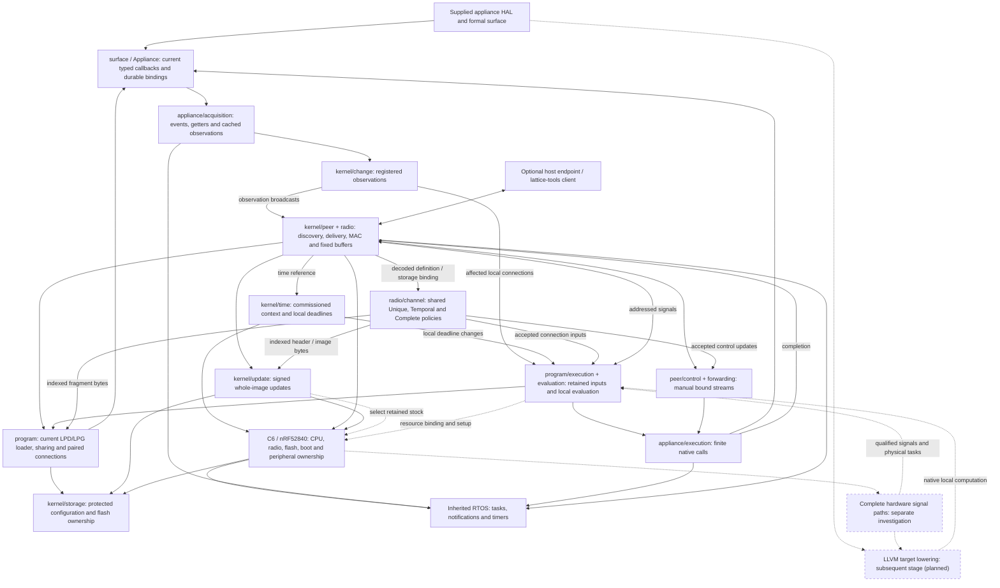

# Lattice vertex implementation direction

[ARCHITECTURE.md](ARCHITECTURE.md) owns intended semantics,
[PROGRAM_DESIGN.md](PROGRAM_DESIGN.md) owns the circuit migration plan,
and [AGENTS.md](../AGENTS.md) owns development discipline. This file is the current
implementation map and work order, not another protocol specification or run diary.

## Current baseline

**Maintained activation and carried context are implemented in software on the
shared C6/Nordic kernel.** Local changes resume their own fragment; selected output
changes propagate downstream without a backward trip to the head. LPD predicates,
branches, arithmetic and authored calls are unchanged. Local record dispatch remains;
Selected two-board validation passed; LLVM native lowering follows. Hardware-offload research remains
separate.

| Area | Current implementation | Boundary / next use |
| --- | --- | --- |
| RTOS and CPU ports | FreeRTOS-derived tasks, interrupts, timers and synchronization on C6/Nordic | Reuse; no new general process environment |
| Appliance surface | Durable named bindings, typed getters/native operations, IR meanings and invariants | Getter callbacks do not describe an allocatable physical circuit |
| Acquisition | Per-state event, interval and call-boundary acquisition into a software observation cache | IRQ wakeups are proven; direct physical state/component realization is not |
| Program installation | Protected persistence, validation, local computation sharing, paired connections, removal and reconstruction | Reuse ownership; LPD v1/LPG v4 retained; no new logic grammar |
| Program execution | Retained per-connection inputs/output, direct local reevaluation, sequenced HIGH/LOW updates and native-call argument tracking | Both chip directions checked; replace local record dispatch with LLVM-generated native code |
| Time/solar | Commissioned UTC/location/civil rules, calculated boundaries, deadline events and peer reacquisition | Reuse local sources; deadline events resume the affected local connection |
| Peer/radio | Formation, discovery, adjacency, addressed forwarding, MAC ACK/retry and protected receive queues | Reuse; addressed signals reuse delivery; active heartbeat remains deferred |
| Observation delivery | Best-effort exposed-value broadcasts plus reliable addressed connection updates | Retained input acceptance is independent of the bounded notice cache |
| Receive policies | Shared Channel<Definition, Policies, Storage>; control/state-notice freshness and indexed program/firmware reception | Retained connection inputs use Unique + Temporal; relay-notice storage remains bounded |
| Manual continuous control | Pinned paths, compact argument messages, latest-target preparation and feedback | Reuse where applicable; its coalescing policy is not automatically circuit policy |
| Native execution | Finite RTOS call tasks, admission/completion, update holds and duplicate handling | Running calls finish; hardware tasks should implement suitable physical actions |
| Storage and updates | One flash owner, protected configuration, signed whole-image OTA, boot confirmation/recovery | Preserve configuration and recovery while changing the execution representation |
| Host and retained state | Optional USB attachment; firmware-bound history helper | USB is not an ordinary appliance requirement; automation-authored history stays deferred |
| Hardware circuit backend | Not implemented on either chipset | Separate investigation of complete signal paths, including RF; isolated predicate offload is not end-to-end proof |

Prior C6/Nordic hardware evidence covers the former traversal engine, shared-fragment reclamation,
time reacquisition, interrupt-driven acquisition, compact manual control and OTA.
The radio fixes also passed back-to-back native calls and reads in both directions.
These runs used software-backed appliance states; they do not prove a physical
circuit backend, arbitrary RF delivery, or hard response-time bounds. Evidence and
maintained procedures belong beside their components.

Incoming LPD fragments remain capped at **512 bytes**; the current resident
arena is **8 KiB**. These are implementation limits, not per-circuit allocations or
the retained execution byte arena. Staged component installation for a genuinely
larger fragment is still deferred. The removed callback-fragment prototype remains
archived outside the repository and must not become a substitute for compiled circuits.

## Implementation map

Solid arrows are current relationships. Dashed arrows are planned relationships.
Native target lowering is the stage after maintained software connections and
occurs **before activation**. Compiler packaging and the native artifact/call ABI
remain to specify. Existing module names identify ownership, not a commitment to
retain the old representation.

The signal path has replaced upstream/forward visits. Existing local arithmetic
and record dispatch remain the explicit intermediate backend. LLVM-generated
computation will replace that dispatch while retaining input/output ownership and
propagation. Kernel code owns installation, resources and networking. The appliance
gains no evaluator, message construction or firmware main loop.

## Next implementation milestone

**Define the native artifact/ABI for LLVM lowering on C6 and nRF52840.** The retained
software engine has host checks, release builds and selected two-board evidence:
local resume without head admission, HIGH/LOW propagation, argument changes,
stale/duplicate acceptance, removal and reboot reconstruction. The physical runs
used software-backed appliance values. They do not establish a hardware circuit
backend or general RF/latency guarantees. Detailed evidence belongs in the
[program component](../src/kernel/program/README.md#maintained-checks).

Execution reuses one 4 KiB arena for retained values and working extents, with
explicit metadata bounds and declaration-based admission. Local compaction keeps
released byte ranges reusable. [The component notes](../src/kernel/program/README.md#storage-and-capacity)
own the exact limits and wire layout. LPD v1/LPG v4 and protected appliance/time
configuration remain unchanged; execution tags 10–13 are retired in favor of
addressed signal tag 30. No deployed-automation compatibility runtime exists.

Incoming activation is LOW and volatile. Only enabled heads originate initial
activation; local changes elsewhere resume against current upstream inputs.
No neighbor snapshot/query or forced reannouncement was added. Retained HIGH
persists between changes; the active heartbeat remains deferred.

The following compiler stage must settle target entry ABI, executable placement,
relocation and authorized native bindings before implementation. The authoring/
compiler tool does not participate in ongoing evaluation. Hardware investigation
does not block native-code work.

## Boundaries of this work

- The inherited RTOS, reliable MAC handling, protected storage, OTA and normal peer
  discovery remain useful. No new scheduler, transport stack or radio tuning is implied.
- Software-maintained activation is the immediate target; CPU-independent sustained
  continuity is a separate hardware goal. Do not claim the former proves the latter.
- Reboot reconstructs definitions and enabled heads, not old activation. General
  replacement/cutover and active-path failure detection remain separate work.
- The old getter fallback remains documented as implemented; it is not the intended
  mandatory route for every physical signal in the new backend.
- Manual continuous-control coalescing remains explicit. A duplicate circuit update
  and a distinct accepted target transition are different things.
- Tickless completion, hardware cryptography and experimental RF-range work are
  separate priorities. C6 TX remains 20 dBm; never scan the laptop Wi-Fi.
- Optional USB debugging/host-companion support is not production appliance work.
  Measure the actual release role when reporting RAM, image or CPU costs.

## Shelly testing: next boot/storage work

The selected direction is a [locally retained, selectable stock backup](FIRMWARE_UPDATES.md#selectable-shelly-stock-backup-planned).
Boot selection and protected placement are not implemented. Inspect one Shelly's
complete stock image and flash map before changing the C6 backend's two-slot layout.
The Wi-Fi recovery-image proposal is deferred.

## Deferred work

An end-to-end heartbeat while a circuit is active follows the software activation
validation. Until then, retained HIGH can outlive an isolated upstream failure.
The present shared-power bench tolerates that limitation; no heartbeat timer or
forced neighbor-state recovery is introduced by the retained-input change.

Independent kernel OTA remains slated after functional program installation and
execution. It must eventually preserve an existing appliance binary through a
stable binary interface. It is not a prerequisite for the current kernel work or
for preserving local configuration through combined-image updates.

## Component references and evidence

| Owner | Documentation |
| --- | --- |
| Peer formation and maintained discovery checks | [peer/TESTING.md](../src/kernel/peer/TESTING.md) |
| Adjacent links and guided traversal | [peer/LINKS.md](../src/kernel/peer/LINKS.md) |
| Mathematical surface encoding/read path | [peer/EXPOSURE.md](../src/kernel/peer/EXPOSURE.md) |
| Native calls, current-state reads and delta propagation | [peer/INVOCATION.md](../src/kernel/peer/INVOCATION.md) |
| Numeric wire types and marginal communication cost | [peer/wire/README.md](../src/kernel/peer/wire/README.md) |
| Continuous scalar intent and feedback | [control/README.md](../src/kernel/peer/control/README.md) |
| Host attachment | [peer/host/README.md](../src/kernel/peer/host/README.md) |
| Image transfer and activation | [FIRMWARE_UPDATES.md](FIRMWARE_UPDATES.md) |
| Local time, solar and commissioning | [time/README.md](../src/kernel/time/README.md) |
| Resident records and program installation | [program/README.md](../src/kernel/program/README.md) |
| Flash regions and committed configuration | [storage/README.md](../src/kernel/storage/README.md) |
| Build/upload and maintained hardware checks | [port/TESTING.md](../src/port/TESTING.md) |

Both MCU targets have kernel/peer builds and selected hardware evidence for native
calls, observed state and update lifecycle behavior. Those checks do not establish
all multi-hop paths, physical appliance convergence
or loss-free RF. Test commands and their scope belong beside the owners above.
RF range/PHY investigation remains parked; historical captures and pre-cleanup
source snapshots are archived outside the repository.
