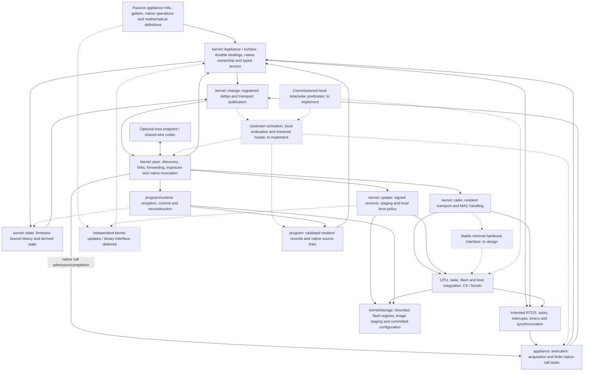

# Lattice vertex implementation direction

Read [ARCHITECTURE.md](ARCHITECTURE.md) for the system model and
[AGENTS.md](../AGENTS.md) for development discipline. This file records the code's
current responsibilities, gaps and next work. It is not a second specification,
protocol manual, test diary or history of completed milestones.

## Current baseline

| Area | Implemented behavior | Current boundary |
| --- | --- | --- |
| RTOS core and CPU ports | Existing task, interrupt, timer and synchronization facilities; C6 and Nordic startup | Reuse this foundation; appliance authors do not reimplement it |
| State and native operations | Passive shared HAL, kernel getter acquisition, observed-value cache, registered deltas and history maintenance | Fallback sampling is implemented; direct device-event acquisition bindings remain optional port work |
| Native call execution | Static FreeRTOS call tasks, asynchronous RF/USB completion, pending-call deduplication and update holds | Execution capacity is bounded; caller/route timeouts do not cancel a call or guarantee late result delivery |
| Durable appliance bindings | Named declarations become owner-local numeric references; native lookup/deltas and LSF v2 use them; duplicate bindings are rejected | Loader reconstruction uses these references; changed physical meanings/types remain compatibility changes |
| Program loading and wiring | Ordinary peer/USB installation, typed LPD records, durable commit, native dependency chains and reconstruction before formation | Definitions install inactive; activation, traversal and native program execution remain unimplemented |
| Protected configuration storage | Both ports reserve 16 KiB; one kernel flash owner serves program storage and optional signed updates | Layout 3 requires coordinated provisioning; host checks do not establish physical power-loss recovery |
| Retained state | Static native-width history, native updater, mathematical enumeration and ordinary reads/deltas | Firmware-bound before startup; not externally authored program storage |
| Communication | Kernel-owned 802.15.4 framing, formation, maintained links, owner-directed forwarding and bounded MAC delivery | Concrete C6/Nordic backends; portable public hardware interface still missing |
| Surface and native access | Read surfaces/current state, invoke native functions, forward observations | Upstream activation and predicate traversal still need execution integration |
| Host participation | Optional USB companion endpoint and shared numeric codec | Host clients live in `lattice-tools`; tablet consumes that library |
| Firmware updates | Signed whole-image staging, durable resume, local deferral, startup confirmation and watchdog recovery | Combined-image replacement is accepted for now; independent kernel updates are deferred |

The callback-based `Fragment` prototype and its private packet queue are removed.
Its source and runs are preserved in the external lab. They established callback
and operand transport, not installation of previously unknown automations.

The firmware-local `observation::Dependent`/report API and its callback example
have been removed and archived. The native updater accepted by
`Appliance::install_state` remains a pre-start history helper, not the compiler's
program interface. Resident records now install through the common peer service.
Traversal execution remains absent.

## Implementation map

Solid edges are implemented relationships; dashed edges are planned integration.
This is a responsibility map, not the executable DAG of a particular automation.
Protocol details and internal updater phases belong in their component notes.

## Next implementation milestone

[Program loading](../src/kernel/program/README.md) now receives definitions after
firmware startup, validates their native bindings and local dataflow, commits them,
and rebuilds state-to-program links on restart. Received bytes are never firmware
callbacks or downloaded function pointers. The host client has upload, read and
inspection commands. Installed definitions remain **inactive**; this is not yet an
executing distributed program.

Next, connect those resident records to execution:

1. Activate dependencies at the observation/history commit boundary, independently
   of the transport ring's oldest-entry eviction. Follow their upstream references
   to an enabled head without evaluating predicates on the upstream trip.
2. Supply bounded per-traversal carried/scratch storage and run the installed local
   primitives, following authored true/false links and reducing values greedily.
   Invoke native functions through the existing RTOS call tasks. The manual-call
   codec's payload limit is not the program head's capacity.
3. Add admission/enablement and its persistent state. Enablement and recovery of an
   enabled head each start one fresh evaluation when required local inputs are
   available. Repeated requests do not create extra enablement evaluations; old
   mutations are never replayed. Subsequent deltas remain independent activations.
4. Bind local time/solar deadlines and externally authored retained-state maintenance
   through the same source mechanism. Their unsupported record kinds are currently
   rejected, not substituted with precompiled appliance functions.

The [remaining program design](PROGRAM_DESIGN.md) keeps the worked distributed
example and integration gaps. New definitions currently append to fixed storage;
replacement, deletion/reclamation and old-work drainage need their own concrete
implementation before those operations are offered. Do not imply that a local
installation receipt establishes remote readiness or complete program execution.

The one physical flash owner supports both configuration-only startup and signed
updates. Trial confirmation now also requires successful program reconstruction.
The loader runs on the resident task stack before PHY formation; it does not wait
for a peer. Hardware validation still requires layout-3 provisioning. Host checks
and builds establish storage/typing/wiring behavior, not live radio installation
or physical execution.

## Deferred work

Independent kernel OTA remains slated after functional program installation and
execution. It must eventually preserve an existing appliance binary through a
stable binary interface. It is not a prerequisite for the current kernel work or
for preserving local configuration through combined-image updates.

## Component references and evidence

| Owner | Documentation |
| --- | --- |
| Peer formation and maintained discovery checks | [peer/TESTING.md](../src/kernel/peer/TESTING.md) |
| Adjacent links and guided traversal | [peer/LINKS.md](../src/kernel/peer/LINKS.md) |
| Mathematical surface encoding/read path | [peer/EXPOSURE.md](../src/kernel/peer/EXPOSURE.md) |
| Native calls, current-state reads and delta propagation | [peer/INVOCATION.md](../src/kernel/peer/INVOCATION.md) |
| Numeric wire types and marginal communication cost | [peer/wire/README.md](../src/kernel/peer/wire/README.md) |
| Host attachment | [peer/host/README.md](../src/kernel/peer/host/README.md) |
| Image transfer and activation | [FIRMWARE_UPDATES.md](FIRMWARE_UPDATES.md) |
| Resident records and program installation | [program/README.md](../src/kernel/program/README.md) |
| Flash regions and committed configuration | [storage/README.md](../src/kernel/storage/README.md) |
| Build/upload and maintained hardware checks | [port/TESTING.md](../src/port/TESTING.md) |

Both MCU targets have kernel/peer builds and selected hardware evidence for native
calls, observed state and update lifecycle behavior. Those checks do not establish
resident program execution, all multi-hop paths, physical appliance convergence
or loss-free RF. Test commands and their scope belong beside the owners above.
RF range/PHY investigation remains parked; historical captures and pre-cleanup
source snapshots are archived outside the repository.
