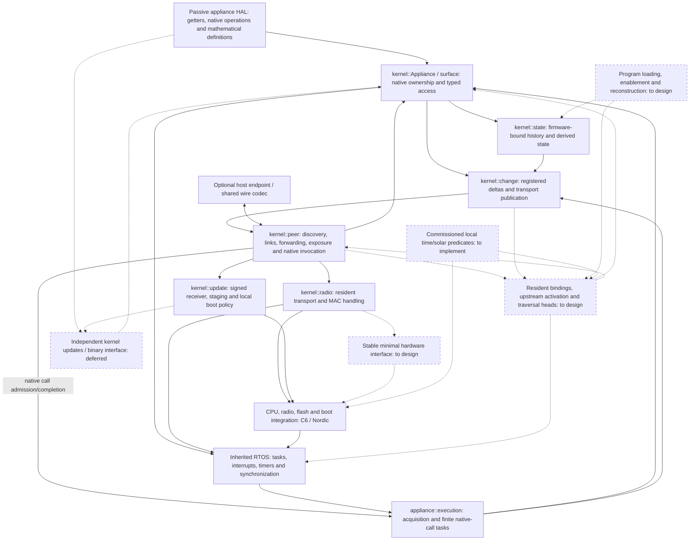

# Lattice vertex implementation direction

Read [ARCHITECTURE.md](ARCHITECTURE.md) for the system model and
[AGENTS.md](../AGENTS.md) for development discipline. This file records the code's
current responsibilities, gaps and next work. It is not a second specification,
protocol manual, test diary or history of completed milestones.

## Current baseline

| Area | Implemented behavior | Current boundary |
| --- | --- | --- |
| RTOS core and CPU ports | Existing task, interrupt, timer and synchronization facilities; C6 and Nordic startup | Reuse this foundation; appliance authors do not reimplement it |
| State and native operations | Passive shared HAL, kernel getter acquisition, observed-value cache, registered deltas and history maintenance | Fallback sampling is implemented; direct device-event acquisition bindings remain optional port work |
| Native call execution | Static FreeRTOS call tasks, asynchronous RF/USB completion, pending-call deduplication and update holds | Execution capacity is bounded; caller/route timeouts do not cancel a call or guarantee late result delivery |
| Retained state | Static native-width history, native updater, mathematical enumeration and ordinary reads/deltas | Firmware-bound before startup; not externally authored program storage |
| Communication | Kernel-owned 802.15.4 framing, formation, maintained links, owner-directed forwarding and bounded MAC delivery | Concrete C6/Nordic backends; portable public hardware interface still missing |
| Surface and native access | Read surfaces/current state, invoke native functions, forward observations | No resident program, upstream activation or predicate traversal |
| Host participation | Optional USB companion endpoint and shared numeric codec | Host clients live in `lattice-tools`; tablet consumes that library |
| Firmware updates | Signed whole-image staging, durable resume, local deferral, startup confirmation and watchdog recovery | Combined-image replacement is accepted for now; independent kernel updates are deferred |

The callback-based `Fragment` prototype and its private packet queue are removed.
Its source and runs are preserved in the external lab. They established callback
and operand transport, not installation of previously unknown automations.

The firmware-local `observation::Dependent`/report API and its callback example
have been removed and archived. The native updater accepted by
`Appliance::install_state` remains a pre-start history helper, not the compiler's
program interface. Installed distributed predicates/traversal are still absent.

## Implementation map

Solid edges are implemented relationships; dashed edges are planned integration.
This is a responsibility map, not the executable DAG of a particular automation.
Protocol details and internal updater phases belong in their component notes.

## Immediate design work

The behavior is settled in the architecture. The remaining design must show the
actual interface and resident records before implementation proceeds.
The [resident program design](PROGRAM_DESIGN.md) records the current code mapping,
proposed mechanisms, worked traversal and decisions still awaiting resolution.
It does not change the implemented/planned boundary in the map above.

Getter acquisition and finite native-call execution are now kernel-owned. The
[current mechanics](../src/kernel/peer/INVOCATION.md#appliance-ownership) describe
the sampling and task bounds; port builds and host boundaries are checked, while
physical validation of this revision remains outstanding.

1. **Lay out the resident program.** Specify owned input references, local test/
   calculation, upstream and true/false links, operand locations and any retained
   state or local deadline. Work through a real branch and computed mutation
   argument; show which values are live and where their locations are reused.
   Each traversal owns its values; capacity follows the emitted program's live
   data, not the number of predicates or today's native-call argument limit.
2. **Define loading and wiring.** Show how received definitions enter reserved
   storage, bind local state/functions and peer references, establish readiness,
   become enabled, and reconstruct after restart from protected local storage.
   Firmware authors supply none of that work. Surface publication must not restrict
   program installation to startup. Resolve any representation or lifecycle ambiguity with the user.

This is a design pass against real integration needs, not a new RF experiment or
an assumed universal I/O framework. The field layout, supported local operation
representation and loading mechanics are not implemented or settled merely by
being listed here.

## Next implementation milestone

Implement the agreed interface and externally supplied program installation and
traversal as one useful capability. An ordinary authoring peer must be able to
install a new program on running appliance firmware and disconnect afterward.
For now, kernel/appliance code remains one combined image that can be reflashed;
installed program/configuration storage gets an explicit protected boundary.

The result must exercise a state change reaching its program head, authored
short-circuit paths, greedy value computation and a native mutation without a
firmware rebuild. Time/solar predicates bind locally at their assigned evaluation
vertices and enter the same activation mechanism. Changes caused by execution
start further traversals normally; there is no supersession or global execution
lock. This milestone is not satisfied by precompiled callbacks exchanging values.

Native access, observation capture, history and peer delivery are foundations to
reuse. Hardware testing answers a specific implemented question after the design
is clear; it is not a substitute for an installation mechanism.

## Deferred work

Independent kernel OTA remains slated after functional program installation and
execution. It must eventually preserve an existing appliance binary through a
stable binary interface. It is not a prerequisite for the current kernel work or
for preserving local configuration through combined-image updates.

## Component references and evidence

| Owner | Documentation |
| --- | --- |
| Peer formation and maintained discovery checks | [peer/TESTING.md](../src/kernel/peer/TESTING.md) |
| Adjacent links and guided traversal | [peer/LINKS.md](../src/kernel/peer/LINKS.md) |
| Mathematical surface encoding/read path | [peer/EXPOSURE.md](../src/kernel/peer/EXPOSURE.md) |
| Native calls, current-state reads and delta propagation | [peer/INVOCATION.md](../src/kernel/peer/INVOCATION.md) |
| Numeric wire types and marginal communication cost | [peer/wire/README.md](../src/kernel/peer/wire/README.md) |
| Host attachment | [peer/host/README.md](../src/kernel/peer/host/README.md) |
| Image transfer and activation | [FIRMWARE_UPDATES.md](FIRMWARE_UPDATES.md) |
| Build/upload and maintained hardware checks | [port/TESTING.md](../src/port/TESTING.md) |

Both MCU targets have kernel/peer builds and selected hardware evidence for native
calls, observed state and update lifecycle behavior. Those checks do not establish
resident program execution, all multi-hop paths, physical appliance convergence
or loss-free RF. Test commands and their scope belong beside the owners above.
RF range/PHY investigation remains parked; historical captures and pre-cleanup
source snapshots are archived outside the repository.
