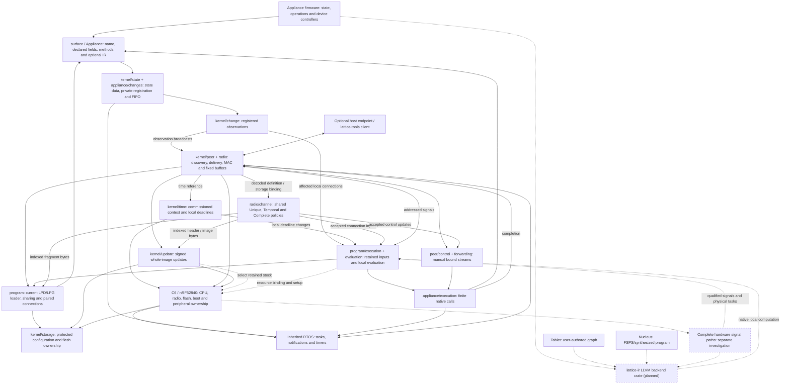

# Lattice vertex implementation direction

[ARCHITECTURE.md](ARCHITECTURE.md) owns intended semantics,
[PROGRAM_DESIGN.md](PROGRAM_DESIGN.md) owns the circuit migration plan,
and [AGENTS.md](../AGENTS.md) owns development discipline. This file is the current
implementation map and work order, not another protocol specification or run diary.

## Current baseline

**Maintained activation and carried context are implemented in software on the
shared C6/Nordic kernel.** Local changes resume their own fragment; selected output
changes propagate downstream without a backward trip to the head. LPD predicates,
branches, arithmetic and authored calls are unchanged. Selected two-board validation
passed. Local record dispatch remains; the initial firmware state/event interface is implemented and awaits appliance
integration before LLVM native lowering. Hardware-offload research remains separate.

| Area | Current implementation | Boundary / next use |
| --- | --- | --- |
| RTOS and CPU ports | FreeRTOS-derived tasks, interrupts, timers and synchronization on C6/Nordic | Reuse while useful; replaceable substrate beneath the Lattice firmware contract |
| Appliance surface | Compile-time names exposed on demand, concrete State values, automatic field/event registration, ordinary native methods and optional IR metadata | Exercise the first interface in real appliance firmware; names do not change durable bindings or compatibility fingerprints |
| State changes | Typed captured-value FIFO, automatic cell transitions and hardware capture handlers; blocking state task | No getter polling or call-boundary sampling; actual appliance/IRQ integration still needs validation |
| Program installation | Protected persistence, validation, local computation sharing, paired connections, removal and reconstruction | Reuse ownership; LPD v1/LPG v4 retained; no new logic grammar |
| Program execution | Retained per-connection inputs/output, direct local reevaluation, sequenced HIGH/LOW updates and native-call argument tracking | Both chip directions checked; replace local record dispatch with LLVM-generated native code |
| Time/solar | Commissioned UTC/location/civil rules, calculated boundaries, deadline events and peer reacquisition | Reuse local sources; deadline events resume the affected local connection |
| Peer/radio | Formation, discovery, adjacency, addressed forwarding, MAC ACK/retry and protected receive queues | Reuse; addressed signals reuse delivery; active heartbeat remains deferred |
| IR availability | Explicit optional models; discovery advertises absent/incomplete/declared-complete without extra frame bytes | Nucleus can skip incomplete declarations; native controls do not require IR |
| Observation delivery | Best-effort exposed-value broadcasts plus reliable addressed connection updates | Retained input acceptance is independent of the bounded notice cache |
| Receive policies | Shared Channel<Definition, Policies, Storage>; control/state-notice freshness and indexed program/firmware reception | Retained connection inputs use Unique + Temporal; relay-notice storage remains bounded |
| Manual continuous control | Pinned paths, compact argument messages, latest-target preparation and feedback | Reuse where applicable; its coalescing policy is not automatically circuit policy |
| Native execution | Finite RTOS call tasks, admission/completion, update holds and duplicate handling | Running calls finish; hardware tasks should implement suitable physical actions |
| Storage and updates | One flash owner, protected configuration, signed whole-image OTA, boot confirmation/recovery | Preserve configuration and recovery while changing the execution representation |
| Host and retained state | Optional USB attachment; firmware-bound history helper | USB is not an ordinary appliance requirement; automation-authored history stays deferred |
| Hardware circuit backend | Not implemented on either chipset | Separate investigation of complete signal paths, including RF; isolated predicate offload is not end-to-end proof |

Prior C6/Nordic hardware evidence covers the former traversal engine, shared-fragment reclamation,
time reacquisition, interrupt-driven acquisition, compact manual control and OTA.
The radio fixes also passed back-to-back native calls and reads in both directions.
These runs used software-backed appliance states; they do not prove a physical
circuit backend, arbitrary RF delivery, or hard response-time bounds. Evidence and
maintained procedures belong beside their components.

Incoming LPD fragments remain capped at **512 bytes**; the current resident
arena is **8 KiB**. These are implementation limits, not per-circuit allocations or
the retained execution byte arena. Staged component installation for a genuinely
larger fragment is still deferred. The removed callback-fragment prototype remains
archived outside the repository and must not become a substitute for compiled circuits.

## Implementation map

Solid arrows are current relationships. Dashed arrows are planned relationships.
Native target lowering is the stage after maintained software connections and
occurs **before activation**. The compiler belongs in a separate lattice-ir crate;
the native artifact/call ABI remains to specify. Existing module names identify
ownership, not a commitment to retain the old representation.

The signal path has replaced upstream/forward visits. Existing local arithmetic
and record dispatch remain the explicit intermediate backend. LLVM-generated
computation will replace that dispatch while retaining input/output ownership and
propagation. Kernel code owns installation, resources and networking. Appliance
firmware uses kernel primitives for its device behavior without implementing a
graph evaluator or message construction. The state/event interface stays
with the existing surface/appliance owners; it does not add a second runtime.

## Next implementation milestone

**Implement appliance firmware against the initial state/event interface, then prune.**
The [firmware interface](../src/kernel/appliance/README.md) is implemented: State data, automatic field/event registration, native method declarations, local calls
and device access for continuing controllers. Default polling, readiness-only event
masks, observation mirrors and before/after native-call sampling are removed.
Host checks and both maintained MCU firmware builds pass; this is not yet a physical
IRQ/actuator validation or proof that the four appliance integrations are complete.
The [consumer entry point](../README.md#start-an-appliance) covers local development
and pinned Git consumption. Surface/argument boundary checks live beside
their implementation; retired getter/callback integration tests are removed.

Use the [integration exercise](PROGRAM_DESIGN.md#appliance-integration-exercise)
for relay, dimmer, fan and diffuser firmware, plus the TV command-model review.
Classify real blockers before extending the kernel, then prune redundant machinery.
Keep broadcast state events separate from directed circuit continuations. Mathematical
surface metadata serves synthesis/authoring; the kernel uses operational bindings.
After those integrations, define the native artifact/ABI for LLVM lowering on C6 and
nRF52840. The retained
software engine has host checks, release builds and selected two-board evidence:
local resume without head admission, HIGH/LOW propagation, argument changes,
stale/duplicate acceptance, removal and reboot reconstruction. The physical runs
used software-backed appliance values. They do not establish a hardware circuit
backend or general RF/latency guarantees. Detailed evidence belongs in the
[program component](../src/kernel/program/README.md#maintained-checks).

Execution reuses one 4 KiB arena for retained values and working extents, with
explicit metadata bounds and declaration-based admission. Local compaction keeps
released byte ranges reusable. [The component notes](../src/kernel/program/README.md#storage-and-capacity)
own the exact limits and wire layout. LPD v1/LPG v4 and protected appliance/time
configuration remain unchanged; execution tags 10–13 are retired in favor of
addressed signal tag 30. No deployed-automation compatibility runtime exists.

LVT v8 carries IR availability; LSF v4 carries optional models and an appliance-name
trailer. Host envelopes remain v4. Surface readers need v4 support; compatibility
fingerprints remain the canonical v3 definitions, independent of the name.

Incoming activation is LOW and volatile. Only enabled heads originate initial
activation; local changes elsewhere resume against current upstream inputs.
No neighbor snapshot/query or forced reannouncement was added. Retained HIGH
persists between changes; the active heartbeat remains deferred.

The shared LLVM backend will live beside the core definitions in lattice-ir,
as a separate crate used by tablet compilation and nucleus. Only nucleus runs
synthesis. The following stage must settle target entry ABI, executable placement,
relocation and authorized native bindings before implementation. The compiler
does not participate in ongoing evaluation. Hardware investigation
does not block native-code work.

## Boundaries of this work

- The inherited RTOS, reliable MAC handling, protected storage, OTA and normal peer
  discovery remain useful. No new scheduler, transport stack or radio tuning is implied.
- Software-maintained activation is the immediate target; CPU-independent sustained
  continuity is a separate hardware goal. Do not claim the former proves the latter.
- Reboot reconstructs definitions and enabled heads, not old activation. General
  replacement/cutover and active-path failure detection remain separate work.
- The getter fallback has been removed. State access is for explicit reads;
  device qualification/acquisition belongs to the source, and captured events drive changes.
- Manual continuous-control coalescing remains explicit. A duplicate circuit update
  and a distinct accepted target transition are different things.
- Tickless completion, hardware cryptography and experimental RF-range work are
  separate priorities. C6 TX remains 20 dBm; never scan the laptop Wi-Fi.
- Optional USB debugging/host-companion support is not production appliance work.
  Measure the actual release role when reporting RAM, image or CPU costs.

## Shelly testing: next boot/storage work

The selected direction is a [locally retained, selectable stock backup](FIRMWARE_UPDATES.md#selectable-shelly-stock-backup-planned).
Boot selection and protected placement are not implemented. Inspect one Shelly's
complete stock image and flash map before changing the C6 backend's two-slot layout.
The Wi-Fi recovery-image proposal is deferred.

## Deferred work

An end-to-end heartbeat while a circuit is active follows the software activation
validation: periodic head-to-tail continuity traffic and a correlated pong, not a
continuous stream or a repeated native invocation. Each DAG performs a discrete
mutation; a sunset-on/midnight-off schedule contains two DAGs. LOW does not issue
the opposite action. Interval, local expiry and recovery handling remain open in
the implementation plan. Until implemented, retained HIGH can outlive an isolated
upstream failure; the current shared-power bench tolerates that limitation.

Independent kernel OTA remains slated after functional program installation and
execution. It must eventually preserve an existing appliance binary through a
stable binary interface. It is not a prerequisite for the current kernel work or
for preserving local configuration through combined-image updates.

## Component references and evidence

| Owner | Documentation |
| --- | --- |
| Peer formation and maintained discovery checks | [peer/TESTING.md](../src/kernel/peer/TESTING.md) |
| Adjacent links and guided traversal | [peer/LINKS.md](../src/kernel/peer/LINKS.md) |
| Mathematical surface encoding/read path | [peer/EXPOSURE.md](../src/kernel/peer/EXPOSURE.md) |
| Firmware-facing state/event primitives | [appliance/README.md](../src/kernel/appliance/README.md) |
| Native calls, current-state reads and delta propagation | [peer/INVOCATION.md](../src/kernel/peer/INVOCATION.md) |
| Numeric wire types and marginal communication cost | [peer/wire/README.md](../src/kernel/peer/wire/README.md) |
| Continuous scalar intent and feedback | [control/README.md](../src/kernel/peer/control/README.md) |
| Host attachment | [peer/host/README.md](../src/kernel/peer/host/README.md) |
| Image transfer and activation | [FIRMWARE_UPDATES.md](FIRMWARE_UPDATES.md) |
| Local time, solar and commissioning | [time/README.md](../src/kernel/time/README.md) |
| Resident records and program installation | [program/README.md](../src/kernel/program/README.md) |
| Flash regions and committed configuration | [storage/README.md](../src/kernel/storage/README.md) |
| Build/upload and maintained hardware checks | [port/TESTING.md](../src/port/TESTING.md) |

Both MCU targets have kernel/peer builds and selected hardware evidence for native
calls, observed state and update lifecycle behavior. Those checks do not establish
all multi-hop paths, physical appliance convergence
or loss-free RF. Test commands and their scope belong beside the owners above.
RF range/PHY investigation remains parked; historical captures and pre-cleanup
source snapshots are archived outside the repository.
