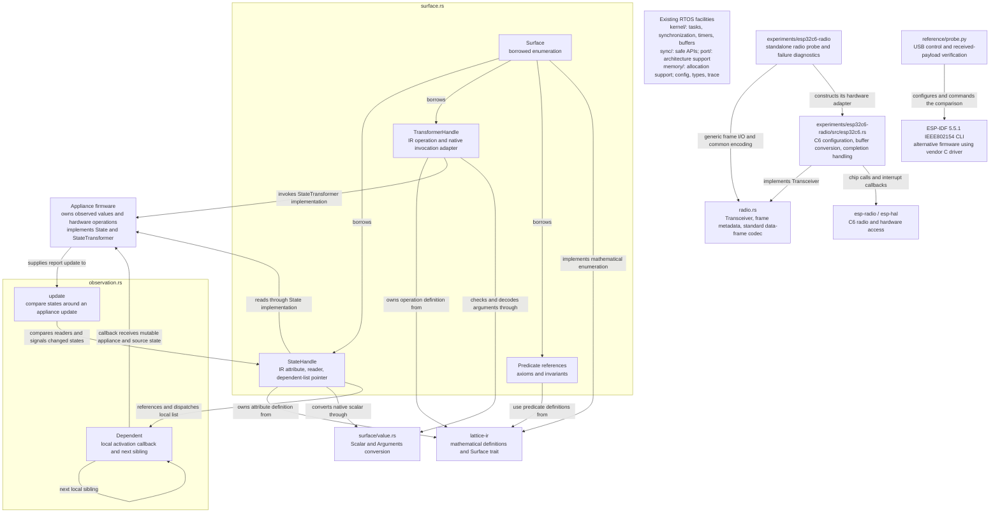

# Lattice vertex kernel direction

This document records the implementation direction for extending the imported
FreeRTOS kernel into a cooperative distributed RTOS. Read it alongside the
[architecture white paper](Lattice-DRTOS-Architecture-White-Paper.docx). The scope,
local participation model, memory approach, and development approach below govern
work in this repository. They describe what we are building, not functionality
already implemented.

## Kernel and firmware responsibilities

The kernel implements the common behavior of a lattice node. Firmware authors
plug their appliance into that behavior through the interfaces we provide. They
should not assemble a protocol from an unstructured collection of primitives or
reimplement enumeration, change broadcasts, conditional evaluation, or forwarding.

The firmware implementor supplies:

- The appliance's typed mutable attributes: for example, a binary power state,
  scalar brightness, or enumerated fan speed.
- Its typed state-transforming function handles, backed by the concrete hardware
  operations that modify those attributes.
- IR definitions of device-model axioms and the safety and operating invariants
  that synthesis must preserve, including relationships across appliance states.
- The hardware facilities the kernel needs, including the platform's timing and
  interrupt support and primitive peer communication operations.

Express these requirements through small interfaces with static dispatch.
`radio::Transceiver` now supplies common frame I/O through configure, transmit,
and receive operations. The kernel does not require a new HAL or an appliance
driver framework.

Hardware observations enter through the supplied attribute interface. From that
point, the kernel handles the dependent activity and communication. Firmware
authors provide access to their state and functions; they do not manually arrange
change propagation or evaluate graph conditions.

Migrating firmware such as `diffuser-fw` or `mhz-radio-fw` means retaining its
appliance-specific hardware code, exposing its attributes and functions through
these interfaces, and replacing its ad hoc networking and prior surface
enumeration with the kernel's common node behavior.

The shared [`lattice-ir`](https://github.com/zacharytomlinson/lattice-ir) crate
defines the mathematical surface of those attributes and transformations.
Firmware can expose these definitions as static data. The nucleus owns proof,
synthesis, and compilation, and delegates compiled fragments to participating
vertices. The shared crate contains definitions, not an interpreter or solver;
vertices execute the delegated fragments without hosting an IR interpreter.
Mathematical effect outputs describe post-state for reasoning. Runtime changes
are communicated through the node's change messages, not program return values.

## Cooperation produces the distributed kernel

The kernel exists collectively across participating nodes. Each node responds to
a local hardware change or an incoming message by doing the part assigned to it:

- Expose and enumerate its states, state transformers, axioms, and invariants.
- Broadcast changes and pass activation messages upstream toward the relevant
  program head through its resident dependencies.
- Execute its assigned compiled conditional and pass the continuation downstream.
- Invoke a reached local state-transforming function.
- Offer relay participation and forward peer messages.

These successive local responses produce the distributed execution. Each node
needs only its own state, functions, executable relationships, and the references
needed for its communications. There is no separate executor conducting a walk
over the distributed graph. The broader installation, recovery, and protection
behavior described in the white paper also belongs to the common kernel
implementation rather than being rebuilt by each appliance author.

Change is the unit of execution. Process local changes and received messages as
they arrive. There is no graph work queue, additional graph scheduler, or periodic
evaluation cycle. FreeRTOS already supplies the local execution facilities,
including tasks for overlapping evaluations when needed. Local timing remains
available for hardware, communication, and explicitly temporal operations; an
omnipresent clock does not drive graph evaluation.

## Structured memory and resident edges

An attribute is actual mutable appliance state exposed to the network. Edges
through attributes carry conditional evaluation; edges through function handles
carry state modification. Together they embody the distributed executable.

Upstream activation belongs to state dependencies. A state transformer is an
invocation endpoint, never an input to a Boolean conditional. Changes caused by
its hardware operation propagate through the affected states' relationships.

Keep an attribute, its dependent edges, and their upstream relationships tied
together in the memory structure. One-to-many relationships are fundamental.
Use structured memory and direct references with no dynamic allocation for the
lattice node machinery. Firmware-resident vertices are terminal hardware
participants, not objects that need relocation between machines.

Choose the concrete layout against the target's available memory and hardware.
A static structure is appropriate when its layout minimizes padding and its
access adds no unnecessary indirection. Do not impose a matrix, generic edge-slot
pool, auto-incremented object IDs, relational lookup layer, or ECS. Existing MCU
storage and registers may be useful where their hardware semantics permit it.
The particular field layout remains an implementation choice.

Fixed-width communication rings with hard eviction are transport storage. They
do not imply a queue of graph jobs. Reuse the RTOS facilities already present and
add the local mechanics that lattice participation actually requires.

## Implementation approach

ESP32 is the initial platform. The flashed firmware will include this kernel.
Existing ESP Rust HAL code and nearby firmware are platform references.
`lattice-ir` starts with the shared mathematical definitions extracted from
Jarvis's `zmt/rewrite` branch. Its formal development continues with the nucleus;
the kernel can use the shared definitions to build surface exposure independently.

Build working kernel code in meaningful increments, compile as we go, and learn
from concrete failures. Use focused checks where they answer a real question.
QEMU is available when useful; exhaustive simulations and speculative failure
models are not prerequisites to ordinary progress. Physical hardware testing
happens when the user chooses that the implementation is far enough along.

Start with the kernel interfaces and local participation behavior. Settle packing
and hardware integration through implementation. Relay tuning and hypothetical
storage-reuse problems must not displace that work. Keep the code small, direct,
and economical in memory; avoid extra abstractions and machinery without a
current purpose.

## Implementation map

This is the working map for the naming and organization review described in
[AGENTS.md](../AGENTS.md#review-after-each-meaningful-change). Update it when a
change alters the responsibilities or relationships shown. Arrows describe code
relationships and calls; this diagram is not a delegated executable DAG.



The appliance owns the actual state. Handles retain mathematical definitions and
native access, while `Surface` borrows those handles and predicate definitions.
Its implementation of `lattice_ir::Surface` exposes that same data to mathematical
consumers without a second collection of descriptors. Native scalar conversion is
kept within the surface module.

`surface` and `observation` currently depend on each other: state handles retain
their local dependent-list pointer, and observation updates use those handles to
read and signal changes. `Dependents` is the private atomic-pointer storage and
dispatch implementation; each public `Dependent` holds a callback and a sibling
link. These links represent local activation only. A callback can invoke a
transformer, as the observation example does, but the list does not specify its
body or a distributed continuation.

The existing RTOS facilities are shown separately because local observation
dispatch runs in its caller's context and adds no scheduling layer. Peer transport,
resident upstream/downstream fragment relationships, and fragment installation
remain unimplemented. Extend the map as those responsibilities acquire concrete
code.

The radio probe is a separate binary with its own Cargo manifest and pinned
dependencies. It now consumes the kernel's `radio` module and supplies a C6
implementation of `Transceiver`. It does not yet connect to the surface or
observation modules or run this repository's RTOS scheduler. Its Cargo dependency
selects the compile-only default port solely to use the portable radio code; this
is not a C6 RTOS port. The reference C firmware remains an independent comparison.

## Radio interface

[`radio::Transceiver`](../src/radio.rs) is the implementor-facing radio boundary:

```rust
fn configure(&mut self, config: Config) -> Result<(), Self::Error>;
fn transmit(&mut self, frame: &[u8]) -> Result<TransmitStatus, Self::Error>;
fn receive(&mut self, frame: &mut [u8; MAX_FRAME_SIZE])
    -> Result<Option<Received>, Self::Error>;
```

Firmware initializes chip-specific clocks, pins, antenna switches, and interrupts,
then provides the adapter. Configuration supplies the 2.4 GHz channel, requested
TX power, PAN, and local short address. The adapter starts listening, handles
checksum generation/validation and standard MAC ACKs, and maps chip completion
events. These facilities may be provided by hardware or the chip's existing
802.15.4 driver. The implementor does not supply Lattice message interpretation,
change propagation, graph scheduling, or an IR evaluator through this interface.

`transmit` performs one attempt and returns its completion. It distinguishes sent,
acknowledged, missing ACK, channel busy, and aborted; missing an ACK does not prove
the peer missed the data. This synchronous boundary belongs in a context where
the radio can complete and interrupts can run. An adapter may wait through the
existing RTOS facilities. It must release its TX buffer before returning, even
on error. There is no automatic application retransmission or graph work queue.

`receive` copies a complete frame into caller-owned storage or immediately returns
`None`. Both directions use MAC bytes without a PHY length prefix, checksum, or
vendor metadata trailer. The maximum normalized frame is 125 bytes. `Received`
reports the written length and optional RSSI. Hardware interrupt/notification
plumbing remains in the port; the interface does not impose polling as the kernel
execution model.

`radio::DataFrame` supplies the common short-address MAC encoding/decoding already
used by the probe: PAN compression, optional unicast ACK request, and broadcast
delivery. It borrows payloads, writes into supplied fixed buffers, checks frame
length/format/addressing, and rejects ACK requests on broadcasts. The current
format is the probe's unsecured 2003-version IEEE data frame; other frame formats
are explicitly rejected. This is standard link framing, not the Lattice message
format or graph-addressing scheme. The test's assigned short addresses do not
define future discovery or address assignment.

The C6-specific implementation is [esp32c6.rs](../experiments/esp32c6-radio/src/esp32c6.rs).
It contains vendor frame-prefix/FCS/trailer conversion, IRQ completion flags, and
the diagnostic TX timeout. The probe's traffic loop is generic over `Transceiver`;
it no longer constructs MAC headers or reads C6 status registers directly. The
upstream C6 receive allocator remains confined to that experiment. Shared radio
code contains no allocation or unsafe code. Nordic's driver exposes corresponding
[configuration and frame operations](https://nrfconnectdocs.nordicsemi.com/ncs/latest/nrfxlib/doxygen/html/nrf__802154_8h.html)
and [completion callbacks](https://nrfconnectdocs.nordicsemi.com/ncs/latest/nrfxlib/doxygen/html/group__nrf__802154__calls_gabde8a50e759b9bb2583682089cc6e3c2.html);
an nRF adapter has not been implemented or hardware-tested.

The post-change organization review separates three concrete responsibilities:
the kernel owns portable I/O definitions and standard framing; the C6 adapter
owns vendor-specific mechanics; the probe owns its diagnostic payload and traffic.
Radio and state-change handling are still separate paths. Wiring change messages,
surface exposure, and delegated-fragment messages into this interface remains
kernel work, rather than callbacks each appliance author must invent.

Validation: the shared wire-vector/boundary tests and the complete host suite pass
in debug and release; the allocator-free Cortex-M0 check passes with the existing
port function-cast warning. Both C6 role builds and probe Clippy pass. The boards
were disconnected during this change, so this refactor has not been reflashed or
verified over the air. Earlier live captures below predate the shared interface.

## Current surface implementation

`lattice_vertex::surface` provides the implementor-facing `State` and
`StateTransformer` traits. A state supplies its native scalar type and observation
reader; its IR type is derived automatically. A transformer supplies typed native
arguments, an IR operation definition, and an invocation method. Static handles
reject disagreement between the native and declared argument signatures during
compilation. Incoming values are checked and decoded before invocation.

`Surface` enumerates states, transformers, device-model axioms, and invariants.
Axioms are supplied facts/assumptions; invariants are device-wide properties that
admitted transitions must preserve. Both use the common IR and direct state
references, independently of individual transformer preconditions. Nucleus
validates and reasons over these declarations. The local surface does not
interpret predicates, prove native behavior, or publish mathematical effects as
observed hardware state.

The common mathematical enumeration interface is `lattice_ir::Surface`. The
vertex's native `Surface` implements it by borrowing definitions from its existing
handles. Nucleus and other mathematical consumers can use this interface without
depending on the RTOS, constructing a second definition table, or invoking native
readers or transformers. Native `State`/`StateTransformer` traits, scalar adapters,
and hardware callbacks remain in vertex. Each native transformer owns its
operation root, preserving distinct callable references even when expressions
are shared; no second collection of mathematical descriptors is retained.

The [surface example](../examples/surface.rs) declares two states, one transformer
with coupled effects, a device axiom, and a safe operating invariant. Run it with
`cargo run --locked --example surface`. The shared IR is pinned to a Git revision
so building this repository does not require a sibling checkout.

Local enumeration, reads, invocation, observation registration, and local
dependent activation are implemented. Lattice message encoding, peer delivery, and
compiled-fragment installation are not implemented yet. The examples exercise
local behavior; they are not ESP hardware ports or networked nodes.

### Observation changes and local activation

`StateHandle::update` applies an observation update and signals an actual value
or availability change. `observation::update` handles a fixed group of states affected
by one hardware report, including derived states. All fields are updated and
compared before callbacks start. Prior values and changed flags exist only on the
caller's stack; the kernel retains no observation mirror. An unchanged report
does not trigger an activation. Where hardware already identifies a change,
`StateHandle::changed` signals it directly after the state is established.

Each state retains one atomic pointer to its first local `Dependent` entry.
Installation code sets that pointer with `set_dependents`; subsequent links
enumerate sibling dependents of this state, not steps toward a DAG entry point.
These list pointers do not encode cross-peer routing or a DAG entry point. Links are
immutable and statically resident; the list must be acyclic. Replacing the first-dependent pointer
affects future dispatches while an already-started dispatch finishes its original
list. This is local binding plumbing, not distributed installation or reclamation.

Activations execute directly in the caller's context and read current state when
reached. A newer delta does not withdraw an earlier activation. There is no graph
work queue, polling loop, or IR interpreter. ISR callers must use the existing
RTOS task-notification facilities when their callbacks cannot run in interrupt
context. The native callbacks are a local execution interface, not a frozen
fragment ABI.

Run `cargo run --locked --example observation` for a contact-change → native activation
→ transformer request → separately observed output-change example. The appliance
examples also route complete observation reports through this same registration
path. Native command success alone does not publish modeled effects.

### Appliance formalizations

Run `cargo run --locked --example appliance_surfaces` to inspect the
[appliance definitions](../examples/appliances/mod.rs) without contacting hardware:

- The diffuser and read-only HVAC-observer surfaces use `diffuser-fw`'s existing
  S3 controller and RA4 snapshot types. Readers preserve sensor validity and fan
  qualification; relay requests use the existing controller's guards and lease
  commands. The model includes the signed 24-bit scale domain and assigned fault
  domains. It does not equate a requested relay state with an observed one.
- The RC400 fan follows the checked-in training record: Off, speeds 1 through 6,
  and direction. It has no fabricated On, toggle, or light function. Off retains
  the selected speed; setting speed has coupled power/selected/running effects.
  A known direction is required before asking the native planner to implement a
  directional setter that may use a toggle waveform. Transmit completion does
  not supply RF feedback or mutate the observation fields.
- The Shelly dimmer is a proposed minimal custom-firmware surface, using the
  documented independent output and 0–100 brightness controls. Its hardware
  backend supplies readiness and applies both settings. The effective setting is
  derived from output and brightness; it is not a measured light intensity.
  See the official [Dimmer Gen4](https://shelly-api-docs.shelly.cloud/gen2/Devices/Gen4/ShellyDimmerG4/)
  and [Light component](https://shelly-api-docs.shelly.cloud/gen2/ComponentsAndServices/Light/)
  references. This is not a complete model of stock Shelly firmware behavior.

Reference dependencies are pinned to `diffuser-fw` commit
`e78cbe3eb31f977222a97acd6f628534462d7ab5` and `mhz-radio-fw` commit
`846da6acc2cf2980d2b14d5162cc76a5c775e9b6`, exclusively as development dependencies.
The RF profile is recorded in that repository's
`fixtures/rc400/2026-09-25-explicit-surface.json`.

These first formalizations describe successful modeled state transitions, not
instantaneous hardware completion. Native I/O hooks still need wiring into each
firmware. Lease expiry/renewal, dimmer calibration/warmup, and full fault-response
dynamics are not encoded as temporal IR in these examples. Per-operation cost
expressions also remain outside the current surface API. The checks exercise
native dispatch, observations, and declared state references; they are not an
FSPS proof of the models or physical-device validation.

## ESP32-C6 radio experiment

[`experiments/esp32c6-radio`](../experiments/esp32c6-radio/src/main.rs) sends raw
IEEE 802.15.4 data frames between two C6s on channel 15, PAN `0x4c56`, at 20 dBm.
Addresses 1 and 2 are assigned only for the experiment. Both boards alternate
addressed and broadcast probes and return an addressed reply with the probe's
sequence and payload. Serial output reports results; the host does not relay the frames.
This is an explicit radio bring-up loop, independent of Lattice graph execution.

Build from that directory using the installed stable Rust toolchain and the
`riscv32imac-unknown-none-elf` target:

```sh
cargo +stable build --release --locked
espflash flash --port <board-a-port> --baud 921600 --flash-size 8mb target/riscv32imac-unknown-none-elf/release/lattice-radio-probe
cargo +stable build --release --locked --features board-b
espflash flash --port <board-b-port> --baud 921600 --flash-size 8mb target/riscv32imac-unknown-none-elf/release/lattice-radio-probe
python3 capture.py <board-a-port> <board-b-port> --reset --seconds 30 --output serial.log
```

Flash each completed build before building the other role; both builds use the
same output filename. The capture script uses `pyserial` and labels the two UART
streams. `mode=0` is an addressed probe; `mode=1` is a broadcast probe. `RX` proves
peer receipt, `REPLY` records the returned application payload, and `acked` counts
transmissions with a hardware ACK. Broadcasts do not request ACKs, but their
addressed replies do. Probe counters include failed send attempts. Reported RTT
includes polling and serial logging overhead and is not a radio latency benchmark.

The initial boards were identified as C6 revision 0.2, 40 MHz crystal, 8 MB flash:

| Role | CH343 serial suffix | Chip MAC |
| --- | --- | --- |
| A / address 1 | `5C83396325` | `e8:f6:0a:fd:43:50` |
| B / address 2 | `5C83397030` | `e8:f6:0a:fb:ef:e0` |

Original full-flash backups and live capture artifacts are local, ignored files
under `target/esp32c6-radio/` at the repository root. Backups are in `backups/`.

On 2026-10-05 UTC, both role builds compiled, passed strict Clippy, flashed, and
booted. The final 30-second paired capture (`serial-final.log` and
`results-final.json`) recorded:

| Probe direction | Addressed: received / attempted | Broadcast: received / attempted | Application replies / all probes |
| --- | --- | --- | --- |
| A to B | 8 / 8 | 8 / 8 | 15 / 16 |
| B to A | 5 / 6 | 6 / 6 | 11 / 12 |

The run had three transmit-failure callbacks and no panics. One failure callback
occurred on a reply that the peer nevertheless received. A failure callback alone
therefore does not establish non-delivery; the probe does not expose the precise
failure reason. The earlier 45-second run also exchanged both frame types in both
directions, with losses. These are short bring-up observations, not range or
reliability measurements. No application retransmission is performed.

The experiment pins `esp-radio` 1.0.0-beta.0 and `esp-hal` 1.1.2. Source inspection
and bring-up identify these concrete integration considerations:

- A successful `transmit_raw` return is submission. The driver copies into one
  internal TX buffer; the probe waits for its completion/failure callback before
  submitting another frame. ACK reception is separately observable.
- `raw_received` returns a fixed-size frame record. Its first byte is the frame
  length, and the driver supplies receive metadata in the trailer. The experiment
  accepts its own exact header and payload shape.
- The driver uses an allocating `VecDeque` internally for receive buffering. The
  probe supplies an 8 KiB backing heap and limits buffered frames to four. This is
  a property of the experimental adapter, not an allocator dependency added to
  the Lattice kernel. A kernel integration must address that storage explicitly.
- The radio path runs from a bare-metal entry point without starting an RTOS
  scheduler. This proves the standalone radio path, not a C6 port of our kernel.

The experiment owns probe traffic and measurement. The driver owns C6 radio
operation. Surface definitions and kernel change handling remain unchanged; no
generic vertex wrapper or experimental probe format has become a kernel API.

### Packet-loss investigation

During the investigation, the probe snapshotted the C6's read-only TX abort status
inside the failure callback and reported it from the foreground with the message kind, probe sequence,
and elapsed time. Captured failures reported status 16 (`RxAckTimeout` in the
pinned driver's `TxAbortReason`), after roughly 3.1 ms. Some failed sends still
arrived at the peer; data delivery and ACK reception are distinct observations.
These diagnostics do not establish why a particular missing data frame was lost.
The current C6 adapter maps those hardware statuses to `TransmitStatus`, and the
generic probe reports that status. Current RSSI logging shows `Some(value)` or
`None`, preserving the optional metadata boundary instead of assuming every
adapter supplies a signal-strength measurement.

Normal serial printing now leaves interrupts enabled: only the foreground prints,
and radio callbacks update atomics. The previous `esp-println/critical-section`
setting masked interrupts across UART output. This was worth removing, but a
comparison still had failures, so it is not established as the loss's sole cause.
The optional `logging-critical-section` feature reproduces that configuration.
The optional `receive-notification` feature compares notification-driven draining
against polling; it also failed to eliminate losses and remains disabled by
default. Neither comparison modifies the upstream driver.

Short paired captures on 2026-10-05 UTC gave the following results. All retain the
same PAN, packet format, probe periods, and hardware ACK requests. Each denominator
counts originating probes across both boards; replies are additional radio frames.

| Capture | Channel / TX dBm | Duration | Peer received / attempted | Replies / attempted | TX failure callbacks | Median reported RSSI |
| --- | --- | --- | --- | --- | --- | --- |
| `diagnostic-cs.log` | 15 / 0 | 30 s | 26 / 28 | 25 / 28 | 1 | -80 dBm |
| `diagnostic-open.log` | 15 / 0 | 45 s | 42 / 43 | 42 / 43 | 2 | -79 dBm |
| `diagnostic-notify.log` | 15 / 0 | 45 s | 38 / 43 | 35 / 43 | 10 | -80 dBm |
| `diagnostic-power9.log` | 15 / 9 | 30 s | 28 / 28 | 28 / 28 | 0 | -66 dBm |
| `diagnostic-channel25.log` | 25 / 0 | 30 s | 28 / 28 | 28 / 28 | 0 | -64 dBm |
| `diagnostic-return15.log` | 15 / 0 | 30 s | 28 / 28 | 28 / 28 | 0 | -69 dBm |

No run panicked. Logs and `comparison.json` are under the local
`target/esp32c6-radio/` artifact directory. The user confirmed onboard PCB antennas.
The host's Wi-Fi was observed on channel 5 / 2432 MHz, overlapping the original
802.15.4 channel 15 / 2425 MHz. Channel 25 / 2475 MHz and higher TX power each gave
clean short runs, but returning to channel 15 / 0 dBm was also clean, with a
stronger reported signal than earlier. Thus interference, physical coupling, or
radio/calibration behavior remain candidates; these runs do not isolate a root
cause or prove that changing the channel fixed it. Placement and the exact board
model were not independently verified during the comparison.

The boards are now on the diagnostic default: channel 15, 20 dBm, polling, serial
interrupt masking disabled. Both role builds and strict Clippy pass. The map's
ownership is unchanged: all diagnostics and comparison switches belong to the
standalone probe; no radio policy or new abstraction was added to the kernel.

### Native USB and vendor-driver comparison

The boards also enumerate through their ESP USB-C ports as Espressif USB
Serial/JTAG devices. Their by-id names contain the chip MAC: `E8:F6:0A:FD:43:50`
is A, and `E8:F6:0A:FB:EF:E0` is B. Use `espflash --before usb-reset` on these
ports. The Rust probe now uses `esp-println`'s `auto` transport: it selects native
USB after seeing host USB traffic, otherwise UART. It remains an independently
running, flash-resident probe. Capturing its output does not forward radio data.

For an independent driver comparison, the ESP-IDF `v5.5.1` example
`examples/ieee802154/ieee802154_cli` was built at commit
`fcae32885b0296b32044cb99ecbdc50d98dddb83`. The checked-in
[reference patch](../experiments/esp32c6-radio/reference/esp-idf-v5.5.1.patch)
selects the native USB console, logs receive RSSI/LQI, selects 8 MB flash, and
disables stored PHY calibration so each boot calibrates fully. No vendor radio
driver source was changed.

The [host script](../experiments/esp32c6-radio/reference/probe.py) configures each
CLI at channel 15, 0 dBm, PAN `0x4c56`, and short addresses 1/2. It sends alternating
unicast/broadcast frames in each direction and verifies the received header and
payload. Frames use the Rust probe's MAC format and 16-byte payload size, with a
distinct reference-test payload. It verifies hardware ACKs for unicast. This CLI
test does not generate application replies or run the Rust probe's periodic loop.

```sh
python3 experiments/esp32c6-radio/reference/probe.py <native-a-port> <native-b-port> --output target/esp32c6-radio/reference/channel15-power0 --count 20
```

The 2026-10-05 UTC control run received 38/40 frames: A to B received 18/20 and B
to A received 20/20. It received 19/20 requested hardware ACKs. One A-to-B unicast
failed with vendor error 3 (`ESP_IEEE802154_TX_ERR_NO_ACK`); one A-to-B broadcast
was not observed. Median receive RSSI was -79 dBm in both directions. The weak
reported signal and loss therefore reproduce with the vendor C driver; they are
not specific to the Rust probe. This does not isolate a bad board, antenna fault,
interference source, or a shared PHY/calibration issue, and the different traffic
patterns do not support a direct reliability comparison between implementations.

Source provenance, SDK configuration, logs, results, and firmware artifacts are
saved locally under `target/esp32c6-radio/reference/`. The SDK checkout is
`/tmp/lattice-esp-idf-v5.5.1`, with tools under `/tmp/lattice-idf-tools` and the
session build environment in `/tmp/lattice-idf-env.sh`.

After the comparison, both boards were restored to the continuous Rust probe with
native USB logging. `native-usb-probe.log` records both role identities, ongoing
radio traffic, similar RSSI, and further ACK timeouts. The reference firmware is
an alternative hardware experiment, not a dependency or architecture adopted by
the Lattice kernel. The map now shows that separate host/firmware comparison path.

### Power and other radio functions

The original 0 dBm (1 mW) setting was chosen for close-range comparison. The
continuous probe now requests 20 dBm (100 mW), matching the driver's default
maximum, for subsequent range testing. Both native USB boards were reflashed and
reported `power_dbm=20`. A 30-second run received all 28 originating probes and
all 28 application replies, with no transmit-failure callbacks or panics. Reported
RSSI ranged from -68 to -61 dBm, substantially stronger than the preceding 0 dBm
capture. Artifacts are `power20.log` and `power20-results.json` in the local
`target/esp32c6-radio/` directory. This is a bench result; the earlier distance
test has not yet been repeated at this power.

The probe enables `esp-radio/ieee802154`; neither its `wifi` nor `ble` feature is
enabled, and no Wi-Fi or Bluetooth controller is started. The reference C CLI
also starts only IEEE 802.15.4. Its SDK configuration includes Wi-Fi support and
coexistence infrastructure, but its application never calls Wi-Fi or Bluetooth
initialization/start APIs. Both implementations initialize the shared PHY and
baseband needed for 802.15.4; those common routines do not imply an active Wi-Fi
or BLE network stack.

The probe contains no antenna-selection setting or RF-switch GPIO configuration.
It uses the board's existing RF connection. The user reports onboard PCB antennas,
but the exact board layout and any selectable antenna switch remain unverified.
No kernel radio interface or structural relationship changed for the power test;
the implementation map retains the same responsibilities.

### Board substitution

The first substitution replaced original A (`e8:f6:0a:fd:43:50`) with board C
(`9c:cc:01:40:67:98`), while original B (`e8:f6:0a:fb:ef:e0`) stayed connected.
C is also a C6 revision 0.2 with a 40 MHz crystal and 8 MB flash. Its original
flash was saved to `backups/board-c-original.bin` under the local artifact
directory, and it was flashed with the exact existing `power20-a.elf` binary.
It therefore uses probe role/address 1; the `[A]` label in this capture identifies
that role, not the removed physical board.

At channel 15 and 20 dBm, the 30-second C/B run delivered all 28 probes and all
28 application replies, with no transmit-failure callbacks or panics. Median RSSI
was -57 dBm at C receiving B and -59 dBm at B receiving C. The original A/B pair's
corresponding medians were -61 and -61.5 dBm. That modest difference did not
establish that original A was defective, so the other substitution followed.
The user was asked to keep position and cable unchanged for the replacement.
This is a bench substitution, not a repeat of the earlier distance test.

Evidence is in `swap-c-for-a.log`, `swap-c-for-a-results.json`, and
`swap-c-for-a-provenance.json` under `target/esp32c6-radio/`. The provenance records
the physical MACs, role, firmware hash, and backup hash. No source or structural
change was needed for this substitution; the existing implementation map applies.

For the second substitution, C remained in role 1 and original A returned in
place of B. Original A was flashed with the existing `power20-b.elf` to assign
role/address 2 and avoid duplicate addresses. This C/A pairing also delivered
28/28 probes and 28/28 application replies in 30 seconds, without failures or
panics. Median RSSI was -59 dBm in both directions.

| Physical pair | Median RSSI at first / second board | Probes received | Replies received |
| --- | --- | --- | --- |
| Original A / original B | -61 / -61.5 dBm | 28/28 | 28/28 |
| New C / original B | -57 / -59 dBm | 28/28 | 28/28 |
| New C / original A | -59 / -59 dBm | 28/28 | 28/28 |

All used channel 15 and 20 dBm. These short bench comparisons do not identify a
single unusually weak board, nor do they prove range or rule out a problem common
to the boards or RF setup. The full-power distance test remains separate work.
The active pair is now C (`9c:cc:01:40:67:98`, role 1) and original A
(`e8:f6:0a:fd:43:50`, role 2). Original B is disconnected and retains role 2.
Role assignments must follow the selected physical pair during further swaps.

The second capture and provenance are `swap-a-for-b.log` and
`swap-a-for-b-provenance.json`; `board-substitution-results.json` records all three
pairs, including directional RSSI distributions and matched probe/reply counts.
