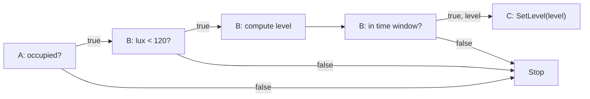

# Remaining program execution design

The [kernel program component](../src/kernel/program/README.md) now owns the
implemented LPD representation, installation protocol, validation and dependency
wiring. Do not maintain a competing record/ABI specification here. The
[architecture](ARCHITECTURE.md) owns execution semantics and the
[implementation map](KERNEL_DIRECTION.md#implementation-map) distinguishes current
behavior from remaining work.

The loader accepts new definitions after firmware startup, commits them in the
protected configuration region, and reconstructs their state-to-program links.
Definitions install inactive and can then be enabled. Native-state predicates,
primitive arithmetic, upstream activation, forward handoffs and native calls execute
from those records. Installed local time/solar predicates now use the same source
and traversal paths. The full three-owner example below remains a layout exercise,
not a claimed hardware run.

## Worked installation and traversal

Use three owners and a time predicate resident on the illumination owner:

```text
A: occupancy bool
B: illuminance u16, local commissioned time
C: SetLevel(u8), valid arguments 0..200

if A.occupied && B.lux < 120 && B.time_in_window(20:00, 22:00):
    C.SetLevel(u8(((120u16 - B.lux) * 200u16) / 120u16))
```

This is a layout exercise, not a claimed physical lighting model. The window uses
commissioned local civil time, including DST. The true lux
branch makes subtraction safe and the intermediate is at most 24,000, so u16
arithmetic followed by explicit narrowing suffices. Read lux once for that visit's
test/calculation; this does not snapshot other vertices.

| Owner | Installed contents | Forward behavior |
| --- | --- | --- |
| A | Head attached to occupancy, true link to B, false stop | Read current occupancy; continue or stop |
| B | Lux test, local time predicate, arithmetic, upstream reference to A, successor C | Read lux; stop if its predicate fails; compute the reduced argument; test the time window; continue or stop |
| C | Bound native SetLevel handle and argument location | Invoke with the received u8; established changes enter their own dependencies |



With occupancy true, lux 60 and time 21:00, B computes 100 and C receives one u8
argument. The maximum carried-value extent is **one byte**, independent of the
three predicate count. B additionally needs its local lux sample and bounded u16
arithmetic scratch; those are local working memory, not extra transmitted operands.
Routing, cause/revision identity and message headers are separate overhead.

A lux change follows B's upstream activation to A before forward evaluation.
Occupancy changes start at A. B's opening/closing deadline also activates through
A; it never skips occupancy and directly calls C. All source attachments remain
installed even if a prior traversal short-circuited. Later changes start independent
visits; they do not rewrite a visit's already-computed argument.

B arms the next temporal boundary using existing local timer/wakeup machinery.
On expiry the kernel registers the internal transition and rearms the next boundary.
No once-per-second program scan is needed. Solar predicates use the same local
deadline path after computing their next boundary. Unanchored time remains unavailable.

## Integration still required

- Vertex-local computation sharing and addressed connection removal are now
  implemented in the program component. Each visit follows only its selected
  pair. Explicit deletion stops remaining local graph work and leaves running
  native calls to finish without continuation. Host checks and the C6/Nordic
  check cover sharing, reboot reconstruction, reclamation and stale references.
  The hardware check uses software-backed appliance states, not physical actuators.
- Delivery assurance follows installed dependencies and explicitly addressed
  recipients through the existing acceptance/retry path. Universal dissemination
  and public receive-log inspection are deferred; relays need no dependency census.
- Historical inputs and automation-authored retained-state maintenance are deferred.
  Current calculations do not require them. The firmware-bound history helper does
  not justify modifying an appliance surface to satisfy an automation's history query.
- Coordinated replacement, head relocation, revision cutover and drain evidence
  remain absent. Explicit removal and free-extent reuse are separate, implemented
  local operations; they do not claim distributed drain or atomic network deletion.
- Reboot recovery currently initiates independent upstream activations from restored
  source bindings. Multiple returning participants can cause repeated evaluations;
  coordinated outage reconciliation is deferred.

The implemented execution bounds, reservation/receipt protocol and admission commands
belong in the [program component](../src/kernel/program/README.md), not a second ABI here.

The appliance boundary remains the implemented passive HAL: getters and finite
native hardware operations. It gains no automation, networking, reporting loop or
program callbacks when these pieces are connected. Independent kernel/appliance
OTA remains deferred.

Time/solar mechanics, recurring-rule limits, clock reference messages and deadline
semantics now belong to [kernel/time](../src/kernel/time/README.md). Jarvis's pure
solar/date mathematics was reused; its entity graph and host database remain there.
