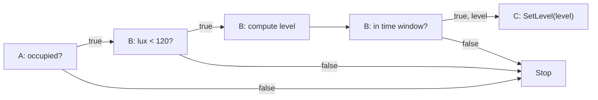

# Resident program design

Design review for the [next implementation milestone](KERNEL_DIRECTION.md#next-implementation-milestone).
This is a proposed implementation, not a new architecture or an implemented API.
The [architecture](ARCHITECTURE.md) owns execution semantics. Appliance firmware
supplies getters and native operations; the kernel owns monitoring and event-driven
traversal. Concrete installed records remain design work. No prototype firmware or
test engine accompanies this note.
Independent kernel OTA is deferred; the current kernel and appliance stay in one image.

## Existing mechanisms to retain

| Current owner | Useful mechanism | Change needed |
| --- | --- | --- |
| [surface](../src/surface.rs) | Typed state, transformer adapters and mathematical declarations | Acquisition and automatic delta registration are implemented |
| [appliance](../src/kernel/appliance.rs) | Stable native instance, native admission and typed dispatch | Shared HAL access and independent native-call tasks are implemented |
| [change](../src/kernel/change.rs) | Captured deltas with publication after local maintenance | Attach installed graph activation to the established change boundary |
| [state](../src/kernel/state.rs) | Native-width history and unavailable samples | Install maintenance definitions after startup instead of a firmware updater function |
| [peer](../src/kernel/peer/mod.rs) | Routes, bounded delivery, native calls, surface/state access | Carry upstream activations, forward visits and installation records |
| [radio task](../src/kernel/radio/task.rs) | IRQ-driven waits, receive buffering and MAC handling | Separate its concrete radio dependency from the common peer interface |

`lattice-ir` already defines scalar types, operation domains and short-circuit
expression order. The checkout matches the revision pinned by this kernel. Reuse
that mathematical vocabulary; do not put a solver or expression-tree evaluator
in the appliance, or equate today's native argument-message limit with head capacity.

## Firmware and hardware boundary

The current implementation links kernel and appliance together. Keep that model
for this functional-kernel milestone. [Independent kernel updates](ARCHITECTURE.md#independently-replaceable-kernel-and-appliance-code)
remain later work; their binary interface does not block these state/program
mechanics. Local configuration survives image replacement through region protection.

Keep typed getters and native mutation functions as the appliance interface.
The appliance implementation is a passive hardware adapter, with no main loop,
independent runtime, monitor/reporting tasks or autonomous mutation scheduling.
The kernel owns initialization, acquisition and function invocation. A board entry
stub only connects the bindings and enters the kernel. `State` and
`StateTransformer` express the callable boundary; no special field or extra
report/changed/broadcast function belongs in the adapter.

The kernel reads a qualified observation, compares it with its last established
local value, records an actual change, maintains dependent history, and activates
the relevant upstream paths. A hardware event can wake acquisition; otherwise the
kernel's monitoring loop samples the getter. Sampling cadence and hardware readiness
are acquisition concerns, not automation predicates. A getter alone cannot reveal
transitions that occurred entirely between reads; event/latching hardware supplies
those observations where needed. No firmware networking knowledge follows from this.

A native call remains a hardware operation, not proof of a physical outcome. The
kernel acquires resulting state through the same getters, including any observed
partial change after an error. Acquisition must preserve captured-change ordering
and use task-context synchronization. The kernel's previous local observation is
change-detection state, not another owner of the physical value or a foreign-state
registry. Getter borrow/error/readiness details must support actual hardware I/O.

Finite native functions now execute in kernel-owned RTOS tasks. Shared hardware
access replaces the old exclusive appliance borrow, while a separate short lock
protects captured observations and history. The maintained fixture supplies plain
getters/setters without report calls. See the implemented
[native ownership and execution path](../src/kernel/peer/INVOCATION.md#appliance-ownership).

A register/mask view can implement the same getter without an appliance-maintained
software value. Where the MCU supplies a suitable interrupt, its binding can wake
acquisition directly. That is an optional lower-level backend; no new public
register-description framework or assumption that arbitrary registers can generate
change IRQs is needed for the getter-based implementation.

The existing hardware facilities supply the remaining kernel dependencies:

| Hardware service | Existing integration and intended boundary |
| --- | --- |
| Elapsed time and wakeup | Reuse the RTOS tick, timer and notification facilities. The platform supplies its oscillator/timer as today; appliance authors do not provide context switching or an executor. |
| Communication | Bind a communications implementation at startup. The kernel prepares/decodes messages and owns participation. The low-level device moves prepared bytes and reports hardware completion. |
| Persistent storage | Bind reserved read/write/erase storage through the port. Program definitions and commissioning data must survive application replacement. |

The current C6/Nordic drivers need configuration, hardware identity, energy
measurement, receive, transmit, and cancellation/progress indications. C6 has
hardware MAC ACK handling; Nordic has port-owned immediate ACK handling. These
are concrete device/profile responsibilities, not appliance policy.

A common communications boundary must hide channel/PAN selection, ACK timing,
packet capacity and framing from appliance code. Under it, the 802.15.4 profile
retains those operations and uses the selected device. Another medium supplies a
different kernel communications implementation; it must not change the state or
transformer interface. A byte/packet function alone does not eliminate the need
to initialize and control hardware. Do not publish a renamed `Radio` trait with
all today's internals and call that the stable interface. Exact adapter signatures
still need to follow this separation; this note does not select a universal bus API.

## Concrete runtime integration

Kernel-owned acquisition and asynchronous native invocation are implemented. Their
current task, sampling, admission, completion and replay bounds are maintained in
[the native-control component](../src/kernel/peer/INVOCATION.md). Firmware report
hooks and the unused local callback list were removed. This completes the passive
HAL runtime boundary; it does not implement the resident program records below.
Register/interrupt-driven acquisition remains optional port work. Independent
kernel OTA stays deferred.

## What is resident

The compiler emits each owner's structured portion of the graph. The following
are record contents, not a Rust ABI or a requirement for one struct per row:

| Storage | Contents and use |
| --- | --- |
| Local operation | Bound kernel routine, typed operand locations, result location if needed, and successor links |
| Input dependency | Link from an actual state to this program's upstream activation path; sibling link for that state's other dependent programs |
| Program head | Admission state, revision association and the required carried-value extent |
| Retained state | Sample width, capacity, current extent/position, maintenance inputs and bound calculation |
| Time/solar predicate | Local predicate parameters and next boundary; an expiry activates its ordinary upstream link |
| Active traversal | Current graph reference, revision/cause identity and only its own live operand bytes |

Input links are owned with their bindings and reached from the state's dependency
head. They are not a global table joining StateId to ProgramId. Multiple local
inputs each need a dependency link. Repeated reads of one state in one program
must not accidentally register several activations for the same source change;
the compiler chooses one source-to-program activation attachment. Different
changes remain different activations.

Saved links identify an owning peer and a location within that peer's installed
storage, with an incarnation/revision discriminator for safe reuse. Local links
resolve to checked addresses at installation/reconstruction. They cannot be raw
pointers supplied by a remote peer. This describes addressing, not a network-wide
entity registry. Field widths and compact encoding remain to be selected.

Immutable operation/edge records have no per-visit Boolean slots. A branch selects
its successor immediately. Temporary results belong to a particular traversal;
history survives across traversals. Fixed reserved storage bounds both. Admission
must account for immutable records, retained values, active visits and replacement
overlap separately; no heap or assumed unlimited activation capacity is introduced.

## Event-driven traversal and local evaluation

The execution flow is hardware event/monitoring -> delta -> task-context dependency
handling -> upstream activation. An incoming radio event wakes task-context dispatch
for a forward visit. The installed binding selects the getter, local condition,
calculation and successor; no appliance-authored automation function is involved.

The radio path already calls `xTaskGenericNotifyFromISR` and yields to its resident
task. Use the same RTOS machinery for installed work, with statically bounded task
storage and independent traversal values. ISR entry captures/acknowledges the event;
I/O getters, native calls and radio waits run in task context. Software-detected
changes can notify directly. Whether a context is started or reused is internal
kernel work, not a new firmware obligation or central graph work queue.

A concrete local comparison still needs its resident parameters:

```text
installation definition: unsigned-16 greater-or-equal, local lux, constant 120
receiver binds:          existing lux getter, kernel comparison, two links
forward visit:           read lux, compare with 120, take the selected link
```

The incoming edge represents the predecessor's decision. In an AND chain, a visit
arrives only after the preceding tests passed. For `A || B`, A's true link skips B
and its false link reaches B. No Boolean accumulator is needed to re-evaluate the
upstream expression. False ends the path unless an authored alternative exists.

Local kernel handlers perform the primitive comparison/arithmetic when work
arrives. Installed data supplies operands and edges; it does not require firmware
callbacks per automation or downloading CPU code merely to perform a comparison.
The exact record encoding and handler bindings remain to be laid out. There is no
continuous predicate scan or interpreter for the mathematical surface definitions.
Unavailable input is distinct from false/zero, and every arriving branch must
supply operands used downstream. A skipped branch cannot supply a needed value.

## Worked installation and traversal

Use three owners and a time predicate resident on the illumination owner:

```text
A: occupancy bool
B: illuminance u16, local commissioned time
C: SetLevel(u8), valid arguments 0..200

if A.occupied && B.lux < 120 && B.time_in_window(20:00, 22:00):
    C.SetLevel(u8(((120u16 - B.lux) * 200u16) / 120u16))
```

This is a layout exercise, not a claimed physical lighting model. The time basis
is UTC for this example; it does not choose a civil-time/DST policy. The true lux
branch makes subtraction safe and the intermediate is at most 24,000, so u16
arithmetic followed by explicit narrowing suffices. Read lux once for that visit's
test/calculation; this does not snapshot other vertices.

| Owner | Installed contents | Forward behavior |
| --- | --- | --- |
| A | Head attached to occupancy, true link to B, false stop | Read current occupancy; continue or stop |
| B | Lux test, local time predicate, arithmetic, upstream reference to A, successor C | Read lux; stop if its predicate fails; compute the reduced argument; test the time window; continue or stop |
| C | Bound native SetLevel handle and argument location | Invoke with the received u8; established changes enter their own dependencies |



With occupancy true, lux 60 and time 21:00, B computes 100 and C receives one u8
argument. The maximum carried-value extent is **one byte**, independent of the
three predicate count. B additionally needs its local lux sample and bounded u16
arithmetic scratch; those are local working memory, not extra transmitted operands.
Routing, cause/revision identity and message headers are separate overhead.

A lux change follows B's upstream activation to A before forward evaluation.
Occupancy changes start at A. B's opening/closing deadline also activates through
A; it never skips occupancy and directly calls C. All source attachments remain
installed even if a prior traversal short-circuited. Later changes start independent
visits; they do not rewrite a visit's already-computed argument.

B arms the next temporal boundary using existing local timer/wakeup machinery.
On expiry the kernel registers the internal transition and rearms the next boundary.
No once-per-second program scan is needed. Solar predicates use the same local
deadline path after computing their next boundary. Unanchored time remains unavailable.

## From authoring to resident memory

1. The authoring peer obtains the required owners' surfaces and uses shared IR to
   type/check the expression. It selects source attachments, branch order, owners,
   local calculations and live operand locations. Basic tablet authoring need not
   invoke FSPS; nucleus can prove/synthesize through the same eventual backend.
2. It contacts each owner through existing routes. The receiver admits a bounded
   local storage extent and receives its definition in checkable ranges. It validates
   operations, operands, references, native signatures and storage bounds while
   inactive; receipt of bytes is not readiness.
3. The receiver binds owned state/native handles and kernel operations. Foreign
   semantic endpoints remain owner references; route changes must not rewrite the
   predicate. Dependency fanout, retained-state maintenance and deadlines are wired
   before the head can admit work. The delegate establishes readiness of required
   owners, persists the selected revision, and enables its head.
4. At restart, committed definitions reconstruct local links against the current
   surface before admission. Current physical state is obtained through firmware;
   unfinished mutations are not replayed. Ordinary operation no longer needs the
   authoring peer. Replacement follows the architecture's stage/cutover/drain rules.

A simple protected region is sufficient for local configuration. Retain an
erase-aligned firmware limit in durable layout metadata; program definitions and
commissioning data occupy the protected space. The kernel can program that space
itself. Firmware updates must not erase or swap it, and a larger image must fit
below the established boundary or explicitly migrate the layout.

The [Nordic loader](../src/port/nrf52840/boot/src/lib.rs) currently swaps the entire
configured active slot, so its erase/swap bounds must honor the same protection;
merely leaving bytes unused after the binary does not yet do that. The
[C6 partition table](../src/port/esp32c6/tests/partitions-update.csv) already provides
region boundaries and can reserve configuration the same way. These are port
layout adjustments, not a need for separate kernel/appliance binaries or a new
storage framework. No layout change or provisioning is made by this design note.

## Remaining implementation design

The firmware responsibility and event-driven execution model are settled. Getter
acquisition and native-call tasks are implemented. Lay out the installed operation/link records and independent traversal storage next. Map
them onto the existing RTOS and peer handlers. Storage admission/reclamation, head
message capacity and revision/drain identity still need concrete representation;
they must not be replaced with firmware-baked callback demonstrations. Independent
kernel/appliance updates remain deferred.
