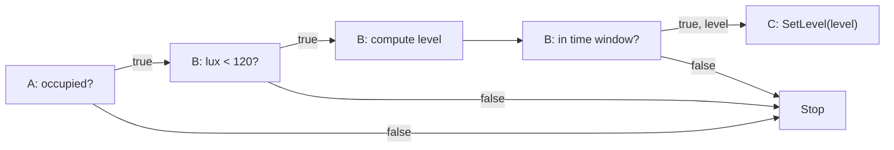

# Remaining program execution design

The [kernel program component](../src/kernel/program/README.md) now owns the
implemented LPD representation, installation protocol, validation and dependency
wiring. Do not maintain a competing record/ABI specification here. The
[architecture](ARCHITECTURE.md) owns execution semantics and the
[implementation map](KERNEL_DIRECTION.md#implementation-map) distinguishes current
behavior from remaining work.

The loader accepts new definitions after firmware startup, commits them in the
protected configuration region, and reconstructs their state-to-program links.
They remain inactive. The following example describes the intended execution of
those records; current installation tests do not establish that execution.

## Worked installation and traversal

Use three owners and a time predicate resident on the illumination owner:

```text
A: occupancy bool
B: illuminance u16, local commissioned time
C: SetLevel(u8), valid arguments 0..200

if A.occupied && B.lux < 120 && B.time_in_window(20:00, 22:00):
    C.SetLevel(u8(((120u16 - B.lux) * 200u16) / 120u16))
```

This is a layout exercise, not a claimed physical lighting model. The time basis
is UTC for this example; it does not choose a civil-time/DST policy. The true lux
branch makes subtraction safe and the intermediate is at most 24,000, so u16
arithmetic followed by explicit narrowing suffices. Read lux once for that visit's
test/calculation; this does not snapshot other vertices.

| Owner | Installed contents | Forward behavior |
| --- | --- | --- |
| A | Head attached to occupancy, true link to B, false stop | Read current occupancy; continue or stop |
| B | Lux test, local time predicate, arithmetic, upstream reference to A, successor C | Read lux; stop if its predicate fails; compute the reduced argument; test the time window; continue or stop |
| C | Bound native SetLevel handle and argument location | Invoke with the received u8; established changes enter their own dependencies |



With occupancy true, lux 60 and time 21:00, B computes 100 and C receives one u8
argument. The maximum carried-value extent is **one byte**, independent of the
three predicate count. B additionally needs its local lux sample and bounded u16
arithmetic scratch; those are local working memory, not extra transmitted operands.
Routing, cause/revision identity and message headers are separate overhead.

A lux change follows B's upstream activation to A before forward evaluation.
Occupancy changes start at A. B's opening/closing deadline also activates through
A; it never skips occupancy and directly calls C. All source attachments remain
installed even if a prior traversal short-circuited. Later changes start independent
visits; they do not rewrite a visit's already-computed argument.

B arms the next temporal boundary using existing local timer/wakeup machinery.
On expiry the kernel registers the internal transition and rearms the next boundary.
No once-per-second program scan is needed. Solar predicates use the same local
deadline path after computing their next boundary. Unanchored time remains unavailable.

## Integration still required

- Observation/history commit activates the owned state's dependency links. The
  eight-entry change ring is a lossy transport buffer; consuming it alone cannot
  define graph activation admission.
- An upstream activation finds the enabled head. Forward visits use independent,
  compiler-sized carried values and visit-local scratch. Neither primitive tests
  nor the read/write head require an IR expression-tree interpreter.
- Complete incoming visits must be assembled before evaluation. Preserve their
  identity across forwarding and handle incomplete handoffs explicitly. A MAC ACK
  alone is not evidence of program admission or physical execution.
- Native program invocations use kernel RTOS tasks and their normal hardware
  synchronization. Preserve independent deltas, overlapping traversals and already
  admitted work. No later state change cancels an earlier visit.
- Enablement and recovery of an enabled head each admit one fresh evaluation once
  required local state/time are available. They do not replay an old invocation.
- Time/solar records use local deadlines at their assigned evaluation owner;
  deadline expiry follows its upstream link. No per-second program scan or special
  clock vertex is introduced. Commissioned time still needs reacquisition after
  lost counter continuity.
- Retained/derived state maintenance needs externally installed calculations and
  bounded storage. The existing firmware-bound history helper is not that loader.
- New-definition installation does not implement head relocation, revision cutover,
  drain evidence or storage reclamation. Those lifecycle operations remain absent;
  occupied definition extents are not silently reused.

The appliance boundary remains the implemented passive HAL: getters and finite
native hardware operations. It gains no automation, networking, reporting loop or
program callbacks when these pieces are connected. Independent kernel/appliance
OTA remains deferred.
